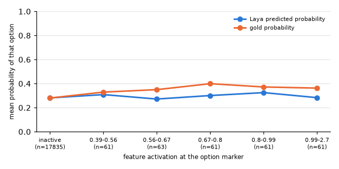

# Feature 1453

Critérios em que aparece: pred_error_stratified, pred_probe_right_laya_wrong_stratified

**Interpretação (preencher):** 

---

## Maiores ativações

**tr_customer_service_000113 / category** (choice, customer_service) | ativação 4.852 em `estado` | opções ['account', 'billing', 'delivery', 'refund', 'technical'] | Laya: **technical** [0.014, 0.008, 0.002, 0.004, 0.972] | gabarito: **technical**

```
<bos> choice question: What is this customer conversation primarily about?<eos>
▸ <mask> account: Login, plan changes, profile or access management.
▸ <mask> billing: A charge, invoice, subscription or payment problem.
▸ <mask> delivery: Shipping, fulfilment or delivery of a physical item.
▸ <mask> refund: The customer is explicitly asking for money back.
▸ <mask> technical: The product or service is not working as expected.

<eos>

 {"account": {"lifetime_value_usd": 47, "prior_tickets_90d": 0, "seats": 1, "tenure_months": 1, "tier": "standard"}, "orders": [{"amount_usd": 87, "date": "2026-01-11", "id": "A-32698", "status": "settled"}, {"amount_usd": 87, "date": "2026-03-25", "id": "A-92735", "status": "refunded"}], "thread": [{"role": "customer", "text": "Hi there! I've been using the standard plan for about a month now and I really enjoy the interface, but I've noticed the page load times are getting quite slow today. Is there anything I should check on my end?"}, {"role": "agent", "text": "Welcome to the platform! I'd be happy to help you look into⟦ those⟧ load times. Are you experiencing this slowness on all pages, or is it specifically when you try to generate reports?"}, {"role": "customer", "text": "It seems to be happening everywhere, especially when I try to save my work. I paid $87 for this month and I have a very important hard deadline this evening, so I'm a bit worried about getting everything finished in time."}, {"role": "agent", "text": "I understand the importance of meeting your deadline. Could you tell me which web browser you are currently using and if you have tried clearing your cache recently?"}, {"role": "customer", "text": "I'm using the latest version of Chrome and I did try clearing the cache, but the lag persists. I really need to have this project submitted by 5:00 PM today, so any guidance on how to speed things up would be greatly appreciated."}]}<eos>
```

**tr_customer_service_000230 / urgency** (score, customer_service) | ativação 4.805 em `estado` | opções ['0', '1', '2', '3'] | Laya: **1** [0.162, 0.418, 0.224, 0.196] | gabarito: **3**

```
<bos> score question: How time-sensitive is this conversation?<eos>
▸ <mask> level 0: No time pressure; can wait indefinitely.
▸ <mask> level 1: Routine; handle within the normal queue.
▸ <mask> level 2: Elevated; should be handled within the same week.
▸ <mask> level 3: Critical; requires action within the same day.

<eos>

 {"account": {"lifetime_value_usd": 284, "prior_tickets_90d": 1, "seats": 1, "tenure_months": 8, "tier": "free"}, "orders": [{"amount_usd": 18, "date": "2026-02-04", "id": "A-58579", "status": "refunded"}, {"amount_usd": 18, "date": "2026-02-26", "id": "A-36822", "status": "settled"}, {"amount_usd": 18, "date": "2026-02-07", "id": "A-33566", "status": "settled"}], "thread": [{"role": "customer", "text": "I’m furious that I still haven’t received the invoice copy for the $18 charge—this is the second time I’ve had to chase you about it!"}, {"role": "agent", "text": "I’m sorry you’ve had to follow up again. Could you tell me the date of the transaction or the invoice number you’re looking for?"}, {"role": "customer", "text": "It was on July 12, reference #FRE-2023-07-12. I opened a ticket about this last week and only⟦ got⟧ a vague reply, which didn’t include the document."}, {"role": "agent", "text": "Thank you for that information. Just to double‑check, is the email address jane.free@example.com still the best way to send the PDF?"}, {"role": "customer", "text": "Yes, that’s the address. Send me the proper invoice this time; I’m tired of being bounced around."}]}<eos>
```

**tr_customer_service_000230 / needs_human** (noul, customer_service) | ativação 4.699 em `estado` | opções ['false', 'true'] | Laya: **false** [0.611, 0.389] | gabarito: **false**

```
<bos> noul question: This conversation requires a human agent rather than automated handling.<eos>
▸ <mask> false: Automation can carry this to resolution.
▸ <mask> true: A human must take over: judgement, authority or empathy is required.

<eos>

 {"account": {"lifetime_value_usd": 284, "prior_tickets_90d": 1, "seats": 1, "tenure_months": 8, "tier": "free"}, "orders": [{"amount_usd": 18, "date": "2026-02-04", "id": "A-58579", "status": "refunded"}, {"amount_usd": 18, "date": "2026-02-26", "id": "A-36822", "status": "settled"}, {"amount_usd": 18, "date": "2026-02-07", "id": "A-33566", "status": "settled"}], "thread": [{"role": "customer", "text": "I’m furious that I still haven’t received the invoice copy for the $18 charge—this is the second time I’ve had to chase you about it!"}, {"role": "agent", "text": "I’m sorry you’ve had to follow up again. Could you tell me the date of the transaction or the invoice number you’re looking for?"}, {"role": "customer", "text": "It was on July 12, reference #FRE-2023-07-12. I opened a ticket about this last week and only⟦ got⟧ a vague reply, which didn’t include the document."}, {"role": "agent", "text": "Thank you for that information. Just to double‑check, is the email address jane.free@example.com still the best way to send the PDF?"}, {"role": "customer", "text": "Yes, that’s the address. Send me the proper invoice this time; I’m tired of being bounced around."}]}<eos>
```

**tr_customer_service_000230 / churn_risk** (score, customer_service) | ativação 4.531 em `estado` | opções ['0', '1', '2', '3'] | Laya: **1** [0.05, 0.715, 0.178, 0.057] | gabarito: **2**

```
<bos> score question: How likely is this customer to stop doing business with us because of this interaction?<eos>
▸ <mask> level 0: No sign of dissatisfaction.
▸ <mask> level 1: Mild frustration, but the relationship is intact.
▸ <mask> level 2: Clearly unhappy; repeat problems or explicit complaints.
▸ <mask> level 3: Imminent: threatening to cancel, dispute or leave.

<eos>

 {"account": {"lifetime_value_usd": 284, "prior_tickets_90d": 1, "seats": 1, "tenure_months": 8, "tier": "free"}, "orders": [{"amount_usd": 18, "date": "2026-02-04", "id": "A-58579", "status": "refunded"}, {"amount_usd": 18, "date": "2026-02-26", "id": "A-36822", "status": "settled"}, {"amount_usd": 18, "date": "2026-02-07", "id": "A-33566", "status": "settled"}], "thread": [{"role": "customer", "text": "I’m furious that I still haven’t received the invoice copy for the $18 charge—this is the second time I’ve had to chase you about it!"}, {"role": "agent", "text": "I’m sorry you’ve had to follow up again. Could you tell me the date of the transaction or the invoice number you’re looking for?"}, {"role": "customer", "text": "It was on July 12, reference #FRE-2023-07-12. I opened a ticket about this last week and only⟦ got⟧ a vague reply, which didn’t include the document."}, {"role": "agent", "text": "Thank you for that information. Just to double‑check, is the email address jane.free@example.com still the best way to send the PDF?"}, {"role": "customer", "text": "Yes, that’s the address. Send me the proper invoice this time; I’m tired of being bounced around."}]}<eos>
```

**tr_customer_service_000230 / category** (choice, customer_service) | ativação 4.449 em `estado` | opções ['account', 'billing', 'delivery', 'refund', 'technical'] | Laya: **billing** [0.001, 0.987, 0.006, 0.001, 0.006] | gabarito: **billing**

```
<bos> choice question: What is this customer conversation primarily about?<eos>
▸ <mask> account: Login, plan changes, profile or access management.
▸ <mask> billing: A charge, invoice, subscription or payment problem.
▸ <mask> delivery: Shipping, fulfilment or delivery of a physical item.
▸ <mask> refund: The customer is explicitly asking for money back.
▸ <mask> technical: The product or service is not working as expected.

<eos>

 {"account": {"lifetime_value_usd": 284, "prior_tickets_90d": 1, "seats": 1, "tenure_months": 8, "tier": "free"}, "orders": [{"amount_usd": 18, "date": "2026-02-04", "id": "A-58579", "status": "refunded"}, {"amount_usd": 18, "date": "2026-02-26", "id": "A-36822", "status": "settled"}, {"amount_usd": 18, "date": "2026-02-07", "id": "A-33566", "status": "settled"}], "thread": [{"role": "customer", "text": "I’m furious that I still haven’t received the invoice copy for the $18 charge—this is the second time I’ve had to chase you about it!"}, {"role": "agent", "text": "I’m sorry you’ve had to follow up again. Could you tell me the date of the transaction or the invoice number you’re looking for?"}, {"role": "customer", "text": "It was on July 12, reference #FRE-2023-07-12. I opened a ticket about this last week and only⟦ got⟧ a vague reply, which didn’t include the document."}, {"role": "agent", "text": "Thank you for that information. Just to double‑check, is the email address jane.free@example.com still the best way to send the PDF?"}, {"role": "customer", "text": "Yes, that’s the address. Send me the proper invoice this time; I’m tired of being bounced around."}]}<eos>
```

## Ativações medianas (faixa 40-60%, mediana 0.833)

**tr_customer_service_000003 / needs_human** (noul, customer_service) | ativação 0.911 em `estado` | opções ['false', 'true'] | Laya: **true** [0.478, 0.522] | gabarito: **false**

```
<bos> noul question: This conversation requires a human agent rather than automated handling.<eos>
▸ <mask> false: Automation can carry this to resolution.
▸ <mask> true: A human must take over: judgement, authority or empathy is required.

<eos>

 {"account": {"lifetime_value_usd": 89, "prior_tickets_90d": 5, "seats": 1, "tenure_months": 1, "tier": "premium"}, "orders": [{"amount_usd": 49, "date": "2026-02-28", "id": "A-29326", "status": "settled"}], "thread": [{"role": "customer", "text": "I’m extremely frustrated – the item I received is completely wrong and I need the correct product by Friday, otherwise I’m canceling my premium subscription."}, {"role": "agent", "text": "I’m sorry you’ve had this experience. Could you share the order number so I can look up the details?"}, {"role": "customer", "text": "The order number is #A12345. I ordered the wireless headphones, but got a Bluetooth speaker instead. I need the headphones before the weekend."}, {"role":⟦ "⟧agent", "text": "Thank you for the information. To arrange a replacement, could you confirm the shipping address you’d like the headphones sent to?"}, {"role": "customer", "text": "Send them to 742 Evergreen Terrace, Springfield. I’ll be watching for the delivery, and I expect it before Friday as I mentioned."}]}<eos>
```

**tr_invoice_processing_000127 / discrepancy_severity** (score, invoice_processing) | ativação 0.874 em `estado` | opções ['0', '1', '2', '3'] | Laya: **2** [0.088, 0.314, 0.521, 0.078] | gabarito: **2**

```
<bos> score question: How material is any discrepancy between the invoice, the order and the delivery?<eos>
▸ <mask> level 0: None: everything reconciles.
▸ <mask> level 1: Trivial: rounding or a cosmetic difference.
▸ <mask> level 2: Moderate: a real difference worth confirming.
▸ <mask> level 3: Material: a large or unexplained difference.

<eos>

 {"delivery": {"condition": "accepted with exceptions", "date": "2026-03-12", "received_qty": 1000}, "invoice": {"currency": "USD", "id": "INV-2026-3386", "lines": [{"qty": 1000, "sku": "SKU-688", "total_usd": 356860.0, "unit_usd": 356.86}], "total_usd": 356860.0, "vendor": "Acme Fabrication"}, "payment": {"days_until_due": 2, "discount_expires_in_days": null, "early_payment_discount_pct": null, "status": "scheduled", "terms": "net 30"}, "purchase_order": {"freight_terms": "freight prepaid by vendor, not separately billable", "id": "PO-8577", "lines": [{"qty": 1000, "unit_usd": 356.86}], "⟦total⟧_usd": 356860.0}, "vendor_history": {"disputes_12m": 0, "invoices_12m": 9, "prior_invoice_ids": ["INV-2026-7212", "INV-2026-5909"]}}<eos>
```

**tr_invoice_processing_000074 / matches_order** (noul, invoice_processing) | ativação 0.754 em `estado` | opções ['false', 'true'] | Laya: **true** [0.017, 0.983] | gabarito: **false**

```
<bos> noul question: The invoice reconciles with the purchase order and the recorded delivery.<eos>
▸ <mask> false: There is a discrepancy against the order or the delivery.
▸ <mask> true: Line items, quantities and amounts reconcile.

<eos>

 {"delivery": {"condition": "accepted", "date": null, "received_qty": 0}, "invoice": {"currency": "USD", "id": "INV-2026-8150", "lines": [{"qty": 10, "sku": "SKU-228", "total_usd": 2795.6, "unit_usd": 279.56}], "total_usd": 2795.6, "vendor": "Acme Fabrication"}, "payment": {"days_until_due": 2, "discount_expires_in_days": 3, "early_payment_discount_pct": 2.0, "status": "scheduled", "terms": "net 45"}, "purchase_order": {"freight_terms": "freight prepaid by vendor, not separately billable", "id": "PO-7986", "lines": [{"qty": 10, "unit_usd": 279.56⟦}],⟧ "total_usd": 2795.6}, "vendor_history": {"disputes_12m": 1, "invoices_12m": 19, "prior_invoice_ids": ["INV-2026-4271"]}}<eos>
```

**tr_customer_service_000124 / churn_risk** (score, customer_service) | ativação 0.816 em `estado` | opções ['0', '1', '2', '3'] | Laya: **1** [0.177, 0.66, 0.095, 0.068] | gabarito: **2**

```
<bos> score question: How likely is this customer to stop doing business with us because of this interaction?<eos>
▸ <mask> level 0: No sign of dissatisfaction.
▸ <mask> level 1: Mild frustration, but the relationship is intact.
▸ <mask> level 2: Clearly unhappy; repeat problems or explicit complaints.
▸ <mask> level 3: Imminent: threatening to cancel, dispute or leave.

<eos>

 {"account": {"lifetime_value_usd": 214, "prior_tickets_90d⟦":⟧ 3, "seats": 1, "tenure_months": 5, "tier": "standard"}, "orders": [{"amount_usd": 99, "date": "2026-03-22", "id": "A-56703", "status": "pending"}], "thread": [{"role": "customer", "text": "Hello, I’m writing because my order #A12345, which was supposed to arrive last week, still hasn’t shown up. I’ve been with you for five months on the standard plan, paying about $99, and I’ve already opened three tickets about this that were only partially addressed. I have a hard deadline to receive it by Friday, so I really need an update."}, {"role": "agent", "text": "I’m sorry to hear about the delay. Let me pull up the details for you—could you confirm the order number once more, and any reference numbers from the previous tickets?"}, {"role": "customer", "text": "Sure, it’s order #A12345. The prior tickets were 5678, 5690, and 5702. As I mentioned, I’ve been a customer for five months, paying $99 per month, and I can’t miss the Friday deadline."}, {"role": "agent", "text": "Thank you for confirming. I see the shipment is still in transit. Could you let me know the exact date you need the package by, so I can check if we can prioritize it?"}, {"role": "customer", "text": "I need it no later than Friday, September 20th. If there’s any way to expedite the delivery or arrange a local pickup, that would help a lot."}, {"role": "agent", "text": "Understood, Friday is critical. Do you have an alternate shipping address or a nearby facility where we could reroute the package if needed?"}, {"role": "customer", "text": "No, the address on file is correct. Please keep me posted on any movement—I'd appreciate an update as soon as you have one."}]}<eos>
```

**tr_customer_service_000017 / needs_human** (noul, customer_service) | ativação 0.813 em `estado` | opções ['false', 'true'] | Laya: **false** [0.986, 0.014] | gabarito: **true**

```
<bos> noul question: This conversation requires a human agent rather than automated handling.<eos>
▸ <mask> false: Automation can carry this to resolution.
▸ <mask> true: A human must take over: judgement, authority or empathy is required.

<eos>

 {"account": {"lifetime_value⟦_⟧usd": 228, "prior_tickets_90d": 3, "seats": 1, "tenure_months": 11, "tier": "premium"}, "orders": [{"amount_usd": 29, "date": "2026-03-25", "id": "A-17351", "status": "settled"}, {"amount_usd": 29, "date": "2026-02-18", "id": "A-55118", "status": "settled"}], "thread": [{"role": "customer", "text": "My payment for the $29 subscription failed this morning. I have a presentation tomorrow morning at 9:00 AM that requires this access, so I need this cleared up immediately."}, {"role": "agent", "text": "I see the status of your account. Before we look into the billing error, could you confirm if the payment method on file has expired or if you have recently updated your banking information?"}, {"role": "customer", "text": "The card is current and active. I have had three previous tickets regarding billing glitches that were supposedly addressed, yet here I am again with the same issue."}, {"role": "agent", "text": "I acknowledge your frustration regarding the previous tickets. To investigate this specific failure, could you provide the transaction reference ID shown in your payment history?"}, {"role": "customer", "text": "I am looking at my bank portal now, but I don't see a reference ID generated for this attempt. How are we going to fix this before my deadline tomorrow?"}]}<eos>
```

## Estatísticas (conjunto de descoberta, dev e teste)

**pred / error**

| split | decisões | ativas | ativas e Laya errou | taxa | lift | q (BH) | OR (CMH) | q (CMH) |
|---|---|---|---|---|---|---|---|---|
| discovery | 5100 | 93 | 44 | 0.473 | 0.73 | 0.00276 | 2.51 | 0.018 |
| dev | 900 | 11 | 5 | 0.455 | 0.68 | nan | nan | nan |
| test | 2000 | 35 | 12 | 0.343 | 0.53 | 0.0014 | 0.91 | 0.991 |

**corr / error**

| split | decisões | ativas | ativas e Laya errou | taxa | lift | q (BH) | OR (CMH) | q (CMH) |
|---|---|---|---|---|---|---|---|---|
| discovery | 5100 | 117 | 68 | 0.581 | 0.90 | 0.224 | 2.43 | 0.00379 |
| dev | 900 | 11 | 5 | 0.455 | 0.68 | nan | nan | nan |
| test | 2000 | 49 | 26 | 0.531 | 0.82 | 0.141 | 3.88 | 0.0228 |

**state / error**

| split | decisões | ativas | ativas e Laya errou | taxa | lift | q (BH) | OR (CMH) | q (CMH) |
|---|---|---|---|---|---|---|---|---|
| discovery | 5100 | 4207 | 2643 | 0.628 | 0.98 | 7.13e-06 | 0.83 | 0.271 |
| dev | 900 | 765 | 509 | 0.665 | 0.99 | 0.72 | 0.92 | 0.916 |
| test | 2000 | 1639 | 1054 | 0.643 | 0.99 | 0.409 | 0.97 | 0.95 |

**pred / probe_right_laya_wrong**

| split | decisões | ativas | ativas e Laya errou | taxa | lift | q (BH) | OR (CMH) | q (CMH) |
|---|---|---|---|---|---|---|---|---|
| discovery | 2932 | 57 | 24 | 0.421 | 0.70 | 0.0126 | 2.87 | 0.0135 |
| dev | 523 | 9 | 4 | 0.444 | 0.69 | nan | nan | nan |
| test | 1149 | 20 | 4 | 0.200 | 0.33 | 0.00114 | 1.16 | 0.95 |

**corr / probe_right_laya_wrong**

| split | decisões | ativas | ativas e Laya errou | taxa | lift | q (BH) | OR (CMH) | q (CMH) |
|---|---|---|---|---|---|---|---|---|
| discovery | 2932 | 64 | 31 | 0.484 | 0.80 | 0.0792 | 2.27 | 0.0696 |
| dev | 523 | 8 | 3 | 0.375 | 0.58 | nan | nan | nan |
| test | 1149 | 32 | 16 | 0.500 | 0.82 | 0.329 | 3.64 | 0.123 |

**state / probe_right_laya_wrong**

| split | decisões | ativas | ativas e Laya errou | taxa | lift | q (BH) | OR (CMH) | q (CMH) |
|---|---|---|---|---|---|---|---|---|
| discovery | 2932 | 2484 | 1459 | 0.587 | 0.97 | 1.93e-05 | 0.72 | 0.135 |
| dev | 523 | 453 | 293 | 0.647 | 1.00 | 1 | 1.08 | 0.944 |
| test | 1149 | 988 | 592 | 0.599 | 0.98 | 0.182 | 0.75 | 0.496 |

Confusão mais sobre-representada (pred): `needs_human|1>0` (n=37, lift 33.26, p=0). Formato `pergunta|índice previsto>índice correto`.

Confusão mais sobre-representada (corr): `needs_human|0>1` (n=24, lift 19.37, p=3.11e-26). Formato `pergunta|índice previsto>índice correto`.

Confusão mais sobre-representada (state): `duplicate|1>0` (n=217, lift 1.21, p=2.64e-19). Formato `pergunta|índice previsto>índice correto`.



