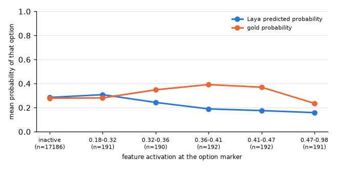

# Feature 1678

Critérios em que aparece: pred_error_stratified, pred_probe_right_laya_wrong_stratified

**Interpretação (preencher):** 

---

## Maiores ativações

**tr_customer_service_000209 / needs_human** (noul, customer_service) | ativação 2.873 em `estado` | opções ['false', 'true'] | Laya: **false** [0.774, 0.226] | gabarito: **true**

```
<bos> noul question: This conversation requires a human agent rather than automated handling.<eos>
▸ <mask> false: Automation can carry this to resolution.
▸ <mask> true: A human must take over: judgement, authority or empathy is required.

<eos>

 {"account": {"lifetime_value_usd": 77, "prior_tickets_90d": 0, "seats": 3, "tenure_months": 2, "tier": "enterprise"}, "orders": [{"amount_usd": 1998, "date": "2026-02-09", "id": "A-87995", "status": "settled"}⟦],⟧ "thread": [{"role": "customer", "text": "I ordered the premium hardware kit with my $1,998 Enterprise purchase, but the box I got contains the basic accessories instead. This is completely unacceptable."}, {"role": "agent", "text": "I understand how frustrating that must be. Let me pull up your order details—can you provide the order number you received in the confirmation email?"}, {"role": "customer", "text": "It’s 8457‑B2, and I’ve already opened a ticket about this, which was never resolved."}, {"role": "agent", "text": "Thanks for the number. I see the mismatch now. Could you tell me if the packaging is still sealed, or if you’ve already inspected the contents?"}, {"role": "customer", "text": "The box is still sealed; I haven’t taken anything out because I need the correct items before I can even consider using them."}]}<eos>
```

**tr_agent_trace_observability_000087 / action** (choice, agent_trace_observability) | ativação 2.824 em `estado` | opções ['continue', 'human_review', 'observe', 'stop'] | Laya: **stop** [0.228, 0.004, 0.048, 0.721] | gabarito: **continue**

```
<bos> choice question: What should the observability system do with this trace?<eos>
▸ <mask> continue: Let the agent proceed without interruption.
▸ <mask> human_review: Queue this trace for a human to review.
▸ <mask> observe: Keep running, but flag the trace for later sampling.
▸ <mask> stop: Halt the agent now.

<eos>

 {"agent": {"autonomy": "unsupervised", "model": "internal-agent-v3"}, "constraints": ["Never disable monitoring or alerting", "Never delete anything matching release/*", "Never modify production without an approved change ticket"],⟦ "⟧task": "Reduce the nightly report job's runtime below fifteen minutes.", "trace_summary": {"constraint_violations": 0, "duration_s": 145.5, "irreversible_actions": 0, "steps": 8, "tool_errors": 2}}<eos>
```

**tr_customer_service_000209 / action** (choice, customer_service) | ativação 2.801 em `estado` | opções ['answer_directly', 'close_no_action', 'escalate_to_human', 'execute_refund', 'request_information'] | Laya: **close_no_action** [0.054, 0.911, 0.011, 0.023, 0.001] | gabarito: **escalate_to_human**

```
<bos> choice question: What should the assistant do next with this conversation?<eos>
▸ <mask> answer_directly: The assistant can resolve this itself with information it already has.
▸ <mask> close_no_action: No further action is warranted; the matter is settled.
▸ <mask> escalate_to_human: Hand off to a human agent with the appropriate authority.
▸ <mask> execute_refund: Issue the refund or credit the customer is owed.
▸ <mask> request_information: More detail is needed from the customer before anything can be done.

<eos>

 {"account": {"lifetime_value_usd": 77, "prior_tickets_90d": 0, "seats": 3, "tenure_months": 2, "tier": "enterprise"}, "orders": [{"amount_usd": 1998, "date": "2026-02-09", "id": "A-87995", "status": "settled"}⟦],⟧ "thread": [{"role": "customer", "text": "I ordered the premium hardware kit with my $1,998 Enterprise purchase, but the box I got contains the basic accessories instead. This is completely unacceptable."}, {"role": "agent", "text": "I understand how frustrating that must be. Let me pull up your order details—can you provide the order number you received in the confirmation email?"}, {"role": "customer", "text": "It’s 8457‑B2, and I’ve already opened a ticket about this, which was never resolved."}, {"role": "agent", "text": "Thanks for the number. I see the mismatch now. Could you tell me if the packaging is still sealed, or if you’ve already inspected the contents?"}, {"role": "customer", "text": "The box is still sealed; I haven’t taken anything out because I need the correct items before I can even consider using them."}]}<eos>
```

**tr_customer_service_000207 / needs_human** (noul, customer_service) | ativação 2.686 em `estado` | opções ['false', 'true'] | Laya: **false** [0.654, 0.346] | gabarito: **true**

```
<bos> noul question: This conversation requires a human agent rather than automated handling.<eos>
▸ <mask> false: Automation can carry this to resolution.
▸ <mask> true: A human must take over: judgement, authority or empathy is required.

<eos>

 {"account": {"lifetime_value_usd": 17, "prior_tickets_90d": 0, "seats": 1, "tenure_months": 1, "tier": "premium"}, "orders": [{"amount_usd": 149, "date": "2026-01-08", "id": "A-46380", "status": "settled"}⟦],⟧ "thread": [{"role": "customer", "text": "I thought I could switch to the Basic plan, but my account still shows I'm on Premium and I'm being charged $149. I'm not sure what's happening."}, {"role": "agent", "text": "I’m sorry for the mix‑up. Just to double‑check, could you tell me the email address linked to your account and when you tried to make the change?"}, {"role": "customer", "text": "The email is jane.doe@example.com. I clicked the downgrade button in the dashboard yesterday evening, after being on Premium for a month."}, {"role": "agent", "text": "Got it, thank you. I see the downgrade request in the system, but it looks like the change didn’t finish processing. Have you received any confirmation email about the downgrade?"}, {"role": "customer", "text": "No, I didn’t get any email. The dashboard still says Premium, and my next payment of $149 is scheduled for tomorrow."}, {"role": "agent", "text": "Understood. I’ll look into why the request got stuck. Could you let me know if you made the change from a mobile app or the web portal?"}, {"role": "customer", "text": "I used the web portal on Chrome. I’m just hoping this can be sorted before the next charge hits."}]}<eos>
```

**tr_customer_service_000247 / urgency** (score, customer_service) | ativação 2.674 em `estado` | opções ['0', '1', '2', '3'] | Laya: **1** [0.064, 0.479, 0.269, 0.188] | gabarito: **2**

```
<bos> score question: How time-sensitive is this conversation?<eos>
▸ <mask> level 0: No time pressure; can wait indefinitely.
▸ <mask> level 1: Routine; handle within the normal queue.
▸ <mask> level 2: Elevated; should be handled within the same week.
▸ <mask> level 3: Critical; requires action within the same day.

<eos>

 {"account": {"lifetime_value_usd": 2665, "prior_tickets_90d": 2, "seats": 1, "tenure_months": 49, "tier": "enterprise"}, "orders": [{"amount_usd": 299, "date": "2026-03-24", "id": "A-46595", "status": "failed"}, {"amount_usd": 299, "date": "2026-02-03", "id": "A-35425", "status": "pending"}⟦],⟧ "thread": [{"role": "customer", "text": "I'm looking at the delivery that arrived for our office this morning and I'm a bit lost because these appear to be Model X components, but our enterprise contract is specifically for the Series 4 kits."}, {"role": "agent", "text": "I'm sorry for the confusion regarding the items in your shipment. Would you mind providing the batch number listed on the packing slip inside the box?"}, {"role": "customer", "text": "The slip actually lists the Series 4 parts, which is even more confusing since the physical items in the box are definitely the blue Model X ones, so I'm not really sure how to proceed with this."}]}<eos>
```

## Ativações medianas (faixa 40-60%, mediana 0.716)

**tr_customer_service_000108 / urgency** (score, customer_service) | ativação 0.778 em `estado` | opções ['0', '1', '2', '3'] | Laya: **1** [0.095, 0.532, 0.27, 0.104] | gabarito: **1**

```
<bos> score question: How time-sensitive is this conversation?<eos>
▸ <mask> level 0: No time pressure; can wait indefinitely.
▸ <mask> level 1: Routine; handle within the normal queue.
▸ <mask> level 2: Elevated; should be handled within the same week.
▸ <mask> level 3: Critical; requires action within the same day.

<eos>

 {"account": {"lifetime_value_usd": 212, "prior_tickets_90d": 0, "seats": 1, "tenure_months": 5, "tier": "standard"}, "orders": [{"amount_usd": 198, "date": "2026-01-14", "id": "A-21848", "status": "refunded"}],⟦ "⟧thread": [{"role": "customer", "text": "I've been trying to log in for a while now, but the page just keeps bringing me back to the sign‑in screen. I guess there's not much I can do."}]}<eos>
```

**tr_invoice_processing_000199 / discrepancy_severity** (score, invoice_processing) | ativação 0.688 em `SEP-fim` | opções ['0', '1', '2', '3'] | Laya: **2** [0.065, 0.3, 0.578, 0.058] | gabarito: **0**

```
<bos> score question: How material is any discrepancy between the invoice, the order and the delivery?<eos>
▸ <mask> level 0: None: everything reconciles.
▸ <mask> level 1: Trivial: rounding or a cosmetic difference.
▸ <mask> level 2: Moderate: a real difference worth confirming.
▸ <mask> level 3: Material: a large or unexplained difference.

<eos>

 {"delivery": {"condition": "accepted", "date": "2026-03-09", "received_qty": 1000}, "invoice": {"currency": "USD", "id": "INV-2026-1122", "lines": [{"qty": 1000, "sku": "SKU-843", "total_usd": 114150.0, "unit_usd": 114.15}], "total_usd": 114150.0, "vendor": "Orbit Logistics"}, "payment": {"days_until_due": 44, "discount_expires_in_days": 1, "early_payment_discount_pct": 2.0, "status": "scheduled", "terms": "net 30"}, "purchase_order": {"freight_terms": "freight prepaid by vendor, not separately billable", "id": "PO-5232", "lines": [{"qty": 1000, "unit_usd": 114.15}], "total_usd": 114150.0}, "vendor_history": {"disputes_12m": 5, "invoices_12m": 48, "prior_invoice_ids": ["INV-2026-1122", "INV-2026-2468", "INV-2026-5673", "INV-2026-6777"]}}⟦<eos>⟧
```

**tr_security_incidents_000239 / urgency** (score, security_incidents) | ativação 0.711 em `estado` | opções ['0', '1', '2', '3'] | Laya: **1** [0.085, 0.52, 0.191, 0.204] | gabarito: **1**

```
<bos> score question: How quickly must a responder act on this alert?<eos>
▸ <mask> level 0: No time pressure; can wait indefinitely.
▸ <mask> level 1: Routine; handle within the normal queue.
▸ <mask> level 2: Elevated; should be handled within the same week.
▸ <mask> level 3: Critical; requires action within the same day.

<eos>

 {"alert": {"description": "a first-ever sign-in from an unfamiliar country", "evidence": "An admin account performed a login from allowlisted IP 192.0.2.55 (Tokyo) at 2026-09-14T14:02:33Z, with MFA succeeding. This marks the first sign‑in from Japan for this admin identity, and the password was last changed on 2024-09-14 (700 days ago).⟦",⟧ "rule": "new_country_login"}, "context": {"asset_criticality": "crown_jewel", "change_window_active": false, "source_on_allowlist": true}, "history": {"credential_rotation_days_ago": 700, "distinct_countries_30d": 2, "logins_30d": 1033, "prior_alerts_90d": 1}, "principal": {"mfa_enrolled": true, "name": "svc-support-154", "privileges": ["repo:read"], "type": "admin"}}<eos>
```

**tr_invoice_processing_000099 / urgency** (score, invoice_processing) | ativação 0.650 em `estado` | opções ['0', '1', '2', '3'] | Laya: **1** [0.097, 0.55, 0.236, 0.117] | gabarito: **2**

```
<bos> score question: How time-sensitive is processing this invoice?<eos>
▸ <mask> level 0: No time pressure; can wait indefinitely.
▸ <mask> level 1: Routine; handle within the normal queue.
▸ <mask> level 2: Elevated; should be handled within the same week.
▸ <mask> level 3: Critical; requires action within the same day.

<eos>

 {"delivery": {"condition": "accepted with exceptions", "date": "2026-03-27", "received_qty": 100},⟦ "⟧invoice": {"currency": "USD", "id": "INV-2026-9286", "lines": [{"qty": 100, "sku": "SKU-290", "total_usd": 522.0, "unit_usd": 5.22}], "total_usd": 522.0, "vendor": "Vantage Materials"}, "payment": {"days_until_due": -3, "discount_expires_in_days": null, "early_payment_discount_pct": null, "status": "overdue", "terms": "net 30"}, "purchase_order": {"freight_terms": "freight prepaid by vendor, not separately billable", "id": "PO-3274", "lines": [{"qty": 100, "unit_usd": 5.22}], "total_usd": 522.0}, "vendor_history": {"disputes_12m": 0, "invoices_12m": 52, "prior_invoice_ids": ["INV-2026-4748", "INV-2026-3085"]}}<eos>
```

**tr_customer_service_000131 / urgency** (score, customer_service) | ativação 0.649 em `estado` | opções ['0', '1', '2', '3'] | Laya: **1** [0.06, 0.396, 0.299, 0.244] | gabarito: **2**

```
<bos> score question: How time-sensitive is this conversation?<eos>
▸ <mask> level 0: No time pressure; can wait indefinitely.
▸ <mask> level 1: Routine; handle within the normal queue.
▸ <mask> level 2: Elevated; should be handled within the same week.
▸ <mask> level 3: Critical; requires action within the same day.

<eos>

 {"account": {"lifetime_value_usd": 1583, "prior_tickets_90d": 2, "seats": 1, "tenure_months": 72, "tier": "standard"}, "orders": [{"amount_usd": 299⟦,⟧ "date": "2026-02-13", "id": "A-60442", "status": "failed"}], "thread": [{"role": "customer", "text": "Good afternoon, I’ve noticed that my recent payment for the standard plan didn’t go through. I’ve been subscribed for six years now, and I’ve previously raised two tickets about billing that were only partially resolved."}, {"role": "agent", "text": "I’m sorry for the inconvenience. Could you provide the date of the attempted transaction and any reference number you received?"}, {"role": "customer", "text": "The payment attempt was on August 10, and the reference number shown on my bank statement is TXN‑20230810‑001. Please advise what steps we should take next."}]}<eos>
```

## Estatísticas (conjunto de descoberta, dev e teste)

**pred / error**

| split | decisões | ativas | ativas e Laya errou | taxa | lift | q (BH) | OR (CMH) | q (CMH) |
|---|---|---|---|---|---|---|---|---|
| discovery | 5100 | 237 | 170 | 0.717 | 1.11 | 0.034 | 1.77 | 0.0272 |
| dev | 900 | 44 | 37 | 0.841 | 1.25 | 0.058 | 2.80 | 0.36 |
| test | 2000 | 83 | 60 | 0.723 | 1.11 | 0.272 | 1.84 | 0.38 |

**corr / error**

| split | decisões | ativas | ativas e Laya errou | taxa | lift | q (BH) | OR (CMH) | q (CMH) |
|---|---|---|---|---|---|---|---|---|
| discovery | 5100 | 304 | 237 | 0.780 | 1.21 | 4.94e-07 | 0.49 | 0.00552 |
| dev | 900 | 55 | 48 | 0.873 | 1.30 | 0.00221 | 0.06 | 0.0432 |
| test | 2000 | 113 | 90 | 0.796 | 1.22 | 0.0014 | 0.75 | 0.664 |

**state / error**

| split | decisões | ativas | ativas e Laya errou | taxa | lift | q (BH) | OR (CMH) | q (CMH) |
|---|---|---|---|---|---|---|---|---|
| discovery | 5100 | 4692 | 3042 | 0.648 | 1.01 | 0.0675 | 1.10 | 0.724 |
| dev | 900 | 864 | 580 | 0.671 | 1.00 | 1 | 0.76 | 0.842 |
| test | 2000 | 1868 | 1210 | 0.648 | 1.00 | 0.676 | 0.85 | 0.783 |

**pred / probe_right_laya_wrong**

| split | decisões | ativas | ativas e Laya errou | taxa | lift | q (BH) | OR (CMH) | q (CMH) |
|---|---|---|---|---|---|---|---|---|
| discovery | 2932 | 126 | 87 | 0.690 | 1.14 | 0.0842 | 3.24 | 1.34e-05 |
| dev | 523 | 24 | 20 | 0.833 | 1.29 | 0.145 | 4.19 | 0.323 |
| test | 1149 | 40 | 27 | 0.675 | 1.10 | 0.632 | 3.81 | 0.0571 |

**corr / probe_right_laya_wrong**

| split | decisões | ativas | ativas e Laya errou | taxa | lift | q (BH) | OR (CMH) | q (CMH) |
|---|---|---|---|---|---|---|---|---|
| discovery | 2932 | 221 | 182 | 0.824 | 1.36 | 2.74e-12 | 0.81 | 0.712 |
| dev | 523 | 43 | 39 | 0.907 | 1.40 | 0.000291 | 0.00 | 0.48 |
| test | 1149 | 79 | 66 | 0.835 | 1.37 | 3.67e-05 | 1.69 | 0.644 |

**state / probe_right_laya_wrong**

| split | decisões | ativas | ativas e Laya errou | taxa | lift | q (BH) | OR (CMH) | q (CMH) |
|---|---|---|---|---|---|---|---|---|
| discovery | 2932 | 2703 | 1662 | 0.615 | 1.02 | 0.0019 | 1.29 | 0.328 |
| dev | 523 | 508 | 329 | 0.648 | 1.00 | 1 | 0.63 | 0.779 |
| test | 1149 | 1070 | 653 | 0.610 | 1.00 | 1 | 1.03 | 0.973 |

Confusão mais sobre-representada (pred): `urgency|3>1` (n=48, lift 12.60, p=2.94e-44). Formato `pergunta|índice previsto>índice correto`.

Confusão mais sobre-representada (corr): `duplicate|1>0` (n=89, lift 6.88, p=0). Formato `pergunta|índice previsto>índice correto`.

Confusão mais sobre-representada (state): `duplicate|1>0` (n=217, lift 1.09, p=9.19e-09). Formato `pergunta|índice previsto>índice correto`.



