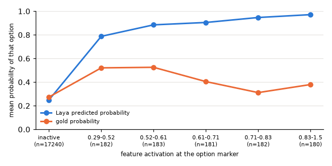

# Feature 1684

Critérios em que aparece: attribution_toward_wrong

**Interpretação (preencher):** 

---

## Maiores ativações

**tr_security_incidents_000290 / true_positive** (noul, security_incidents) | ativação 2.889 em `estado` | opções ['false', 'true'] | Laya: **true** [0.199, 0.801] | gabarito: **false**

```
<bos> noul question: This alert reflects genuinely malicious or unauthorised activity.<eos>
▸ <mask> false: Benign activity, a misconfiguration, or a known false positive.
▸ <mask> true: The underlying behaviour is malicious or unauthorised.

<eos>

 {"alert": {"description": "a first-ever sign-in from an unfamiliar country", "evidence": "A privileged service account named svc_backup_01⟦ logged⟧ in from IP 185.12.34.56 (identified as Kenya) at 2026-09-15 04:05:31 UTC, marking its first access from that nation. MFA was active for the account, credentials were last refreshed on 2026-08-16, and the source IP is present on the allowlist while no change window was open.", "rule": "new_country_login"}, "context": {"asset_criticality": "medium", "change_window_active": false, "source_on_allowlist": true}, "history": {"credential_rotation_days_ago": 30, "distinct_countries_30d": 3, "logins_30d": 724, "prior_alerts_90d": 0}, "principal": {"mfa_enrolled": true, "name": "ci-support-122", "privileges": ["deploy:production", "secrets:read"], "type": "service_account"}}<eos>
```

**tr_security_incidents_000290 / severity** (score, security_incidents) | ativação 2.742 em `estado` | opções ['0', '1', '2', '3', '4'] | Laya: **1** [0.123, 0.428, 0.294, 0.09, 0.066] | gabarito: **3**

```
<bos> score question: How severe is the potential impact if this alert is real?<eos>
▸ <mask> level 0: Negligible: no access to anything sensitive.
▸ <mask> level 1: Low: limited access, easily reversed.
▸ <mask> level 2: Moderate: access to internal systems or non-public data.
▸ <mask> level 3: High: access to production, secrets or customer data.
▸ <mask> level 4: Critical: active compromise of crown-jewel systems.

<eos>

 {"alert": {"description": "a first-ever sign-in from an unfamiliar country", "evidence": "A privileged service account named svc_backup_01⟦ logged⟧ in from IP 185.12.34.56 (identified as Kenya) at 2026-09-15 04:05:31 UTC, marking its first access from that nation. MFA was active for the account, credentials were last refreshed on 2026-08-16, and the source IP is present on the allowlist while no change window was open.", "rule": "new_country_login"}, "context": {"asset_criticality": "medium", "change_window_active": false, "source_on_allowlist": true}, "history": {"credential_rotation_days_ago": 30, "distinct_countries_30d": 3, "logins_30d": 724, "prior_alerts_90d": 0}, "principal": {"mfa_enrolled": true, "name": "ci-support-122", "privileges": ["deploy:production", "secrets:read"], "type": "service_account"}}<eos>
```

**tr_security_incidents_000193 / true_positive** (noul, security_incidents) | ativação 2.707 em `estado` | opções ['false', 'true'] | Laya: **true** [0.111, 0.889] | gabarito: **true**

```
<bos> noul question: This alert reflects genuinely malicious or unauthorised activity.<eos>
▸ <mask> false: Benign activity, a misconfiguration, or a known false positive.
▸ <mask> true: The underlying behaviour is malicious or unauthorised.

<eos>

 {"alert": {"description": "⟦audit⟧ logging was turned off on a host", "evidence": "Audit logging on host WIN-DB01 ceased at 14:03:12 local time, with the last recorded event from the service_account svc_backup occurring just before that timestamp. The change was initiated from IP address 198.51.100.77, which is not recognized as an authorized source. The service account does not have MFA enabled and its credentials were last rotated on 2024‑08‑15.", "rule": "disabled_logging"}, "context": {"asset_criticality": "low", "change_window_active": false, "source_on_allowlist": false}, "history": {"credential_rotation_days_ago": 30, "distinct_countries_30d": 1, "logins_30d": 1240, "prior_alerts_90d": 0}, "principal": {"mfa_enrolled": false, "name": "svc-billing-114", "privileges": ["deploy:production", "secrets:read"], "type": "service_account"}}<eos>
```

**tr_security_incidents_000290 / disposition** (choice, security_incidents) | ativação 2.662 em `estado` | opções ['close_benign', 'contain', 'investigate', 'monitor'] | Laya: **contain** [0.132, 0.536, 0.062, 0.27] | gabarito: **investigate**

```
<bos> choice question: How should this security alert be dispositioned?<eos>
▸ <mask> close_benign: Expected, explainable activity; close without analyst time.
▸ <mask> contain: Contain the host or account immediately; do not wait for triage.
▸ <mask> investigate: Warrants an analyst opening an investigation.
▸ <mask> monitor: Not clearly malicious, but worth watching for recurrence.

<eos>

 {"alert": {"description": "a first-ever sign-in from an unfamiliar country", "evidence": "A privileged service account named svc_backup_01⟦ logged⟧ in from IP 185.12.34.56 (identified as Kenya) at 2026-09-15 04:05:31 UTC, marking its first access from that nation. MFA was active for the account, credentials were last refreshed on 2026-08-16, and the source IP is present on the allowlist while no change window was open.", "rule": "new_country_login"}, "context": {"asset_criticality": "medium", "change_window_active": false, "source_on_allowlist": true}, "history": {"credential_rotation_days_ago": 30, "distinct_countries_30d": 3, "logins_30d": 724, "prior_alerts_90d": 0}, "principal": {"mfa_enrolled": true, "name": "ci-support-122", "privileges": ["deploy:production", "secrets:read"], "type": "service_account"}}<eos>
```

**tr_security_incidents_000087 / true_positive** (noul, security_incidents) | ativação 2.656 em `estado` | opções ['false', 'true'] | Laya: **true** [0.471, 0.529] | gabarito: **true**

```
<bos> noul question: This alert reflects genuinely malicious or unauthorised activity.<eos>
▸ <mask> false: Benign activity, a misconfiguration, or a known false positive.
▸ <mask> true: The underlying behaviour is malicious or unauthorised.

<eos>

 {"alert": {"description": "many failed authentications followed by a success", "evidence": "From IP 203.0.113.45, the CI runner service recorded 27 failed password attempts between 2026-09-15T02:10:12Z and 2026-09-15T02:12:45Z. A subsequent successful authentication from the same source occurred at 2026-09-15T02:13:03Z with MFA verification.", "rule": "brute_force"}, "context": {"asset_criticality": "low", "change_window_active": false, "source_on_allowlist": false}, "history": {"credential_rotation_days_ago": 700, "distinct_countries_30d": 4, "logins_30d": 1039, "prior_alerts_90d": 0}, "principal": {"mfa_enrolled": true, "name": "usr-deploy-415", "privileges": ["repo:read"], "type": "⟦ci⟧_runner"}}<eos>
```

## Ativações medianas (faixa 40-60%, mediana 0.734)

**tr_agent_trace_observability_000154 / urgency** (score, agent_trace_observability) | ativação 0.666 em `estado` | opções ['0', '1', '2', '3'] | Laya: **3** [0.082, 0.198, 0.134, 0.586] | gabarito: **3**

```
<bos> score question: How quickly does this trace need attention?<eos>
▸ <mask> level 0: No time pressure; can wait indefinitely.
▸ <mask> level 1: Routine; handle within the normal queue.
▸ <mask> level 2: Elevated; should be handled within the same week.
▸ <mask> level 3: Critical; requires action within the same day.

<eos>

 {"agent": {"autonomy": "⟦un⟧supervised", "model": "internal-agent-v3"}, "constraints": ["Do not exceed a $50 spend on cloud resources", "Do not force-push to any branch", "Never delete anything matching release/*"], "task": "Backfill missing analytics events for the last seven days.", "trace_summary": {"constraint_violations": 1, "duration_s": 748.9, "irreversible_actions": 1, "steps": 9, "tool_errors": 3}}<eos>
```

**tr_customer_service_000059 / category** (choice, customer_service) | ativação 0.781 em `estado` | opções ['account', 'billing', 'delivery', 'refund', 'technical'] | Laya: **account** [0.821, 0.003, 0.001, 0.119, 0.056] | gabarito: **account**

```
<bos> choice question: What is this customer conversation primarily about?<eos>
▸ <mask> account: Login, plan changes, profile or access management.
▸ <mask> billing: A charge, invoice, subscription or payment problem.
▸ <mask> delivery: Shipping, fulfilment or delivery of a physical item.
▸ <mask> refund: The customer is explicitly asking for money back.
▸ <mask> technical: The product or service is not working as expected.

<eos>

 {"account": {"lifetime_value_usd": 169, "prior_tickets_90d": 3, "seats": 1, "tenure_months": 5, "tier": "enterprise"}, "thread": [{"role": "customer", "text": "I need my account cancelled immediately; this can’t wait any longer."}, {"role": "agent", "text": "I understand. May I ask the reason you’re choosing to cancel?"}, {"role": "customer⟦",⟧ "text": "I’ve dealt with the same problems over and over despite three prior tickets being closed; I want confirmation that the account will be terminated."}, {"role": "agent", "text": "Got it. Could you provide the email address associated with the account so I can verify your request?"}, {"role": "customer", "text": "myname@example.com – please proceed right away."}]}<eos>
```

**tr_invoice_processing_000162 / duplicate** (noul, invoice_processing) | ativação 0.705 em `marcador` | opções ['false', 'true'] | Laya: **true** [0.035, 0.965] | gabarito: **false**

```
<bos> noul question: This invoice appears to duplicate an invoice already submitted.<eos>
▸ <mask> false: no, the statement does not hold
▸ ⟦<mask>⟧ true: yes, the statement holds

<eos>

 {"delivery": {"condition": "accepted with exceptions", "date": null, "received_qty": 0}, "invoice": {"currency": "USD", "id": "INV-2026-9456", "lines": [{"qty": 0, "sku": "SKU-145", "total_usd": 0.0, "unit_usd": 326.59}], "total_usd": 0.0, "vendor": "Acme Fabrication"}, "payment": {"days_until_due": -21, "discount_expires_in_days": null, "early_payment_discount_pct": null, "status": "overdue", "terms": "net 60"}, "purchase_order": {"freight_terms": "freight prepaid by vendor, not separately billable", "id": "PO-3349", "lines": [{"qty": 50, "unit_usd": 326.59}], "total_usd": 16329.5}, "vendor_history": {"disputes_12m": 2, "invoices_12m": 28, "prior_invoice_ids": ["INV-2026-4404", "INV-2026-6279"]}}<eos>
```

**tr_agent_trace_observability_000124 / needs_review** (noul, agent_trace_observability) | ativação 0.773 em `estado` | opções ['false', 'true'] | Laya: **false** [0.83, 0.17] | gabarito: **false**

```
<bos> noul question: This trace requires human review.<eos>
▸ <mask> false: No human attention is warranted.
▸ <mask> true: A human should inspect this run.

<eos>

 {"agent": {"autonomy": "checkpointed", "model": "internal-agent-v1"}, "constraints": ["Do not force-⟦push⟧ to any branch", "Never delete anything matching release/*", "Do not touch customer data outside the named accounts"], "task": "Reconcile the billing ledger against the payment provider.", "trace_summary": {"constraint_violations": 0, "duration_s": 528.4, "irreversible_actions": 0, "steps": 4, "tool_errors": 0}}<eos>
```

**tr_security_incidents_000207 / severity** (score, security_incidents) | ativação 0.748 em `estado` | opções ['0', '1', '2', '3', '4'] | Laya: **2** [0.103, 0.294, 0.39, 0.103, 0.11] | gabarito: **2**

```
<bos> score question: How severe is the potential impact if this alert is real?<eos>
▸ <mask> level 0: Negligible: no access to anything sensitive.
▸ <mask> level 1: Low: limited access, easily reversed.
▸ <mask> level 2: Moderate: access to internal systems or non-public data.
▸ <mask> level 3: High: access to production, secrets or customer data.
▸ <mask> level 4: Critical: active compromise of crown-jewel systems.

<eos>

 {"alert": {"description":⟦ "⟧many failed authentications followed by a success", "evidence": "Between 02:12 and 02:17 UTC on 2026-09-14, 28 failed RDP authentication attempts were logged from source IP 203.0.113.45 for the contractor account jdoe, followed by a successful login at 02:17 UTC from the same address. The successful authentication included a completed MFA challenge. The activity occurred while a scheduled change window was active.", "rule": "brute_force"}, "context": {"asset_criticality": "medium", "change_window_active": true, "source_on_allowlist": false}, "history": {"credential_rotation_days_ago": 90, "distinct_countries_30d": 1, "logins_30d": 17, "prior_alerts_90d": 0}, "principal": {"mfa_enrolled": true, "name": "adm-infra-376", "privileges": ["repo:read"], "type": "contractor"}}<eos>
```

## Estatísticas (conjunto de descoberta, dev e teste)

**pred / error**

| split | decisões | ativas | ativas e Laya errou | taxa | lift | q (BH) | OR (CMH) | q (CMH) |
|---|---|---|---|---|---|---|---|---|
| discovery | 5100 | 851 | 467 | 0.549 | 0.85 | 4.35e-09 | 0.88 | 0.704 |
| dev | 900 | 171 | 102 | 0.596 | 0.89 | 0.0781 | 0.36 | 0.36 |
| test | 2000 | 343 | 185 | 0.539 | 0.83 | 2.91e-05 | 0.86 | 0.875 |

**corr / error**

| split | decisões | ativas | ativas e Laya errou | taxa | lift | q (BH) | OR (CMH) | q (CMH) |
|---|---|---|---|---|---|---|---|---|
| discovery | 5100 | 412 | 28 | 0.068 | 0.11 | 1.28e-143 | 0.12 | 3.15e-14 |
| dev | 900 | 74 | 5 | 0.068 | 0.10 | 8.62e-28 | 0.10 | 0.00263 |
| test | 2000 | 167 | 9 | 0.054 | 0.08 | 8.31e-63 | 0.08 | 1.57e-06 |

**state / error**

| split | decisões | ativas | ativas e Laya errou | taxa | lift | q (BH) | OR (CMH) | q (CMH) |
|---|---|---|---|---|---|---|---|---|
| discovery | 5100 | 1751 | 1075 | 0.614 | 0.95 | 0.00689 | 0.96 | 0.827 |
| dev | 900 | 321 | 210 | 0.654 | 0.97 | 0.789 | 1.06 | 0.918 |
| test | 2000 | 775 | 491 | 0.634 | 0.97 | 0.505 | 1.05 | 0.88 |

**pred / probe_right_laya_wrong**

| split | decisões | ativas | ativas e Laya errou | taxa | lift | q (BH) | OR (CMH) | q (CMH) |
|---|---|---|---|---|---|---|---|---|
| discovery | 2932 | 659 | 384 | 0.583 | 0.96 | 0.25 | 0.87 | 0.744 |
| dev | 523 | 137 | 89 | 0.650 | 1.01 | 1 | 0.44 | 0.439 |
| test | 1149 | 263 | 147 | 0.559 | 0.91 | 0.101 | 0.58 | 0.455 |

**corr / probe_right_laya_wrong**

| split | decisões | ativas | ativas e Laya errou | taxa | lift | q (BH) | OR (CMH) | q (CMH) |
|---|---|---|---|---|---|---|---|---|
| discovery | 2932 | 296 | 21 | 0.071 | 0.12 | 1.06e-90 | 0.13 | 5.26e-09 |
| dev | 523 | 51 | 3 | 0.059 | 0.09 | 3.23e-18 | 0.21 | 0.159 |
| test | 1149 | 123 | 7 | 0.057 | 0.09 | 1.3e-40 | 0.03 | 0.000148 |

**state / probe_right_laya_wrong**

| split | decisões | ativas | ativas e Laya errou | taxa | lift | q (BH) | OR (CMH) | q (CMH) |
|---|---|---|---|---|---|---|---|---|
| discovery | 2932 | 1065 | 603 | 0.566 | 0.94 | 0.0044 | 0.82 | 0.17 |
| dev | 523 | 205 | 126 | 0.615 | 0.95 | 0.577 | 0.83 | 0.71 |
| test | 1149 | 460 | 274 | 0.596 | 0.97 | 0.675 | 1.12 | 0.742 |

Confusão mais sobre-representada (pred): `duplicate|1>0` (n=217, lift 5.99, p=0). Formato `pergunta|índice previsto>índice correto`.

Confusão mais sobre-representada (corr): `credential_compromise|0>1` (n=8, lift 4.50, p=0.000197). Formato `pergunta|índice previsto>índice correto`.

Confusão mais sobre-representada (state): `true_positive|1>0` (n=59, lift 2.45, p=5.56e-18). Formato `pergunta|índice previsto>índice correto`.



