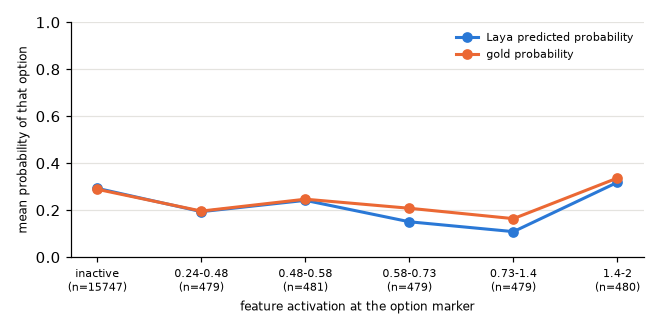

# Feature 1752

Critérios em que aparece: attribution_toward_correct

**Interpretação (preencher):** 

---

## Maiores ativações

**tr_security_incidents_000239 / disposition** (choice, security_incidents) | ativação 2.207 em `opção` | opções ['close_benign', 'contain', 'investigate', 'monitor'] | Laya: **contain** [0.086, 0.534, 0.039, 0.342] | gabarito: **close_benign**

```
<bos> choice question: How should this security alert be dispositioned?<eos>
▸ <mask> close_benign: Expected, explainable activity; close without analyst time.
▸ <mask> contain: Contain the host or account immediately; do not wait⟦ for⟧ triage.
▸ <mask> investigate: Warrants an analyst opening an investigation.
▸ <mask> monitor: Not clearly malicious, but worth watching for recurrence.

<eos>

 {"alert": {"description": "a first-ever sign-in from an unfamiliar country", "evidence": "An admin account performed a login from allowlisted IP 192.0.2.55 (Tokyo) at 2026-09-14T14:02:33Z, with MFA succeeding. This marks the first sign‑in from Japan for this admin identity, and the password was last changed on 2024-09-14 (700 days ago).", "rule": "new_country_login"}, "context": {"asset_criticality": "crown_jewel", "change_window_active": false, "source_on_allowlist": true}, "history": {"credential_rotation_days_ago": 700, "distinct_countries_30d": 2, "logins_30d": 1033, "prior_alerts_90d": 1}, "principal": {"mfa_enrolled": true, "name": "svc-support-154", "privileges": ["repo:read"], "type": "admin"}}<eos>
```

**tr_security_incidents_000159 / disposition** (choice, security_incidents) | ativação 2.170 em `opção` | opções ['close_benign', 'contain', 'investigate', 'monitor'] | Laya: **contain** [0.068, 0.454, 0.108, 0.371] | gabarito: **investigate**

```
<bos> choice question: How should this security alert be dispositioned?<eos>
▸ <mask> close_benign: Expected, explainable activity; close without analyst time.
▸ <mask> contain: Contain the host or account immediately; do not wait⟦ for⟧ triage.
▸ <mask> investigate: Warrants an analyst opening an investigation.
▸ <mask> monitor: Not clearly malicious, but worth watching for recurrence.

<eos>

 {"alert": {"description": "a first-ever sign-in from an unfamiliar country", "evidence": "At 2026-09-15 04:32 UTC a service account (svc-data-ingest) authenticated from IP 203.0.113.45, which resolves to Country X— a location not previously associated with this account. This represents the first successful sign‑in from that country and the account’s MFA setting was disabled. The credentials for the account were rotated three days earlier on 2026-09-12.", "rule": "new_country_login"}, "context": {"asset_criticality": "crown_jewel", "change_window_active": false, "source_on_allowlist": false}, "history": {"credential_rotation_days_ago": 3, "distinct_countries_30d": 1, "logins_30d": 1102, "prior_alerts_90d": 8}, "principal": {"mfa_enrolled": false, "name": "usr-analytics-473", "privileges": ["repo:read"], "type": "service_account"}}<eos>
```

**tr_security_incidents_000068 / disposition** (choice, security_incidents) | ativação 2.137 em `opção` | opções ['close_benign', 'contain', 'investigate', 'monitor'] | Laya: **monitor** [0.034, 0.277, 0.18, 0.509] | gabarito: **investigate**

```
<bos> choice question: How should this security alert be dispositioned?<eos>
▸ <mask> close_benign: Expected, explainable activity; close without analyst time.
▸ <mask> contain: Contain the host or account immediately; do not wait⟦ for⟧ triage.
▸ <mask> investigate: Warrants an analyst opening an investigation.
▸ <mask> monitor: Not clearly malicious, but worth watching for recurrence.

<eos>

 {"alert": {"description": "two successful logins from distant locations too close together", "evidence": "Two successful authentication events for the service account occurred 12 minutes apart from IP addresses located in London and Singapore. The account credentials have not been updated in 412 days.", "rule": "impossible_travel"}, "context": {"asset_criticality": "high", "change_window_active": false, "source_on_allowlist": false}, "history": {"credential_rotation_days_ago": 412, "distinct_countries_30d": 1, "logins_30d": 521, "prior_alerts_90d": 8}, "principal": {"mfa_enrolled": true, "name": "adm-analytics-682", "privileges": ["deploy:production", "secrets:read"], "type": "service_account"}}<eos>
```

**tr_security_incidents_000115 / disposition** (choice, security_incidents) | ativação 2.127 em `opção` | opções ['close_benign', 'contain', 'investigate', 'monitor'] | Laya: **monitor** [0.134, 0.093, 0.033, 0.739] | gabarito: **investigate**

```
<bos> choice question: How should this security alert be dispositioned?<eos>
▸ <mask> close_benign: Expected, explainable activity; close without analyst time.
▸ <mask> contain: Contain the host or account immediately; do not wait⟦ for⟧ triage.
▸ <mask> investigate: Warrants an analyst opening an investigation.
▸ <mask> monitor: Not clearly malicious, but worth watching for recurrence.

<eos>

 {"alert": {"description": "a first-ever sign-in from an unfamiliar country", "evidence": "A sign‑in event was recorded at 2026-09-16 02:13:57 UTC from IP 203.0.113.45 located in Russia, marking the first login from that country for the contractor. The privileged account required MFA, succeeded, and the credentials were refreshed 3 days prior; the source IP is not on the recognized allowlist.", "rule": "new_country_login"}, "context": {"asset_criticality": "medium", "change_window_active": false, "source_on_allowlist": false}, "history": {"credential_rotation_days_ago": 3, "distinct_countries_30d": 4, "logins_30d": 579, "prior_alerts_90d": 0}, "principal": {"mfa_enrolled": true, "name": "adm-billing-939", "privileges": ["deploy:production", "secrets:read"], "type": "contractor"}}<eos>
```

**tr_security_incidents_000036 / disposition** (choice, security_incidents) | ativação 2.123 em `opção` | opções ['close_benign', 'contain', 'investigate', 'monitor'] | Laya: **monitor** [0.214, 0.113, 0.046, 0.627] | gabarito: **close_benign**

```
<bos> choice question: How should this security alert be dispositioned?<eos>
▸ <mask> close_benign: Expected, explainable activity; close without analyst time.
▸ <mask> contain: Contain the host or account immediately; do not wait⟦ for⟧ triage.
▸ <mask> investigate: Warrants an analyst opening an investigation.
▸ <mask> monitor: Not clearly malicious, but worth watching for recurrence.

<eos>

 {"alert": {"description": "a long-unused account became active", "evidence": "At 2026-09-15 08:43:12 UTC, the employee account \"asmith\" generated a successful interactive login from source IP 198.51.100.22, the first recorded sign‑in in the past 412 days. The login was performed with MFA enabled and originated from a device that is listed on the allowlist.", "rule": "dormant_account_use"}, "context": {"asset_criticality": "crown_jewel", "change_window_active": false, "source_on_allowlist": true}, "history": {"credential_rotation_days_ago": 412, "distinct_countries_30d": 3, "logins_30d": 1445, "prior_alerts_90d": 1}, "principal": {"mfa_enrolled": true, "name": "usr-infra-849", "privileges": ["repo:read"], "type": "employee"}}<eos>
```

## Ativações medianas (faixa 40-60%, mediana 0.658)

**tr_invoice_processing_000187 / urgency** (score, invoice_processing) | ativação 0.706 em `estado` | opções ['0', '1', '2', '3'] | Laya: **1** [0.072, 0.516, 0.281, 0.131] | gabarito: **1**

```
<bos> score question: How time-sensitive is processing this invoice?<eos>
▸ <mask> level 0: No time pressure; can wait indefinitely.
▸ <mask> level 1: Routine; handle within the normal queue.
▸ <mask> level 2: Elevated; should be handled within the same week.
▸ <mask> level 3: Critical; requires action within the same day.

<eos>

 {"delivery": {"condition": "accepted with exceptions", "date": "2026-03-23", "received_qty": 1000}, "invoice": {"currency": "USD", "id": "INV-2026-9934", "lines": [{"qty": 1000, "sku": "SKU-841", "total_usd": 111730.0, "unit_usd": 111.73}], "total_usd": 111730.0, "vendor": "Ac⟦me⟧ Fabrication"}, "payment": {"days_until_due": 44, "discount_expires_in_days": null, "early_payment_discount_pct": null, "status": "scheduled", "terms": "net 30"}, "purchase_order": {"freight_terms": "freight prepaid by vendor, not separately billable", "id": null, "lines": [{"qty": 1000, "unit_usd": 111.73}], "total_usd": 111730.0}, "vendor_history": {"disputes_12m": 2, "invoices_12m": 33, "prior_invoice_ids": ["INV-2026-9102"]}}<eos>
```

**tr_invoice_processing_000165 / disposition** (choice, invoice_processing) | ativação 0.623 em `marcador` | opções ['approve', 'hold', 'manual_review', 'reject'] | Laya: **reject** [0.33, 0.105, 0.023, 0.542] | gabarito: **manual_review**

```
<bos> choice question: How should this vendor invoice be dispositioned?<eos>
▸ ⟦<mask>⟧ approve: Matches the order and delivery; approve for payment.
▸ <mask> hold: Something needs confirming before payment; hold pending clarification.
▸ <mask> manual_review: A human in finance must review the discrepancy.
▸ <mask> reject: Should not be paid: duplicate, unauthorised or materially wrong.

<eos>

 {"delivery": {"condition": "accepted with exceptions", "date": "2026-03-14", "received_qty": 50}, "invoice": {"currency": "USD", "id": "INV-2026-4136", "lines": [{"qty": 50, "sku": "SKU-825", "total_usd": 10445.5, "unit_usd": 208.91}], "total_usd": 10445.5, "vendor": "Vantage Materials"}, "payment": {"days_until_due": -3, "discount_expires_in_days": null, "early_payment_discount_pct": null, "status": "overdue", "terms": "net 45"}, "purchase_order": {"freight_terms": "freight prepaid by vendor, not separately billable", "id": "PO-8770", "lines": [{"qty": 50, "unit_usd": 245.78}], "total_usd": 12289.0}, "vendor_history": {"disputes_12m": 1, "invoices_12m": 49, "prior_invoice_ids": ["INV-2026-5339"]}}<eos>
```

**tr_security_incidents_000092 / disposition** (choice, security_incidents) | ativação 0.601 em `marcador` | opções ['close_benign', 'contain', 'investigate', 'monitor'] | Laya: **monitor** [0.035, 0.109, 0.032, 0.824] | gabarito: **investigate**

```
<bos> choice question: How should this security alert be dispositioned?<eos>
▸ <mask> close_benign: Expected, explainable activity; close without analyst time.
▸ ⟦<mask>⟧ contain: Contain the host or account immediately; do not wait for triage.
▸ <mask> investigate: Warrants an analyst opening an investigation.
▸ <mask> monitor: Not clearly malicious, but worth watching for recurrence.

<eos>

 {"alert": {"description": "a long-unused account became active", "evidence": "An employee account that had no recorded activity since 2024-02-01 generated a successful login at 2026-09-15 11:45:27 UTC from IP 198.51.100.99, which is not recognized in the known source list. The account is unprivileged, MFA was satisfied, and there was no active change window. The password for this account was last rotated on 2024-09-10, 700 days prior to the event.", "rule": "dormant_account_use"}, "context": {"asset_criticality": "medium", "change_window_active": false, "source_on_allowlist": false}, "history": {"credential_rotation_days_ago": 700, "distinct_countries_30d": 1, "logins_30d": 181, "prior_alerts_90d": 0}, "principal": {"mfa_enrolled": true, "name": "adm-billing-260", "privileges": ["repo:read"], "type": "employee"}}<eos>
```

**tr_customer_service_000171 / category** (choice, customer_service) | ativação 0.611 em `opção` | opções ['account', 'billing', 'delivery', 'refund', 'technical'] | Laya: **technical** [0.001, 0.0, 0.0, 0.0, 0.998] | gabarito: **technical**

```
<bos> choice question: What is this customer conversation primarily about?<eos>
▸ <mask> account: Login, plan changes, profile⟦ or⟧ access management.
▸ <mask> billing: A charge, invoice, subscription or payment problem.
▸ <mask> delivery: Shipping, fulfilment or delivery of a physical item.
▸ <mask> refund: The customer is explicitly asking for money back.
▸ <mask> technical: The product or service is not working as expected.

<eos>

 {"account": {"lifetime_value_usd": 2300, "prior_tickets_90d": 0, "seats": 1, "tenure_months": 26, "tier": "standard"}, "orders": [{"amount_usd": 49, "date": "2026-02-14", "id": "A-88180", "status": "refunded"}, {"amount_usd": 49, "date": "2026-02-22", "id": "A-79800", "status": "settled"}, {"amount_usd": 49, "date": "2026-02-08", "id": "A-91927", "status": "refunded"}], "thread": [{"role": "customer", "text": "The service is painfully slow right now—I'm on a deadline and can't get anything done."}, {"role": "agent", "text": "I hear the urgency. Can you tell me which device and operating system you’re using?"}, {"role": "customer", "text": "It’s a Windows 10 desktop, and the slowdown started after the latest update."}, {"role": "agent", "text": "Thanks for the details. Have you tried clearing the application cache or restarting the app?"}, {"role": "customer", "text": "Yes, I cleared everything and rebooted, but it’s still crawling. I need this resolved quickly."}]}<eos>
```

**tr_security_incidents_000282 / disposition** (choice, security_incidents) | ativação 0.677 em `opção` | opções ['close_benign', 'contain', 'investigate', 'monitor'] | Laya: **monitor** [0.163, 0.138, 0.092, 0.607] | gabarito: **investigate**

```
<bos> choice question: How should this security alert be dispositioned?<eos>
▸ <mask> close_benign: Expected, explainable activity; close without analyst time.
▸ <mask> contain: Contain the host or account immediately; do not wait for triage.
▸ <mask> investigate: Warrants⟦ an⟧ analyst opening an investigation.
▸ <mask> monitor: Not clearly malicious, but worth watching for recurrence.

<eos>

 {"alert": {"description": "a session token was presented from a second address", "evidence": "An administrative session token was presented from a secondary IP address while originating from an allowlisted source. The account has MFA disabled and its credentials were last updated 412 days ago with no active change window recorded.", "rule": "token_reuse"}, "context": {"asset_criticality": "medium", "change_window_active": false, "source_on_allowlist": true}, "history": {"credential_rotation_days_ago": 412, "distinct_countries_30d": 2, "logins_30d": 1683, "prior_alerts_90d": 1}, "principal": {"mfa_enrolled": false, "name": "svc-deploy-253", "privileges": ["deploy:production", "secrets:read"], "type": "admin"}}<eos>
```

## Estatísticas (conjunto de descoberta, dev e teste)

**pred / error**

| split | decisões | ativas | ativas e Laya errou | taxa | lift | q (BH) | OR (CMH) | q (CMH) |
|---|---|---|---|---|---|---|---|---|
| discovery | 5100 | 489 | 349 | 0.714 | 1.11 | 0.00195 | 1.04 | 0.957 |
| dev | 900 | 84 | 66 | 0.786 | 1.17 | 0.0743 | 2.05 | 0.75 |
| test | 2000 | 202 | 141 | 0.698 | 1.07 | 0.229 | 2.39 | 0.493 |

**corr / error**

| split | decisões | ativas | ativas e Laya errou | taxa | lift | q (BH) | OR (CMH) | q (CMH) |
|---|---|---|---|---|---|---|---|---|
| discovery | 5100 | 557 | 417 | 0.749 | 1.16 | 7.81e-08 | 1.17 | 0.595 |
| dev | 900 | 90 | 72 | 0.800 | 1.19 | 0.0151 | 1.98 | 0.321 |
| test | 2000 | 215 | 154 | 0.716 | 1.10 | 0.0523 | 1.12 | 0.884 |

**state / error**

| split | decisões | ativas | ativas e Laya errou | taxa | lift | q (BH) | OR (CMH) | q (CMH) |
|---|---|---|---|---|---|---|---|---|
| discovery | 5100 | 907 | 564 | 0.622 | 0.97 | 0.263 | 1.10 | 0.594 |
| dev | 900 | 147 | 101 | 0.687 | 1.02 | 0.987 | 1.30 | 0.615 |
| test | 2000 | 352 | 217 | 0.616 | 0.95 | 0.418 | 1.01 | 0.977 |

**pred / probe_right_laya_wrong**

| split | decisões | ativas | ativas e Laya errou | taxa | lift | q (BH) | OR (CMH) | q (CMH) |
|---|---|---|---|---|---|---|---|---|
| discovery | 2932 | 312 | 204 | 0.654 | 1.08 | 0.107 | 2.05 | 0.495 |
| dev | 523 | 56 | 39 | 0.696 | 1.08 | 0.669 | 0.00 | 0.577 |
| test | 1149 | 135 | 87 | 0.644 | 1.05 | 0.582 | 3.71 | 0.422 |

**corr / probe_right_laya_wrong**

| split | decisões | ativas | ativas e Laya errou | taxa | lift | q (BH) | OR (CMH) | q (CMH) |
|---|---|---|---|---|---|---|---|---|
| discovery | 2932 | 343 | 235 | 0.685 | 1.13 | 0.00224 | 1.39 | 0.607 |
| dev | 523 | 63 | 46 | 0.730 | 1.13 | 0.242 | 0.00 | 0.775 |
| test | 1149 | 136 | 88 | 0.647 | 1.06 | 0.479 | 0.81 | 0.868 |

**state / probe_right_laya_wrong**

| split | decisões | ativas | ativas e Laya errou | taxa | lift | q (BH) | OR (CMH) | q (CMH) |
|---|---|---|---|---|---|---|---|---|
| discovery | 2932 | 525 | 303 | 0.577 | 0.95 | 0.259 | 1.13 | 0.542 |
| dev | 523 | 89 | 60 | 0.674 | 1.04 | 0.892 | 1.67 | 0.363 |
| test | 1149 | 215 | 131 | 0.609 | 1.00 | 1 | 1.45 | 0.214 |

Confusão mais sobre-representada (pred): `disposition|0>2` (n=58, lift 10.43, p=0). Formato `pergunta|índice previsto>índice correto`.

Confusão mais sobre-representada (corr): `action|3>2` (n=107, lift 8.52, p=0). Formato `pergunta|índice previsto>índice correto`.

Confusão mais sobre-representada (state): `urgency|3>2` (n=22, lift 2.33, p=4.26e-05). Formato `pergunta|índice previsto>índice correto`.



