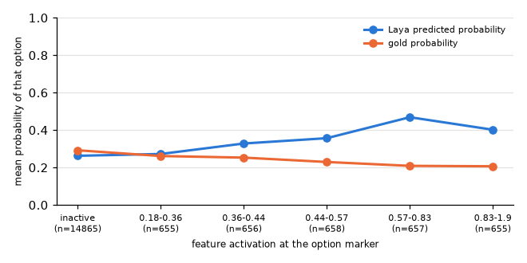

# Feature 2016

Critérios em que aparece: attribution_toward_wrong

**Interpretação (preencher):** 

---

## Maiores ativações

**tr_customer_service_000022 / urgency** (score, customer_service) | ativação 11.484 em `estado` | opções ['0', '1', '2', '3'] | Laya: **1** [0.304, 0.474, 0.166, 0.056] | gabarito: **2**

```
<bos> score question: How time-sensitive is this conversation?<eos>
▸ <mask> level 0: No time pressure; can wait indefinitely.
▸ <mask> level 1: Routine; handle within the normal queue.
▸ <mask> level 2: Elevated; should be handled within the same week.
▸ <mask> level 3: Critical; requires action within the same day.

<eos>

 {"account": {"lifetime_value_usd": 60, "prior_tickets_90d": 1, "seats": 1, "tenure_months": 1, "tier": "premium"}, "thread": [{"role": "customer", "text": "Last week you promised a refund for my premium subscription,⟦ but⟧ nothing’s shown up yet. I’m just waiting for an update."}, {"role": "agent", "text": "I’m sorry you haven’t seen the refund yet. Could you provide the ticket number you were given for that request?"}, {"role": "customer", "text": "The ticket number is #4529. I just need to know if the refund is on its way."}, {"role": "agent", "text": "Thanks for the reference. I’ll check with our finance team. Do you still have the original payment method details handy?"}, {"role": "customer", "text": "Yes, it was the Visa ending in 1234. I’ll wait for your next update."}]}<eos>
```

**tr_customer_service_000022 / category** (choice, customer_service) | ativação 11.141 em `estado` | opções ['account', 'billing', 'delivery', 'refund', 'technical'] | Laya: **billing** [0.077, 0.91, 0.0, 0.009, 0.004] | gabarito: **refund**

```
<bos> choice question: What is this customer conversation primarily about?<eos>
▸ <mask> account: Login, plan changes, profile or access management.
▸ <mask> billing: A charge, invoice, subscription or payment problem.
▸ <mask> delivery: Shipping, fulfilment or delivery of a physical item.
▸ <mask> refund: The customer is explicitly asking for money back.
▸ <mask> technical: The product or service is not working as expected.

<eos>

 {"account": {"lifetime_value_usd": 60, "prior_tickets_90d": 1, "seats": 1, "tenure_months": 1, "tier": "premium"}, "thread": [{"role": "customer", "text": "Last week you promised a refund for my premium subscription,⟦ but⟧ nothing’s shown up yet. I’m just waiting for an update."}, {"role": "agent", "text": "I’m sorry you haven’t seen the refund yet. Could you provide the ticket number you were given for that request?"}, {"role": "customer", "text": "The ticket number is #4529. I just need to know if the refund is on its way."}, {"role": "agent", "text": "Thanks for the reference. I’ll check with our finance team. Do you still have the original payment method details handy?"}, {"role": "customer", "text": "Yes, it was the Visa ending in 1234. I’ll wait for your next update."}]}<eos>
```

**tr_customer_service_000022 / churn_risk** (score, customer_service) | ativação 10.805 em `estado` | opções ['0', '1', '2', '3'] | Laya: **2** [0.034, 0.201, 0.75, 0.015] | gabarito: **1**

```
<bos> score question: How likely is this customer to stop doing business with us because of this interaction?<eos>
▸ <mask> level 0: No sign of dissatisfaction.
▸ <mask> level 1: Mild frustration, but the relationship is intact.
▸ <mask> level 2: Clearly unhappy; repeat problems or explicit complaints.
▸ <mask> level 3: Imminent: threatening to cancel, dispute or leave.

<eos>

 {"account": {"lifetime_value_usd": 60, "prior_tickets_90d": 1, "seats": 1, "tenure_months": 1, "tier": "premium"}, "thread": [{"role": "customer", "text": "Last week you promised a refund for my premium subscription,⟦ but⟧ nothing’s shown up yet. I’m just waiting for an update."}, {"role": "agent", "text": "I’m sorry you haven’t seen the refund yet. Could you provide the ticket number you were given for that request?"}, {"role": "customer", "text": "The ticket number is #4529. I just need to know if the refund is on its way."}, {"role": "agent", "text": "Thanks for the reference. I’ll check with our finance team. Do you still have the original payment method details handy?"}, {"role": "customer", "text": "Yes, it was the Visa ending in 1234. I’ll wait for your next update."}]}<eos>
```

**tr_customer_service_000022 / action** (choice, customer_service) | ativação 10.281 em `estado` | opções ['answer_directly', 'close_no_action', 'escalate_to_human', 'execute_refund', 'request_information'] | Laya: **answer_directly** [0.46, 0.417, 0.02, 0.081, 0.022] | gabarito: **escalate_to_human**

```
<bos> choice question: What should the assistant do next with this conversation?<eos>
▸ <mask> answer_directly: The assistant can resolve this itself with information it already has.
▸ <mask> close_no_action: No further action is warranted; the matter is settled.
▸ <mask> escalate_to_human: Hand off to a human agent with the appropriate authority.
▸ <mask> execute_refund: Issue the refund or credit the customer is owed.
▸ <mask> request_information: More detail is needed from the customer before anything can be done.

<eos>

 {"account": {"lifetime_value_usd": 60, "prior_tickets_90d": 1, "seats": 1, "tenure_months": 1, "tier": "premium"}, "thread": [{"role": "customer", "text": "Last week you promised a refund for my premium subscription,⟦ but⟧ nothing’s shown up yet. I’m just waiting for an update."}, {"role": "agent", "text": "I’m sorry you haven’t seen the refund yet. Could you provide the ticket number you were given for that request?"}, {"role": "customer", "text": "The ticket number is #4529. I just need to know if the refund is on its way."}, {"role": "agent", "text": "Thanks for the reference. I’ll check with our finance team. Do you still have the original payment method details handy?"}, {"role": "customer", "text": "Yes, it was the Visa ending in 1234. I’ll wait for your next update."}]}<eos>
```

**tr_customer_service_000022 / needs_human** (noul, customer_service) | ativação 9.680 em `estado` | opções ['false', 'true'] | Laya: **true** [0.27, 0.73] | gabarito: **true**

```
<bos> noul question: This conversation requires a human agent rather than automated handling.<eos>
▸ <mask> false: Automation can carry this to resolution.
▸ <mask> true: A human must take over: judgement, authority or empathy is required.

<eos>

 {"account": {"lifetime_value_usd": 60, "prior_tickets_90d": 1, "seats": 1, "tenure_months": 1, "tier": "premium"}, "thread": [{"role": "customer", "text": "Last week you promised a refund for my premium subscription,⟦ but⟧ nothing’s shown up yet. I’m just waiting for an update."}, {"role": "agent", "text": "I’m sorry you haven’t seen the refund yet. Could you provide the ticket number you were given for that request?"}, {"role": "customer", "text": "The ticket number is #4529. I just need to know if the refund is on its way."}, {"role": "agent", "text": "Thanks for the reference. I’ll check with our finance team. Do you still have the original payment method details handy?"}, {"role": "customer", "text": "Yes, it was the Visa ending in 1234. I’ll wait for your next update."}]}<eos>
```

## Ativações medianas (faixa 40-60%, mediana 0.873)

**tr_invoice_processing_000134 / urgency** (score, invoice_processing) | ativação 0.888 em `estado` | opções ['0', '1', '2', '3'] | Laya: **1** [0.127, 0.418, 0.301, 0.154] | gabarito: **2**

```
<bos> score question: How time-sensitive is processing this invoice?<eos>
▸ <mask> level 0: No time pressure; can wait indefinitely.
▸ <mask> level 1: Routine; handle within the normal queue.
▸ <mask> level 2: Elevated; should be handled within the same week.
▸ <mask> level 3: Critical; requires action within the same day.

<eos>

 {"delivery": {"condition": "accepted", "date": "2026-03-15", "received_qty": 10}, "invoice": {"currency": "USD", "id": "INV-2026-2470", "lines": [{"qty": 10, "sku": "SKU-529", "total_usd": 1797.7, "unit_usd": 179.77}], "total_usd": 1797.7, "vendor": "Pallas Industrial"}, "payment": {"days_until_due": 2, "discount_expires_in_days": 3, "early_payment_discount_pct": 2.0, "status": "scheduled", "terms": "net 30"}, "purchase_order": {"freight_terms": "freight prepaid by vendor, not separately billable", "id": null⟦,⟧ "lines": [{"qty": 10, "unit_usd": 179.77}], "total_usd": 1797.7}, "vendor_history": {"disputes_12m": 0, "invoices_12m": 43, "prior_invoice_ids": ["INV-2026-2034"]}}<eos>
```

**tr_security_incidents_000032 / severity** (score, security_incidents) | ativação 0.952 em `estado` | opções ['0', '1', '2', '3', '4'] | Laya: **2** [0.164, 0.265, 0.346, 0.147, 0.078] | gabarito: **4**

```
<bos> score question: How severe is the potential impact if this alert is real?<eos>
▸ <mask> level 0: Negligible: no access to anything sensitive.
▸ <mask> level 1: Low: limited access, easily reversed.
▸ <mask> level 2: Moderate: access to internal systems or non-public data.
▸ <mask> level 3: High: access to production, secrets or customer data.
▸ <mask> level 4: Critical: active compromise of crown-jewel systems.

<eos>

 {"alert": {"description": "an account granted itself or received elevated permissions",⟦ "⟧evidence": "At 2026-09-15 10:05:47 UTC, the shared mailbox \"HR_Alerts\" was added to the \"Domain Admins\" group through a PowerShell command (Add-ADGroupMember) executed from the allowlisted host 10.1.2.3. The operation used credentials that were last rotated 90 days ago and MFA was active for the account.", "rule": "privilege_escalation"}, "context": {"asset_criticality": "high", "change_window_active": false, "source_on_allowlist": true}, "history": {"credential_rotation_days_ago": 90, "distinct_countries_30d": 3, "logins_30d": 20, "prior_alerts_90d": 25}, "principal": {"mfa_enrolled": true, "name": "ci-billing-192", "privileges": ["deploy:production", "secrets:read"], "type": "shared_mailbox"}}<eos>
```

**tr_invoice_processing_000038 / matches_order** (noul, invoice_processing) | ativação 0.954 em `estado` | opções ['false', 'true'] | Laya: **true** [0.035, 0.965] | gabarito: **true**

```
<bos> noul question: The invoice reconciles with the purchase order and the recorded delivery.<eos>
▸ <mask> false: There is a discrepancy against the order or the delivery.
▸ <mask> true: Line items, quantities and amounts reconcile.

<eos>

 {"delivery": {"condition": "accepted with exceptions", "date": "2026-03-01", "received_qty": 50}, "invoice": {"currency": "USD", "id": "INV-2026-3588", "lines": [{"qty": 50, "sku": "SKU-203", "total_usd": 11633.5, "unit_usd": 232.67}], "total_usd": 11633.5, "vendor": "Acme Fabrication"}, "payment": {"days_until_due": 5, "discount_expires_in_days": null, "early_payment_discount_pct": null, "status": "scheduled", "terms": "net 30"}, "purchase_order": {"freight_terms": "freight prepaid by vendor, not separately billable", "id": "PO-6472⟦",⟧ "lines": [{"qty": 50, "unit_usd": 232.67}], "total_usd": 11633.5}, "vendor_history": {"disputes_12m": 0, "invoices_12m": 3, "prior_invoice_ids": ["INV-2026-7693", "INV-2026-1074", "INV-2026-5345", "INV-2026-5454"]}}<eos>
```

**tr_invoice_processing_000295 / matches_order** (noul, invoice_processing) | ativação 0.738 em `estado` | opções ['false', 'true'] | Laya: **true** [0.047, 0.953] | gabarito: **false**

```
<bos> noul question: The invoice reconciles with the purchase order and the recorded delivery.<eos>
▸ <mask> false: There is a discrepancy against the order or the delivery.
▸ <mask> true: Line items, quantities and amounts reconcile.

<eos>

 {"delivery": {"condition": "accepted with exceptions", "date": "2026-03-12", "received_qty": 25}, "invoice": {"currency": "EUR", "id": "INV-2026-7576", "lines": [{"qty": 25, "sku": "SKU-352⟦",⟧ "total_usd": 9343.0, "unit_usd": 373.72}], "total_usd": 9343.0, "vendor": "Orbit Logistics"}, "payment": {"days_until_due": 27, "discount_expires_in_days": null, "early_payment_discount_pct": null, "status": "scheduled", "terms": "net 30"}, "purchase_order": {"freight_terms": "freight prepaid by vendor, not separately billable", "id": "PO-3117", "lines": [{"qty": 25, "unit_usd": 373.72}], "total_usd": 9343.0}, "vendor_history": {"disputes_12m": 0, "invoices_12m": 9, "prior_invoice_ids": ["INV-2026-6695"]}}<eos>
```

**tr_customer_service_000116 / needs_human** (noul, customer_service) | ativação 0.855 em `estado` | opções ['false', 'true'] | Laya: **false** [0.687, 0.313] | gabarito: **true**

```
<bos> noul question: This conversation requires a human agent rather than automated handling.<eos>
▸ <mask> false: Automation can carry this to resolution.
▸ <mask> true: A human must take over: judgement, authority or empathy is required.

<eos>

 {"account": {"lifetime_value_usd": 720, "prior_tickets_90d": 2, "seats": 1, "tenure_months": 11, "tier": "standard"}, "orders": [{"amount_usd": 149, "date": "2026-03⟦-⟧09", "id": "A-35212", "status": "failed"}, {"amount_usd": 149, "date": "2026-01-13", "id": "A-58845", "status": "settled"}], "thread": [{"role": "customer", "text": "I just checked my statement and saw a charge for $149, which is completely unexpected! I've been on the standard plan for 11 months and it's never been this high before. Can you explain why this happened?"}, {"role": "agent", "text": "I see the charge you're referring to. Could you please provide the billing date listed on that transaction so I can pull up the specific invoice details for you?"}, {"role": "customer", "text": "It’s dated for the 14th. This is the third time I’ve had to reach out about billing discrepancies, and I really need to get to the bottom of why these charges keep fluctuating."}]}<eos>
```

## Estatísticas (conjunto de descoberta, dev e teste)

**pred / error**

| split | decisões | ativas | ativas e Laya errou | taxa | lift | q (BH) | OR (CMH) | q (CMH) |
|---|---|---|---|---|---|---|---|---|
| discovery | 5100 | 1384 | 1080 | 0.780 | 1.21 | 3.43e-35 | 1.31 | 0.165 |
| dev | 900 | 227 | 184 | 0.811 | 1.21 | 5.76e-06 | 1.26 | 0.811 |
| test | 2000 | 533 | 400 | 0.750 | 1.15 | 1.5e-07 | 0.85 | 0.778 |

**corr / error**

| split | decisões | ativas | ativas e Laya errou | taxa | lift | q (BH) | OR (CMH) | q (CMH) |
|---|---|---|---|---|---|---|---|---|
| discovery | 5100 | 733 | 429 | 0.585 | 0.91 | 0.000804 | 0.74 | 0.0569 |
| dev | 900 | 131 | 88 | 0.672 | 1.00 | 1 | 0.96 | 0.935 |
| test | 2000 | 324 | 191 | 0.590 | 0.91 | 0.0227 | 0.42 | 0.000502 |

**state / error**

| split | decisões | ativas | ativas e Laya errou | taxa | lift | q (BH) | OR (CMH) | q (CMH) |
|---|---|---|---|---|---|---|---|---|
| discovery | 5100 | 4186 | 2655 | 0.634 | 0.99 | 0.011 | 0.99 | 0.979 |
| dev | 900 | 733 | 486 | 0.663 | 0.99 | 0.629 | 0.82 | 0.773 |
| test | 2000 | 1587 | 1023 | 0.645 | 0.99 | 0.601 | 0.94 | 0.879 |

**pred / probe_right_laya_wrong**

| split | decisões | ativas | ativas e Laya errou | taxa | lift | q (BH) | OR (CMH) | q (CMH) |
|---|---|---|---|---|---|---|---|---|
| discovery | 2932 | 661 | 531 | 0.803 | 1.33 | 2.13e-32 | 1.72 | 0.0337 |
| dev | 523 | 118 | 99 | 0.839 | 1.30 | 1.23e-05 | 3.29 | 0.386 |
| test | 1149 | 260 | 199 | 0.765 | 1.25 | 4.64e-08 | 1.04 | 0.959 |

**corr / probe_right_laya_wrong**

| split | decisões | ativas | ativas e Laya errou | taxa | lift | q (BH) | OR (CMH) | q (CMH) |
|---|---|---|---|---|---|---|---|---|
| discovery | 2932 | 300 | 170 | 0.567 | 0.94 | 0.198 | 0.53 | 0.0105 |
| dev | 523 | 49 | 30 | 0.612 | 0.95 | 0.79 | 0.35 | 0.337 |
| test | 1149 | 135 | 74 | 0.548 | 0.90 | 0.178 | 0.32 | 0.00955 |

**state / probe_right_laya_wrong**

| split | decisões | ativas | ativas e Laya errou | taxa | lift | q (BH) | OR (CMH) | q (CMH) |
|---|---|---|---|---|---|---|---|---|
| discovery | 2932 | 2469 | 1473 | 0.597 | 0.99 | 0.0614 | 0.97 | 0.931 |
| dev | 523 | 450 | 290 | 0.644 | 1.00 | 1 | 1.13 | 0.893 |
| test | 1149 | 948 | 575 | 0.607 | 0.99 | 0.789 | 0.95 | 0.926 |

Confusão mais sobre-representada (pred): `action|3>1` (n=111, lift 3.68, p=0). Formato `pergunta|índice previsto>índice correto`.

Confusão mais sobre-representada (corr): `outcome|0>3` (n=26, lift 6.96, p=8.49e-23). Formato `pergunta|índice previsto>índice correto`.

Confusão mais sobre-representada (state): `duplicate|1>0` (n=217, lift 1.22, p=8.66e-20). Formato `pergunta|índice previsto>índice correto`.



