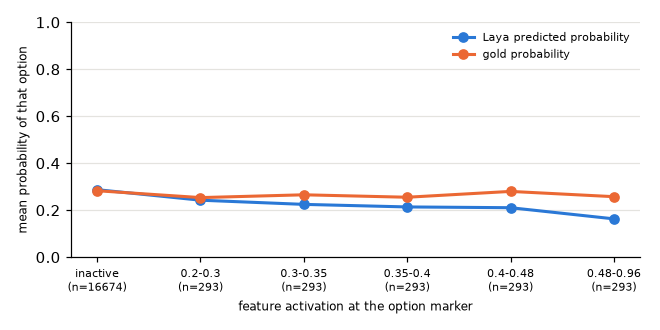

# Feature 2079

Critérios em que aparece: corr_error_stratified, corr_probe_right_laya_wrong_stratified

**Interpretação (preencher):** 

---

## Maiores ativações

**tr_security_incidents_000059 / credential_compromise** (noul, security_incidents) | ativação 4.070 em `estado` | opções ['false', 'true'] | Laya: **true** [0.036, 0.964] | gabarito: **true**

```
<bos> noul question: The evidence indicates a credential or account has been compromised.<eos>
▸ <mask> false: no, the statement does not hold
▸ <mask> true: yes, the statement holds

<eos>

 {"alert": {"description": "many failed authentications followed by a success", "evidence": "At 14:02 UTC on 2026-05-19, IIS worker process w3wp.exe on EXCH-02 recorded 63 failed OWA logons for shared⟦ mailbox⟧ accountsales@corp.example from 192.0.2.77, followed by one successful MFA logon at 14:05 UTC from the same address. The mailbox password was last changed 365 days ago, and no change window was active on EXCH-02 during that period. The source IP was not in the known office, VPN, or partner address lists.", "rule": "brute_force"}, "context": {"asset_criticality": "medium", "change_window_active": false, "source_on_allowlist": false}, "history": {"credential_rotation_days_ago": 365, "distinct_countries_30d": 1, "logins_30d": 1177, "prior_alerts_90d": 1}, "principal": {"mfa_enrolled": true, "name": "svc-support-100", "privileges": ["repo:read"], "type": "shared_mailbox"}}<eos>
```

**tr_customer_service_000257 / needs_human** (noul, customer_service) | ativação 3.896 em `estado` | opções ['false', 'true'] | Laya: **true** [0.072, 0.928] | gabarito: **false**

```
<bos> noul question: This conversation requires a human agent rather than automated handling.<eos>
▸ <mask> false: Automation can carry this to resolution.
▸ <mask> true: A human must take over: judgement, authority or empathy is required.

<eos>

 {"account": {"lifetime_value_usd": 131, "prior_tickets_90d": 1, "seats": 1, "tenure_months": 5, "tier": "standard"}, "orders": [{"amount_usd": 447, "date": "2026-03-22", "id": "A-40460", "status": "settled"}, {"amount_usd": 447, "date": "2026-02-25", "id": "A-64478", "status": "failed"}], "thread": [{"role": "customer", "text": "What the hell? I ordered the deluxe⟦ headset⟧ for $447 and you sent me a basic mouse instead. This is unacceptable."}, {"role": "agent", "text": "I’m sorry you received the wrong item. Can you tell me the order number so I can look into the mix‑up?"}, {"role": "customer", "text": "Order #B5544LM. I need the correct headset sent to me immediately."}]}<eos>
```

**tr_customer_service_000003 / needs_human** (noul, customer_service) | ativação 3.820 em `estado` | opções ['false', 'true'] | Laya: **true** [0.478, 0.522] | gabarito: **false**

```
<bos> noul question: This conversation requires a human agent rather than automated handling.<eos>
▸ <mask> false: Automation can carry this to resolution.
▸ <mask> true: A human must take over: judgement, authority or empathy is required.

<eos>

 {"account": {"lifetime_value_usd": 89, "prior_tickets_90d": 5, "seats": 1, "tenure_months": 1, "tier": "premium"}, "orders": [{"amount_usd": 49, "date": "2026-02-28", "id": "A-29326", "status": "settled"}], "thread": [{"role": "customer", "text": "I’m extremely frustrated – the item I received is completely wrong and I need the correct product by Friday, otherwise I’m canceling my premium subscription."}, {"role": "agent", "text": "I’m sorry you’ve had this experience. Could you share the order number so I can look up the details?"}, {"role": "customer", "text": "The order number is #A12345. I ordered the wireless⟦ headphones⟧, but got a Bluetooth speaker instead. I need the headphones before the weekend."}, {"role": "agent", "text": "Thank you for the information. To arrange a replacement, could you confirm the shipping address you’d like the headphones sent to?"}, {"role": "customer", "text": "Send them to 742 Evergreen Terrace, Springfield. I’ll be watching for the delivery, and I expect it before Friday as I mentioned."}]}<eos>
```

**tr_customer_service_000233 / churn_risk** (score, customer_service) | ativação 3.730 em `estado` | opções ['0', '1', '2', '3'] | Laya: **1** [0.074, 0.428, 0.24, 0.258] | gabarito: **2**

```
<bos> score question: How likely is this customer to stop doing business with us because of this interaction?<eos>
▸ <mask> level 0: No sign of dissatisfaction.
▸ <mask> level 1: Mild frustration, but the relationship is intact.
▸ <mask> level 2: Clearly unhappy; repeat problems or explicit complaints.
▸ <mask> level 3: Imminent: threatening to cancel, dispute or leave.

<eos>

 {"account": {"lifetime_value_usd": 273, "prior_tickets_90d": 2, "seats": 1, "tenure_months": 14, "tier": "free"}, "orders": [{"amount_usd": 29, "date": "2026-02-02", "id": "A-72334", "status": "settled"}, {"amount_usd": 29, "date": "2026-01-16", "id": "A-43421", "status": "settled"}], "thread": [{"role": "customer", "text": "I just opened my delivery and you sent me the wrong replacement part, I ordered the $29⟦ filter⟧ kit but I received a pack of gaskets instead. I have an inspection scheduled for tomorrow morning and I absolutely must have the right parts installed by then."}, {"role": "agent", "text": "I'm sorry to hear that the incorrect items were delivered. Could you please provide the order number located on your packing slip so I can check the shipment details?"}, {"role": "customer", "text": "The order number is 44921-A. This is the third time I've had to reach out about shipping errors in the last year and I'm really in a bind here. Is there any way to get the correct filter kit to me today?"}, {"role": "agent", "text": "I've pulled up the order and see the filter kit listed. For our records, could you please describe any labels or SKU numbers visible on the packaging of the gaskets you received by mistake?"}, {"role": "customer", "text": "The sticker says G-992-X, but I really don't have time for a back-and-forth investigation. I need to know immediately how we can fix this because the inspector will be here at 9 AM and the system won't pass without those specific filters."}]}<eos>
```

**tr_security_incidents_000059 / true_positive** (noul, security_incidents) | ativação 3.688 em `estado` | opções ['false', 'true'] | Laya: **true** [0.08, 0.92] | gabarito: **true**

```
<bos> noul question: This alert reflects genuinely malicious or unauthorised activity.<eos>
▸ <mask> false: Benign activity, a misconfiguration, or a known false positive.
▸ <mask> true: The underlying behaviour is malicious or unauthorised.

<eos>

 {"alert": {"description": "many failed authentications followed by a success", "evidence": "At 14:02 UTC on 2026-05-19, IIS worker process w3wp.exe on EXCH-02 recorded 63 failed OWA logons for shared⟦ mailbox⟧ accountsales@corp.example from 192.0.2.77, followed by one successful MFA logon at 14:05 UTC from the same address. The mailbox password was last changed 365 days ago, and no change window was active on EXCH-02 during that period. The source IP was not in the known office, VPN, or partner address lists.", "rule": "brute_force"}, "context": {"asset_criticality": "medium", "change_window_active": false, "source_on_allowlist": false}, "history": {"credential_rotation_days_ago": 365, "distinct_countries_30d": 1, "logins_30d": 1177, "prior_alerts_90d": 1}, "principal": {"mfa_enrolled": true, "name": "svc-support-100", "privileges": ["repo:read"], "type": "shared_mailbox"}}<eos>
```

## Ativações medianas (faixa 40-60%, mediana 0.981)

**tr_security_incidents_000164 / true_positive** (noul, security_incidents) | ativação 0.941 em `estado` | opções ['false', 'true'] | Laya: **true** [0.239, 0.761] | gabarito: **false**

```
<bos> noul question: This alert reflects genuinely malicious or unauthorised activity.<eos>
▸ <mask> false: Benign activity, a misconfiguration, or a known false positive.
▸ <mask> true: The underlying behaviour is malicious or unauthorised.

<eos>

 {"alert": {"description": "two successful logins from distant locations too close together", "evidence": "Two successful authentication events for a CI runner account originated from geographic locations that are physically impossible to traverse within the elapsed time between logins. Both requests were received from an IP address currently defined on the allowlist.", "rule": "impossible_travel"}, "context": {"asset_⟦critical⟧ity": "low", "change_window_active": false, "source_on_allowlist": true}, "history": {"credential_rotation_days_ago": 30, "distinct_countries_30d": 2, "logins_30d": 1175, "prior_alerts_90d": 3}, "principal": {"mfa_enrolled": true, "name": "ci-support-866", "privileges": ["deploy:production", "secrets:read"], "type": "ci_runner"}}<eos>
```

**tr_customer_service_000168 / churn_risk** (score, customer_service) | ativação 1.113 em `estado` | opções ['0', '1', '2', '3'] | Laya: **3** [0.048, 0.168, 0.172, 0.612] | gabarito: **1**

```
<bos> score question: How likely is this customer to stop doing business with us because of this interaction?<eos>
▸ <mask> level 0: No sign of dissatisfaction.
▸ <mask> level 1: Mild frustration, but the relationship is intact.
▸ <mask> level 2: Clearly unhappy; repeat problems or explicit complaints.
▸ <mask> level 3: Imminent: threatening to cancel, dispute or leave.

<eos>

 {"account": {"lifetime_value_usd": 4178, "prior_tickets_90d": 0, "seats": 1, "tenure_months": 60, "tier": "premium"}, "orders": [{"amount⟦_⟧usd": 147, "date": "2026-03-07", "id": "A-83083", "status": "settled"}, {"amount_usd": 147, "date": "2026-02-24", "id": "A-35216", "status": "settled"}], "thread": [{"role": "customer", "text": "I need a copy of the invoice for the $147 charge on my premium account—I've been a customer for five years and the deadline to submit it is tomorrow. This is getting ridiculous."}, {"role": "agent", "text": "I’m sorry to hear you’re under pressure. Could you tell me which billing period the invoice is for?"}, {"role": "customer", "text": "It’s the most recent one, the one that showed up on my statement for the $147 premium fee. I can’t afford to wait any longer."}, {"role": "agent", "text": "Got it. Do you have a preferred way to receive the invoice—email attachment or a secure link?"}, {"role": "customer", "text": "Email it to me right away, please. I’ll be checking my inbox constantly until I get it."}]}<eos>
```

**tr_security_incidents_000273 / disposition** (choice, security_incidents) | ativação 0.989 em `estado` | opções ['close_benign', 'contain', 'investigate', 'monitor'] | Laya: **monitor** [0.0, 0.0, 0.035, 0.964] | gabarito: **contain**

```
<bos> choice question: How should this security alert be dispositioned?<eos>
▸ <mask> close_benign: Expected, explainable activity; close without analyst time.
▸ <mask> contain: Contain the host or account immediately; do not wait for triage.
▸ <mask> investigate: Warrants an analyst opening an investigation.
▸ <mask> monitor: Not clearly malicious, but worth watching for recurrence.

<eos>

 {"alert": {"description": "an endpoint agent matched a known signature", "evidence": "Endpoint sensor on workstation WKS-07 detected a file named 'svchost64.dll' in C:\\Users\\temp that matched the known malware signature 'Trojan:Win32/Emotet.A' at 2026-09-15 08:17:02 UTC. The detection was generated by an unregistered source. The associated admin account, which has⟦ MFA⟧ enabled and was last rotated 14 days prior, was not in a scheduled change window.", "rule": "malware_signature"}, "context": {"asset_criticality": "medium", "change_window_active": false, "source_on_allowlist": false}, "history": {"credential_rotation_days_ago": 14, "distinct_countries_30d": 2, "logins_30d": 1414, "prior_alerts_90d": 0}, "principal": {"mfa_enrolled": true, "name": "adm-infra-828", "privileges": ["deploy:production", "secrets:read"], "type": "admin"}}<eos>
```

**tr_invoice_processing_000216 / urgency** (score, invoice_processing) | ativação 0.912 em `estado` | opções ['0', '1', '2', '3'] | Laya: **1** [0.106, 0.447, 0.28, 0.167] | gabarito: **1**

```
<bos> score question: How time-sensitive is processing this invoice?<eos>
▸ <mask> level 0: No time pressure; can wait indefinitely.
▸ <mask> level 1: Routine; handle within the normal queue.
▸ <mask> level 2: Elevated; should be handled within the same week.
▸ <mask> level 3: Critical; requires action within the same day.

<eos>

 {"delivery": {"condition": "accepted with exceptions", "date": "2026-03-10", "received_qty": 10}, "invoice": {"currency": "USD", "id": "INV-2026-7534", "lines": [{"qty": 10, "sku": "SKU-280", "total_usd": 1714.8, "unit_usd": 171.48}], "total_usd": 1714.8, "⟦vendor⟧": "Northwind Components"}, "payment": {"days_until_due": 44, "discount_expires_in_days": null, "early_payment_discount_pct": null, "status": "scheduled", "terms": "net 45"}, "purchase_order": {"freight_terms": "freight prepaid by vendor, not separately billable", "id": "PO-8496", "lines": [{"qty": 10, "unit_usd": 171.48}], "total_usd": 1714.8}, "vendor_history": {"disputes_12m": 0, "invoices_12m": 3, "prior_invoice_ids": ["INV-2026-4895", "INV-2026-8989", "INV-2026-8659"]}}<eos>
```

**tr_security_incidents_000064 / credential_compromise** (noul, security_incidents) | ativação 1.098 em `estado` | opções ['false', 'true'] | Laya: **true** [0.225, 0.775] | gabarito: **true**

```
<bos> noul question: The evidence indicates a credential or account has been compromised.<eos>
▸ <mask> false: no, the statement does not hold
▸ <mask> true: yes, the statement holds

<eos>

 {"alert": {"description": "an account granted itself or received elevated permissions", "evidence": "On 2026-09-15 11:07:53 UTC, CI runner \"ci-runner-99\" issued an API call from IP 198.51.100.23 that added the \"admin\" role to its own service account. MFA was disabled for this principal, and the credentials have not been rotated for 700 days. No change window was active at the time of the role assignment.", "rule": "privilege_escalation"}, "context": {"asset_criticality": "medium", "change_window_active": false, "source_on_allowlist": false}, "history": {"⟦credential⟧_rotation_days_ago": 700, "distinct_countries_30d": 4, "logins_30d": 1185, "prior_alerts_90d": 3}, "principal": {"mfa_enrolled": false, "name": "ci-deploy-175", "privileges": ["repo:read"], "type": "ci_runner"}}<eos>
```

## Estatísticas (conjunto de descoberta, dev e teste)

**pred / error**

| split | decisões | ativas | ativas e Laya errou | taxa | lift | q (BH) | OR (CMH) | q (CMH) |
|---|---|---|---|---|---|---|---|---|
| discovery | 5100 | 173 | 122 | 0.705 | 1.10 | 0.159 | 1.22 | 0.603 |
| dev | 900 | 35 | 21 | 0.600 | 0.89 | 0.644 | 0.86 | 0.911 |
| test | 2000 | 69 | 46 | 0.667 | 1.02 | 0.937 | 0.77 | 0.771 |

**corr / error**

| split | decisões | ativas | ativas e Laya errou | taxa | lift | q (BH) | OR (CMH) | q (CMH) |
|---|---|---|---|---|---|---|---|---|
| discovery | 5100 | 350 | 299 | 0.854 | 1.33 | 1.14e-18 | 2.85 | 9.54e-06 |
| dev | 900 | 74 | 60 | 0.811 | 1.21 | 0.0182 | 2.12 | 0.397 |
| test | 2000 | 153 | 130 | 0.850 | 1.31 | 8.66e-08 | 2.47 | 0.0347 |

**state / error**

| split | decisões | ativas | ativas e Laya errou | taxa | lift | q (BH) | OR (CMH) | q (CMH) |
|---|---|---|---|---|---|---|---|---|
| discovery | 5100 | 4627 | 2992 | 0.647 | 1.00 | 0.332 | 0.88 | 0.586 |
| dev | 900 | 820 | 554 | 0.676 | 1.01 | 0.884 | 0.80 | 0.792 |
| test | 2000 | 1828 | 1197 | 0.655 | 1.01 | 0.498 | 1.09 | 0.878 |

**pred / probe_right_laya_wrong**

| split | decisões | ativas | ativas e Laya errou | taxa | lift | q (BH) | OR (CMH) | q (CMH) |
|---|---|---|---|---|---|---|---|---|
| discovery | 2932 | 79 | 51 | 0.646 | 1.07 | 0.607 | 1.32 | 0.54 |
| dev | 523 | 15 | 8 | 0.533 | 0.83 | nan | nan | nan |
| test | 1149 | 27 | 18 | 0.667 | 1.09 | 0.814 | 1.31 | 0.775 |

**corr / probe_right_laya_wrong**

| split | decisões | ativas | ativas e Laya errou | taxa | lift | q (BH) | OR (CMH) | q (CMH) |
|---|---|---|---|---|---|---|---|---|
| discovery | 2932 | 168 | 140 | 0.833 | 1.38 | 2.86e-10 | 2.99 | 0.00296 |
| dev | 523 | 37 | 30 | 0.811 | 1.25 | 0.063 | 2.86 | 0.395 |
| test | 1149 | 59 | 50 | 0.847 | 1.39 | 0.00021 | 3.82 | 0.149 |

**state / probe_right_laya_wrong**

| split | decisões | ativas | ativas e Laya errou | taxa | lift | q (BH) | OR (CMH) | q (CMH) |
|---|---|---|---|---|---|---|---|---|
| discovery | 2932 | 2677 | 1649 | 0.616 | 1.02 | 0.000985 | 1.10 | 0.744 |
| dev | 523 | 479 | 315 | 0.658 | 1.02 | 0.356 | 0.96 | 0.973 |
| test | 1149 | 1060 | 652 | 0.615 | 1.01 | 0.634 | 0.86 | 0.791 |

Confusão mais sobre-representada (pred): `urgency|1>2` (n=49, lift 6.91, p=2.22e-29). Formato `pergunta|índice previsto>índice correto`.

Confusão mais sobre-representada (corr): `urgency|1>2` (n=173, lift 12.06, p=0). Formato `pergunta|índice previsto>índice correto`.

Confusão mais sobre-representada (state): `duplicate|1>0` (n=217, lift 1.10, p=4.14e-10). Formato `pergunta|índice previsto>índice correto`.



