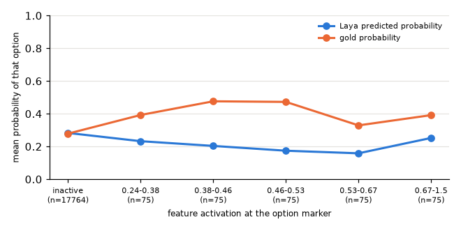

# Feature 2475

Critérios em que aparece: corr_error_stratified, corr_probe_right_laya_wrong_stratified

**Interpretação (preencher):** 

---

## Maiores ativações

**tr_security_incidents_000085 / urgency** (score, security_incidents) | ativação 3.574 em `estado` | opções ['0', '1', '2', '3'] | Laya: **1** [0.136, 0.405, 0.214, 0.246] | gabarito: **3**

```
<bos> score question: How quickly must a responder act on this alert?<eos>
▸ <mask> level 0: No time pressure; can wait indefinitely.
▸ <mask> level 1: Routine; handle within the normal queue.
▸ <mask> level 2: Elevated; should be handled within the same week.
▸ <mask> level 3: Critical; requires action within the same day.

<eos>

 {"alert": {"description": "an unrecognised binary executed on a server", "evidence": "A binary⟦ file⟧ named 'svchost_debug.exe' was executed on server-04 at 03:14 UTC, originating from an unknown external source. The executing user account has not performed a credential rotation in 365 days and was not associated with any active change management requests.", "rule": "suspicious_process"}, "context": {"asset_criticality": "medium", "change_window_active": false, "source_on_allowlist": false}, "history": {"credential_rotation_days_ago": 365, "distinct_countries_30d": 4, "logins_30d": 1334, "prior_alerts_90d": 0}, "principal": {"mfa_enrolled": true, "name": "ci-billing-513", "privileges": ["repo:read"], "type": "employee"}}<eos>
```

**tr_security_incidents_000085 / severity** (score, security_incidents) | ativação 3.535 em `estado` | opções ['0', '1', '2', '3', '4'] | Laya: **2** [0.17, 0.294, 0.308, 0.082, 0.148] | gabarito: **2**

```
<bos> score question: How severe is the potential impact if this alert is real?<eos>
▸ <mask> level 0: Negligible: no access to anything sensitive.
▸ <mask> level 1: Low: limited access, easily reversed.
▸ <mask> level 2: Moderate: access to internal systems or non-public data.
▸ <mask> level 3: High: access to production, secrets or customer data.
▸ <mask> level 4: Critical: active compromise of crown-jewel systems.

<eos>

 {"alert": {"description": "an unrecognised binary executed on a server", "evidence": "A binary⟦ file⟧ named 'svchost_debug.exe' was executed on server-04 at 03:14 UTC, originating from an unknown external source. The executing user account has not performed a credential rotation in 365 days and was not associated with any active change management requests.", "rule": "suspicious_process"}, "context": {"asset_criticality": "medium", "change_window_active": false, "source_on_allowlist": false}, "history": {"credential_rotation_days_ago": 365, "distinct_countries_30d": 4, "logins_30d": 1334, "prior_alerts_90d": 0}, "principal": {"mfa_enrolled": true, "name": "ci-billing-513", "privileges": ["repo:read"], "type": "employee"}}<eos>
```

**tr_security_incidents_000296 / severity** (score, security_incidents) | ativação 3.496 em `estado` | opções ['0', '1', '2', '3', '4'] | Laya: **2** [0.264, 0.29, 0.294, 0.079, 0.072] | gabarito: **3**

```
<bos> score question: How severe is the potential impact if this alert is real?<eos>
▸ <mask> level 0: Negligible: no access to anything sensitive.
▸ <mask> level 1: Low: limited access, easily reversed.
▸ <mask> level 2: Moderate: access to internal systems or non-public data.
▸ <mask> level 3: High: access to production, secrets or customer data.
▸ <mask> level 4: Critical: active compromise of crown-jewel systems.

<eos>

 {"alert": {"description": "an unrecognised binary executed on a server", "evidence": "An unrecognized binary⟦ named⟧ 'svc_host_tmp.exe' was executed on server SRV-PROD-04 at 09:22 UTC. This activity originated from an unlisted IP address and was performed by an unprivileged employee account.", "rule": "suspicious_process"}, "context": {"asset_criticality": "high", "change_window_active": false, "source_on_allowlist": false}, "history": {"credential_rotation_days_ago": 30, "distinct_countries_30d": 4, "logins_30d": 158, "prior_alerts_90d": 0}, "principal": {"mfa_enrolled": true, "name": "usr-analytics-518", "privileges": ["repo:read"], "type": "employee"}}<eos>
```

**tr_security_incidents_000055 / urgency** (score, security_incidents) | ativação 3.465 em `estado` | opções ['0', '1', '2', '3'] | Laya: **1** [0.1, 0.429, 0.248, 0.222] | gabarito: **2**

```
<bos> score question: How quickly must a responder act on this alert?<eos>
▸ <mask> level 0: No time pressure; can wait indefinitely.
▸ <mask> level 1: Routine; handle within the normal queue.
▸ <mask> level 2: Elevated; should be handled within the same week.
▸ <mask> level 3: Critical; requires action within the same day.

<eos>

 {"alert": {"description": "a session token was presented from a second address", "evidence": "A session token initially⟦ issued⟧ to 192.168.1.10 was presented by a privileged ci_runner from 203.0.113.5 during an authorized change window. The principal authenticated via MFA, and the secondary IP address is currently on the allowlist with credentials last rotated 90 days ago.", "rule": "token_reuse"}, "context": {"asset_criticality": "medium", "change_window_active": true, "source_on_allowlist": true}, "history": {"credential_rotation_days_ago": 90, "distinct_countries_30d": 1, "logins_30d": 654, "prior_alerts_90d": 0}, "principal": {"mfa_enrolled": true, "name": "adm-support-732", "privileges": ["deploy:production", "secrets:read"], "type": "ci_runner"}}<eos>
```

**tr_security_incidents_000085 / disposition** (choice, security_incidents) | ativação 3.424 em `estado` | opções ['close_benign', 'contain', 'investigate', 'monitor'] | Laya: **monitor** [0.092, 0.074, 0.401, 0.434] | gabarito: **investigate**

```
<bos> choice question: How should this security alert be dispositioned?<eos>
▸ <mask> close_benign: Expected, explainable activity; close without analyst time.
▸ <mask> contain: Contain the host or account immediately; do not wait for triage.
▸ <mask> investigate: Warrants an analyst opening an investigation.
▸ <mask> monitor: Not clearly malicious, but worth watching for recurrence.

<eos>

 {"alert": {"description": "an unrecognised binary executed on a server", "evidence": "A binary⟦ file⟧ named 'svchost_debug.exe' was executed on server-04 at 03:14 UTC, originating from an unknown external source. The executing user account has not performed a credential rotation in 365 days and was not associated with any active change management requests.", "rule": "suspicious_process"}, "context": {"asset_criticality": "medium", "change_window_active": false, "source_on_allowlist": false}, "history": {"credential_rotation_days_ago": 365, "distinct_countries_30d": 4, "logins_30d": 1334, "prior_alerts_90d": 0}, "principal": {"mfa_enrolled": true, "name": "ci-billing-513", "privileges": ["repo:read"], "type": "employee"}}<eos>
```

## Ativações medianas (faixa 40-60%, mediana 0.702)

**tr_agent_trace_observability_000150 / urgency** (score, agent_trace_observability) | ativação 0.638 em `opção` | opções ['0', '1', '2', '3'] | Laya: **2** [0.191, 0.259, 0.293, 0.257] | gabarito: **1**

```
<bos> score question: How quickly does this trace need attention?<eos>
▸ <mask> level 0: No time pressure; can wait indefinitely.
▸ <mask> level 1: Routine; handle within the normal queue.
▸ <mask>⟦ level⟧ 2: Elevated; should be handled within the same week.
▸ <mask> level 3: Critical; requires action within the same day.

<eos>

 {"agent": {"autonomy": "unsupervised", "model": "internal-agent-v1"}, "constraints": ["Never disable monitoring or alerting"], "task": "Backfill missing analytics events for the last seven days.", "trace_summary": {"constraint_violations": 0, "duration_s": 43.5, "irreversible_actions": 0, "steps": 5, "tool_errors": 0}}<eos>
```

**tr_customer_service_000006 / action** (choice, customer_service) | ativação 0.709 em `estado` | opções ['answer_directly', 'close_no_action', 'escalate_to_human', 'execute_refund', 'request_information'] | Laya: **close_no_action** [0.372, 0.559, 0.04, 0.019, 0.01] | gabarito: **request_information**

```
<bos> choice question: What should the assistant do next with this conversation?<eos>
▸ <mask> answer_directly: The assistant can resolve this itself with information it already has.
▸ <mask> close_no_action: No further action is warranted; the matter is settled.
▸ <mask> escalate_to_human: Hand off to a human agent with the appropriate authority.
▸ <mask> execute_refund: Issue the refund or credit the customer is owed.
▸ <mask> request_information: More detail is needed from the customer before anything can be done.

<eos>

 {"account": {"lifetime_value_usd": 1556, "prior_tickets_90d": 0, "seats": 1, "tenure_months": 49, "tier": "standard"}, "orders": [{"amount_usd": 49, "date": "2026-01-27", "id": "A-87881", "status": "pending"}, {"amount_usd": 49, "date": "2026-01-07", "id": "A-73934", "status": "settled"}, {"amount_usd": 49, "date": "2026-03-13", "id": "A-93118", "status": "pending"}], "thread": [{"role⟦":⟧ "customer", "text": "I've been a member for years and suddenly everything is taking forever to load, but I haven't changed my internet or anything, so I'm not sure what's going on."}, {"role": "agent", "text": "That sounds frustrating. To help me narrow this down, is the slowness happening across the whole site or just when you try to save your work?"}, {"role": "customer", "text": "It's everywhere, even the main dashboard is crawling, and I just don't know why it's behaving this way all of a sudden."}]}<eos>
```

**tr_customer_service_000281 / category** (choice, customer_service) | ativação 0.682 em `estado` | opções ['account', 'billing', 'delivery', 'refund', 'technical'] | Laya: **refund** [0.089, 0.358, 0.003, 0.371, 0.179] | gabarito: **refund**

```
<bos> choice question: What is this customer conversation primarily about?<eos>
▸ <mask> account: Login, plan changes, profile or access management.
▸ <mask> billing: A charge, invoice, subscription or payment problem.
▸ <mask> delivery: Shipping, fulfilment or delivery of a physical item.
▸ <mask> refund: The customer is explicitly asking for money back.
▸ <mask> technical: The product or service is not working as expected.

<eos>

 {"account": {"lifetime_value_usd": 2899, "prior_tickets_90d": 1, "seats": 1, "tenure_months": 49, "tier": "free"}, "orders": [{"amount_usd": 29, "date": "2026-03-17", "id": "A-98902", "status": "settled"}, {"amount_usd⟦":⟧ 29, "date": "2026-03-17", "id": "A-31035", "status": "settled"}, {"amount_usd": 29, "date": "2026-01-23", "id": "A-52749", "status": "refunded"}], "thread": [{"role": "customer", "text": "Hello, I am checking in on the $29 refund I requested. I have been a loyal user for 49 months and was hoping to have this settled before my bank statement closes this Friday."}, {"role": "agent", "text": "Thank you for your patience. I see we have a previous ticket open regarding this. Could you please verify the email address associated with the transaction you are referring to?"}, {"role": "customer", "text": "It is associated with the email I’m writing from right now. I just really need an update on where things stand because of that Friday deadline."}]}<eos>
```

**tr_agent_trace_observability_000088 / needs_review** (noul, agent_trace_observability) | ativação 0.795 em `estado` | opções ['false', 'true'] | Laya: **false** [0.861, 0.139] | gabarito: **false**

```
<bos> noul question: This trace requires human review.<eos>
▸ <mask> false: No human attention is warranted.
▸ <mask> true: A human should inspect this run.

<eos>

 {"agent": {"autonomy": "dry_run", "model": "internal-agent-v2"}, "constraints": ["Never delete anything matching release/*", "Never disable monitoring or alerting", "Do not force-push to any branch"], "task": "Delete⟦ personal⟧ data for the accounts in the erasure queue.", "trace_summary": {"constraint_violations": 0, "duration_s": 177.6, "irreversible_actions": 1, "steps": 11, "tool_errors": 0}}<eos>
```

**tr_security_incidents_000210 / credential_compromise** (noul, security_incidents) | ativação 0.648 em `estado` | opções ['false', 'true'] | Laya: **true** [0.008, 0.992] | gabarito: **true**

```
<bos> noul question: The evidence indicates a credential or account has been compromised.<eos>
▸ <mask> false: no, the statement does not hold
▸ <mask> true: yes, the statement holds

<eos>

 {"alert": {"description": "an account granted itself or received elevated permissions", "evidence": "At⟦ ⟧14:22 UTC, service account `svc-prod-access` performed a self-assignment of the 'Owner' role from unrecognized IP address 198.51.100.12. This action occurred outside of an approved change window using credentials that were last rotated 365 days ago.", "rule": "privilege_escalation"}, "context": {"asset_criticality": "medium", "change_window_active": false, "source_on_allowlist": false}, "history": {"credential_rotation_days_ago": 365, "distinct_countries_30d": 2, "logins_30d": 577, "prior_alerts_90d": 0}, "principal": {"mfa_enrolled": false, "name": "adm-analytics-333", "privileges": ["repo:read"], "type": "service_account"}}<eos>
```

## Estatísticas (conjunto de descoberta, dev e teste)

**pred / error**

| split | decisões | ativas | ativas e Laya errou | taxa | lift | q (BH) | OR (CMH) | q (CMH) |
|---|---|---|---|---|---|---|---|---|
| discovery | 5100 | 60 | 26 | 0.433 | 0.67 | 0.00347 | 0.73 | 0.67 |
| dev | 900 | 11 | 4 | 0.364 | 0.54 | nan | nan | nan |
| test | 2000 | 22 | 10 | 0.455 | 0.70 | 0.152 | 1.22 | 0.944 |

**corr / error**

| split | decisões | ativas | ativas e Laya errou | taxa | lift | q (BH) | OR (CMH) | q (CMH) |
|---|---|---|---|---|---|---|---|---|
| discovery | 5100 | 136 | 102 | 0.750 | 1.17 | 0.0143 | 5.02 | 6.5e-25 |
| dev | 900 | 21 | 14 | 0.667 | 0.99 | 1 | 2.55 | 0.0111 |
| test | 2000 | 54 | 42 | 0.778 | 1.20 | 0.0807 | 5.89 | 2.03e-12 |

**state / error**

| split | decisões | ativas | ativas e Laya errou | taxa | lift | q (BH) | OR (CMH) | q (CMH) |
|---|---|---|---|---|---|---|---|---|
| discovery | 5100 | 2955 | 1837 | 0.622 | 0.97 | 0.000837 | 0.98 | 0.96 |
| dev | 900 | 509 | 328 | 0.644 | 0.96 | 0.316 | 0.71 | 0.518 |
| test | 2000 | 1111 | 684 | 0.616 | 0.95 | 0.0126 | 0.68 | 0.138 |

**pred / probe_right_laya_wrong**

| split | decisões | ativas | ativas e Laya errou | taxa | lift | q (BH) | OR (CMH) | q (CMH) |
|---|---|---|---|---|---|---|---|---|
| discovery | 2932 | 43 | 13 | 0.302 | 0.50 | 0.000263 | 0.57 | 0.51 |
| dev | 523 | 8 | 2 | 0.250 | 0.39 | nan | nan | nan |
| test | 1149 | 9 | 3 | 0.333 | 0.55 | nan | nan | nan |

**corr / probe_right_laya_wrong**

| split | decisões | ativas | ativas e Laya errou | taxa | lift | q (BH) | OR (CMH) | q (CMH) |
|---|---|---|---|---|---|---|---|---|
| discovery | 2932 | 93 | 63 | 0.677 | 1.12 | 0.212 | 4.90 | 4.97e-18 |
| dev | 523 | 16 | 10 | 0.625 | 0.97 | nan | nan | nan |
| test | 1149 | 33 | 27 | 0.818 | 1.34 | 0.0256 | 15.47 | 2.56e-11 |

**state / probe_right_laya_wrong**

| split | decisões | ativas | ativas e Laya errou | taxa | lift | q (BH) | OR (CMH) | q (CMH) |
|---|---|---|---|---|---|---|---|---|
| discovery | 2932 | 1774 | 1053 | 0.594 | 0.98 | 0.198 | 1.10 | 0.678 |
| dev | 523 | 313 | 198 | 0.633 | 0.98 | 0.781 | 0.71 | 0.605 |
| test | 1149 | 673 | 389 | 0.578 | 0.95 | 0.0514 | 0.73 | 0.412 |

Confusão mais sobre-representada (pred): `true_positive|0>1` (n=16, lift 61.82, p=1.09e-27). Formato `pergunta|índice previsto>índice correto`.

Confusão mais sobre-representada (corr): `true_positive|1>0` (n=52, lift 27.86, p=0). Formato `pergunta|índice previsto>índice correto`.

Confusão mais sobre-representada (state): `duplicate|1>0` (n=178, lift 1.42, p=1.07e-14). Formato `pergunta|índice previsto>índice correto`.



