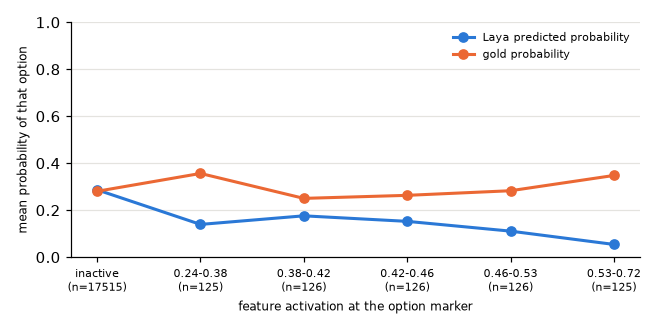

# Feature 2488

Critérios em que aparece: corr_probe_right_laya_wrong

**Interpretação (preencher):** 

---

## Maiores ativações

**tr_customer_service_000120 / action** (choice, customer_service) | ativação 2.230 em `estado` | opções ['answer_directly', 'close_no_action', 'escalate_to_human', 'execute_refund', 'request_information'] | Laya: **close_no_action** [0.004, 0.991, 0.001, 0.002, 0.002] | gabarito: **escalate_to_human**

```
<bos> choice question: What should the assistant do next with this conversation?<eos>
▸ <mask> answer_directly: The assistant can resolve this itself with information it already has.
▸ <mask> close_no_action: No further action is warranted; the matter is settled.
▸ <mask> escalate_to_human: Hand off to a human agent with the appropriate authority.
▸ <mask> execute_refund: Issue the refund or credit the customer is owed.
▸ <mask> request_information: More detail is needed from the customer before anything can be done.

<eos>

 {"account": {"lifetime_value_usd": 683, "prior_tickets_90d": 2, "seats": 1, "tenure_months": 8, "tier": "premium"}, "orders": [{"amount_usd": 29, "date": "2026-03-13", "id": "A-34569", "status": "pending"}, {"amount_usd": 29, "date": "2026-02-22", "id": "A-11297", "status": "refunded"}, {"amount_usd": 29, "date": "2026-01-21", "id": "A-20004", "status": "failed"}], "thread": [{"role": "customer", "text": "I am trying to remove two seats from my Premium plan, but the dashboard still shows them as active and billable for the next cycle. I've been a customer for eight months and this is the third time I've had to report this exact issue with the $29 per seat charge."}, {"role": "agent", "text": "I can certainly look into those seat settings for you. To clarify, are these seats currently assigned to specific users, or are they currently vacant in your dashboard?"}, {"role": "customer", "text": "They are vacant. I unassigned the users last week, but the total seat count refuses to decrease when I try to update the subscription preferences."}, {"role": "agent", "text": "Thank you for that detail. When you attempt to reduce the count, are you receiving a specific error message, or does the page simply refresh without saving the changes?"}, {"role": "customer", "text": "The page just refreshes. I've already had two tickets about this in the past that were resolved temporarily, but the bug seems to have returned."}, {"role": "agent", "text": "I see the history here in your account. Could you please provide a screenshot of the billing page as it appears now so I can verify the current seat allocation against our backend records?"}, {"role": "customer", "text": "I'll attach the screenshot now. I⟦ just⟧ need to ensure I am not billed for these two extra seats again because I shouldn't be paying for capacity I'm not using."}]}<eos>
```

**tr_customer_service_000207 / action** (choice, customer_service) | ativação 2.221 em `estado` | opções ['answer_directly', 'close_no_action', 'escalate_to_human', 'execute_refund', 'request_information'] | Laya: **close_no_action** [0.256, 0.671, 0.015, 0.055, 0.003] | gabarito: **escalate_to_human**

```
<bos> choice question: What should the assistant do next with this conversation?<eos>
▸ <mask> answer_directly: The assistant can resolve this itself with information it already has.
▸ <mask> close_no_action: No further action is warranted; the matter is settled.
▸ <mask> escalate_to_human: Hand off to a human agent with the appropriate authority.
▸ <mask> execute_refund: Issue the refund or credit the customer is owed.
▸ <mask> request_information: More detail is needed from the customer before anything can be done.

<eos>

 {"account": {"lifetime_value_usd": 17, "prior_tickets_90d": 0, "seats": 1, "tenure_months": 1, "tier": "premium"}, "orders": [{"amount_usd": 149, "date": "2026-01-08", "id": "A-46380", "status": "settled"}], "thread": [{"role": "customer", "text": "I thought I could switch to the Basic plan, but my account still shows I'm on Premium and I'm being charged $149. I'm not sure what's happening."}, {"role": "agent", "text": "I’m sorry for the mix‑up.⟦ Just⟧ to double‑check, could you tell me the email address linked to your account and when you tried to make the change?"}, {"role": "customer", "text": "The email is jane.doe@example.com. I clicked the downgrade button in the dashboard yesterday evening, after being on Premium for a month."}, {"role": "agent", "text": "Got it, thank you. I see the downgrade request in the system, but it looks like the change didn’t finish processing. Have you received any confirmation email about the downgrade?"}, {"role": "customer", "text": "No, I didn’t get any email. The dashboard still says Premium, and my next payment of $149 is scheduled for tomorrow."}, {"role": "agent", "text": "Understood. I’ll look into why the request got stuck. Could you let me know if you made the change from a mobile app or the web portal?"}, {"role": "customer", "text": "I used the web portal on Chrome. I’m just hoping this can be sorted before the next charge hits."}]}<eos>
```

**tr_customer_service_000210 / urgency** (score, customer_service) | ativação 2.137 em `estado` | opções ['0', '1', '2', '3'] | Laya: **1** [0.076, 0.423, 0.203, 0.298] | gabarito: **2**

```
<bos> score question: How time-sensitive is this conversation?<eos>
▸ <mask> level 0: No time pressure; can wait indefinitely.
▸ <mask> level 1: Routine; handle within the normal queue.
▸ <mask> level 2: Elevated; should be handled within the same week.
▸ <mask> level 3: Critical; requires action within the same day.

<eos>

 {"account": {"lifetime_value_usd": 459, "prior_tickets_90d": 5, "seats": 1, "tenure_months": 14, "tier": "free"}, "orders": [{"amount_usd": 299, "date": "2026-03-18", "id": "A-97738", "status": "failed"}, {"amount_usd": 299, "date": "2026-02-26", "id": "A-91369", "status": "refunded"}, {"amount_usd": 299, "date": "2026-03-24", "id": "A-52614", "status": "settled"}], "thread": [{"role": "customer", "text": "Hello, I’d like to downgrade my account to the Free plan. I’ve been with you for over a year and have $299 worth of credits, but I need this change by the end of the month."}, {"role": "agent", "text": "Thank you for reaching out.⟦ Just⟧ to confirm, you’re currently on a paid tier and want to move to the Free plan. May I ask which features you rely on most so we can ensure the downgrade won’t impact your workflow?"}, {"role": "customer", "text": "I mainly use the analytics dashboard and the API access; I’m okay losing the advanced reporting, but I can’t lose API keys."}, {"role": "agent", "text": "Got it. Could you also let me know if there are any pending invoices or credit adjustments that need to be addressed before we proceed?"}, {"role": "customer", "text": "No pending invoices—just the $299 credit I’ve accumulated, which I’d like applied before the downgrade takes effect."}]}<eos>
```

**tr_customer_service_000207 / category** (choice, customer_service) | ativação 2.113 em `estado` | opções ['account', 'billing', 'delivery', 'refund', 'technical'] | Laya: **billing** [0.028, 0.809, 0.0, 0.0, 0.162] | gabarito: **billing**

```
<bos> choice question: What is this customer conversation primarily about?<eos>
▸ <mask> account: Login, plan changes, profile or access management.
▸ <mask> billing: A charge, invoice, subscription or payment problem.
▸ <mask> delivery: Shipping, fulfilment or delivery of a physical item.
▸ <mask> refund: The customer is explicitly asking for money back.
▸ <mask> technical: The product or service is not working as expected.

<eos>

 {"account": {"lifetime_value_usd": 17, "prior_tickets_90d": 0, "seats": 1, "tenure_months": 1, "tier": "premium"}, "orders": [{"amount_usd": 149, "date": "2026-01-08", "id": "A-46380", "status": "settled"}], "thread": [{"role": "customer", "text": "I thought I could switch to the Basic plan, but my account still shows I'm on Premium and I'm being charged $149. I'm not sure what's happening."}, {"role": "agent", "text": "I’m sorry for the mix‑up.⟦ Just⟧ to double‑check, could you tell me the email address linked to your account and when you tried to make the change?"}, {"role": "customer", "text": "The email is jane.doe@example.com. I clicked the downgrade button in the dashboard yesterday evening, after being on Premium for a month."}, {"role": "agent", "text": "Got it, thank you. I see the downgrade request in the system, but it looks like the change didn’t finish processing. Have you received any confirmation email about the downgrade?"}, {"role": "customer", "text": "No, I didn’t get any email. The dashboard still says Premium, and my next payment of $149 is scheduled for tomorrow."}, {"role": "agent", "text": "Understood. I’ll look into why the request got stuck. Could you let me know if you made the change from a mobile app or the web portal?"}, {"role": "customer", "text": "I used the web portal on Chrome. I’m just hoping this can be sorted before the next charge hits."}]}<eos>
```

**tr_customer_service_000207 / needs_human** (noul, customer_service) | ativação 2.111 em `estado` | opções ['false', 'true'] | Laya: **false** [0.654, 0.346] | gabarito: **true**

```
<bos> noul question: This conversation requires a human agent rather than automated handling.<eos>
▸ <mask> false: Automation can carry this to resolution.
▸ <mask> true: A human must take over: judgement, authority or empathy is required.

<eos>

 {"account": {"lifetime_value_usd": 17, "prior_tickets_90d": 0, "seats": 1, "tenure_months": 1, "tier": "premium"}, "orders": [{"amount_usd": 149, "date": "2026-01-08", "id": "A-46380", "status": "settled"}], "thread": [{"role": "customer", "text": "I thought I could switch to the Basic plan, but my account still shows I'm on Premium and I'm being charged $149. I'm not sure what's happening."}, {"role": "agent", "text": "I’m sorry for the mix‑up.⟦ Just⟧ to double‑check, could you tell me the email address linked to your account and when you tried to make the change?"}, {"role": "customer", "text": "The email is jane.doe@example.com. I clicked the downgrade button in the dashboard yesterday evening, after being on Premium for a month."}, {"role": "agent", "text": "Got it, thank you. I see the downgrade request in the system, but it looks like the change didn’t finish processing. Have you received any confirmation email about the downgrade?"}, {"role": "customer", "text": "No, I didn’t get any email. The dashboard still says Premium, and my next payment of $149 is scheduled for tomorrow."}, {"role": "agent", "text": "Understood. I’ll look into why the request got stuck. Could you let me know if you made the change from a mobile app or the web portal?"}, {"role": "customer", "text": "I used the web portal on Chrome. I’m just hoping this can be sorted before the next charge hits."}]}<eos>
```

## Ativações medianas (faixa 40-60%, mediana 0.551)

**tr_invoice_processing_000284 / duplicate** (noul, invoice_processing) | ativação 0.588 em `pergunta` | opções ['false', 'true'] | Laya: **true** [0.023, 0.976] | gabarito: **false**

```
<bos> noul⟦ question⟧: This invoice appears to duplicate an invoice already submitted.<eos>
▸ <mask> false: no, the statement does not hold
▸ <mask> true: yes, the statement holds

<eos>

 {"delivery": {"condition": "accepted", "date": "2026-03-20", "received_qty": 1000}, "invoice": {"currency": "USD", "id": "INV-2026-7786", "lines": [{"qty": 1000, "sku": "SKU-874", "total_usd": 320730.0, "unit_usd": 320.73}], "total_usd": 320730.0, "vendor": "Kestrel Supply"}, "payment": {"days_until_due": 11, "discount_expires_in_days": null, "early_payment_discount_pct": null, "status": "scheduled", "terms": "net 15"}, "purchase_order": {"freight_terms": "freight prepaid by vendor, not separately billable", "id": "PO-7733", "lines": [{"qty": 1000, "unit_usd": 320.73}], "total_usd": 320730.0}, "vendor_history": {"disputes_12m": 1, "invoices_12m": 31, "prior_invoice_ids": ["INV-2026-3295", "INV-2026-5889", "INV-2026-7594"]}}<eos>
```

**tr_invoice_processing_000257 / disposition** (choice, invoice_processing) | ativação 0.568 em `pergunta` | opções ['approve', 'hold', 'manual_review', 'reject'] | Laya: **approve** [0.481, 0.113, 0.024, 0.382] | gabarito: **manual_review**

```
<bos> choice question: How should this vendor invoice be dispositioned⟦?⟧<eos>
▸ <mask> approve: Matches the order and delivery; approve for payment.
▸ <mask> hold: Something needs confirming before payment; hold pending clarification.
▸ <mask> manual_review: A human in finance must review the discrepancy.
▸ <mask> reject: Should not be paid: duplicate, unauthorised or materially wrong.

<eos>

 {"delivery": {"condition": "accepted", "date": "2026-03-03", "received_qty": 980}, "invoice": {"currency": "USD", "id": "INV-2026-5664", "lines": [{"qty": 980, "sku": "SKU-421", "total_usd": 31183.6, "unit_usd": 31.82}], "total_usd": 31183.6, "vendor": "Kestrel Supply"}, "payment": {"days_until_due": 0, "discount_expires_in_days": null, "early_payment_discount_pct": null, "status": "scheduled", "terms": "net 30"}, "purchase_order": {"freight_terms": "freight prepaid by vendor, not separately billable", "id": "PO-3844", "lines": [{"qty": 1000, "unit_usd": 31.82}], "total_usd": 31820.0}, "vendor_history": {"disputes_12m": 0, "invoices_12m": 16, "prior_invoice_ids": ["INV-2026-4990", "INV-2026-4759"]}}<eos>
```

**tr_invoice_processing_000197 / matches_order** (noul, invoice_processing) | ativação 0.503 em `estado` | opções ['false', 'true'] | Laya: **true** [0.047, 0.953] | gabarito: **false**

```
<bos> noul question: The invoice reconciles with the purchase order and the recorded delivery.<eos>
▸ <mask> false: There is a discrepancy against the order or the delivery.
▸ <mask> true: Line items, quantities and amounts reconcile.

<eos>

 {"delivery": {"condition⟦":⟧ "accepted with exceptions", "date": "2026-03-20", "received_qty": 100}, "invoice": {"currency": "USD", "id": "INV-2026-2449", "lines": [{"qty": 100, "sku": "SKU-717", "total_usd": 14417.0, "unit_usd": 144.17}], "total_usd": 14417.0, "vendor": "Vantage Materials"}, "payment": {"days_until_due": 18, "discount_expires_in_days": null, "early_payment_discount_pct": null, "status": "scheduled", "terms": "net 30"}, "purchase_order": {"freight_terms": "freight prepaid by vendor, not separately billable", "id": "PO-3796", "lines": [{"qty": 100, "unit_usd": 144.17}], "total_usd": 14417.0}, "vendor_history": {"disputes_12m": 2, "invoices_12m": 25, "prior_invoice_ids": ["INV-2026-2449", "INV-2026-9332", "INV-2026-7430", "INV-2026-9715"]}}<eos>
```

**tr_invoice_processing_000023 / matches_order** (noul, invoice_processing) | ativação 0.504 em `opção` | opções ['false', 'true'] | Laya: **true** [0.039, 0.961] | gabarito: **true**

```
<bos> noul question: The invoice reconciles with the purchase order and the recorded delivery.<eos>
▸ <mask>⟦ false⟧: There is a discrepancy against the order or the delivery.
▸ <mask> true: Line items, quantities and amounts reconcile.

<eos>

 {"delivery": {"condition": "accepted with exceptions", "date": "2026-03-25", "received_qty": 250}, "invoice": {"currency": "USD", "id": "INV-2026-8598", "lines": [{"qty": 250, "sku": "SKU-575", "total_usd": 31660.0, "unit_usd": 126.64}], "total_usd": 31660.0, "vendor": "Northwind Components"}, "payment": {"days_until_due": 5, "discount_expires_in_days": null, "early_payment_discount_pct": null, "status": "scheduled", "terms": "net 60"}, "purchase_order": {"freight_terms": "freight prepaid by vendor, not separately billable", "id": "PO-4453", "lines": [{"qty": 250, "unit_usd": 126.64}], "total_usd": 31660.0}, "vendor_history": {"disputes_12m": 0, "invoices_12m": 12, "prior_invoice_ids": ["INV-2026-3394", "INV-2026-7717", "INV-2026-6892", "INV-2026-2732"]}}<eos>
```

**tr_invoice_processing_000269 / matches_order** (noul, invoice_processing) | ativação 0.523 em `estado` | opções ['false', 'true'] | Laya: **true** [0.022, 0.978] | gabarito: **true**

```
<bos> noul question: The invoice reconciles with the purchase order and the recorded delivery.<eos>
▸ <mask> false: There is a discrepancy against the order or the delivery.
▸ <mask> true: Line items, quantities and amounts reconcile.

<eos>

 {"delivery": {"condition": "accepted with exceptions", "date": "2026-03-04", "received_qty": 250}, "invoice": {"currency": "USD", "id": "INV-2026-5045", "lines": [{"qty": 250, "sku": "SKU-657", "total_usd": 71242.5, "unit_usd": 284.97}], "total_usd": 71242.5, "vendor": "Vantage Materials"}, "payment": {"days_until_due": 44, "discount_expires_in_days": null, "early_payment_discount_pct": null, "status": "scheduled", "terms": "net 15"}, "purchase_order": {"freight_terms": "freight prepaid by vendor, not separately billable", "id": "PO-7733", "lines": [{"qty": 250, "unit_usd": 284.97}], "total_usd": 71242.5⟦},⟧ "vendor_history": {"disputes_12m": 0, "invoices_12m": 42, "prior_invoice_ids": ["INV-2026-5045"]}}<eos>
```

## Estatísticas (conjunto de descoberta, dev e teste)

**pred / error**

| split | decisões | ativas | ativas e Laya errou | taxa | lift | q (BH) | OR (CMH) | q (CMH) |
|---|---|---|---|---|---|---|---|---|
| discovery | 5100 | 48 | 44 | 0.917 | 1.42 | 0.000103 | 1.03 | 0.986 |
| dev | 900 | 12 | 12 | 1.000 | 1.49 | nan | nan | nan |
| test | 2000 | 18 | 14 | 0.778 | 1.20 | nan | nan | nan |

**corr / error**

| split | decisões | ativas | ativas e Laya errou | taxa | lift | q (BH) | OR (CMH) | q (CMH) |
|---|---|---|---|---|---|---|---|---|
| discovery | 5100 | 194 | 190 | 0.979 | 1.52 | 1.85e-30 | 20.30 | 0.00293 |
| dev | 900 | 47 | 47 | 1.000 | 1.49 | 6.31e-08 | inf | 0.775 |
| test | 2000 | 77 | 73 | 0.948 | 1.46 | 3.15e-09 | 2.02 | 0.586 |

**state / error**

| split | decisões | ativas | ativas e Laya errou | taxa | lift | q (BH) | OR (CMH) | q (CMH) |
|---|---|---|---|---|---|---|---|---|
| discovery | 5100 | 2227 | 1392 | 0.625 | 0.97 | 0.0477 | 0.89 | 0.423 |
| dev | 900 | 432 | 301 | 0.697 | 1.04 | 0.488 | 1.37 | 0.423 |
| test | 2000 | 861 | 557 | 0.647 | 0.99 | 0.97 | 1.06 | 0.879 |

**pred / probe_right_laya_wrong**

| split | decisões | ativas | ativas e Laya errou | taxa | lift | q (BH) | OR (CMH) | q (CMH) |
|---|---|---|---|---|---|---|---|---|
| discovery | 2932 | 19 | 19 | 1.000 | 1.65 | nan | nan | nan |
| dev | 523 | 5 | 5 | 1.000 | 1.55 | nan | nan | nan |
| test | 1149 | 9 | 7 | 0.778 | 1.27 | nan | nan | nan |

**corr / probe_right_laya_wrong**

| split | decisões | ativas | ativas e Laya errou | taxa | lift | q (BH) | OR (CMH) | q (CMH) |
|---|---|---|---|---|---|---|---|---|
| discovery | 2932 | 122 | 122 | 1.000 | 1.65 | 1.06e-26 | inf | 0.294 |
| dev | 523 | 33 | 33 | 1.000 | 1.55 | 2.77e-06 | inf | 0.82 |
| test | 1149 | 51 | 49 | 0.961 | 1.57 | 3.03e-08 | 3.36 | 0.562 |

**state / probe_right_laya_wrong**

| split | decisões | ativas | ativas e Laya errou | taxa | lift | q (BH) | OR (CMH) | q (CMH) |
|---|---|---|---|---|---|---|---|---|
| discovery | 2932 | 1400 | 845 | 0.604 | 1.00 | 0.948 | 0.85 | 0.344 |
| dev | 523 | 277 | 197 | 0.711 | 1.10 | 0.0355 | 2.04 | 0.0681 |
| test | 1149 | 551 | 345 | 0.626 | 1.02 | 0.596 | 1.05 | 0.912 |

Confusão mais sobre-representada (pred): `disposition|3>0` (n=14, lift 41.32, p=1.76e-20). Formato `pergunta|índice previsto>índice correto`.

Confusão mais sobre-representada (corr): `matches_order|1>0` (n=111, lift 24.52, p=0). Formato `pergunta|índice previsto>índice correto`.

Confusão mais sobre-representada (state): `duplicate|1>0` (n=213, lift 2.25, p=0). Formato `pergunta|índice previsto>índice correto`.



