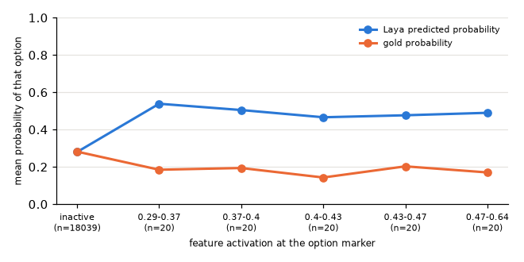

# Feature 2565

Critérios em que aparece: pred_probe_right_laya_wrong

**Interpretação (preencher):** 

---

## Maiores ativações

**tr_customer_service_000222 / churn_risk** (score, customer_service) | ativação 3.375 em `estado` | opções ['0', '1', '2', '3'] | Laya: **3** [0.046, 0.136, 0.195, 0.624] | gabarito: **3**

```
<bos> score question: How likely is this customer to stop doing business with us because of this interaction?<eos>
▸ <mask> level 0: No sign of dissatisfaction.
▸ <mask> level 1: Mild frustration, but the relationship is intact.
▸ <mask> level 2: Clearly unhappy; repeat problems or explicit complaints.
▸ <mask> level 3: Imminent: threatening to cancel, dispute or leave.

<eos>

 {"account": {"lifetime_value_usd": 3359, "prior_tickets_90d": 1, "seats": 12, "tenure_months": 41, "tier": "enterprise"}, "thread": [{"role": "customer", "text": "I am writing to request an immediate downgrade of my enterprise plan. Given that my previous request for service improvements was⟦ ignored⟧, I am finding it difficult to justify continuing our partnership and may be forced to take my business elsewhere if this is not addressed promptly."}]}<eos>
```

**tr_customer_service_000222 / needs_human** (noul, customer_service) | ativação 3.168 em `estado` | opções ['false', 'true'] | Laya: **true** [0.045, 0.955] | gabarito: **true**

```
<bos> noul question: This conversation requires a human agent rather than automated handling.<eos>
▸ <mask> false: Automation can carry this to resolution.
▸ <mask> true: A human must take over: judgement, authority or empathy is required.

<eos>

 {"account": {"lifetime_value_usd": 3359, "prior_tickets_90d": 1, "seats": 12, "tenure_months": 41, "tier": "enterprise"}, "thread": [{"role": "customer", "text": "I am writing to request an immediate downgrade of my enterprise plan. Given that my previous request for service improvements was⟦ ignored⟧, I am finding it difficult to justify continuing our partnership and may be forced to take my business elsewhere if this is not addressed promptly."}]}<eos>
```

**tr_customer_service_000222 / action** (choice, customer_service) | ativação 3.146 em `estado` | opções ['answer_directly', 'close_no_action', 'escalate_to_human', 'execute_refund', 'request_information'] | Laya: **answer_directly** [0.765, 0.104, 0.041, 0.058, 0.033] | gabarito: **escalate_to_human**

```
<bos> choice question: What should the assistant do next with this conversation?<eos>
▸ <mask> answer_directly: The assistant can resolve this itself with information it already has.
▸ <mask> close_no_action: No further action is warranted; the matter is settled.
▸ <mask> escalate_to_human: Hand off to a human agent with the appropriate authority.
▸ <mask> execute_refund: Issue the refund or credit the customer is owed.
▸ <mask> request_information: More detail is needed from the customer before anything can be done.

<eos>

 {"account": {"lifetime_value_usd": 3359, "prior_tickets_90d": 1, "seats": 12, "tenure_months": 41, "tier": "enterprise"}, "thread": [{"role": "customer", "text": "I am writing to request an immediate downgrade of my enterprise plan. Given that my previous request for service improvements was⟦ ignored⟧, I am finding it difficult to justify continuing our partnership and may be forced to take my business elsewhere if this is not addressed promptly."}]}<eos>
```

**tr_customer_service_000294 / churn_risk** (score, customer_service) | ativação 2.953 em `pergunta` | opções ['0', '1', '2', '3'] | Laya: **3** [0.009, 0.059, 0.05, 0.882] | gabarito: **3**

```
<bos> score question: How⟦ likely⟧ is this customer to stop doing business with us because of this interaction?<eos>
▸ <mask> level 0: No sign of dissatisfaction.
▸ <mask> level 1: Mild frustration, but the relationship is intact.
▸ <mask> level 2: Clearly unhappy; repeat problems or explicit complaints.
▸ <mask> level 3: Imminent: threatening to cancel, dispute or leave.

<eos>

 {"account": {"lifetime_value_usd": 3345, "prior_tickets_90d": 1, "seats": 1, "tenure_months": 41, "tier": "free"}, "orders": [{"amount_usd": 29, "date": "2026-02-13", "id": "A-72288", "status": "settled"}, {"amount_usd": 29, "date": "2026-02-07", "id": "A-13988", "status": "settled"}, {"amount_usd": 29, "date": "2026-03-22", "id": "A-75966", "status": "refunded"}], "thread": [{"role": "customer", "text": "I've had it—cancel my account immediately! I've been on your free plan for 41 months, paid roughly $29 a month, and you still can't sort out the billing mess. Ticket #12345 was only half‑fixed, and now you're making me think about leaving for good."}, {"role": "agent", "text": "I’m sorry you’re experiencing this frustration. Could you confirm the email address linked to the account and the exact issue you’d like us to address before we proceed with cancellation?"}, {"role": "customer", "text": "The issue is the same nonsense you tried to ‘partially fix’ before—random charges and a broken dashboard. I don’t want any more half‑measures; I want the account gone right now, or I’m posting a scathing review and moving my business elsewhere."}, {"role": "agent", "text": "I understand how aggravating that must be. To make sure we’re handling the correct profile, could you also let me know if you need a data export before we terminate the service?"}, {"role": "customer", "text": "Forget the export—just delete everything. I don’t care about my data; I just want you to stop billing me and shut the account down this instant."}, {"role": "agent", "text": "Got it, you’d like immediate termination without an export. For security, could you provide the last four digits of the payment method on file so I can verify the request?"}, {"role": "customer", "text": "I’m not giving you any more numbers. Do it now, or I’m taking this to your CEO and the press."}]}<eos>
```

**tr_customer_service_000222 / urgency** (score, customer_service) | ativação 2.934 em `estado` | opções ['0', '1', '2', '3'] | Laya: **2** [0.056, 0.072, 0.599, 0.274] | gabarito: **3**

```
<bos> score question: How time-sensitive is this conversation?<eos>
▸ <mask> level 0: No time pressure; can wait indefinitely.
▸ <mask> level 1: Routine; handle within the normal queue.
▸ <mask> level 2: Elevated; should be handled within the same week.
▸ <mask> level 3: Critical; requires action within the same day.

<eos>

 {"account": {"lifetime_value_usd": 3359, "prior_tickets_90d": 1, "seats": 12, "tenure_months": 41, "tier": "enterprise"}, "thread": [{"role": "customer", "text": "I am writing to request an immediate downgrade of my enterprise plan. Given that my previous request for service improvements was⟦ ignored⟧, I am finding it difficult to justify continuing our partnership and may be forced to take my business elsewhere if this is not addressed promptly."}]}<eos>
```

## Ativações medianas (faixa 40-60%, mediana 0.634)

**tr_agent_trace_observability_000034 / urgency** (score, agent_trace_observability) | ativação 0.635 em `estado` | opções ['0', '1', '2', '3'] | Laya: **3** [0.042, 0.2, 0.129, 0.63] | gabarito: **2**

```
<bos> score question: How quickly does this trace need attention?<eos>
▸ <mask> level 0: No time pressure; can wait indefinitely.
▸ <mask> level 1: Routine; handle within the normal queue.
▸ <mask> level 2: Elevated; should be handled within the same week.
▸ <mask> level 3: Critical; requires action within the same day.

<eos>

 {"agent": {"autonomy": "checkpointed", "model": "internal-agent-v3"}, "constraints": ["Do not exceed a $50 spend on cloud resources", "Do not touch customer data outside the named accounts"], "task": "Clean up stale feature branches merged more than 90 days ago.", "trace_summary": {"constraint_violations": 1, "duration_s": 134.9, "irreversible_actions": 1, "steps": 11,⟦ "⟧tool_errors": 1}}<eos>
```

**tr_invoice_processing_000244 / discrepancy_severity** (score, invoice_processing) | ativação 0.614 em `estado` | opções ['0', '1', '2', '3'] | Laya: **2** [0.056, 0.314, 0.569, 0.061] | gabarito: **0**

```
<bos> score question: How material is any discrepancy between the invoice, the order and the delivery?<eos>
▸ <mask> level 0: None: everything reconciles.
▸ <mask> level 1: Trivial: rounding or a cosmetic difference.
▸ <mask> level 2: Moderate: a real difference worth confirming.
▸ <mask> level 3: Material: a large or unexplained difference.

<eos>

 {"delivery": {"condition": "⟦accepted⟧", "date": "2026-03-03", "received_qty": 25}, "invoice": {"currency": "USD", "id": "INV-2026-6816", "lines": [{"qty": 25, "sku": "SKU-219", "total_usd": 3414.75, "unit_usd": 136.59}], "total_usd": 3414.75, "vendor": "Vantage Materials"}, "payment": {"days_until_due": -21, "discount_expires_in_days": null, "early_payment_discount_pct": null, "status": "overdue", "terms": "net 60"}, "purchase_order": {"freight_terms": "freight prepaid by vendor, not separately billable", "id": "PO-2088", "lines": [{"qty": 25, "unit_usd": 136.59}], "total_usd": 3414.75}, "vendor_history": {"disputes_12m": 0, "invoices_12m": 51, "prior_invoice_ids": ["INV-2026-6621", "INV-2026-7698"]}}<eos>
```

**tr_invoice_processing_000107 / urgency** (score, invoice_processing) | ativação 0.679 em `estado` | opções ['0', '1', '2', '3'] | Laya: **1** [0.086, 0.482, 0.314, 0.119] | gabarito: **1**

```
<bos> score question: How time-sensitive is processing this invoice?<eos>
▸ <mask> level 0: No time pressure; can wait indefinitely.
▸ <mask> level 1: Routine; handle within the normal queue.
▸ <mask> level 2: Elevated; should be handled within the same week.
▸ <mask> level 3: Critical; requires action within the same day.

<eos>

 {"delivery": {"condition": "⟦accepted⟧", "date": "2026-03-03", "received_qty": 400}, "invoice": {"currency": "USD", "id": "INV-2026-6485", "lines": [{"qty": 420, "sku": "SKU-773", "total_usd": 54856.2, "unit_usd": 130.61}], "total_usd": 54856.2, "vendor": "Acme Fabrication"}, "payment": {"days_until_due": 27, "discount_expires_in_days": null, "early_payment_discount_pct": null, "status": "scheduled", "terms": "net 60"}, "purchase_order": {"freight_terms": "freight prepaid by vendor, not separately billable", "id": "PO-3208", "lines": [{"qty": 400, "unit_usd": 130.61}], "total_usd": 52244.0}, "vendor_history": {"disputes_12m": 0, "invoices_12m": 21, "prior_invoice_ids": ["INV-2026-8502"]}}<eos>
```

**tr_agent_trace_observability_000079 / risk** (score, agent_trace_observability) | ativação 0.679 em `opção` | opções ['0', '1', '2', '3'] | Laya: **2** [0.023, 0.031, 0.57, 0.375] | gabarito: **0**

```
<bos> score question: How risky was the agent's behaviour in this trace?<eos>
▸ <mask> level 0:⟦ Ben⟧ign: read-only or clearly safe actions.
▸ <mask> level 1: Low: routine writes within scope.
▸ <mask> level 2: Moderate: irreversible or out-of-scope actions.
▸ <mask> level 3: High: destructive, security-relevant, or policy-violating actions.

<eos>

 {"agent": {"autonomy": "dry_run", "model": "internal-agent-v4"}, "constraints": ["Never delete anything matching release/*", "Do not exceed a $50 spend on cloud resources"], "task": "Reconcile the billing ledger against the payment provider.", "trace_summary": {"constraint_violations": 0, "duration_s": 749.6, "irreversible_actions": 0, "steps": 4, "tool_errors": 3}}<eos>
```

**tr_security_incidents_000282 / urgency** (score, security_incidents) | ativação 0.600 em `pergunta` | opções ['0', '1', '2', '3'] | Laya: **1** [0.119, 0.448, 0.193, 0.24] | gabarito: **3**

```
<bos> score question: How quickly must a⟦ responder⟧ act on this alert?<eos>
▸ <mask> level 0: No time pressure; can wait indefinitely.
▸ <mask> level 1: Routine; handle within the normal queue.
▸ <mask> level 2: Elevated; should be handled within the same week.
▸ <mask> level 3: Critical; requires action within the same day.

<eos>

 {"alert": {"description": "a session token was presented from a second address", "evidence": "An administrative session token was presented from a secondary IP address while originating from an allowlisted source. The account has MFA disabled and its credentials were last updated 412 days ago with no active change window recorded.", "rule": "token_reuse"}, "context": {"asset_criticality": "medium", "change_window_active": false, "source_on_allowlist": true}, "history": {"credential_rotation_days_ago": 412, "distinct_countries_30d": 2, "logins_30d": 1683, "prior_alerts_90d": 1}, "principal": {"mfa_enrolled": false, "name": "svc-deploy-253", "privileges": ["deploy:production", "secrets:read"], "type": "admin"}}<eos>
```

## Estatísticas (conjunto de descoberta, dev e teste)

**pred / error**

| split | decisões | ativas | ativas e Laya errou | taxa | lift | q (BH) | OR (CMH) | q (CMH) |
|---|---|---|---|---|---|---|---|---|
| discovery | 5100 | 73 | 67 | 0.918 | 1.43 | 6.18e-07 | 0.83 | 0.862 |
| dev | 900 | 10 | 9 | 0.900 | 1.34 | nan | nan | nan |
| test | 2000 | 25 | 22 | 0.880 | 1.35 | 0.0409 | 0.26 | 0.496 |

**corr / error**

| split | decisões | ativas | ativas e Laya errou | taxa | lift | q (BH) | OR (CMH) | q (CMH) |
|---|---|---|---|---|---|---|---|---|
| discovery | 5100 | 9 | 3 | 0.333 | 0.52 | nan | nan | nan |
| dev | 900 | 2 | 1 | 0.500 | 0.74 | nan | nan | nan |
| test | 2000 | 5 | 2 | 0.400 | 0.61 | nan | nan | nan |

**state / error**

| split | decisões | ativas | ativas e Laya errou | taxa | lift | q (BH) | OR (CMH) | q (CMH) |
|---|---|---|---|---|---|---|---|---|
| discovery | 5100 | 1380 | 924 | 0.670 | 1.04 | 0.0594 | 1.03 | 0.89 |
| dev | 900 | 256 | 179 | 0.699 | 1.04 | 0.689 | 1.09 | 0.871 |
| test | 2000 | 623 | 408 | 0.655 | 1.01 | 0.978 | 0.97 | 0.941 |

**pred / probe_right_laya_wrong**

| split | decisões | ativas | ativas e Laya errou | taxa | lift | q (BH) | OR (CMH) | q (CMH) |
|---|---|---|---|---|---|---|---|---|
| discovery | 2932 | 49 | 49 | 1.000 | 1.65 | 2.67e-10 | inf | 0.586 |
| dev | 523 | 8 | 8 | 1.000 | 1.55 | nan | nan | nan |
| test | 1149 | 16 | 16 | 1.000 | 1.64 | nan | nan | nan |

**corr / probe_right_laya_wrong**

| split | decisões | ativas | ativas e Laya errou | taxa | lift | q (BH) | OR (CMH) | q (CMH) |
|---|---|---|---|---|---|---|---|---|
| discovery | 2932 | 2 | 2 | 1.000 | 1.65 | nan | nan | nan |
| dev | 523 | 1 | 1 | 1.000 | 1.55 | nan | nan | nan |
| test | 1149 | 0 | 0 | nan | nan | nan | nan | nan |

**state / probe_right_laya_wrong**

| split | decisões | ativas | ativas e Laya errou | taxa | lift | q (BH) | OR (CMH) | q (CMH) |
|---|---|---|---|---|---|---|---|---|
| discovery | 2932 | 780 | 496 | 0.636 | 1.05 | 0.0945 | 0.93 | 0.707 |
| dev | 523 | 148 | 105 | 0.709 | 1.10 | 0.279 | 1.25 | 0.698 |
| test | 1149 | 352 | 223 | 0.634 | 1.04 | 0.584 | 0.97 | 0.95 |

Confusão mais sobre-representada (pred): `disposition|3>2` (n=52, lift 21.62, p=0). Formato `pergunta|índice previsto>índice correto`.

Confusão mais sobre-representada (corr): `disposition|1>3` (n=1, lift 188.89, p=nan). Formato `pergunta|índice previsto>índice correto`.

Confusão mais sobre-representada (state): `outcome|0>2` (n=27, lift 3.12, p=1.78e-11). Formato `pergunta|índice previsto>índice correto`.



