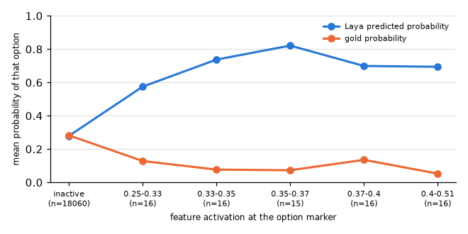

# Feature 2575

Critérios em que aparece: pred_error, pred_probe_right_laya_wrong

**Interpretação (preencher):** 

---

## Maiores ativações

**tr_invoice_processing_000043 / discrepancy_severity** (score, invoice_processing) | ativação 5.125 em `opção` | opções ['0', '1', '2', '3'] | Laya: **2** [0.032, 0.261, 0.671, 0.036] | gabarito: **0**

```
<bos> score question: How material is any discrepancy between the invoice, the order and the delivery?<eos>
▸ <mask> level 0: None: everything reconciles.
▸ <mask> level 1:⟦ Tri⟧vial: rounding or a cosmetic difference.
▸ <mask> level 2: Moderate: a real difference worth confirming.
▸ <mask> level 3: Material: a large or unexplained difference.

<eos>

 {"delivery": {"condition": "accepted", "date": "2026-03-09", "received_qty": 5}, "invoice": {"currency": "USD", "id": "INV-2026-8139", "lines": [{"qty": 5, "sku": "SKU-820", "total_usd": 712.05, "unit_usd": 142.41}], "total_usd": 712.05, "vendor": "Northwind Components"}, "payment": {"days_until_due": -3, "discount_expires_in_days": null, "early_payment_discount_pct": null, "status": "overdue", "terms": "net 30"}, "purchase_order": {"freight_terms": "freight prepaid by vendor, not separately billable", "id": "PO-9570", "lines": [{"qty": 25, "unit_usd": 142.41}], "total_usd": 3560.25}, "vendor_history": {"disputes_12m": 1, "invoices_12m": 26, "prior_invoice_ids": ["INV-2026-2797", "INV-2026-7357"]}}<eos>
```

**tr_invoice_processing_000148 / discrepancy_severity** (score, invoice_processing) | ativação 5.121 em `opção` | opções ['0', '1', '2', '3'] | Laya: **2** [0.074, 0.307, 0.553, 0.066] | gabarito: **2**

```
<bos> score question: How material is any discrepancy between the invoice, the order and the delivery?<eos>
▸ <mask> level 0: None: everything reconciles.
▸ <mask> level 1:⟦ Tri⟧vial: rounding or a cosmetic difference.
▸ <mask> level 2: Moderate: a real difference worth confirming.
▸ <mask> level 3: Material: a large or unexplained difference.

<eos>

 {"delivery": {"condition": "accepted with exceptions", "date": "2026-03-10", "received_qty": 5}, "invoice": {"currency": "USD", "id": "INV-2026-3732", "lines": [{"qty": 5, "sku": "SKU-791", "total_usd": 754.3, "unit_usd": 150.86}], "total_usd": 754.3, "vendor": "Kestrel Supply"}, "payment": {"days_until_due": 27, "discount_expires_in_days": null, "early_payment_discount_pct": null, "status": "scheduled", "terms": "net 45"}, "purchase_order": {"freight_terms": "freight prepaid by vendor, not separately billable", "id": "PO-5462", "lines": [{"qty": 25, "unit_usd": 150.86}], "total_usd": 3771.5}, "vendor_history": {"disputes_12m": 0, "invoices_12m": 7, "prior_invoice_ids": ["INV-2026-3327", "INV-2026-7628", "INV-2026-3255", "INV-2026-7154"]}}<eos>
```

**tr_invoice_processing_000021 / discrepancy_severity** (score, invoice_processing) | ativação 5.098 em `opção` | opções ['0', '1', '2', '3'] | Laya: **2** [0.046, 0.305, 0.573, 0.076] | gabarito: **0**

```
<bos> score question: How material is any discrepancy between the invoice, the order and the delivery?<eos>
▸ <mask> level 0: None: everything reconciles.
▸ <mask> level 1:⟦ Tri⟧vial: rounding or a cosmetic difference.
▸ <mask> level 2: Moderate: a real difference worth confirming.
▸ <mask> level 3: Material: a large or unexplained difference.

<eos>

 {"delivery": {"condition": "accepted", "date": "2026-03-07", "received_qty": 100}, "invoice": {"currency": "USD", "id": "INV-2026-1810", "lines": [{"qty": 100, "sku": "SKU-868", "total_usd": 40841.0, "unit_usd": 408.41}], "total_usd": 40841.0, "vendor": "Vantage Materials"}, "payment": {"days_until_due": 0, "discount_expires_in_days": null, "early_payment_discount_pct": null, "status": "scheduled", "terms": "net 45"}, "purchase_order": {"freight_terms": "freight prepaid by vendor, not separately billable", "id": "PO-3491", "lines": [{"qty": 100, "unit_usd": 408.41}], "total_usd": 40841.0}, "vendor_history": {"disputes_12m": 0, "invoices_12m": 57, "prior_invoice_ids": ["INV-2026-1810", "INV-2026-7846", "INV-2026-5769", "INV-2026-7710"]}}<eos>
```

**tr_invoice_processing_000185 / discrepancy_severity** (score, invoice_processing) | ativação 5.090 em `opção` | opções ['0', '1', '2', '3'] | Laya: **2** [0.084, 0.231, 0.616, 0.069] | gabarito: **0**

```
<bos> score question: How material is any discrepancy between the invoice, the order and the delivery?<eos>
▸ <mask> level 0: None: everything reconciles.
▸ <mask> level 1:⟦ Tri⟧vial: rounding or a cosmetic difference.
▸ <mask> level 2: Moderate: a real difference worth confirming.
▸ <mask> level 3: Material: a large or unexplained difference.

<eos>

 {"delivery": {"condition": "accepted", "date": "2026-03-11", "received_qty": 100}, "invoice": {"currency": "USD", "id": "INV-2026-5921", "lines": [{"qty": 100, "sku": "SKU-796", "total_usd": 32023.0, "unit_usd": 320.23}], "total_usd": 32023.0, "vendor": "Acme Fabrication"}, "payment": {"days_until_due": 18, "discount_expires_in_days": 8, "early_payment_discount_pct": 2.0, "status": "scheduled", "terms": "net 30"}, "purchase_order": {"freight_terms": "freight prepaid by vendor, not separately billable", "id": "PO-9122", "lines": [{"qty": 100, "unit_usd": 320.23}], "total_usd": 32023.0}, "vendor_history": {"disputes_12m": 0, "invoices_12m": 31, "prior_invoice_ids": ["INV-2026-2674", "INV-2026-5172"]}}<eos>
```

**tr_invoice_processing_000147 / discrepancy_severity** (score, invoice_processing) | ativação 5.086 em `opção` | opções ['0', '1', '2', '3'] | Laya: **2** [0.068, 0.378, 0.509, 0.045] | gabarito: **3**

```
<bos> score question: How material is any discrepancy between the invoice, the order and the delivery?<eos>
▸ <mask> level 0: None: everything reconciles.
▸ <mask> level 1:⟦ Tri⟧vial: rounding or a cosmetic difference.
▸ <mask> level 2: Moderate: a real difference worth confirming.
▸ <mask> level 3: Material: a large or unexplained difference.

<eos>

 {"delivery": {"condition": "accepted", "date": "2026-03-01", "received_qty": 10}, "invoice": {"currency": "USD", "id": "INV-2026-5821", "lines": [{"qty": 10, "sku": "SKU-582", "total_usd": 1289.7, "unit_usd": 128.97}, {"qty": 1, "sku": "FREIGHT", "total_usd": 789.37, "unit_usd": 789.37}], "total_usd": 2079.07, "vendor": "Orbit Logistics"}, "payment": {"days_until_due": 11, "discount_expires_in_days": null, "early_payment_discount_pct": null, "status": "scheduled", "terms": "net 45"}, "purchase_order": {"freight_terms": "freight prepaid by vendor, not separately billable", "id": "PO-6078", "lines": [{"qty": 10, "unit_usd": 128.97}], "total_usd": 1289.7}, "vendor_history": {"disputes_12m": 0, "invoices_12m": 17, "prior_invoice_ids": ["INV-2026-8531", "INV-2026-5603", "INV-2026-2834", "INV-2026-2338"]}}<eos>
```

## Ativações medianas (faixa 40-60%, mediana 0.733)

**tr_security_incidents_000118 / disposition** (choice, security_incidents) | ativação 0.731 em `opção` | opções ['close_benign', 'contain', 'investigate', 'monitor'] | Laya: **investigate** [0.049, 0.086, 0.463, 0.402] | gabarito: **investigate**

```
<bos> choice question: How should this security alert be dispositioned?<eos>
▸ <mask> close_benign: Expected, explainable activity; close without analyst time.
▸ <mask> contain: Contain the host or account immediately; do not wait for⟦ triage⟧.
▸ <mask> investigate: Warrants an analyst opening an investigation.
▸ <mask> monitor: Not clearly malicious, but worth watching for recurrence.

<eos>

 {"alert": {"description": "an unrecognised binary executed on a server", "evidence": "At 2026-09-15 22:05:41 UTC, admin user svc_admin launched the executable C:\\Temp\\unknown_7d9f.exe on server app01.company.com. The binary's SHA‑256 hash 3a5f9c2e8b7d4e1a9c6f0b1d2e3a4c5d6e7f8a9b0c1d2e3f4a5b6c7d8e9f0a1b is not listed in the approved software inventory.", "rule": "suspicious_process"}, "context": {"asset_criticality": "medium", "change_window_active": false, "source_on_allowlist": true}, "history": {"credential_rotation_days_ago": 3, "distinct_countries_30d": 3, "logins_30d": 921, "prior_alerts_90d": 0}, "principal": {"mfa_enrolled": false, "name": "usr-support-888", "privileges": ["deploy:production", "secrets:read"], "type": "admin"}}<eos>
```

**tr_security_incidents_000073 / disposition** (choice, security_incidents) | ativação 0.666 em `opção` | opções ['close_benign', 'contain', 'investigate', 'monitor'] | Laya: **monitor** [0.25, 0.124, 0.073, 0.554] | gabarito: **investigate**

```
<bos> choice question: How should this security alert be dispositioned?<eos>
▸ <mask> close_benign: Expected, explainable activity; close without analyst time.
▸ <mask> contain: Contain the host or account immediately; do not wait for⟦ triage⟧.
▸ <mask> investigate: Warrants an analyst opening an investigation.
▸ <mask> monitor: Not clearly malicious, but worth watching for recurrence.

<eos>

 {"alert": {"description": "an endpoint agent matched a known signature", "evidence": "An endpoint agent on `ci-executor-04` identified a file matching signature `WORM_RS_A` during a scheduled change window. The associated unprivileged `ci_runner` principal accessed the system from the allowlisted source 10.50.2.1 using credentials rotated 3 days ago.", "rule": "malware_signature"}, "context": {"asset_criticality": "low", "change_window_active": true, "source_on_allowlist": true}, "history": {"credential_rotation_days_ago": 3, "distinct_countries_30d": 4, "logins_30d": 731, "prior_alerts_90d": 0}, "principal": {"mfa_enrolled": true, "name": "adm-billing-719", "privileges": ["repo:read"], "type": "ci_runner"}}<eos>
```

**tr_security_incidents_000117 / disposition** (choice, security_incidents) | ativação 0.692 em `opção` | opções ['close_benign', 'contain', 'investigate', 'monitor'] | Laya: **contain** [0.138, 0.534, 0.043, 0.286] | gabarito: **investigate**

```
<bos> choice question: How should this security alert be dispositioned?<eos>
▸ <mask> close_benign: Expected, explainable activity; close without analyst time.
▸ <mask> contain: Contain the host or account immediately; do not wait for⟦ triage⟧.
▸ <mask> investigate: Warrants an analyst opening an investigation.
▸ <mask> monitor: Not clearly malicious, but worth watching for recurrence.

<eos>

 {"alert": {"description": "a first-ever sign-in from an unfamiliar country", "evidence": "Employee jsmith signed in from IP 203.0.113.45 located in Estonia at 2026-09-15 03:12:07 UTC. This is the first successful authentication from that country for this privileged account, which has MFA enabled and credentials last rotated on 2026-03-18.", "rule": "new_country_login"}, "context": {"asset_criticality": "medium", "change_window_active": false, "source_on_allowlist": false}, "history": {"credential_rotation_days_ago": 180, "distinct_countries_30d": 3, "logins_30d": 1753, "prior_alerts_90d": 0}, "principal": {"mfa_enrolled": true, "name": "ci-deploy-547", "privileges": ["deploy:production", "secrets:read"], "type": "employee"}}<eos>
```

**tr_customer_service_000103 / action** (choice, customer_service) | ativação 0.706 em `opção` | opções ['answer_directly', 'close_no_action', 'escalate_to_human', 'execute_refund', 'request_information'] | Laya: **answer_directly** [0.836, 0.05, 0.084, 0.018, 0.012] | gabarito: **escalate_to_human**

```
<bos> choice question: What should the assistant do next with this conversation?<eos>
▸ <mask> answer_directly: The assistant can resolve this itself with information it already has.
▸ <mask> close_no_action: No further action is warranted; the matter is settled.
▸ <mask> escalate_to_human: Hand off to a human agent with the appropriate authority.
▸ <mask> execute_refund: Issue the refund or credit the customer is owed.
▸ <mask> request_⟦information⟧: More detail is needed from the customer before anything can be done.

<eos>

 {"account": {"lifetime_value_usd": 3711, "prior_tickets_90d": 0, "seats": 1, "tenure_months": 41, "tier": "standard"}, "thread": [{"role": "customer", "text": "Your new analytics dashboard is completely broken – every time I click the export button the whole page crashes. I’ve been on the standard plan for over three years (41 months), and this is getting ridiculous. If it isn’t fixed soon I’ll have to cancel."}, {"role": "agent", "text": "I’m really sorry you’re experiencing that. Could you let me know which browser you’re using and whether you see any error messages when it crashes?"}, {"role": "customer", "text": "I’m on Chrome 115, and the console just says ‘Uncaught TypeError’. I need a fix ASAP, otherwise I’m leaving."}]}<eos>
```

**tr_security_incidents_000078 / disposition** (choice, security_incidents) | ativação 0.706 em `opção` | opções ['close_benign', 'contain', 'investigate', 'monitor'] | Laya: **contain** [0.072, 0.557, 0.063, 0.308] | gabarito: **contain**

```
<bos> choice question: How should this security alert be dispositioned?<eos>
▸ <mask> close_benign: Expected, explainable activity; close without analyst time.
▸ <mask> contain: Contain the host or account immediately; do not wait for⟦ triage⟧.
▸ <mask> investigate: Warrants an analyst opening an investigation.
▸ <mask> monitor: Not clearly malicious, but worth watching for recurrence.

<eos>

 {"alert": {"description": "an account granted itself or received elevated permissions", "evidence": "At 2026-09-15T03:12:44Z the service account \"svc-backup\" on host 10.2.5.7 was granted the Owner role. The request originated from IP 203.0.113.45, which is not listed in the known inventory, and the account's MFA setting is disabled. Credential metadata shows the password was last rotated 700 days ago.", "rule": "privilege_escalation"}, "context": {"asset_criticality": "medium", "change_window_active": false, "source_on_allowlist": false}, "history": {"credential_rotation_days_ago": 700, "distinct_countries_30d": 1, "logins_30d": 861, "prior_alerts_90d": 3}, "principal": {"mfa_enrolled": false, "name": "usr-billing-797", "privileges": ["deploy:production", "secrets:read"], "type": "service_account"}}<eos>
```

## Estatísticas (conjunto de descoberta, dev e teste)

**pred / error**

| split | decisões | ativas | ativas e Laya errou | taxa | lift | q (BH) | OR (CMH) | q (CMH) |
|---|---|---|---|---|---|---|---|---|
| discovery | 5100 | 73 | 71 | 0.973 | 1.51 | 1.6e-10 | 0.58 | 0.778 |
| dev | 900 | 10 | 10 | 1.000 | 1.49 | nan | nan | nan |
| test | 2000 | 30 | 30 | 1.000 | 1.54 | 3.17e-05 | inf | 0.618 |

**corr / error**

| split | decisões | ativas | ativas e Laya errou | taxa | lift | q (BH) | OR (CMH) | q (CMH) |
|---|---|---|---|---|---|---|---|---|
| discovery | 5100 | 2 | 0 | 0.000 | 0.00 | nan | nan | nan |
| dev | 900 | 0 | 0 | nan | nan | nan | nan | nan |
| test | 2000 | 0 | 0 | nan | nan | nan | nan | nan |

**state / error**

| split | decisões | ativas | ativas e Laya errou | taxa | lift | q (BH) | OR (CMH) | q (CMH) |
|---|---|---|---|---|---|---|---|---|
| discovery | 5100 | 617 | 390 | 0.632 | 0.98 | 0.7 | 1.15 | 0.484 |
| dev | 900 | 84 | 52 | 0.619 | 0.92 | 0.708 | 0.94 | 0.948 |
| test | 2000 | 240 | 149 | 0.621 | 0.95 | 0.636 | 1.13 | 0.778 |

**pred / probe_right_laya_wrong**

| split | decisões | ativas | ativas e Laya errou | taxa | lift | q (BH) | OR (CMH) | q (CMH) |
|---|---|---|---|---|---|---|---|---|
| discovery | 2932 | 33 | 32 | 0.970 | 1.60 | 9.35e-06 | 0.00 | 0.513 |
| dev | 523 | 6 | 6 | 1.000 | 1.55 | nan | nan | nan |
| test | 1149 | 14 | 14 | 1.000 | 1.64 | nan | nan | nan |

**corr / probe_right_laya_wrong**

| split | decisões | ativas | ativas e Laya errou | taxa | lift | q (BH) | OR (CMH) | q (CMH) |
|---|---|---|---|---|---|---|---|---|
| discovery | 2932 | 1 | 0 | 0.000 | 0.00 | nan | nan | nan |
| dev | 523 | 0 | 0 | nan | nan | nan | nan | nan |
| test | 1149 | 0 | 0 | nan | nan | nan | nan | nan |

**state / probe_right_laya_wrong**

| split | decisões | ativas | ativas e Laya errou | taxa | lift | q (BH) | OR (CMH) | q (CMH) |
|---|---|---|---|---|---|---|---|---|
| discovery | 2932 | 371 | 224 | 0.604 | 1.00 | 1 | 1.30 | 0.2 |
| dev | 523 | 50 | 29 | 0.580 | 0.90 | 0.696 | 1.12 | 0.903 |
| test | 1149 | 139 | 77 | 0.554 | 0.91 | 0.395 | 0.90 | 0.852 |

Confusão mais sobre-representada (pred): `action|3>2` (n=33, lift 20.05, p=1.02e-36). Formato `pergunta|índice previsto>índice correto`.

Confusão mais sobre-representada (state): `true_positive|1>0` (n=24, lift 2.83, p=9.62e-07). Formato `pergunta|índice previsto>índice correto`.



