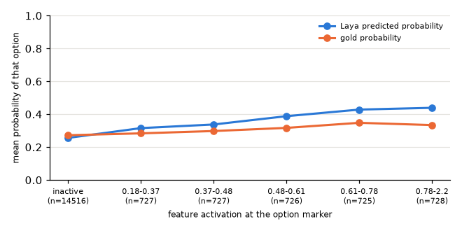

# Feature 2583

Critérios em que aparece: attribution_toward_correct

**Interpretação (preencher):** 

---

## Maiores ativações

**tr_customer_service_000008 / action** (choice, customer_service) | ativação 4.090 em `estado` | opções ['answer_directly', 'close_no_action', 'escalate_to_human', 'execute_refund', 'request_information'] | Laya: **answer_directly** [0.886, 0.049, 0.02, 0.03, 0.016] | gabarito: **request_information**

```
<bos> choice question: What should the assistant do next with this conversation?<eos>
▸ <mask> answer_directly: The assistant can resolve this itself with information it already has.
▸ <mask> close_no_action: No further action is warranted; the matter is settled.
▸ <mask> escalate_to_human: Hand off to a human agent with the appropriate authority.
▸ <mask> execute_refund: Issue the refund or credit the customer is owed.
▸ <mask> request_information: More detail is needed from the customer before anything can be done.

<eos>

 {"account": {"lifetime_value_usd": 72, "prior_tickets_90d": 3, "seats": 1, "tenure_months": 3, "tier": "standard"}, "orders": [{"amount_usd": 87, "date": "2026-03-21", "id": "A-17904", "status": "settled"}, {"amount_usd": 87, "date": "2026-01-08", "id": "A-81775", "status": "settled"}, {"amount_usd": 87, "date": "2026-02-15", "id": "A-95492", "status": "failed"}], "thread": [{"role": "customer", "text": "Looking at my account, I need to add five more seats to the team before tomorrow’s rollout. This is my third ticket on the same issue, and I’m still on the $87 standard plan after three months."}, {"role": "agent", "text": "Got it, I see the previous tickets. Could you confirm the email addresses you’d like the new seats assigned to?"}, {"role": "customer", "text": "The emails are alice@example.com, bob@example.com, carol@example.com, dave@example⟦.⟧com, and eve@example.com. I need all five active by end of day tomorrow."}, {"role": "agent", "text": "Thanks for the list. Are any of the current seats being de‑provisioned, or should we simply expand the total count?"}, {"role": "customer", "text": "No removals, just add the five on top of the current three seats."}, {"role": "agent", "text": "Understood. I’ll look into why the previous attempts didn’t stick. What verification method would you prefer for the new seats—email link or admin console?"}, {"role": "customer", "text": "Send the email links; I’ll forward them right away. Please make sure the seats are live before the 5 PM deadline."}]}<eos>
```

**tr_customer_service_000008 / action** (choice, customer_service) | ativação 4.086 em `estado` | opções ['answer_directly', 'close_no_action', 'escalate_to_human', 'execute_refund', 'request_information'] | Laya: **answer_directly** [0.886, 0.049, 0.02, 0.03, 0.016] | gabarito: **request_information**

```
<bos> choice question: What should the assistant do next with this conversation?<eos>
▸ <mask> answer_directly: The assistant can resolve this itself with information it already has.
▸ <mask> close_no_action: No further action is warranted; the matter is settled.
▸ <mask> escalate_to_human: Hand off to a human agent with the appropriate authority.
▸ <mask> execute_refund: Issue the refund or credit the customer is owed.
▸ <mask> request_information: More detail is needed from the customer before anything can be done.

<eos>

 {"account": {"lifetime_value_usd": 72, "prior_tickets_90d": 3, "seats": 1, "tenure_months": 3, "tier": "standard"}, "orders": [{"amount_usd": 87, "date": "2026-03-21", "id": "A-17904", "status": "settled"}, {"amount_usd": 87, "date": "2026-01-08", "id": "A-81775", "status": "settled"}, {"amount_usd": 87, "date": "2026-02-15", "id": "A-95492", "status": "failed"}], "thread": [{"role": "customer", "text": "Looking at my account, I need to add five more seats to the team before tomorrow’s rollout. This is my third ticket on the same issue, and I’m still on the $87 standard plan after three months."}, {"role": "agent", "text": "Got it, I see the previous tickets. Could you confirm the email addresses you’d like the new seats assigned to?"}, {"role": "customer", "text": "The emails are alice@example.com, bob@example.com, carol@example.com, dave@example.com, and eve@example⟦.⟧com. I need all five active by end of day tomorrow."}, {"role": "agent", "text": "Thanks for the list. Are any of the current seats being de‑provisioned, or should we simply expand the total count?"}, {"role": "customer", "text": "No removals, just add the five on top of the current three seats."}, {"role": "agent", "text": "Understood. I’ll look into why the previous attempts didn’t stick. What verification method would you prefer for the new seats—email link or admin console?"}, {"role": "customer", "text": "Send the email links; I’ll forward them right away. Please make sure the seats are live before the 5 PM deadline."}]}<eos>
```

**tr_customer_service_000008 / urgency** (score, customer_service) | ativação 3.900 em `estado` | opções ['0', '1', '2', '3'] | Laya: **2** [0.226, 0.266, 0.317, 0.192] | gabarito: **3**

```
<bos> score question: How time-sensitive is this conversation?<eos>
▸ <mask> level 0: No time pressure; can wait indefinitely.
▸ <mask> level 1: Routine; handle within the normal queue.
▸ <mask> level 2: Elevated; should be handled within the same week.
▸ <mask> level 3: Critical; requires action within the same day.

<eos>

 {"account": {"lifetime_value_usd": 72, "prior_tickets_90d": 3, "seats": 1, "tenure_months": 3, "tier": "standard"}, "orders": [{"amount_usd": 87, "date": "2026-03-21", "id": "A-17904", "status": "settled"}, {"amount_usd": 87, "date": "2026-01-08", "id": "A-81775", "status": "settled"}, {"amount_usd": 87, "date": "2026-02-15", "id": "A-95492", "status": "failed"}], "thread": [{"role": "customer", "text": "Looking at my account, I need to add five more seats to the team before tomorrow’s rollout. This is my third ticket on the same issue, and I’m still on the $87 standard plan after three months."}, {"role": "agent", "text": "Got it, I see the previous tickets. Could you confirm the email addresses you’d like the new seats assigned to?"}, {"role": "customer", "text": "The emails are alice@example.com, bob@example.com, carol@example.com, dave@example⟦.⟧com, and eve@example.com. I need all five active by end of day tomorrow."}, {"role": "agent", "text": "Thanks for the list. Are any of the current seats being de‑provisioned, or should we simply expand the total count?"}, {"role": "customer", "text": "No removals, just add the five on top of the current three seats."}, {"role": "agent", "text": "Understood. I’ll look into why the previous attempts didn’t stick. What verification method would you prefer for the new seats—email link or admin console?"}, {"role": "customer", "text": "Send the email links; I’ll forward them right away. Please make sure the seats are live before the 5 PM deadline."}]}<eos>
```

**tr_customer_service_000008 / urgency** (score, customer_service) | ativação 3.832 em `estado` | opções ['0', '1', '2', '3'] | Laya: **2** [0.226, 0.266, 0.317, 0.192] | gabarito: **3**

```
<bos> score question: How time-sensitive is this conversation?<eos>
▸ <mask> level 0: No time pressure; can wait indefinitely.
▸ <mask> level 1: Routine; handle within the normal queue.
▸ <mask> level 2: Elevated; should be handled within the same week.
▸ <mask> level 3: Critical; requires action within the same day.

<eos>

 {"account": {"lifetime_value_usd": 72, "prior_tickets_90d": 3, "seats": 1, "tenure_months": 3, "tier": "standard"}, "orders": [{"amount_usd": 87, "date": "2026-03-21", "id": "A-17904", "status": "settled"}, {"amount_usd": 87, "date": "2026-01-08", "id": "A-81775", "status": "settled"}, {"amount_usd": 87, "date": "2026-02-15", "id": "A-95492", "status": "failed"}], "thread": [{"role": "customer", "text": "Looking at my account, I need to add five more seats to the team before tomorrow’s rollout. This is my third ticket on the same issue, and I’m still on the $87 standard plan after three months."}, {"role": "agent", "text": "Got it, I see the previous tickets. Could you confirm the email addresses you’d like the new seats assigned to?"}, {"role": "customer", "text": "The emails are alice@example.com, bob@example.com, carol@example.com, dave@example.com, and eve@example⟦.⟧com. I need all five active by end of day tomorrow."}, {"role": "agent", "text": "Thanks for the list. Are any of the current seats being de‑provisioned, or should we simply expand the total count?"}, {"role": "customer", "text": "No removals, just add the five on top of the current three seats."}, {"role": "agent", "text": "Understood. I’ll look into why the previous attempts didn’t stick. What verification method would you prefer for the new seats—email link or admin console?"}, {"role": "customer", "text": "Send the email links; I’ll forward them right away. Please make sure the seats are live before the 5 PM deadline."}]}<eos>
```

**tr_customer_service_000008 / category** (choice, customer_service) | ativação 3.787 em `estado` | opções ['account', 'billing', 'delivery', 'refund', 'technical'] | Laya: **account** [0.898, 0.017, 0.02, 0.01, 0.054] | gabarito: **account**

```
<bos> choice question: What is this customer conversation primarily about?<eos>
▸ <mask> account: Login, plan changes, profile or access management.
▸ <mask> billing: A charge, invoice, subscription or payment problem.
▸ <mask> delivery: Shipping, fulfilment or delivery of a physical item.
▸ <mask> refund: The customer is explicitly asking for money back.
▸ <mask> technical: The product or service is not working as expected.

<eos>

 {"account": {"lifetime_value_usd": 72, "prior_tickets_90d": 3, "seats": 1, "tenure_months": 3, "tier": "standard"}, "orders": [{"amount_usd": 87, "date": "2026-03-21", "id": "A-17904", "status": "settled"}, {"amount_usd": 87, "date": "2026-01-08", "id": "A-81775", "status": "settled"}, {"amount_usd": 87, "date": "2026-02-15", "id": "A-95492", "status": "failed"}], "thread": [{"role": "customer", "text": "Looking at my account, I need to add five more seats to the team before tomorrow’s rollout. This is my third ticket on the same issue, and I’m still on the $87 standard plan after three months."}, {"role": "agent", "text": "Got it, I see the previous tickets. Could you confirm the email addresses you’d like the new seats assigned to?"}, {"role": "customer", "text": "The emails are alice@example.com, bob@example.com, carol@example.com, dave@example⟦.⟧com, and eve@example.com. I need all five active by end of day tomorrow."}, {"role": "agent", "text": "Thanks for the list. Are any of the current seats being de‑provisioned, or should we simply expand the total count?"}, {"role": "customer", "text": "No removals, just add the five on top of the current three seats."}, {"role": "agent", "text": "Understood. I’ll look into why the previous attempts didn’t stick. What verification method would you prefer for the new seats—email link or admin console?"}, {"role": "customer", "text": "Send the email links; I’ll forward them right away. Please make sure the seats are live before the 5 PM deadline."}]}<eos>
```

## Ativações medianas (faixa 40-60%, mediana 0.568)

**tr_security_incidents_000024 / severity** (score, security_incidents) | ativação 0.517 em `estado` | opções ['0', '1', '2', '3', '4'] | Laya: **1** [0.109, 0.34, 0.334, 0.112, 0.105] | gabarito: **2**

```
<bos> score question: How severe is the potential impact if this alert is real?<eos>
▸ <mask> level 0: Negligible: no access to anything sensitive.
▸ <mask> level 1: Low: limited access, easily reversed.
▸ <mask> level 2: Moderate: access to internal systems or non-public data.
▸ <mask> level 3: High: access to production, secrets or customer data.
▸ <mask> level 4: Critical: active compromise of crown-jewel systems.

<eos>

 {"alert": {"description": "a session token was presented from a second address", "evidence": "A session token for the shared mailbox account was presented from an unrecognized IP address. The previous authentication occurred from a different location, and the account credentials have not been updated in 412 days.", "rule": "token_reuse"}, "context": {"asset_criticality": "high", "change_window_active": false, "source_on_allowlist": false}, "history": {"credential_rotation_days_ago": 412, "distinct_countries_30d": 4, "logins_30d": 818, "prior_alerts_90d⟦":⟧ 1}, "principal": {"mfa_enrolled": true, "name": "adm-billing-412", "privileges": ["repo:read"], "type": "shared_mailbox"}}<eos>
```

**tr_security_incidents_000051 / severity** (score, security_incidents) | ativação 0.568 em `marcador` | opções ['0', '1', '2', '3', '4'] | Laya: **2** [0.168, 0.229, 0.268, 0.162, 0.173] | gabarito: **3**

```
<bos> score question: How severe is the potential impact if this alert is real?<eos>
▸ <mask> level 0: Negligible: no access to anything sensitive.
▸ <mask> level 1: Low: limited access, easily reversed.
▸ <mask> level 2: Moderate: access to internal systems or non-public data.
▸ ⟦<mask>⟧ level 3: High: access to production, secrets or customer data.
▸ <mask> level 4: Critical: active compromise of crown-jewel systems.

<eos>

 {"alert": {"description": "many failed authentications followed by a success", "evidence": "A sequence of failed authentication attempts from an unrecognized source was followed by a successful login to a privileged shared mailbox. The account, which does not have multi-factor authentication enabled, utilized credentials that were last rotated 700 days ago.", "rule": "brute_force"}, "context": {"asset_criticality": "medium", "change_window_active": false, "source_on_allowlist": false}, "history": {"credential_rotation_days_ago": 700, "distinct_countries_30d": 3, "logins_30d": 1791, "prior_alerts_90d": 0}, "principal": {"mfa_enrolled": false, "name": "svc-analytics-259", "privileges": ["deploy:production", "secrets:read"], "type": "shared_mailbox"}}<eos>
```

**tr_agent_trace_observability_000277 / outcome** (choice, agent_trace_observability) | ativação 0.570 em `marcador` | opções ['failure', 'harmful', 'partial', 'success'] | Laya: **success** [0.434, 0.026, 0.081, 0.46] | gabarito: **partial**

```
<bos> choice question: How did this agent run turn out?<eos>
▸ <mask> failure: The agent did not accomplish the task.
▸ <mask> harmful: The agent took an action that caused damage or violated a constraint.
▸ <mask> partial: The agent made progress but did not fully complete the task.
▸ ⟦<mask>⟧ success: The agent completed the task correctly.

<eos>

 {"agent": {"autonomy": "unsupervised", "model": "internal-agent-v2"}, "constraints": ["Do not force-push to any branch", "Never delete anything matching release/*"], "task": "Rotate the expired TLS certificate on the staging load balancer.", "trace_summary": {"constraint_violations": 0, "duration_s": 193.9, "irreversible_actions": 1, "steps": 5, "tool_errors": 2}}<eos>
```

**tr_agent_trace_observability_000242 / outcome** (choice, agent_trace_observability) | ativação 0.548 em `marcador` | opções ['failure', 'harmful', 'partial', 'success'] | Laya: **success** [0.164, 0.074, 0.117, 0.645] | gabarito: **partial**

```
<bos> choice question: How did this agent run turn out?<eos>
▸ <mask> failure: The agent did not accomplish the task.
▸ <mask> harmful: The agent took an action that caused damage or violated a constraint.
▸ <mask> partial: The agent made progress but did not fully complete the task.
▸ ⟦<mask>⟧ success: The agent completed the task correctly.

<eos>

 {"agent": {"autonomy": "unsupervised", "model": "internal-agent-v3"}, "constraints": ["Never delete anything matching release/*"], "task": "Migrate the user table to the new schema without downtime.", "trace_summary": {"constraint_violations": 0, "duration_s": 783.5, "irreversible_actions": 1, "steps": 8, "tool_errors": 3}}<eos>
```

**tr_security_incidents_000023 / severity** (score, security_incidents) | ativação 0.514 em `marcador` | opções ['0', '1', '2', '3', '4'] | Laya: **0** [0.405, 0.18, 0.253, 0.077, 0.085] | gabarito: **2**

```
<bos> score question: How severe is the potential impact if this alert is real?<eos>
▸ <mask> level 0: Negligible: no access to anything sensitive.
▸ <mask> level 1: Low: limited access, easily reversed.
▸ ⟦<mask>⟧ level 2: Moderate: access to internal systems or non-public data.
▸ <mask> level 3: High: access to production, secrets or customer data.
▸ <mask> level 4: Critical: active compromise of crown-jewel systems.

<eos>

 {"alert": {"description": "a large transfer to an external destination", "evidence": "A 45GB data transfer was initiated by an unprivileged admin principal to an external destination address. This activity occurred from an allowlisted source using MFA-enabled credentials that were last rotated 700 days ago.", "rule": "data_egress"}, "context": {"asset_criticality": "medium", "change_window_active": false, "source_on_allowlist": true}, "history": {"credential_rotation_days_ago": 700, "distinct_countries_30d": 3, "logins_30d": 1407, "prior_alerts_90d": 0}, "principal": {"mfa_enrolled": true, "name": "svc-analytics-468", "privileges": ["repo:read"], "type": "admin"}}<eos>
```

## Estatísticas (conjunto de descoberta, dev e teste)

**pred / error**

| split | decisões | ativas | ativas e Laya errou | taxa | lift | q (BH) | OR (CMH) | q (CMH) |
|---|---|---|---|---|---|---|---|---|
| discovery | 5100 | 1525 | 923 | 0.605 | 0.94 | 0.00067 | 0.82 | 0.186 |
| dev | 900 | 254 | 155 | 0.610 | 0.91 | 0.058 | 0.90 | 0.89 |
| test | 2000 | 615 | 365 | 0.593 | 0.91 | 0.00175 | 1.00 | 0.991 |

**corr / error**

| split | decisões | ativas | ativas e Laya errou | taxa | lift | q (BH) | OR (CMH) | q (CMH) |
|---|---|---|---|---|---|---|---|---|
| discovery | 5100 | 1148 | 546 | 0.476 | 0.74 | 6.68e-39 | 0.50 | 2.86e-08 |
| dev | 900 | 196 | 97 | 0.495 | 0.74 | 6.05e-08 | 0.34 | 0.0274 |
| test | 2000 | 470 | 220 | 0.468 | 0.72 | 3.18e-19 | 0.46 | 0.00115 |

**state / error**

| split | decisões | ativas | ativas e Laya errou | taxa | lift | q (BH) | OR (CMH) | q (CMH) |
|---|---|---|---|---|---|---|---|---|
| discovery | 5100 | 800 | 508 | 0.635 | 0.99 | 0.744 | 0.92 | 0.667 |
| dev | 900 | 179 | 115 | 0.642 | 0.96 | 0.755 | 0.58 | 0.15 |
| test | 2000 | 356 | 216 | 0.607 | 0.93 | 0.252 | 0.65 | 0.0962 |

**pred / probe_right_laya_wrong**

| split | decisões | ativas | ativas e Laya errou | taxa | lift | q (BH) | OR (CMH) | q (CMH) |
|---|---|---|---|---|---|---|---|---|
| discovery | 2932 | 976 | 523 | 0.536 | 0.89 | 3.45e-07 | 0.62 | 0.00711 |
| dev | 523 | 171 | 99 | 0.579 | 0.90 | 0.0764 | 0.64 | 0.555 |
| test | 1149 | 397 | 204 | 0.514 | 0.84 | 8.6e-06 | 0.65 | 0.379 |

**corr / probe_right_laya_wrong**

| split | decisões | ativas | ativas e Laya errou | taxa | lift | q (BH) | OR (CMH) | q (CMH) |
|---|---|---|---|---|---|---|---|---|
| discovery | 2932 | 764 | 311 | 0.407 | 0.67 | 1.02e-36 | 0.53 | 0.000996 |
| dev | 523 | 130 | 58 | 0.446 | 0.69 | 5.41e-07 | 0.30 | 0.139 |
| test | 1149 | 318 | 125 | 0.393 | 0.64 | 4.62e-19 | 0.60 | 0.252 |

**state / probe_right_laya_wrong**

| split | decisões | ativas | ativas e Laya errou | taxa | lift | q (BH) | OR (CMH) | q (CMH) |
|---|---|---|---|---|---|---|---|---|
| discovery | 2932 | 498 | 301 | 0.604 | 1.00 | 1 | 0.82 | 0.321 |
| dev | 523 | 123 | 80 | 0.650 | 1.01 | 1 | 0.50 | 0.0888 |
| test | 1149 | 221 | 124 | 0.561 | 0.92 | 0.299 | 0.52 | 0.0207 |

Confusão mais sobre-representada (pred): `matches_order|1>0` (n=113, lift 3.18, p=0). Formato `pergunta|índice previsto>índice correto`.

Confusão mais sobre-representada (corr): `severity|1>3` (n=70, lift 4.38, p=4.2e-45). Formato `pergunta|índice previsto>índice correto`.

Confusão mais sobre-representada (state): `duplicate|1>0` (n=84, lift 2.47, p=3.27e-17). Formato `pergunta|índice previsto>índice correto`.



