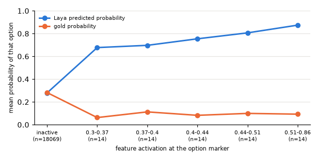

# Feature 2610

Critérios em que aparece: pred_error, pred_probe_right_laya_wrong

**Interpretação (preencher):** 

---

## Maiores ativações

**tr_customer_service_000178 / category** (choice, customer_service) | ativação 1.868 em `estado` | opções ['account', 'billing', 'delivery', 'refund', 'technical'] | Laya: **account** [0.999, 0.0, 0.0, 0.0, 0.001] | gabarito: **account**

```
<bos> choice question: What is this customer conversation primarily about?<eos>
▸ <mask> account: Login, plan changes, profile or access management.
▸ <mask> billing: A charge, invoice, subscription or payment problem.
▸ <mask> delivery: Shipping, fulfilment or delivery of a physical item.
▸ <mask> refund: The customer is explicitly asking for money back.
▸ <mask> technical: The product or service is not working as expected.

<eos>

 {"account": {"lifetime_value_usd": 337, "prior_tickets_90d": 2, "seats": 1, "tenure_months": 5, "tier": "premium"}, "thread": [{"role": "customer", "text": "Good morning, I hope you can help—I'm unable to log into my premium account."}, {"role": "agent", "text": "Good morning! Could you let me know what you see on the screen when you try to sign in?"}, {"role": "customer", "text": "When I enter my password, the system just reloads the login page without an error."}, {"role": "agent", "text": "Thanks for the detail. Are you using two‑factor authentication, and have you tried clearing your browser cache?"}, {"role": "customer", "text": "I do have 2FA enabled, and I've cleared my browser cache, but the issue persists."}, {"role": "agent", "text": "Understood⟦.⟧ When was the last time you successfully logged in, and have you changed your phone number or authentication app recently?"}, {"role": "customer", "text": "The last time I logged in was about a week ago, and I haven't changed my phone; I really need access before Friday's meeting."}]}<eos>
```

**tr_customer_service_000178 / action** (choice, customer_service) | ativação 1.660 em `estado` | opções ['answer_directly', 'close_no_action', 'escalate_to_human', 'execute_refund', 'request_information'] | Laya: **close_no_action** [0.056, 0.933, 0.005, 0.003, 0.002] | gabarito: **escalate_to_human**

```
<bos> choice question: What should the assistant do next with this conversation?<eos>
▸ <mask> answer_directly: The assistant can resolve this itself with information it already has.
▸ <mask> close_no_action: No further action is warranted; the matter is settled.
▸ <mask> escalate_to_human: Hand off to a human agent with the appropriate authority.
▸ <mask> execute_refund: Issue the refund or credit the customer is owed.
▸ <mask> request_information: More detail is needed from the customer before anything can be done.

<eos>

 {"account": {"lifetime_value_usd": 337, "prior_tickets_90d": 2, "seats": 1, "tenure_months": 5, "tier": "premium"}, "thread": [{"role": "customer", "text": "Good morning, I hope you can help—I'm unable to log into my premium account."}, {"role": "agent", "text": "Good morning! Could you let me know what you see on the screen when you try to sign in?"}, {"role": "customer", "text": "When I enter my password, the system just reloads the login page without an error."}, {"role": "agent", "text": "Thanks for the detail. Are you using two‑factor authentication, and have you tried clearing your browser cache?"}, {"role": "customer", "text": "I do have 2FA enabled, and I've cleared my browser cache, but the issue persists."}, {"role": "agent", "text": "Understood⟦.⟧ When was the last time you successfully logged in, and have you changed your phone number or authentication app recently?"}, {"role": "customer", "text": "The last time I logged in was about a week ago, and I haven't changed my phone; I really need access before Friday's meeting."}]}<eos>
```

**tr_customer_service_000121 / action** (choice, customer_service) | ativação 1.632 em `estado` | opções ['answer_directly', 'close_no_action', 'escalate_to_human', 'execute_refund', 'request_information'] | Laya: **answer_directly** [0.677, 0.211, 0.016, 0.083, 0.013] | gabarito: **escalate_to_human**

```
<bos> choice question: What should the assistant do next with this conversation?<eos>
▸ <mask> answer_directly: The assistant can resolve this itself with information it already has.
▸ <mask> close_no_action: No further action is warranted; the matter is settled.
▸ <mask> escalate_to_human: Hand off to a human agent with the appropriate authority.
▸ <mask> execute_refund: Issue the refund or credit the customer is owed.
▸ <mask> request_information: More detail is needed from the customer before anything can be done.

<eos>

 {"account": {"lifetime_value_usd": 285, "prior_tickets_90d": 2, "seats": 5, "tenure_months": 5, "tier": "enterprise"}, "orders": [{"amount_usd": 999, "date": "2026-01-20", "id": "A-59192", "status": "settled"}], "thread": [{"role": "customer", "text": "I just checked our Enterprise account and we have been charged $999 twice this morning. This needs to be corrected immediately as it's a significant duplicate hit on our corporate card."}, {"role": "agent", "text": "I understand the urgency of this billing matter. Let me pull up your transaction history to see what might have triggered the double charge."}, {"role": "customer", "text": "We've only been with you for five months and I already have two other unresolved tickets regarding our seat configuration. Now this happens and I have a hard deadline of 4:00 PM today to finalize our monthly budget report."}, {"role": "agent", "text": "I see those open tickets in our system and I appreciate you bringing this new discrepancy to our attention⟦.⟧ Are both charges showing as 'posted' on your bank statement, or is one still in a 'pending' state?"}, {"role": "customer", "text": "Both are fully posted. I cannot submit my financial report to my director with a $1,000 error, so I need a status update as soon as possible."}, {"role": "agent", "text": "Understood. To help me investigate further, could you confirm the last four digits of the credit card that was charged and the exact timestamps for both transactions?"}, {"role": "customer", "text": "The card ends in 8821. The first charge was at 8:05 AM and the second was at 8:07 AM. Please get back to me quickly because the clock is ticking on my reporting deadline."}]}<eos>
```

**tr_customer_service_000178 / churn_risk** (score, customer_service) | ativação 1.592 em `estado` | opções ['0', '1', '2', '3'] | Laya: **2** [0.072, 0.356, 0.49, 0.082] | gabarito: **1**

```
<bos> score question: How likely is this customer to stop doing business with us because of this interaction?<eos>
▸ <mask> level 0: No sign of dissatisfaction.
▸ <mask> level 1: Mild frustration, but the relationship is intact.
▸ <mask> level 2: Clearly unhappy; repeat problems or explicit complaints.
▸ <mask> level 3: Imminent: threatening to cancel, dispute or leave.

<eos>

 {"account": {"lifetime_value_usd": 337, "prior_tickets_90d": 2, "seats": 1, "tenure_months": 5, "tier": "premium"}, "thread": [{"role": "customer", "text": "Good morning, I hope you can help—I'm unable to log into my premium account."}, {"role": "agent", "text": "Good morning! Could you let me know what you see on the screen when you try to sign in?"}, {"role": "customer", "text": "When I enter my password, the system just reloads the login page without an error."}, {"role": "agent", "text": "Thanks for the detail. Are you using two‑factor authentication, and have you tried clearing your browser cache?"}, {"role": "customer", "text": "I do have 2FA enabled, and I've cleared my browser cache, but the issue persists."}, {"role": "agent", "text": "Understood⟦.⟧ When was the last time you successfully logged in, and have you changed your phone number or authentication app recently?"}, {"role": "customer", "text": "The last time I logged in was about a week ago, and I haven't changed my phone; I really need access before Friday's meeting."}]}<eos>
```

**tr_customer_service_000021 / category** (choice, customer_service) | ativação 1.534 em `estado` | opções ['account', 'billing', 'delivery', 'refund', 'technical'] | Laya: **billing** [0.0, 1.0, 0.0, 0.0, 0.0] | gabarito: **billing**

```
<bos> choice question: What is this customer conversation primarily about?<eos>
▸ <mask> account: Login, plan changes, profile or access management.
▸ <mask> billing: A charge, invoice, subscription or payment problem.
▸ <mask> delivery: Shipping, fulfilment or delivery of a physical item.
▸ <mask> refund: The customer is explicitly asking for money back.
▸ <mask> technical: The product or service is not working as expected.

<eos>

 {"account": {"lifetime_value_usd": 2339, "prior_tickets_90d": 0, "seats": 1, "tenure_months": 33, "tier": "free"}, "orders": [{"amount_usd": 999, "date": "2026-02-27", "id": "A-76350", "status": "pending"}], "thread": [{"role": "customer", "text": "I was charged $999 this month even though I’m on the free plan. Can you explain why this happened?"}, {"role": "agent", "text": "I see the charge you’re referring to. Could you share the invoice number or the date it appeared on your statement?"}, {"role": "customer", "text": "The invoice is #INV-20230914 and it shows up on my credit card as a $999 charge. I thought I was only on the free tier."}, {"role": "agent", "text": "Thank you for that information. I’ll pull up the billing records⟦.⟧ Could you confirm the email address linked to your account?"}, {"role": "customer", "text": "The account email is user@example.com. Please let me know why this charge was applied."}]}<eos>
```

## Ativações medianas (faixa 40-60%, mediana 0.566)

**tr_security_incidents_000160 / urgency** (score, security_incidents) | ativação 0.592 em `estado` | opções ['0', '1', '2', '3'] | Laya: **3** [0.038, 0.078, 0.048, 0.836] | gabarito: **3**

```
<bos> score question: How quickly must a responder act on this alert?<eos>
▸ <mask> level 0: No time pressure; can wait indefinitely.
▸ <mask> level 1: Routine; handle within the normal queue.
▸ <mask> level 2: Elevated; should be handled within the same week.
▸ <mask> level 3: Critical; requires action within the same day.

<eos>

 {"alert": {"description": "an endpoint agent matched a known signature", "evidence": "On 2026-09-15 09:18 UTC the endpoint host WIN-01A2B3C4 flagged a file located at C:\\Temp\\malicious.exe that matched a known malware signature (SHA‑256: a1b2c3d4e5f6…). The detection was generated by the endpoint agent for an administrator account (admin‑ops) that has MFA enabled. The admin’s password had been changed three days prior, on 2026‑09‑12.", "rule":⟦ "⟧malware_signature"}, "context": {"asset_criticality": "crown_jewel", "change_window_active": false, "source_on_allowlist": false}, "history": {"credential_rotation_days_ago": 3, "distinct_countries_30d": 1, "logins_30d": 1481, "prior_alerts_90d": 1}, "principal": {"mfa_enrolled": true, "name": "usr-infra-911", "privileges": ["deploy:production", "secrets:read"], "type": "admin"}}<eos>
```

**tr_agent_trace_observability_000162 / action** (choice, agent_trace_observability) | ativação 0.489 em `marcador` | opções ['continue', 'human_review', 'observe', 'stop'] | Laya: **stop** [0.108, 0.014, 0.048, 0.83] | gabarito: **observe**

```
<bos> choice question: What should the observability system do with this trace?<eos>
▸ <mask> continue: Let the agent proceed without interruption.
▸ <mask> human_review: Queue this trace for a human to review.
▸ <mask> observe: Keep running, but flag the trace for later sampling.
▸ ⟦<mask>⟧ stop: Halt the agent now.

<eos>

 {"agent": {"autonomy": "unsupervised", "model": "internal-agent-v4"}, "constraints": ["Never modify production without an approved change ticket"], "task": "Triage and close duplicate issues in the support tracker.", "trace_summary": {"constraint_violations": 0, "duration_s": 506.8, "irreversible_actions": 0, "steps": 8, "tool_errors": 3}}<eos>
```

**tr_security_incidents_000157 / credential_compromise** (noul, security_incidents) | ativação 0.575 em `estado` | opções ['false', 'true'] | Laya: **true** [0.411, 0.589] | gabarito: **true**

```
<bos> noul question: The evidence indicates a credential or account has been compromised.<eos>
▸ <mask> false: no, the statement does not hold
▸ <mask> true: yes, the statement holds

<eos>

 {"alert": {"description": "a first-ever sign-in from an unfamiliar country", "evidence": "A privileged employee account performed a successful sign‑in at 2026-09-16 08:45 UTC from 185.76.234.12, located in Moscow, Russia, which is a country with no prior login history for this principal. The authentication employed MFA, the source IP is not recognized in the asset inventory, and the password for the account was last changed on 2026‑09‑13⟦.",⟧ "rule": "new_country_login"}, "context": {"asset_criticality": "crown_jewel", "change_window_active": false, "source_on_allowlist": false}, "history": {"credential_rotation_days_ago": 3, "distinct_countries_30d": 3, "logins_30d": 744, "prior_alerts_90d": 0}, "principal": {"mfa_enrolled": true, "name": "svc-billing-232", "privileges": ["deploy:production", "secrets:read"], "type": "employee"}}<eos>
```

**tr_invoice_processing_000141 / urgency** (score, invoice_processing) | ativação 0.486 em `opção` | opções ['0', '1', '2', '3'] | Laya: **1** [0.108, 0.525, 0.229, 0.137] | gabarito: **2**

```
<bos> score question: How time-sensitive is processing this invoice?<eos>
▸ <mask> level 0: No time pressure; can wait indefinitely.
▸ <mask> level 1: Routine; handle within the normal queue.
▸ <mask> level⟦ ⟧2: Elevated; should be handled within the same week.
▸ <mask> level 3: Critical; requires action within the same day.

<eos>

 {"delivery": {"condition": "accepted", "date": "2026-03-04", "received_qty": 400}, "invoice": {"currency": "USD", "id": "INV-2026-9876", "lines": [{"qty": 400, "sku": "SKU-665", "total_usd": 40408.0, "unit_usd": 101.02}, {"qty": 1, "sku": "FREIGHT", "total_usd": 1975.55, "unit_usd": 1975.55}], "total_usd": 42383.55, "vendor": "Kestrel Supply"}, "payment": {"days_until_due": -9, "discount_expires_in_days": null, "early_payment_discount_pct": null, "status": "overdue", "terms": "net 60"}, "purchase_order": {"freight_terms": "freight prepaid by vendor, not separately billable", "id": "PO-5110", "lines": [{"qty": 400, "unit_usd": 101.02}], "total_usd": 40408.0}, "vendor_history": {"disputes_12m": 0, "invoices_12m": 12, "prior_invoice_ids": ["INV-2026-3144", "INV-2026-2282", "INV-2026-7894", "INV-2026-6333"]}}<eos>
```

**tr_security_incidents_000271 / severity** (score, security_incidents) | ativação 0.516 em `estado` | opções ['0', '1', '2', '3', '4'] | Laya: **1** [0.119, 0.313, 0.303, 0.126, 0.139] | gabarito: **2**

```
<bos> score question: How severe is the potential impact if this alert is real?<eos>
▸ <mask> level 0: Negligible: no access to anything sensitive.
▸ <mask> level 1: Low: limited access, easily reversed.
▸ <mask> level 2: Moderate: access to internal systems or non-public data.
▸ <mask> level 3: High: access to production, secrets or customer data.
▸ <mask> level 4: Critical: active compromise of crown-jewel systems.

<eos>

 {"alert": {"description": "a large transfer to an external destination", "evidence": "At 2026-09-16 02:15:44 UTC, a data transfer of 2.3 GB was observed from the internal server srv-data01 to external IP 203.0.113.45 over TCP port 443. The transfer was initiated by a service_account lacking MFA, whose password was refreshed 14 days earlier.", "rule⟦":⟧ "data_egress"}, "context": {"asset_criticality": "low", "change_window_active": false, "source_on_allowlist": false}, "history": {"credential_rotation_days_ago": 14, "distinct_countries_30d": 2, "logins_30d": 1659, "prior_alerts_90d": 1}, "principal": {"mfa_enrolled": false, "name": "usr-billing-416", "privileges": ["repo:read"], "type": "service_account"}}<eos>
```

## Estatísticas (conjunto de descoberta, dev e teste)

**pred / error**

| split | decisões | ativas | ativas e Laya errou | taxa | lift | q (BH) | OR (CMH) | q (CMH) |
|---|---|---|---|---|---|---|---|---|
| discovery | 5100 | 68 | 68 | 1.000 | 1.55 | 2.22e-12 | inf | 0.165 |
| dev | 900 | 8 | 8 | 1.000 | 1.49 | nan | nan | nan |
| test | 2000 | 14 | 13 | 0.929 | 1.43 | nan | nan | nan |

**corr / error**

| split | decisões | ativas | ativas e Laya errou | taxa | lift | q (BH) | OR (CMH) | q (CMH) |
|---|---|---|---|---|---|---|---|---|
| discovery | 5100 | 0 | 0 | nan | nan | nan | nan | nan |
| dev | 900 | 0 | 0 | nan | nan | nan | nan | nan |
| test | 2000 | 1 | 0 | 0.000 | 0.00 | nan | nan | nan |

**state / error**

| split | decisões | ativas | ativas e Laya errou | taxa | lift | q (BH) | OR (CMH) | q (CMH) |
|---|---|---|---|---|---|---|---|---|
| discovery | 5100 | 670 | 407 | 0.607 | 0.94 | 0.103 | 0.93 | 0.748 |
| dev | 900 | 138 | 99 | 0.717 | 1.07 | 0.633 | 1.42 | 0.464 |
| test | 2000 | 233 | 153 | 0.657 | 1.01 | 1 | 1.28 | 0.508 |

**pred / probe_right_laya_wrong**

| split | decisões | ativas | ativas e Laya errou | taxa | lift | q (BH) | OR (CMH) | q (CMH) |
|---|---|---|---|---|---|---|---|---|
| discovery | 2932 | 35 | 35 | 1.000 | 1.65 | 2.02e-07 | inf | 0.771 |
| dev | 523 | 2 | 2 | 1.000 | 1.55 | nan | nan | nan |
| test | 1149 | 10 | 10 | 1.000 | 1.64 | nan | nan | nan |

**corr / probe_right_laya_wrong**

| split | decisões | ativas | ativas e Laya errou | taxa | lift | q (BH) | OR (CMH) | q (CMH) |
|---|---|---|---|---|---|---|---|---|
| discovery | 2932 | 0 | 0 | nan | nan | nan | nan | nan |
| dev | 523 | 0 | 0 | nan | nan | nan | nan | nan |
| test | 1149 | 0 | 0 | nan | nan | nan | nan | nan |

**state / probe_right_laya_wrong**

| split | decisões | ativas | ativas e Laya errou | taxa | lift | q (BH) | OR (CMH) | q (CMH) |
|---|---|---|---|---|---|---|---|---|
| discovery | 2932 | 408 | 218 | 0.534 | 0.88 | 0.00673 | 0.87 | 0.522 |
| dev | 523 | 74 | 50 | 0.676 | 1.05 | 0.912 | 1.14 | 0.863 |
| test | 1149 | 136 | 83 | 0.610 | 1.00 | 1 | 1.44 | 0.372 |

Confusão mais sobre-representada (pred): `action|3>1` (n=37, lift 25.00, p=0). Formato `pergunta|índice previsto>índice correto`.

Confusão mais sobre-representada (state): `disposition|0>2` (n=31, lift 4.07, p=1.99e-13). Formato `pergunta|índice previsto>índice correto`.



