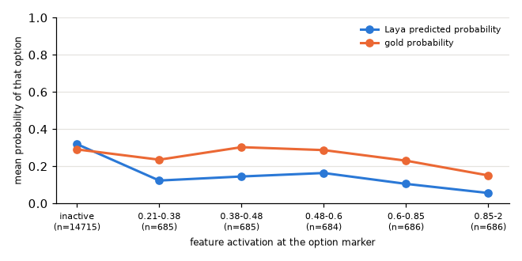

# Feature 2766

Critérios em que aparece: corr_probe_right_laya_wrong_stratified, attribution_toward_correct

**Interpretação (preencher):** 

---

## Maiores ativações

**tr_customer_service_000216 / churn_risk** (score, customer_service) | ativação 2.611 em `estado` | opções ['0', '1', '2', '3'] | Laya: **1** [0.135, 0.547, 0.228, 0.09] | gabarito: **1**

```
<bos> score question: How likely is this customer to stop doing business with us because of this interaction?<eos>
▸ <mask> level 0: No sign of dissatisfaction.
▸ <mask> level 1: Mild frustration, but the relationship is intact.
▸ <mask> level 2: Clearly unhappy; repeat problems or explicit complaints.
▸ <mask> level 3: Imminent: threatening to cancel, dispute or leave.

<eos>

 {"account": {"lifetime_value_usd": 90, "prior_tickets_90d": 0, "seats": 1, "tenure_months": 2, "tier": "free"}, "thread": [{"role": "customer", "text": "Hello there, I am checking on the status of my order⟦.⟧ It’s for a birthday party this weekend, so I’m a bit worried it hasn't arrived yet."}, {"role": "agent", "text": "I would be happy to look into that for you. Could you please provide the order number so I can check the current shipping status in our system?"}, {"role": "customer", "text": "Of course, the order number is #44921. I really need these supplies by Friday at the latest for the event to go smoothly, so any help is appreciated."}]}<eos>
```

**tr_customer_service_000216 / urgency** (score, customer_service) | ativação 2.611 em `estado` | opções ['0', '1', '2', '3'] | Laya: **1** [0.117, 0.467, 0.219, 0.198] | gabarito: **2**

```
<bos> score question: How time-sensitive is this conversation?<eos>
▸ <mask> level 0: No time pressure; can wait indefinitely.
▸ <mask> level 1: Routine; handle within the normal queue.
▸ <mask> level 2: Elevated; should be handled within the same week.
▸ <mask> level 3: Critical; requires action within the same day.

<eos>

 {"account": {"lifetime_value_usd": 90, "prior_tickets_90d": 0, "seats": 1, "tenure_months": 2, "tier": "free"}, "thread": [{"role": "customer", "text": "Hello there, I am checking on the status of my order⟦.⟧ It’s for a birthday party this weekend, so I’m a bit worried it hasn't arrived yet."}, {"role": "agent", "text": "I would be happy to look into that for you. Could you please provide the order number so I can check the current shipping status in our system?"}, {"role": "customer", "text": "Of course, the order number is #44921. I really need these supplies by Friday at the latest for the event to go smoothly, so any help is appreciated."}]}<eos>
```

**tr_customer_service_000008 / needs_human** (noul, customer_service) | ativação 2.578 em `opção` | opções ['false', 'true'] | Laya: **false** [0.525, 0.475] | gabarito: **true**

```
<bos> noul question: This conversation requires a human agent rather than automated handling.<eos>
▸ <mask> false: Automation can carry this to resolution.
▸ <mask> true: A human must take over⟦:⟧ judgement, authority or empathy is required.

<eos>

 {"account": {"lifetime_value_usd": 72, "prior_tickets_90d": 3, "seats": 1, "tenure_months": 3, "tier": "standard"}, "orders": [{"amount_usd": 87, "date": "2026-03-21", "id": "A-17904", "status": "settled"}, {"amount_usd": 87, "date": "2026-01-08", "id": "A-81775", "status": "settled"}, {"amount_usd": 87, "date": "2026-02-15", "id": "A-95492", "status": "failed"}], "thread": [{"role": "customer", "text": "Looking at my account, I need to add five more seats to the team before tomorrow’s rollout. This is my third ticket on the same issue, and I’m still on the $87 standard plan after three months."}, {"role": "agent", "text": "Got it, I see the previous tickets. Could you confirm the email addresses you’d like the new seats assigned to?"}, {"role": "customer", "text": "The emails are alice@example.com, bob@example.com, carol@example.com, dave@example.com, and eve@example.com. I need all five active by end of day tomorrow."}, {"role": "agent", "text": "Thanks for the list. Are any of the current seats being de‑provisioned, or should we simply expand the total count?"}, {"role": "customer", "text": "No removals, just add the five on top of the current three seats."}, {"role": "agent", "text": "Understood. I’ll look into why the previous attempts didn’t stick. What verification method would you prefer for the new seats—email link or admin console?"}, {"role": "customer", "text": "Send the email links; I’ll forward them right away. Please make sure the seats are live before the 5 PM deadline."}]}<eos>
```

**tr_customer_service_000216 / action** (choice, customer_service) | ativação 2.543 em `estado` | opções ['answer_directly', 'close_no_action', 'escalate_to_human', 'execute_refund', 'request_information'] | Laya: **answer_directly** [0.615, 0.134, 0.042, 0.014, 0.195] | gabarito: **answer_directly**

```
<bos> choice question: What should the assistant do next with this conversation?<eos>
▸ <mask> answer_directly: The assistant can resolve this itself with information it already has.
▸ <mask> close_no_action: No further action is warranted; the matter is settled.
▸ <mask> escalate_to_human: Hand off to a human agent with the appropriate authority.
▸ <mask> execute_refund: Issue the refund or credit the customer is owed.
▸ <mask> request_information: More detail is needed from the customer before anything can be done.

<eos>

 {"account": {"lifetime_value_usd": 90, "prior_tickets_90d": 0, "seats": 1, "tenure_months": 2, "tier": "free"}, "thread": [{"role": "customer", "text": "Hello there, I am checking on the status of my order⟦.⟧ It’s for a birthday party this weekend, so I’m a bit worried it hasn't arrived yet."}, {"role": "agent", "text": "I would be happy to look into that for you. Could you please provide the order number so I can check the current shipping status in our system?"}, {"role": "customer", "text": "Of course, the order number is #44921. I really need these supplies by Friday at the latest for the event to go smoothly, so any help is appreciated."}]}<eos>
```

**tr_customer_service_000200 / needs_human** (noul, customer_service) | ativação 2.543 em `opção` | opções ['false', 'true'] | Laya: **false** [0.926, 0.074] | gabarito: **false**

```
<bos> noul question: This conversation requires a human agent rather than automated handling.<eos>
▸ <mask> false⟦:⟧ Automation can carry this to resolution.
▸ <mask> true: A human must take over: judgement, authority or empathy is required.

<eos>

 {"account": {"lifetime_value_usd": 1072, "prior_tickets_90d": 0, "seats": 12, "tenure_months": 41, "tier": "premium"}, "orders": [{"amount_usd": 29, "date": "2026-03-18", "id": "A-98366", "status": "refunded"}, {"amount_usd": 29, "date": "2026-03-25", "id": "A-11332", "status": "settled"}, {"amount_usd": 29, "date": "2026-03-18", "id": "A-35045", "status": "failed"}], "thread": [{"role": "customer", "text": "I can't believe you just charged me $29 this month! I've been on the premium plan for over three years and never saw this price before. This is unacceptable!"}, {"role": "agent", "text": "I’m sorry you’re seeing an unexpected charge. Could you confirm the email address linked to your account so I can look into the billing details?"}, {"role": "customer", "text": "Fine. It’s john.doe@example.com. I’ve been paying the same amount for 41 months, and now this random jump appears on my statement. I need an explanation, not a generic apology."}, {"role": "agent", "text": "Thank you for confirming. I’ll pull up the recent invoices. Just to be sure, are you referring to the $29.00 charge labeled as “Premium Plan Renewal” on your latest bill?"}, {"role": "customer", "text": "Yes, that’s the one. I want to know why it’s higher now and what I’m supposed to do about it. Please tell me what’s going on."}]}<eos>
```

## Ativações medianas (faixa 40-60%, mediana 0.599)

**tr_customer_service_000151 / category** (choice, customer_service) | ativação 0.647 em `opção` | opções ['account', 'billing', 'delivery', 'refund', 'technical'] | Laya: **technical** [0.006, 0.023, 0.006, 0.003, 0.962] | gabarito: **technical**

```
<bos> choice question: What is this customer conversation primarily about?<eos>
▸ <mask> account: Login, plan changes, profile or access management.
▸ <mask> billing⟦:⟧ A charge, invoice, subscription or payment problem.
▸ <mask> delivery: Shipping, fulfilment or delivery of a physical item.
▸ <mask> refund: The customer is explicitly asking for money back.
▸ <mask> technical: The product or service is not working as expected.

<eos>

 {"account": {"lifetime_value_usd": 95, "prior_tickets_90d": 0, "seats": 1, "tenure_months": 3, "tier": "enterprise"}, "orders": [{"amount_usd": 299, "date": "2026-02-01", "id": "A-70416", "status": "failed"}, {"amount_usd": 299, "date": "2026-02-15", "id": "A-68913", "status": "pending"}], "thread": [{"role": "customer", "text": "Hello, I’m reaching out because the platform’s performance has been noticeably slow over the past week, and it’s affecting our workflow. We’re on the enterprise plan, paying $299 a month, and we need a stable experience."}, {"role": "agent", "text": "I’m sorry to hear about the slowdown. Could you tell me which features or pages are most affected, and any error messages you’ve encountered?"}, {"role": "customer", "text": "The dashboard and reporting modules take up to 45 seconds to load, and occasional time‑outs appear when we try to export data. I need a solution in place by next Friday, or we’ll have to look elsewhere."}, {"role": "agent", "text": "Thanks for the specifics. Do you have any recent logs or screenshots that show the time‑outs? That would help us pinpoint the bottleneck."}, {"role": "customer", "text": "I’ve attached the latest logs from our server and a couple of screenshots of the timeout dialogs. Please let me know what’s causing this lag."}, {"role": "agent", "text": "I appreciate you sending those files. I’ll have our performance team examine them and see what’s triggering the delay. Meanwhile, is there any temporary workaround you’ve tried that offers a bit more speed?"}, {"role": "customer", "text": "We’ve tried clearing caches and using a different browser, but the issue persists. If this isn’t sorted out by next Friday, I’ll have to consider moving to a competitor."}]}<eos>
```

**tr_agent_trace_observability_000141 / urgency** (score, agent_trace_observability) | ativação 0.600 em `estado` | opções ['0', '1', '2', '3'] | Laya: **3** [0.078, 0.216, 0.135, 0.57] | gabarito: **1**

```
<bos> score question: How quickly does this trace need attention?<eos>
▸ <mask> level 0: No time pressure; can wait indefinitely.
▸ <mask> level 1: Routine; handle within the normal queue.
▸ <mask> level 2: Elevated; should be handled within the same week.
▸ <mask> level 3: Critical; requires action within the same day.

<eos>

 {"agent": {"autonomy⟦":⟧ "checkpointed", "model": "internal-agent-v3"}, "constraints": ["Do not exceed a $50 spend on cloud resources", "Do not force-push to any branch"], "task": "Reduce the nightly report job's runtime below fifteen minutes.", "trace_summary": {"constraint_violations": 0, "duration_s": 236.1, "irreversible_actions": 1, "steps": 8, "tool_errors": 1}}<eos>
```

**tr_invoice_processing_000060 / urgency** (score, invoice_processing) | ativação 0.535 em `estado` | opções ['0', '1', '2', '3'] | Laya: **1** [0.138, 0.411, 0.31, 0.142] | gabarito: **2**

```
<bos> score question: How time-sensitive is processing this invoice?<eos>
▸ <mask> level 0: No time pressure; can wait indefinitely.
▸ <mask> level 1: Routine; handle within the normal queue.
▸ <mask> level 2: Elevated; should be handled within the same week.
▸ <mask> level 3: Critical; requires action within the same day.

<eos>

 {"delivery": {"condition": "accepted", "date": "2026-03-20", "received_qty": 400}, "invoice": {"currency": "USD", "id": "INV-2026-6086", "lines": [{"qty": 450, "sku": "SKU-902", "total_usd": 98122.5, "unit_usd": 218.05}], "total_usd": 98122.5, "vendor": "Kestrel Supply"}, "payment": {"days_until_due⟦":⟧ -21, "discount_expires_in_days": 3, "early_payment_discount_pct": 2.0, "status": "overdue", "terms": "net 30"}, "purchase_order": {"freight_terms": "freight prepaid by vendor, not separately billable", "id": "PO-8955", "lines": [{"qty": 400, "unit_usd": 218.05}], "total_usd": 87220.0}, "vendor_history": {"disputes_12m": 0, "invoices_12m": 29, "prior_invoice_ids": ["INV-2026-8411"]}}<eos>
```

**tr_security_incidents_000060 / true_positive** (noul, security_incidents) | ativação 0.623 em `estado` | opções ['false', 'true'] | Laya: **true** [0.37, 0.63] | gabarito: **true**

```
<bos> noul question: This alert reflects genuinely malicious or unauthorised activity.<eos>
▸ <mask> false: Benign activity, a misconfiguration, or a known false positive.
▸ <mask> true: The underlying behaviour is malicious or unauthorised.

<eos>

 {"alert": {"description⟦":⟧ "a security group was opened to the public internet", "evidence": "At 2026-09-14 03:12:07 UTC the security group sg-0a1b2c3d was modified to add an inbound rule allowing 0.0.0.0/0 on TCP port 22. The change was executed by service account \"svc-prod-admin\" which is marked privileged, has MFA disabled, and its credentials were last rotated 365 days ago. The source of the request could not be matched to any known entity.", "rule": "config_drift"}, "context": {"asset_criticality": "low", "change_window_active": false, "source_on_allowlist": false}, "history": {"credential_rotation_days_ago": 365, "distinct_countries_30d": 1, "logins_30d": 697, "prior_alerts_90d": 0}, "principal": {"mfa_enrolled": false, "name": "svc-support-879", "privileges": ["deploy:production", "secrets:read"], "type": "service_account"}}<eos>
```

**tr_agent_trace_observability_000032 / needs_review** (noul, agent_trace_observability) | ativação 0.557 em `opção` | opções ['false', 'true'] | Laya: **true** [0.123, 0.877] | gabarito: **false**

```
<bos> noul question: This trace requires human review.<eos>
▸ <mask> false: No human attention is warranted⟦.⟧
▸ <mask> true: A human should inspect this run.

<eos>

 {"agent": {"autonomy": "unsupervised", "model": "internal-agent-v3"}, "constraints": ["Do not touch customer data outside the named accounts"], "task": "Reduce the nightly report job's runtime below fifteen minutes.", "trace_summary": {"constraint_violations": 0, "duration_s": 580.0, "irreversible_actions": 0, "steps": 12, "tool_errors": 2}}<eos>
```

## Estatísticas (conjunto de descoberta, dev e teste)

**pred / error**

| split | decisões | ativas | ativas e Laya errou | taxa | lift | q (BH) | OR (CMH) | q (CMH) |
|---|---|---|---|---|---|---|---|---|
| discovery | 5100 | 271 | 160 | 0.590 | 0.92 | 0.121 | 0.93 | 0.952 |
| dev | 900 | 46 | 28 | 0.609 | 0.91 | 0.629 | 0.15 | 0.36 |
| test | 2000 | 100 | 55 | 0.550 | 0.85 | 0.0789 | 0.59 | 0.788 |

**corr / error**

| split | decisões | ativas | ativas e Laya errou | taxa | lift | q (BH) | OR (CMH) | q (CMH) |
|---|---|---|---|---|---|---|---|---|
| discovery | 5100 | 855 | 744 | 0.870 | 1.35 | 5.45e-57 | 2.41 | 0.00016 |
| dev | 900 | 145 | 127 | 0.876 | 1.30 | 1.95e-08 | 3.29 | 0.0661 |
| test | 2000 | 293 | 248 | 0.846 | 1.30 | 1.57e-14 | 5.12 | 0.00481 |

**state / error**

| split | decisões | ativas | ativas e Laya errou | taxa | lift | q (BH) | OR (CMH) | q (CMH) |
|---|---|---|---|---|---|---|---|---|
| discovery | 5100 | 4744 | 3030 | 0.639 | 0.99 | 0.0239 | 0.84 | 0.536 |
| dev | 900 | 830 | 553 | 0.666 | 0.99 | 0.607 | 0.70 | 0.688 |
| test | 2000 | 1852 | 1192 | 0.644 | 0.99 | 0.152 | 0.77 | 0.596 |

**pred / probe_right_laya_wrong**

| split | decisões | ativas | ativas e Laya errou | taxa | lift | q (BH) | OR (CMH) | q (CMH) |
|---|---|---|---|---|---|---|---|---|
| discovery | 2932 | 159 | 72 | 0.453 | 0.75 | 0.000241 | 0.99 | 0.948 |
| dev | 523 | 28 | 12 | 0.429 | 0.66 | 0.0634 | 0.28 | 0.386 |
| test | 1149 | 62 | 27 | 0.435 | 0.71 | 0.0134 | 0.00 | 0.831 |

**corr / probe_right_laya_wrong**

| split | decisões | ativas | ativas e Laya errou | taxa | lift | q (BH) | OR (CMH) | q (CMH) |
|---|---|---|---|---|---|---|---|---|
| discovery | 2932 | 471 | 384 | 0.815 | 1.35 | 4.25e-25 | 3.85 | 2.23e-05 |
| dev | 523 | 93 | 77 | 0.828 | 1.28 | 0.000126 | 3.76 | 0.0474 |
| test | 1149 | 180 | 145 | 0.806 | 1.32 | 1.02e-08 | 4.95 | 0.024 |

**state / probe_right_laya_wrong**

| split | decisões | ativas | ativas e Laya errou | taxa | lift | q (BH) | OR (CMH) | q (CMH) |
|---|---|---|---|---|---|---|---|---|
| discovery | 2932 | 2759 | 1665 | 0.603 | 1.00 | 0.58 | 0.79 | 0.484 |
| dev | 523 | 485 | 315 | 0.649 | 1.00 | 0.929 | 0.86 | 0.905 |
| test | 1149 | 1086 | 658 | 0.606 | 0.99 | 0.408 | 0.64 | 0.491 |

Confusão mais sobre-representada (pred): `disposition|0>2` (n=52, lift 16.87, p=0). Formato `pergunta|índice previsto>índice correto`.

Confusão mais sobre-representada (corr): `action|3>2` (n=112, lift 5.81, p=0). Formato `pergunta|índice previsto>índice correto`.

Confusão mais sobre-representada (state): `duplicate|1>0` (n=216, lift 1.07, p=1.92e-06). Formato `pergunta|índice previsto>índice correto`.



