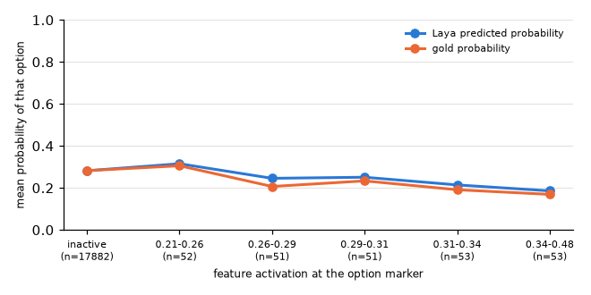

# Feature 2819

Critérios em que aparece: pred_probe_right_laya_wrong_stratified

**Interpretação (preencher):** 

---

## Maiores ativações

**tr_agent_trace_observability_000234 / needs_review** (noul, agent_trace_observability) | ativação 2.234 em `opção` | opções ['false', 'true'] | Laya: **false** [0.904, 0.096] | gabarito: **false**

```
<bos> noul question: This trace requires human review.<eos>
▸ <mask> false: No human attention is warranted.
▸ <mask> true: A human should inspect this⟦ run⟧.

<eos>

 {"agent": {"autonomy": "checkpointed", "model": "internal-agent-v3"}, "constraints": ["Do not force-push to any branch"], "task": "Backfill missing analytics events for the last seven days.", "trace_summary": {"constraint_violations": 0, "duration_s": 316.7, "irreversible_actions": 0, "steps": 3, "tool_errors": 2}}<eos>
```

**tr_customer_service_000071 / churn_risk** (score, customer_service) | ativação 2.184 em `estado` | opções ['0', '1', '2', '3'] | Laya: **1** [0.112, 0.464, 0.195, 0.228] | gabarito: **3**

```
<bos> score question: How likely is this customer to stop doing business with us because of this interaction?<eos>
▸ <mask> level 0: No sign of dissatisfaction.
▸ <mask> level 1: Mild frustration, but the relationship is intact.
▸ <mask> level 2: Clearly unhappy; repeat problems or explicit complaints.
▸ <mask> level 3: Imminent: threatening to cancel, dispute or leave.

<eos>

 {"account": {"lifetime_value_usd": 34, "prior_tickets_90d": 0, "seats": 5, "tenure_months": 1, "tier": "premium"}, "orders": [{"amount_usd": 49, "date": "2026-03-16", "id": "A-22387", "status": "refunded"}], "thread": [{"role": "customer", "text": "I want to cancel the account. We're on the premium plan, about $49 a month, and we've only been using it for a month."}, {"role": "agent", "text": "I can help with that. Could you let me know whether you want to cancel at the end of the current billing period or immediately, if immediate cancellation is an option?"}, {"role": "customer", "text": "I'd prefer it⟦ to⟧ stop at the end of the current period. I don't want to continue into another month."}, {"role": "agent", "text": "Understood. Could you also confirm whether you want to keep any data until the current period ends, or have you already completed your migration?"}, {"role": "customer", "text": "We still need read-only access until the period ends. After that, the account can be closed."}, {"role": "agent", "text": "I understand. For the record, is this a standard account cancellation, or do you need a specific invoice or final access request included in the cancellation note?"}, {"role": "customer", "text": "Standard cancellation. If a final invoice is generated, please make sure it reflects the current period only."}]}<eos>
```

**tr_customer_service_000071 / needs_human** (noul, customer_service) | ativação 2.162 em `estado` | opções ['false', 'true'] | Laya: **true** [0.312, 0.688] | gabarito: **false**

```
<bos> noul question: This conversation requires a human agent rather than automated handling.<eos>
▸ <mask> false: Automation can carry this to resolution.
▸ <mask> true: A human must take over: judgement, authority or empathy is required.

<eos>

 {"account": {"lifetime_value_usd": 34, "prior_tickets_90d": 0, "seats": 5, "tenure_months": 1, "tier": "premium"}, "orders": [{"amount_usd": 49, "date": "2026-03-16", "id": "A-22387", "status": "refunded"}], "thread": [{"role": "customer", "text": "I want to cancel the account. We're on the premium plan, about $49 a month, and we've only been using it for a month."}, {"role": "agent", "text": "I can help with that. Could you let me know whether you want to cancel at the end of the current billing period or immediately, if immediate cancellation is an option?"}, {"role": "customer", "text": "I'd prefer it⟦ to⟧ stop at the end of the current period. I don't want to continue into another month."}, {"role": "agent", "text": "Understood. Could you also confirm whether you want to keep any data until the current period ends, or have you already completed your migration?"}, {"role": "customer", "text": "We still need read-only access until the period ends. After that, the account can be closed."}, {"role": "agent", "text": "I understand. For the record, is this a standard account cancellation, or do you need a specific invoice or final access request included in the cancellation note?"}, {"role": "customer", "text": "Standard cancellation. If a final invoice is generated, please make sure it reflects the current period only."}]}<eos>
```

**tr_agent_trace_observability_000128 / needs_review** (noul, agent_trace_observability) | ativação 2.104 em `opção` | opções ['false', 'true'] | Laya: **false** [0.946, 0.054] | gabarito: **false**

```
<bos> noul question: This trace requires human review.<eos>
▸ <mask> false: No human attention is warranted.
▸ <mask> true: A human should inspect this⟦ run⟧.

<eos>

 {"agent": {"autonomy": "unsupervised", "model": "internal-agent-v3"}, "constraints": ["Do not force-push to any branch"], "task": "Delete personal data for the accounts in the erasure queue.", "trace_summary": {"constraint_violations": 0, "duration_s": 114.8, "irreversible_actions": 0, "steps": 11, "tool_errors": 0}}<eos>
```

**tr_security_incidents_000209 / severity** (score, security_incidents) | ativação 2.078 em `estado` | opções ['0', '1', '2', '3', '4'] | Laya: **2** [0.157, 0.228, 0.302, 0.157, 0.157] | gabarito: **4**

```
<bos> score question: How severe is the potential impact if this alert is real?<eos>
▸ <mask> level 0: Negligible: no access to anything sensitive.
▸ <mask> level 1: Low: limited access, easily reversed.
▸ <mask> level 2: Moderate: access to internal systems or non-public data.
▸ <mask> level 3: High: access to production, secrets or customer data.
▸ <mask> level 4: Critical: active compromise of crown-jewel systems.

<eos>

 {"alert": {"description": "a long-unused account became active", "evidence": "On 2026-09-13 at 09:45 UTC, the shared mailbox account finance_reports (last login 700 days prior) accessed the mailbox via Outlook.exe from source IP 192.0.2.55. This marked the first successful authentication for the account since its last activity. The login happened while a change window was in effect.", "rule": "dormant_account⟦_⟧use"}, "context": {"asset_criticality": "crown_jewel", "change_window_active": true, "source_on_allowlist": false}, "history": {"credential_rotation_days_ago": 700, "distinct_countries_30d": 4, "logins_30d": 1257, "prior_alerts_90d": 0}, "principal": {"mfa_enrolled": true, "name": "svc-billing-676", "privileges": ["deploy:production", "secrets:read"], "type": "shared_mailbox"}}<eos>
```

## Ativações medianas (faixa 40-60%, mediana 0.542)

**tr_security_incidents_000290 / true_positive** (noul, security_incidents) | ativação 0.536 em `estado` | opções ['false', 'true'] | Laya: **true** [0.199, 0.801] | gabarito: **false**

```
<bos> noul question: This alert reflects genuinely malicious or unauthorised activity.<eos>
▸ <mask> false: Benign activity, a misconfiguration, or a known false positive.
▸ <mask> true: The underlying behaviour is malicious or unauthorised.

<eos>

 {"alert": {"description": "a first-ever sign-in from an unfamiliar country", "evidence": "A privileged service account named svc_backup_01 logged in from IP 185.12.34.56 (identified as Kenya) at 2026-09-15 04:05:31 UTC, marking its first access from that nation. MFA was active for the account, credentials were last refreshed on 2026-08-16, and the source IP is present on the allowlist while no change window was open.",⟦ "⟧rule": "new_country_login"}, "context": {"asset_criticality": "medium", "change_window_active": false, "source_on_allowlist": true}, "history": {"credential_rotation_days_ago": 30, "distinct_countries_30d": 3, "logins_30d": 724, "prior_alerts_90d": 0}, "principal": {"mfa_enrolled": true, "name": "ci-support-122", "privileges": ["deploy:production", "secrets:read"], "type": "service_account"}}<eos>
```

**tr_customer_service_000230 / action** (choice, customer_service) | ativação 0.630 em `estado` | opções ['answer_directly', 'close_no_action', 'escalate_to_human', 'execute_refund', 'request_information'] | Laya: **close_no_action** [0.343, 0.421, 0.011, 0.22, 0.006] | gabarito: **answer_directly**

```
<bos> choice question: What should the assistant do next with this conversation?<eos>
▸ <mask> answer_directly: The assistant can resolve this itself with information it already has.
▸ <mask> close_no_action: No further action is warranted; the matter is settled.
▸ <mask> escalate_to_human: Hand off to a human agent with the appropriate authority.
▸ <mask> execute_refund: Issue the refund or credit the customer is owed.
▸ <mask> request_information: More detail is needed from the customer before anything can be done.

<eos>

 {"account": {"lifetime_value_usd": 284, "prior_tickets_90d": 1, "seats": 1, "tenure_months": 8, "tier": "free"}, "orders": [{"amount_usd": 18, "date": "2026-02-04", "id": "A-58579", "status": "refunded"}, {"amount_usd": 18, "date": "2026-02-26", "id": "A-36822", "status": "settled"}, {"amount_usd": 18, "date": "2026-02-07", "id": "A-33566", "status": "settled"}], "thread": [{"role": "customer", "text": "I’m furious that I still haven’t received the invoice copy for the $18 charge—this is the second time I’ve had to chase you about it!"}, {"role":⟦ "⟧agent", "text": "I’m sorry you’ve had to follow up again. Could you tell me the date of the transaction or the invoice number you’re looking for?"}, {"role": "customer", "text": "It was on July 12, reference #FRE-2023-07-12. I opened a ticket about this last week and only got a vague reply, which didn’t include the document."}, {"role": "agent", "text": "Thank you for that information. Just to double‑check, is the email address jane.free@example.com still the best way to send the PDF?"}, {"role": "customer", "text": "Yes, that’s the address. Send me the proper invoice this time; I’m tired of being bounced around."}]}<eos>
```

**tr_invoice_processing_000238 / disposition** (choice, invoice_processing) | ativação 0.527 em `estado` | opções ['approve', 'hold', 'manual_review', 'reject'] | Laya: **approve** [0.392, 0.374, 0.024, 0.208] | gabarito: **manual_review**

```
<bos> choice question: How should this vendor invoice be dispositioned?<eos>
▸ <mask> approve: Matches the order and delivery; approve for payment.
▸ <mask> hold: Something needs confirming before payment; hold pending clarification.
▸ <mask> manual_review: A human in finance must review the discrepancy.
▸ <mask> reject: Should not be paid: duplicate, unauthorised or materially wrong.

<eos>

 {"delivery": {"condition":⟦ "⟧accepted", "date": null, "received_qty": 0}, "invoice": {"currency": "USD", "id": "INV-2026-7587", "lines": [{"qty": 10, "sku": "SKU-342", "total_usd": 957.4, "unit_usd": 95.74}], "total_usd": 957.4, "vendor": "Acme Fabrication"}, "payment": {"days_until_due": -21, "discount_expires_in_days": 2, "early_payment_discount_pct": 2.0, "status": "overdue", "terms": "net 15"}, "purchase_order": {"freight_terms": "freight prepaid by vendor, not separately billable", "id": "PO-3578", "lines": [{"qty": 10, "unit_usd": 95.74}], "total_usd": 957.4}, "vendor_history": {"disputes_12m": 2, "invoices_12m": 12, "prior_invoice_ids": ["INV-2026-7852", "INV-2026-2436", "INV-2026-7084"]}}<eos>
```

**tr_invoice_processing_000249 / discrepancy_severity** (score, invoice_processing) | ativação 0.510 em `estado` | opções ['0', '1', '2', '3'] | Laya: **2** [0.062, 0.2, 0.679, 0.059] | gabarito: **2**

```
<bos> score question: How material is any discrepancy between the invoice, the order and the delivery?<eos>
▸ <mask> level 0: None: everything reconciles.
▸ <mask> level 1: Trivial: rounding or a cosmetic difference.
▸ <mask> level 2: Moderate: a real difference worth confirming.
▸ <mask> level 3: Material: a large or unexplained difference.

<eos>

 {"delivery": {"condition": "accepted with exceptions", "date": "2026-03-28", "received_qty": 50}, "invoice": {"currency": "USD", "id": "INV-2026-7945", "lines": [{"qty": 50, "sku": "SKU-204", "total_usd": 7926.5, "unit_usd": 158.53}], "total_usd": 7926.5, "vendor": "Acme Fabrication"}, "payment": {"days_until_due": 11, "discount_expires_in_days": null, "early_payment_discount_pct": null, "status":⟦ "⟧scheduled", "terms": "net 15"}, "purchase_order": {"freight_terms": "freight prepaid by vendor, not separately billable", "id": null, "lines": [{"qty": 50, "unit_usd": 158.53}], "total_usd": 7926.5}, "vendor_history": {"disputes_12m": 0, "invoices_12m": 20, "prior_invoice_ids": ["INV-2026-7636", "INV-2026-3392", "INV-2026-4291"]}}<eos>
```

**tr_invoice_processing_000257 / matches_order** (noul, invoice_processing) | ativação 0.513 em `estado` | opções ['false', 'true'] | Laya: **true** [0.044, 0.956] | gabarito: **false**

```
<bos> noul question: The invoice reconciles with the purchase order and the recorded delivery.<eos>
▸ <mask> false: There is a discrepancy against the order or the delivery.
▸ <mask> true: Line items, quantities and amounts reconcile.

<eos>

 {"delivery": {"condition": "accepted", "date": "2026-03⟦-⟧03", "received_qty": 980}, "invoice": {"currency": "USD", "id": "INV-2026-5664", "lines": [{"qty": 980, "sku": "SKU-421", "total_usd": 31183.6, "unit_usd": 31.82}], "total_usd": 31183.6, "vendor": "Kestrel Supply"}, "payment": {"days_until_due": 0, "discount_expires_in_days": null, "early_payment_discount_pct": null, "status": "scheduled", "terms": "net 30"}, "purchase_order": {"freight_terms": "freight prepaid by vendor, not separately billable", "id": "PO-3844", "lines": [{"qty": 1000, "unit_usd": 31.82}], "total_usd": 31820.0}, "vendor_history": {"disputes_12m": 0, "invoices_12m": 16, "prior_invoice_ids": ["INV-2026-4990", "INV-2026-4759"]}}<eos>
```

## Estatísticas (conjunto de descoberta, dev e teste)

**pred / error**

| split | decisões | ativas | ativas e Laya errou | taxa | lift | q (BH) | OR (CMH) | q (CMH) |
|---|---|---|---|---|---|---|---|---|
| discovery | 5100 | 54 | 41 | 0.759 | 1.18 | 0.155 | 1.89 | 0.239 |
| dev | 900 | 12 | 4 | 0.333 | 0.50 | nan | nan | nan |
| test | 2000 | 21 | 15 | 0.714 | 1.10 | 0.801 | 1.02 | 0.991 |

**corr / error**

| split | decisões | ativas | ativas e Laya errou | taxa | lift | q (BH) | OR (CMH) | q (CMH) |
|---|---|---|---|---|---|---|---|---|
| discovery | 5100 | 49 | 36 | 0.735 | 1.14 | 0.275 | 2.91 | 0.0199 |
| dev | 900 | 12 | 4 | 0.333 | 0.50 | nan | nan | nan |
| test | 2000 | 23 | 17 | 0.739 | 1.14 | 0.564 | 3.71 | 0.126 |

**state / error**

| split | decisões | ativas | ativas e Laya errou | taxa | lift | q (BH) | OR (CMH) | q (CMH) |
|---|---|---|---|---|---|---|---|---|
| discovery | 5100 | 2572 | 1642 | 0.638 | 0.99 | 0.604 | 1.00 | 0.994 |
| dev | 900 | 492 | 332 | 0.675 | 1.00 | 1 | 1.01 | 0.986 |
| test | 2000 | 1054 | 693 | 0.657 | 1.01 | 0.782 | 1.06 | 0.845 |

**pred / probe_right_laya_wrong**

| split | decisões | ativas | ativas e Laya errou | taxa | lift | q (BH) | OR (CMH) | q (CMH) |
|---|---|---|---|---|---|---|---|---|
| discovery | 2932 | 27 | 24 | 0.889 | 1.47 | 0.00492 | 5.69 | 0.00362 |
| dev | 523 | 5 | 1 | 0.200 | 0.31 | nan | nan | nan |
| test | 1149 | 8 | 6 | 0.750 | 1.23 | nan | nan | nan |

**corr / probe_right_laya_wrong**

| split | decisões | ativas | ativas e Laya errou | taxa | lift | q (BH) | OR (CMH) | q (CMH) |
|---|---|---|---|---|---|---|---|---|
| discovery | 2932 | 10 | 7 | 0.700 | 1.16 | nan | nan | nan |
| dev | 523 | 4 | 0 | 0.000 | 0.00 | nan | nan | nan |
| test | 1149 | 5 | 3 | 0.600 | 0.98 | nan | nan | nan |

**state / probe_right_laya_wrong**

| split | decisões | ativas | ativas e Laya errou | taxa | lift | q (BH) | OR (CMH) | q (CMH) |
|---|---|---|---|---|---|---|---|---|
| discovery | 2932 | 1532 | 935 | 0.610 | 1.01 | 0.718 | 0.96 | 0.86 |
| dev | 523 | 315 | 211 | 0.670 | 1.04 | 0.495 | 1.07 | 0.912 |
| test | 1149 | 638 | 401 | 0.629 | 1.03 | 0.426 | 1.13 | 0.72 |

Confusão mais sobre-representada (pred): `urgency|1>2` (n=28, lift 12.65, p=1.73e-25). Formato `pergunta|índice previsto>índice correto`.

Confusão mais sobre-representada (corr): `urgency|1>3` (n=24, lift 16.54, p=1.08e-24). Formato `pergunta|índice previsto>índice correto`.

Confusão mais sobre-representada (state): `duplicate|1>0` (n=177, lift 1.62, p=2.34e-22). Formato `pergunta|índice previsto>índice correto`.



