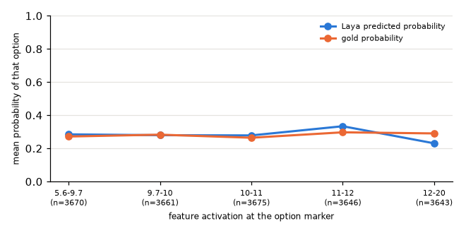

# Feature 2892

Critérios em que aparece: attribution_toward_correct

**Interpretação (preencher):** 

---

## Maiores ativações

**tr_customer_service_000134 / churn_risk** (score, customer_service) | ativação 22.047 em `opção` | opções ['0', '1', '2', '3'] | Laya: **0** [0.428, 0.353, 0.049, 0.17] | gabarito: **3**

```
<bos> score question: How likely is this customer to stop doing business with us because of this interaction?<eos>
▸ <mask> level 0: No sign of dissatisfaction.
▸ <mask>⟦ level⟧ 1: Mild frustration, but the relationship is intact.
▸ <mask> level 2: Clearly unhappy; repeat problems or explicit complaints.
▸ <mask> level 3: Imminent: threatening to cancel, dispute or leave.

<eos>

 {"account": {"lifetime_value_usd": 1659, "prior_tickets_90d": 0, "seats": 3, "tenure_months": 19, "tier": "enterprise"}, "thread": [{"role": "customer", "text": "I’m requesting a full export of all my company’s data by the end of the week; otherwise I’ll have to consider moving to a different platform."}, {"role": "agent", "text": "I understand the urgency. Could you specify which date range you need and whether you prefer CSV or JSON format?"}, {"role": "customer", "text": "We need everything from January 1 2023 through today, and CSV would be best. The deadline is Friday at 5 PM GMT."}, {"role": "agent", "text": "Got it. To ensure we’re exporting the correct records, could you confirm the primary account email you’d like the files sent to?"}, {"role": "customer", "text": "Please send the export to dataadmin@ourcompany.com. I’ll also be ready to verify my identity if you need any additional confirmation."}, {"role": "agent", "text": "Thank you for confirming. I’ll begin preparing the export and will follow up with any further questions."}, {"role": "customer", "text": "Great, just let me know the exact time you expect to have the files ready; we really can’t miss that Friday deadline."}]}<eos>
```

**tr_customer_service_000134 / churn_risk** (score, customer_service) | ativação 21.969 em `opção` | opções ['0', '1', '2', '3'] | Laya: **0** [0.428, 0.353, 0.049, 0.17] | gabarito: **3**

```
<bos> score question: How likely is this customer to stop doing business with us because of this interaction?<eos>
▸ <mask> level 0: No sign of dissatisfaction.
▸ <mask> level 1: Mild frustration, but the relationship is intact.
▸ <mask>⟦ level⟧ 2: Clearly unhappy; repeat problems or explicit complaints.
▸ <mask> level 3: Imminent: threatening to cancel, dispute or leave.

<eos>

 {"account": {"lifetime_value_usd": 1659, "prior_tickets_90d": 0, "seats": 3, "tenure_months": 19, "tier": "enterprise"}, "thread": [{"role": "customer", "text": "I’m requesting a full export of all my company’s data by the end of the week; otherwise I’ll have to consider moving to a different platform."}, {"role": "agent", "text": "I understand the urgency. Could you specify which date range you need and whether you prefer CSV or JSON format?"}, {"role": "customer", "text": "We need everything from January 1 2023 through today, and CSV would be best. The deadline is Friday at 5 PM GMT."}, {"role": "agent", "text": "Got it. To ensure we’re exporting the correct records, could you confirm the primary account email you’d like the files sent to?"}, {"role": "customer", "text": "Please send the export to dataadmin@ourcompany.com. I’ll also be ready to verify my identity if you need any additional confirmation."}, {"role": "agent", "text": "Thank you for confirming. I’ll begin preparing the export and will follow up with any further questions."}, {"role": "customer", "text": "Great, just let me know the exact time you expect to have the files ready; we really can’t miss that Friday deadline."}]}<eos>
```

**tr_customer_service_000262 / churn_risk** (score, customer_service) | ativação 21.375 em `opção` | opções ['0', '1', '2', '3'] | Laya: **3** [0.024, 0.05, 0.099, 0.828] | gabarito: **2**

```
<bos> score question: How likely is this customer to stop doing business with us because of this interaction?<eos>
▸ <mask> level 0: No sign of dissatisfaction.
▸ <mask>⟦ level⟧ 1: Mild frustration, but the relationship is intact.
▸ <mask> level 2: Clearly unhappy; repeat problems or explicit complaints.
▸ <mask> level 3: Imminent: threatening to cancel, dispute or leave.

<eos>

 {"account": {"lifetime_value_usd": 728, "prior_tickets_90d": 1, "seats": 1, "tenure_months": 19, "tier": "standard"}, "orders": [{"amount_usd": 18, "date": "2026-01-04", "id": "A-75798", "status": "settled"}, {"amount_usd": 18, "date": "2026-02-14", "id": "A-84810", "status": "failed"}, {"amount_usd": 18, "date": "2026-01-11", "id": "A-71488", "status": "settled"}], "thread": [{"role": "customer", "text": "I need help immediately. I've been a loyal customer for 19 months on the $18 standard plan, but I just noticed I've been downgraded to the free tier without my consent. This happened once before and was only half-fixed, and now I've lost access to my active projects."}, {"role": "agent", "text": "I see your account history here and recognize you've been with us for quite a while. To help me investigate the billing status, could you confirm if you received any automated emails regarding a failed payment recently?"}, {"role": "customer", "text": "No, there were no emails at all, and my card on file is perfectly fine. I have a team waiting on these files right now and we can't get anything done while the account says 'Basic'."}, {"role": "agent", "text": "Thank you for that information. Could you please provide the last four digits of the card you have on file so I can cross-reference it with our payment processor's logs?"}, {"role": "customer", "text": "It's 4492. Please, just check whatever you need to check quickly, because our entire workflow is stalled until those standard features are toggled back on."}]}<eos>
```

**tr_customer_service_000085 / churn_risk** (score, customer_service) | ativação 21.297 em `opção` | opções ['0', '1', '2', '3'] | Laya: **1** [0.141, 0.605, 0.187, 0.067] | gabarito: **2**

```
<bos> score question: How likely is this customer to stop doing business with us because of this interaction?<eos>
▸ <mask> level 0: No sign of dissatisfaction.
▸ <mask> level 1: Mild frustration, but the relationship is intact.
▸ <mask>⟦ level⟧ 2: Clearly unhappy; repeat problems or explicit complaints.
▸ <mask> level 3: Imminent: threatening to cancel, dispute or leave.

<eos>

 {"account": {"lifetime_value_usd": 62, "prior_tickets_90d": 3, "seats": 1, "tenure_months": 1, "tier": "standard"}, "thread": [{"role": "customer", "text": "I still haven't gotten a copy of my invoice for this month, even after three tickets. I need it by Friday for my accounting."}, {"role": "agent", "text": "I understand how inconvenient that is. Could you confirm the email address linked to your account so I can verify where the invoice was sent?"}, {"role": "customer", "text": "It's the same john.doe@example.com you have on file. Please just send the PDF; I can't wait any longer."}, {"role": "agent", "text": "Thanks for confirming. I’ll check the sending logs and resend the document. Is there any specific format you prefer, or will a standard PDF work?"}, {"role": "customer", "text": "A standard PDF is fine, but make sure it actually arrives this time—my deadline is this Friday and I can’t afford another delay."}]}<eos>
```

**tr_customer_service_000240 / churn_risk** (score, customer_service) | ativação 21.297 em `opção` | opções ['0', '1', '2', '3'] | Laya: **1** [0.31, 0.506, 0.059, 0.124] | gabarito: **1**

```
<bos> score question: How likely is this customer to stop doing business with us because of this interaction?<eos>
▸ <mask> level 0: No sign of dissatisfaction.
▸ <mask> level 1: Mild frustration, but the relationship is intact.
▸ <mask>⟦ level⟧ 2: Clearly unhappy; repeat problems or explicit complaints.
▸ <mask> level 3: Imminent: threatening to cancel, dispute or leave.

<eos>

 {"account": {"lifetime_value_usd": 363, "prior_tickets_90d": 0, "seats": 1, "tenure_months": 5, "tier": "standard"}, "thread": [{"role": "customer", "text": "I’d like to move my account from the Premium tier to the Standard tier, effective as of the 15th of next month."}, {"role": "agent", "text": "I understand you want to downgrade to Standard on that date. Could you confirm the email associated with the account so we can pull up the details?"}, {"role": "customer", "text": "The email is jane.doe@example.com, and I’ve been on the Premium plan for the past five months."}, {"role": "agent", "text": "Got it, Jane. Just to be clear, are there any additional services or add‑ons you’d like to keep after the downgrade?"}, {"role": "customer", "text": "No, I only need the core features that come with Standard. I also need to make sure my billing reflects the change by the deadline."}, {"role": "agent", "text": "Understood. To proceed, could you let me know if there are any outstanding invoices or credit balances we should account for before the switch?"}, {"role": "customer", "text": "There are no pending invoices; the last payment was processed last week. Please confirm the downgrade will be in place by the 15th."}]}<eos>
```

## Ativações medianas (faixa 40-60%, mediana 5.434)

**tr_security_incidents_000095 / true_positive** (noul, security_incidents) | ativação 5.336 em `estado` | opções ['false', 'true'] | Laya: **true** [0.2, 0.8] | gabarito: **true**

```
<bos> noul question: This alert reflects genuinely malicious or unauthorised activity.<eos>
▸ <mask> false: Benign activity, a misconfiguration, or a known false positive.
▸ <mask> true: The underlying behaviour is malicious or unauthorised.

<eos>

 {"alert": {"description": "a security group was opened to the public internet", "evidence": "An unprivileged admin principal modified the security group 'sg-0a1b2c3d' to permit inbound traffic from 0.0.0.0/0 at 21:08:44. This configuration change was initiated from an unrecognized external IP address and did not correlate with an active change window. The principal's credentials were last rotated 180 days ago, though multi⟦-⟧factor authentication was present for the session.", "rule": "config_drift"}, "context": {"asset_criticality": "low", "change_window_active": false, "source_on_allowlist": false}, "history": {"credential_rotation_days_ago": 180, "distinct_countries_30d": 2, "logins_30d": 1207, "prior_alerts_90d": 25}, "principal": {"mfa_enrolled": true, "name": "usr-deploy-183", "privileges": ["repo:read"], "type": "admin"}}<eos>
```

**tr_invoice_processing_000169 / discrepancy_severity** (score, invoice_processing) | ativação 4.777 em `estado` | opções ['0', '1', '2', '3'] | Laya: **2** [0.054, 0.327, 0.535, 0.083] | gabarito: **0**

```
<bos> score question: How material is any discrepancy between the invoice, the order and the delivery?<eos>
▸ <mask> level 0: None: everything reconciles.
▸ <mask> level 1: Trivial: rounding or a cosmetic difference.
▸ <mask> level 2: Moderate: a real difference worth confirming.
▸ <mask> level 3: Material: a large or unexplained difference.

<eos>

⟦ {"⟧delivery": {"condition": "accepted", "date": "2026-03-20", "received_qty": 400}, "invoice": {"currency": "USD", "id": "INV-2026-2565", "lines": [{"qty": 400, "sku": "SKU-890", "total_usd": 22948.0, "unit_usd": 57.37}], "total_usd": 22948.0, "vendor": "Kestrel Supply"}, "payment": {"days_until_due": 2, "discount_expires_in_days": null, "early_payment_discount_pct": null, "status": "scheduled", "terms": "net 15"}, "purchase_order": {"freight_terms": "freight prepaid by vendor, not separately billable", "id": "PO-1197", "lines": [{"qty": 400, "unit_usd": 57.37}], "total_usd": 22948.0}, "vendor_history": {"disputes_12m": 0, "invoices_12m": 39, "prior_invoice_ids": ["INV-2026-8904", "INV-2026-5420", "INV-2026-1117", "INV-2026-2620"]}}<eos>
```

**tr_customer_service_000276 / action** (choice, customer_service) | ativação 5.336 em `estado` | opções ['answer_directly', 'close_no_action', 'escalate_to_human', 'execute_refund', 'request_information'] | Laya: **close_no_action** [0.256, 0.504, 0.116, 0.082, 0.042] | gabarito: **execute_refund**

```
<bos> choice question: What should the assistant do next with this conversation?<eos>
▸ <mask> answer_directly: The assistant can resolve this itself with information it already has.
▸ <mask> close_no_action: No further action is warranted; the matter is settled.
▸ <mask> escalate_to_human: Hand off to a human agent with the appropriate authority.
▸ <mask> execute_refund: Issue the refund or credit the customer is owed.
▸ <mask> request_information: More detail is needed from the customer before anything can be done.

<eos>

 {"account": {"lifetime_value_usd": 2578, "prior_tickets_90d": 2, "seats": 1, "tenure_months": 33, "tier": "free"}, "orders": [{"amount_usd": 19, "date": "2026-02-10", "id": "A-44819", "status": "pending"}, {"amount_usd": 19, "date": "2026-02-04", "id": "A-86947", "status": "refunded"}, {"amount_usd": 19, "date": "2026-03-02", "id": "A-96218", "status": "refunded"}], "thread": [{"role": "customer", "text": "Hi there. I’m checking in on the $19 refund I requested a while back. I’ve been with you for 33 months on the free plan, and since I have a hard deadline for my accounting this Friday, I was hoping for an update."}, {"role": "agent", "text": "Hello. I appreciate your long-standing loyalty over the last few years. I can certainly look into the status of that refund request for you; could you please provide the reference number from your previous inquiries?"},⟦ {"⟧role": "customer", "text": "I’ve opened two tickets already, but they seem to have stalled. I’m trying to keep my records clean before my deadline at the end of the week, so any movement on this would be greatly appreciated."}, {"role": "agent", "text": "Thank you for that clarification. I am currently reviewing your account history and the previous tickets mentioned to see where the hold-up might be occurring."}, {"role": "customer", "text": "I understand. I’m just really concerned about hitting that Friday cutoff, so please let me know as soon as you find anything out."}]}<eos>
```

**tr_customer_service_000232 / churn_risk** (score, customer_service) | ativação 4.984 em `estado` | opções ['0', '1', '2', '3'] | Laya: **2** [0.054, 0.212, 0.68, 0.054] | gabarito: **2**

```
<bos> score question: How likely is this customer to stop doing business with us because of this interaction?<eos>
▸ <mask> level 0: No sign of dissatisfaction.
▸ <mask> level 1: Mild frustration, but the relationship is intact.
▸ <mask> level 2: Clearly unhappy; repeat problems or explicit complaints.
▸ <mask> level 3: Imminent: threatening to cancel, dispute or leave.

<eos>

 {"account": {"lifetime_value_usd": 186, "prior_tickets_90d": 0, "seats": 5, "tenure_months": 3, "tier": "premium"}, "orders": [{"amount_usd": 2997, "date": "2026-01-02", "id": "A-95746", "status": "refunded"}, {"amount_usd": 2997, "date": "2026-03-02", "id": "A-16068", "status": "settled"}], "thread": [{"role": "customer", "text": "I'm looking at my dashboard and everything is grayed out, it says I'm⟦ on⟧ a trial but I've been a Premium member for three months? I don't understand why it would change now, especially since I have a massive project deadline tomorrow and I need my tools."}, {"role": "agent", "text": "I can certainly look into your subscription status for you. To get started, could you please confirm the email address associated with your $2997 annual Premium plan?"}, {"role": "customer", "text": "It's the same email I'm using for this chat, but I'm just so confused because my bank shows the payment went through months ago. Why would the system suddenly think I'm not a customer anymore?"}, {"role": "agent", "text": "Thank you for that information. I am reviewing your account history now. Have you recently made any changes to your team settings or tried to link a secondary account to this workspace?"}, {"role": "customer", "text": "I haven't touched the settings at all, I just logged in to finish my work and saw the 'downgraded' notification at the top. I'm really worried because I have to submit this work by 8 AM tomorrow and I can't even export my files right now."}, {"role": "agent", "text": "I appreciate you clarifying that. To help me narrow this down, could you tell me if you are seeing any specific error codes when you try to click on the export button?"}, {"role": "customer", "text": "There aren't any codes, it just opens a pop-up telling me to 'Upgrade to Premium' to use that feature, which makes no sense at all since I'm already paying. Can someone please figure out why the system isn't recognizing my plan before I lose my window to finish this?"}]}<eos>
```

**tr_security_incidents_000072 / disposition** (choice, security_incidents) | ativação 4.840 em `estado` | opções ['close_benign', 'contain', 'investigate', 'monitor'] | Laya: **monitor** [0.202, 0.242, 0.191, 0.366] | gabarito: **investigate**

```
<bos> choice question: How should this security alert be dispositioned?<eos>
▸ <mask> close_benign: Expected, explainable activity; close without analyst time.
▸ <mask> contain: Contain the host or account immediately; do not wait for triage.
▸ <mask> investigate: Warrants an analyst opening an investigation.
▸ <mask> monitor: Not clearly malicious, but worth watching for recurrence.

<eos>

 {"alert": {"description": "an unrecognised binary executed on a server",⟦ "⟧evidence": "The unrecognised binary `svc_init.bin` was executed by an unprivileged admin principal on server `srv-prod-09` at 14:22 UTC. This execution originated from the unrecognised IP 198.51.100.12 outside of a change window using credentials last rotated 90 days ago.", "rule": "suspicious_process"}, "context": {"asset_criticality": "medium", "change_window_active": false, "source_on_allowlist": false}, "history": {"credential_rotation_days_ago": 90, "distinct_countries_30d": 1, "logins_30d": 1141, "prior_alerts_90d": 1}, "principal": {"mfa_enrolled": true, "name": "ci-infra-555", "privileges": ["repo:read"], "type": "admin"}}<eos>
```

## Estatísticas (conjunto de descoberta, dev e teste)

**pred / error**

| split | decisões | ativas | ativas e Laya errou | taxa | lift | q (BH) | OR (CMH) | q (CMH) |
|---|---|---|---|---|---|---|---|---|
| discovery | 5100 | 5100 | 3283 | 0.644 | 1.00 | 1 | nan | nan |
| dev | 900 | 900 | 605 | 0.672 | 1.00 | 1 | nan | nan |
| test | 2000 | 2000 | 1301 | 0.650 | 1.00 | 1 | nan | nan |

**corr / error**

| split | decisões | ativas | ativas e Laya errou | taxa | lift | q (BH) | OR (CMH) | q (CMH) |
|---|---|---|---|---|---|---|---|---|
| discovery | 5100 | 5100 | 3283 | 0.644 | 1.00 | 1 | nan | nan |
| dev | 900 | 900 | 605 | 0.672 | 1.00 | 1 | nan | nan |
| test | 2000 | 2000 | 1301 | 0.650 | 1.00 | 1 | nan | nan |

**state / error**

| split | decisões | ativas | ativas e Laya errou | taxa | lift | q (BH) | OR (CMH) | q (CMH) |
|---|---|---|---|---|---|---|---|---|
| discovery | 5100 | 5100 | 3283 | 0.644 | 1.00 | 1 | nan | nan |
| dev | 900 | 900 | 605 | 0.672 | 1.00 | 1 | nan | nan |
| test | 2000 | 2000 | 1301 | 0.650 | 1.00 | 1 | nan | nan |

**pred / probe_right_laya_wrong**

| split | decisões | ativas | ativas e Laya errou | taxa | lift | q (BH) | OR (CMH) | q (CMH) |
|---|---|---|---|---|---|---|---|---|
| discovery | 2932 | 2932 | 1775 | 0.605 | 1.00 | 1 | nan | nan |
| dev | 523 | 523 | 338 | 0.646 | 1.00 | 1 | nan | nan |
| test | 1149 | 1149 | 702 | 0.611 | 1.00 | 1 | nan | nan |

**corr / probe_right_laya_wrong**

| split | decisões | ativas | ativas e Laya errou | taxa | lift | q (BH) | OR (CMH) | q (CMH) |
|---|---|---|---|---|---|---|---|---|
| discovery | 2932 | 2932 | 1775 | 0.605 | 1.00 | 1 | nan | nan |
| dev | 523 | 523 | 338 | 0.646 | 1.00 | 1 | nan | nan |
| test | 1149 | 1149 | 702 | 0.611 | 1.00 | 1 | nan | nan |

**state / probe_right_laya_wrong**

| split | decisões | ativas | ativas e Laya errou | taxa | lift | q (BH) | OR (CMH) | q (CMH) |
|---|---|---|---|---|---|---|---|---|
| discovery | 2932 | 2932 | 1775 | 0.605 | 1.00 | 1 | nan | nan |
| dev | 523 | 523 | 338 | 0.646 | 1.00 | 1 | nan | nan |
| test | 1149 | 1149 | 702 | 0.611 | 1.00 | 1 | nan | nan |

Confusão mais sobre-representada (pred): `action|0>1` (n=6, lift 1.00, p=1). Formato `pergunta|índice previsto>índice correto`.

Confusão mais sobre-representada (corr): `action|0>1` (n=6, lift 1.00, p=1). Formato `pergunta|índice previsto>índice correto`.

Confusão mais sobre-representada (state): `action|0>1` (n=6, lift 1.00, p=1). Formato `pergunta|índice previsto>índice correto`.



