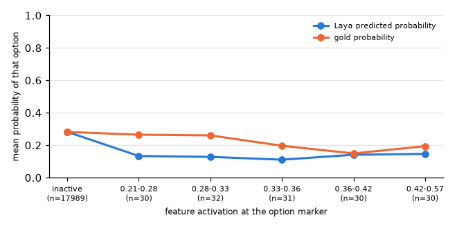

# Feature 2989

Critérios em que aparece: corr_error

**Interpretação (preencher):** 

---

## Maiores ativações

**tr_security_incidents_000284 / true_positive** (noul, security_incidents) | ativação 3.529 em `estado` | opções ['false', 'true'] | Laya: **true** [0.13, 0.87] | gabarito: **true**

```
<bos> noul question: This alert reflects genuinely malicious or unauthorised activity.<eos>
▸ <mask> false: Benign activity, a misconfiguration, or a known false positive.
▸ <mask> true: The underlying behaviour is malicious or unauthorised.

<eos>

 {"alert": {"description": "⟦a⟧ large transfer to an external destination", "evidence": "A large volume of data was transferred to an unrecognized external endpoint by a privileged employee account. The activity occurred during an open change window, and the account credentials were last rotated 3 days ago.", "rule": "data_egress"}, "context": {"asset_criticality": "low", "change_window_active": true, "source_on_allowlist": false}, "history": {"credential_rotation_days_ago": 3, "distinct_countries_30d": 3, "logins_30d": 861, "prior_alerts_90d": 1}, "principal": {"mfa_enrolled": true, "name": "svc-deploy-149", "privileges": ["deploy:production", "secrets:read"], "type": "employee"}}<eos>
```

**tr_customer_service_000055 / churn_risk** (score, customer_service) | ativação 3.355 em `estado` | opções ['0', '1', '2', '3'] | Laya: **1** [0.061, 0.666, 0.23, 0.043] | gabarito: **1**

```
<bos> score question: How likely is this customer to stop doing business with us because of this interaction?<eos>
▸ <mask> level 0: No sign of dissatisfaction.
▸ <mask> level 1: Mild frustration, but the relationship is intact.
▸ <mask> level 2: Clearly unhappy; repeat problems or explicit complaints.
▸ <mask> level 3: Imminent: threatening to cancel, dispute or leave.

<eos>

 {"account": {"lifetime_value_usd": 936, "prior_tickets_90d": 0, "seats": 40, "tenure_months": 19, "tier": "premium"}, "orders": [{"amount_usd": 149, "date": "2026-03-09", "id": "A-69038", "status": "pending"}, {"amount_usd": 149, "date": "2026-03-25", "id": "A-22591", "status": "settled"}], "thread": [{"role": "customer", "text": "I just checked my statement and see two identical charges for $149 on the same day. I’m on the premium plan and this is really puzzling."}, {"role": "agent", "text": "I’m sorry for the confusion. Could you provide the transaction dates and the last four digits of the card used, so I can locate the duplicate entries?"}, {"role": "customer", "text": "Both charges are dated September 5th, and the card ends in 9012. I need this sorted out before the 15th of this month."}, {"role": "agent", "text": "Got it, thank you. I’ll need to verify the merchant name associated with those charges. Could you let me know how the description appears on your statement?"}, {"role": "customer", "text": "It just says ‘Premium Service⟦ –⟧ Monthly Billing’. Please let me know what you find."}]}<eos>
```

**tr_security_incidents_000284 / credential_compromise** (noul, security_incidents) | ativação 3.342 em `estado` | opções ['false', 'true'] | Laya: **true** [0.052, 0.948] | gabarito: **false**

```
<bos> noul question: The evidence indicates a credential or account has been compromised.<eos>
▸ <mask> false: no, the statement does not hold
▸ <mask> true: yes, the statement holds

<eos>

 {"alert": {"description": "⟦a⟧ large transfer to an external destination", "evidence": "A large volume of data was transferred to an unrecognized external endpoint by a privileged employee account. The activity occurred during an open change window, and the account credentials were last rotated 3 days ago.", "rule": "data_egress"}, "context": {"asset_criticality": "low", "change_window_active": true, "source_on_allowlist": false}, "history": {"credential_rotation_days_ago": 3, "distinct_countries_30d": 3, "logins_30d": 861, "prior_alerts_90d": 1}, "principal": {"mfa_enrolled": true, "name": "svc-deploy-149", "privileges": ["deploy:production", "secrets:read"], "type": "employee"}}<eos>
```

**tr_security_incidents_000284 / disposition** (choice, security_incidents) | ativação 3.336 em `estado` | opções ['close_benign', 'contain', 'investigate', 'monitor'] | Laya: **monitor** [0.059, 0.181, 0.11, 0.651] | gabarito: **investigate**

```
<bos> choice question: How should this security alert be dispositioned?<eos>
▸ <mask> close_benign: Expected, explainable activity; close without analyst time.
▸ <mask> contain: Contain the host or account immediately; do not wait for triage.
▸ <mask> investigate: Warrants an analyst opening an investigation.
▸ <mask> monitor: Not clearly malicious, but worth watching for recurrence.

<eos>

 {"alert": {"description": "⟦a⟧ large transfer to an external destination", "evidence": "A large volume of data was transferred to an unrecognized external endpoint by a privileged employee account. The activity occurred during an open change window, and the account credentials were last rotated 3 days ago.", "rule": "data_egress"}, "context": {"asset_criticality": "low", "change_window_active": true, "source_on_allowlist": false}, "history": {"credential_rotation_days_ago": 3, "distinct_countries_30d": 3, "logins_30d": 861, "prior_alerts_90d": 1}, "principal": {"mfa_enrolled": true, "name": "svc-deploy-149", "privileges": ["deploy:production", "secrets:read"], "type": "employee"}}<eos>
```

**tr_customer_service_000055 / urgency** (score, customer_service) | ativação 3.191 em `estado` | opções ['0', '1', '2', '3'] | Laya: **1** [0.13, 0.545, 0.198, 0.128] | gabarito: **2**

```
<bos> score question: How time-sensitive is this conversation?<eos>
▸ <mask> level 0: No time pressure; can wait indefinitely.
▸ <mask> level 1: Routine; handle within the normal queue.
▸ <mask> level 2: Elevated; should be handled within the same week.
▸ <mask> level 3: Critical; requires action within the same day.

<eos>

 {"account": {"lifetime_value_usd": 936, "prior_tickets_90d": 0, "seats": 40, "tenure_months": 19, "tier": "premium"}, "orders": [{"amount_usd": 149, "date": "2026-03-09", "id": "A-69038", "status": "pending"}, {"amount_usd": 149, "date": "2026-03-25", "id": "A-22591", "status": "settled"}], "thread": [{"role": "customer", "text": "I just checked my statement and see two identical charges for $149 on the same day. I’m on the premium plan and this is really puzzling."}, {"role": "agent", "text": "I’m sorry for the confusion. Could you provide the transaction dates and the last four digits of the card used, so I can locate the duplicate entries?"}, {"role": "customer", "text": "Both charges are dated September 5th, and the card ends in 9012. I need this sorted out before the 15th of this month."}, {"role": "agent", "text": "Got it, thank you. I’ll need to verify the merchant name associated with those charges. Could you let me know how the description appears on your statement?"}, {"role": "customer", "text": "It just says ‘Premium Service⟦ –⟧ Monthly Billing’. Please let me know what you find."}]}<eos>
```

## Ativações medianas (faixa 40-60%, mediana 0.713)

**tr_security_incidents_000247 / disposition** (choice, security_incidents) | ativação 0.691 em `estado` | opções ['close_benign', 'contain', 'investigate', 'monitor'] | Laya: **investigate** [0.0, 0.001, 0.963, 0.036] | gabarito: **investigate**

```
<bos> choice question: How should this security alert be dispositioned?<eos>
▸ <mask> close_benign: Expected, explainable activity; close without analyst time.
▸ <mask> contain: Contain the host or account immediately; do not wait for triage.
▸ <mask> investigate: Warrants an analyst opening an investigation.
▸ <mask> monitor: Not clearly malicious, but worth watching for recurrence.

<eos>

 {"alert": {"description":⟦ "⟧an endpoint agent matched a known signature", "evidence": "An endpoint agent detected the file 'win_payload.exe' matching a known malware signature on a host associated with a shared mailbox. This activity occurred outside of any approved change window, and the credentials for this account have not been updated in 365 days.", "rule": "malware_signature"}, "context": {"asset_criticality": "medium", "change_window_active": false, "source_on_allowlist": false}, "history": {"credential_rotation_days_ago": 365, "distinct_countries_30d": 4, "logins_30d": 1034, "prior_alerts_90d": 8}, "principal": {"mfa_enrolled": true, "name": "svc-analytics-742", "privileges": ["repo:read"], "type": "shared_mailbox"}}<eos>
```

**tr_security_incidents_000153 / severity** (score, security_incidents) | ativação 0.711 em `estado` | opções ['0', '1', '2', '3', '4'] | Laya: **2** [0.042, 0.362, 0.535, 0.045, 0.016] | gabarito: **1**

```
<bos> score question: How severe is the potential impact if this alert is real?<eos>
▸ <mask> level 0: Negligible: no access to anything sensitive.
▸ <mask> level 1: Low: limited access, easily reversed.
▸ <mask> level 2: Moderate: access to internal systems or non-public data.
▸ <mask> level 3: High: access to production, secrets or customer data.
▸ <mask> level 4: Critical: active compromise of crown-jewel systems.

<eos>

 {"alert": {"description": "an unusual volume of files read in a short window", "evidence": "The user account accessed 450 files within a two-minute window, significantly exceeding the baseline for this principal. The activity originated from an unrecognized IP address at 03:14 UTC, outside of any scheduled change management window.", "rule": "mass_download"}, "context": {"asset_criticality": "low", "change_window_active": false, "source_on_allowlist": false}, "history": {"credential_rotation_days_⟦ago⟧": 3, "distinct_countries_30d": 1, "logins_30d": 415, "prior_alerts_90d": 0}, "principal": {"mfa_enrolled": true, "name": "adm-analytics-872", "privileges": ["repo:read"], "type": "employee"}}<eos>
```

**tr_agent_trace_observability_000092 / needs_review** (noul, agent_trace_observability) | ativação 0.724 em `estado` | opções ['false', 'true'] | Laya: **true** [0.484, 0.516] | gabarito: **true**

```
<bos> noul question: This trace requires human review.<eos>
▸ <mask> false: No human attention is warranted.
▸ <mask> true: A human should inspect this run.

<eos>

 {"agent": {"autonomy": "dry_run", "model": "internal-agent⟦-⟧v3"}, "constraints": ["Do not exceed a $50 spend on cloud resources", "Do not touch customer data outside the named accounts"], "task": "Rotate the expired TLS certificate on the staging load balancer.", "trace_summary": {"constraint_violations": 0, "duration_s": 615.5, "irreversible_actions": 0, "steps": 12, "tool_errors": 3}}<eos>
```

**tr_security_incidents_000217 / severity** (score, security_incidents) | ativação 0.652 em `estado` | opções ['0', '1', '2', '3', '4'] | Laya: **1** [0.087, 0.39, 0.334, 0.084, 0.105] | gabarito: **3**

```
<bos> score question: How severe is the potential impact if this alert is real?<eos>
▸ <mask> level 0: Negligible: no access to anything sensitive.
▸ <mask> level 1: Low: limited access, easily reversed.
▸ <mask> level 2: Moderate: access to internal systems or non-public data.
▸ <mask> level 3: High: access to production, secrets or customer data.
▸ <mask> level 4: Critical: active compromise of crown-jewel systems.

<eos>

 {"alert": {"description": "a session token was presented from a second address", "evidence": "At 11:30 UTC, a session token belonging to the privileged account `svc_storage_admin` was presented from IP `10.50.2.14` and subsequently from `10.50.2.89`. The activity originated from an allowlisted source, though the account's authentication credentials have not been updated in 412 days.", "rule": "token_reuse"}, "context": {"asset_criticality": "crown_jewel", "change_window_active": false, "source_on_allowlist": true}, "history": {"credential_rotation_days_ago": 412, "distinct_countries_30d": 3, "logins_30d": 50, "prior_alerts_90d": 0}, "principal": {"mfa_enrolled": false, "name": "usr⟦-⟧deploy-906", "privileges": ["deploy:production", "secrets:read"], "type": "service_account"}}<eos>
```

**tr_security_incidents_000293 / disposition** (choice, security_incidents) | ativação 0.719 em `estado` | opções ['close_benign', 'contain', 'investigate', 'monitor'] | Laya: **monitor** [0.092, 0.202, 0.045, 0.661] | gabarito: **investigate**

```
<bos> choice question: How should this security alert be dispositioned?<eos>
▸ <mask> close_benign: Expected, explainable activity; close without analyst time.
▸ <mask> contain: Contain the host or account immediately; do not wait for triage.
▸ <mask> investigate: Warrants an analyst opening an investigation.
▸ <mask> monitor: Not clearly malicious, but worth watching for recurrence.

<eos>

 {"alert": {"description":⟦ "⟧a session token was presented from a second address", "evidence": "A single session token was used to access resources from two distinct, unrecognized IP addresses within a 15-minute span. While the user is a contractor currently operating within an active change window, the second connection originated from an unknown network source.", "rule": "token_reuse"}, "context": {"asset_criticality": "medium", "change_window_active": true, "source_on_allowlist": false}, "history": {"credential_rotation_days_ago": 30, "distinct_countries_30d": 2, "logins_30d": 1286, "prior_alerts_90d": 0}, "principal": {"mfa_enrolled": true, "name": "adm-deploy-459", "privileges": ["repo:read"], "type": "contractor"}}<eos>
```

## Estatísticas (conjunto de descoberta, dev e teste)

**pred / error**

| split | decisões | ativas | ativas e Laya errou | taxa | lift | q (BH) | OR (CMH) | q (CMH) |
|---|---|---|---|---|---|---|---|---|
| discovery | 5100 | 0 | 0 | nan | nan | nan | nan | nan |
| dev | 900 | 0 | 0 | nan | nan | nan | nan | nan |
| test | 2000 | 0 | 0 | nan | nan | nan | nan | nan |

**corr / error**

| split | decisões | ativas | ativas e Laya errou | taxa | lift | q (BH) | OR (CMH) | q (CMH) |
|---|---|---|---|---|---|---|---|---|
| discovery | 5100 | 27 | 27 | 1.000 | 1.55 | 2.82e-05 | inf | 0.539 |
| dev | 900 | 3 | 3 | 1.000 | 1.49 | nan | nan | nan |
| test | 2000 | 19 | 19 | 1.000 | 1.54 | nan | nan | nan |

**state / error**

| split | decisões | ativas | ativas e Laya errou | taxa | lift | q (BH) | OR (CMH) | q (CMH) |
|---|---|---|---|---|---|---|---|---|
| discovery | 5100 | 1170 | 736 | 0.629 | 0.98 | 0.401 | 1.13 | 0.415 |
| dev | 900 | 190 | 120 | 0.632 | 0.94 | 0.576 | 1.02 | 0.974 |
| test | 2000 | 427 | 278 | 0.651 | 1.00 | 1 | 1.30 | 0.304 |

**pred / probe_right_laya_wrong**

| split | decisões | ativas | ativas e Laya errou | taxa | lift | q (BH) | OR (CMH) | q (CMH) |
|---|---|---|---|---|---|---|---|---|
| discovery | 2932 | 0 | 0 | nan | nan | nan | nan | nan |
| dev | 523 | 0 | 0 | nan | nan | nan | nan | nan |
| test | 1149 | 0 | 0 | nan | nan | nan | nan | nan |

**corr / probe_right_laya_wrong**

| split | decisões | ativas | ativas e Laya errou | taxa | lift | q (BH) | OR (CMH) | q (CMH) |
|---|---|---|---|---|---|---|---|---|
| discovery | 2932 | 10 | 10 | 1.000 | 1.65 | nan | nan | nan |
| dev | 523 | 1 | 1 | 1.000 | 1.55 | nan | nan | nan |
| test | 1149 | 5 | 5 | 1.000 | 1.64 | nan | nan | nan |

**state / probe_right_laya_wrong**

| split | decisões | ativas | ativas e Laya errou | taxa | lift | q (BH) | OR (CMH) | q (CMH) |
|---|---|---|---|---|---|---|---|---|
| discovery | 2932 | 673 | 405 | 0.602 | 0.99 | 0.936 | 1.29 | 0.0912 |
| dev | 523 | 109 | 70 | 0.642 | 0.99 | 1 | 1.50 | 0.403 |
| test | 1149 | 266 | 170 | 0.639 | 1.05 | 0.569 | 1.65 | 0.0663 |

Confusão mais sobre-representada (corr): `urgency|3>0` (n=20, lift 94.44, p=2.12e-39). Formato `pergunta|índice previsto>índice correto`.

Confusão mais sobre-representada (state): `credential_compromise|1>0` (n=42, lift 2.23, p=1.76e-08). Formato `pergunta|índice previsto>índice correto`.



