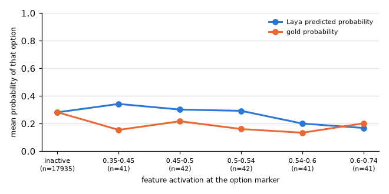

# Feature 2999

Critérios em que aparece: pred_error

**Interpretação (preencher):** 

---

## Maiores ativações

**tr_customer_service_000221 / churn_risk** (score, customer_service) | ativação 6.207 em `estado` | opções ['0', '1', '2', '3'] | Laya: **1** [0.165, 0.524, 0.28, 0.03] | gabarito: **1**

```
<bos> score question: How likely is this customer to stop doing business with us because of this interaction?<eos>
▸ <mask> level 0: No sign of dissatisfaction.
▸ <mask> level 1: Mild frustration, but the relationship is intact.
▸ <mask> level 2: Clearly unhappy; repeat problems or explicit complaints.
▸ <mask> level 3: Imminent: threatening to cancel, dispute or leave.

<eos>

 {"account": {"lifetime_value_usd": 1327, "prior_tickets_90d": 0, "seats": 1, "tenure_months": 14, "tier": "standard"}, "orders": [{"amount_usd": 149, "date": "2026-02-16", "id": "A-75209", "status": "pending"}, {"amount_usd": 149, "date": "2026-02-14", "id": "A-62252", "status": "settled"}], "thread": [{"role": "customer", "text": "My order arrived this afternoon, but the contents are incorrect.⟦ I⟧ received a blue thermal carafe instead of the stainless steel model I ordered."}, {"role": "agent", "text": "I apologize for the mix-up with your shipment. I’d like to look into this for you; could you please share your order number and the SKU listed on the box you received?"}, {"role": "customer", "text": "The order number is #88492-AX. The box says SKU-992-B, but my invoice clearly lists SKU-992-S."}, {"role": "agent", "text": "Thank you for verifying those details. Are you able to upload a photo of the item you received so I can confirm the discrepancy for our records?"}, {"role": "customer", "text": "I've attached the photo to this message. Please let me know what the next steps are once you have verified it."}]}<eos>
```

**tr_customer_service_000163 / action** (choice, customer_service) | ativação 6.156 em `estado` | opções ['answer_directly', 'close_no_action', 'escalate_to_human', 'execute_refund', 'request_information'] | Laya: **close_no_action** [0.174, 0.544, 0.104, 0.17, 0.008] | gabarito: **execute_refund**

```
<bos> choice question: What should the assistant do next with this conversation?<eos>
▸ <mask> answer_directly: The assistant can resolve this itself with information it already has.
▸ <mask> close_no_action: No further action is warranted; the matter is settled.
▸ <mask> escalate_to_human: Hand off to a human agent with the appropriate authority.
▸ <mask> execute_refund: Issue the refund or credit the customer is owed.
▸ <mask> request_information: More detail is needed from the customer before anything can be done.

<eos>

 {"account": {"lifetime_value_usd": 1046, "prior_tickets_90d": 1, "seats": 1, "tenure_months": 41, "tier": "standard"}, "orders": [{"amount_usd": 87, "date": "2026-01-23", "id": "A-89226", "status": "settled"}], "thread": [{"role": "customer", "text": "I’m fed up—my refund of $87 from about a month ago is still nowhere to be seen, despite the ticket I opened weeks back."}, {"role": "agent", "text": "I’m sorry you’re dealing with this; could you confirm the ticket reference so I can check the latest notes?"}, {"role": "customer", "text": "It’s ticket 98421.⟦ I⟧ was promised a response yesterday and got nothing."}, {"role": "agent", "text": "Understood. I’ll look into the activity on that ticket. Is there any additional documentation you’d like to attach?"}, {"role": "customer", "text": "No, I just want the refund processed—this back‑and‑forth is getting ridiculous."}]}<eos>
```

**tr_customer_service_000265 / needs_human** (noul, customer_service) | ativação 6.125 em `estado` | opções ['false', 'true'] | Laya: **true** [0.454, 0.546] | gabarito: **true**

```
<bos> noul question: This conversation requires a human agent rather than automated handling.<eos>
▸ <mask> false: Automation can carry this to resolution.
▸ <mask> true: A human must take over: judgement, authority or empathy is required.

<eos>

 {"account": {"lifetime_value_usd": 379, "prior_tickets_90d": 3, "seats": 5, "tenure_months": 11, "tier": "premium"}, "orders": [{"amount_usd": 999, "date": "2026-02-26", "id": "A-44178", "status": "settled"}, {"amount_usd": 999, "date": "2026-02-11", "id": "A-78032", "status": "settled"}, {"amount_usd": 999, "date": "2026-03-13", "id": "A-48014", "status": "pending"}], "thread": [{"role": "customer", "text": "My premium subscription delivery arrived today, but I received the wrong item. It’s the $999 package, but it’s completely different from what I ordered."}, {"role": "agent", "text": "I see you have been with us for nearly a year, and I appreciate you bringing this discrepancy to our attention. To assist you further, could you please provide the order number and describe the item you actually received?"}, {"role": "customer", "text": "The order number is #88291.⟦ I⟧ was expecting the professional hardware kit, but the box I opened contained a set of basic cabling accessories instead."}, {"role": "agent", "text": "Thank you for providing those details. I am reviewing the shipping manifest for that specific order number now; would you be able to upload a photo of the packing slip that was included in the box?"}, {"role": "customer", "text": "I’ve attached the photo of the slip to this chat. I just need to know how we’re going to handle this mix-up."}]}<eos>
```

**tr_customer_service_000138 / churn_risk** (score, customer_service) | ativação 6.102 em `estado` | opções ['0', '1', '2', '3'] | Laya: **1** [0.046, 0.489, 0.428, 0.037] | gabarito: **2**

```
<bos> score question: How likely is this customer to stop doing business with us because of this interaction?<eos>
▸ <mask> level 0: No sign of dissatisfaction.
▸ <mask> level 1: Mild frustration, but the relationship is intact.
▸ <mask> level 2: Clearly unhappy; repeat problems or explicit complaints.
▸ <mask> level 3: Imminent: threatening to cancel, dispute or leave.

<eos>

 {"account": {"lifetime_value_usd": 247, "prior_tickets_90d": 1, "seats": 1, "tenure_months": 3, "tier": "standard"}, "thread": [{"role": "customer", "text": "Good afternoon,⟦ I⟧ need the data export we discussed last month. This is my third month on the standard plan, and the previous ticket promised the export but never arrived."}, {"role": "agent", "text": "I’m sorry you haven’t received the export yet. Could you remind me of the ticket number so I can locate the original request?"}, {"role": "customer", "text": "The ticket was #7890, opened on July 20th. I was told it would be ready within 48 hours, but I still have nothing."}, {"role": "agent", "text": "Thank you for the details. I’ll pull up the logs for that ticket. In the meantime, could you confirm the email address you’d like the export sent to?"}, {"role": "customer", "text": "Please send it to me at alex.tan@example.com. I need the data before the end of the month, so any update would be great."}]}<eos>
```

**tr_customer_service_000265 / category** (choice, customer_service) | ativação 6.066 em `estado` | opções ['account', 'billing', 'delivery', 'refund', 'technical'] | Laya: **delivery** [0.0, 0.0, 1.0, 0.0, 0.0] | gabarito: **delivery**

```
<bos> choice question: What is this customer conversation primarily about?<eos>
▸ <mask> account: Login, plan changes, profile or access management.
▸ <mask> billing: A charge, invoice, subscription or payment problem.
▸ <mask> delivery: Shipping, fulfilment or delivery of a physical item.
▸ <mask> refund: The customer is explicitly asking for money back.
▸ <mask> technical: The product or service is not working as expected.

<eos>

 {"account": {"lifetime_value_usd": 379, "prior_tickets_90d": 3, "seats": 5, "tenure_months": 11, "tier": "premium"}, "orders": [{"amount_usd": 999, "date": "2026-02-26", "id": "A-44178", "status": "settled"}, {"amount_usd": 999, "date": "2026-02-11", "id": "A-78032", "status": "settled"}, {"amount_usd": 999, "date": "2026-03-13", "id": "A-48014", "status": "pending"}], "thread": [{"role": "customer", "text": "My premium subscription delivery arrived today, but I received the wrong item. It’s the $999 package, but it’s completely different from what I ordered."}, {"role": "agent", "text": "I see you have been with us for nearly a year, and I appreciate you bringing this discrepancy to our attention. To assist you further, could you please provide the order number and describe the item you actually received?"}, {"role": "customer", "text": "The order number is #88291.⟦ I⟧ was expecting the professional hardware kit, but the box I opened contained a set of basic cabling accessories instead."}, {"role": "agent", "text": "Thank you for providing those details. I am reviewing the shipping manifest for that specific order number now; would you be able to upload a photo of the packing slip that was included in the box?"}, {"role": "customer", "text": "I’ve attached the photo of the slip to this chat. I just need to know how we’re going to handle this mix-up."}]}<eos>
```

## Ativações medianas (faixa 40-60%, mediana 3.335)

**tr_customer_service_000017 / category** (choice, customer_service) | ativação 3.471 em `estado` | opções ['account', 'billing', 'delivery', 'refund', 'technical'] | Laya: **billing** [0.002, 0.995, 0.0, 0.001, 0.002] | gabarito: **billing**

```
<bos> choice question: What is this customer conversation primarily about?<eos>
▸ <mask> account: Login, plan changes, profile or access management.
▸ <mask> billing: A charge, invoice, subscription or payment problem.
▸ <mask> delivery: Shipping, fulfilment or delivery of a physical item.
▸ <mask> refund: The customer is explicitly asking for money back.
▸ <mask> technical: The product or service is not working as expected.

<eos>

 {"account": {"lifetime_value_usd": 228, "prior_tickets_90d": 3, "seats": 1, "tenure_months": 11, "tier": "premium"}, "orders": [{"amount_usd": 29, "date": "2026-03-25", "id": "A-17351", "status": "settled"}, {"amount_usd": 29, "date": "2026-02-18", "id": "A-55118", "status": "settled"}], "thread": [{"role": "customer", "text": "My payment for the $29 subscription failed this morning. I have a presentation tomorrow morning at 9:00 AM that requires this access, so I need this cleared up immediately."}, {"role": "agent", "text": "I see the status of your account. Before we look into the billing error, could you confirm if the payment method on file has expired or if you have recently updated your banking information?"}, {"role": "customer", "text": "The card is current and active. I have had three previous tickets regarding billing glitches that were supposedly addressed, yet here I am again with the same issue."}, {"role": "agent", "text": "I acknowledge your frustration regarding the previous tickets. To investigate this specific failure, could you provide the transaction reference ID shown in your payment history?"}, {"role": "customer", "text": "I am looking at⟦ my⟧ bank portal now, but I don't see a reference ID generated for this attempt. How are we going to fix this before my deadline tomorrow?"}]}<eos>
```

**tr_customer_service_000184 / urgency** (score, customer_service) | ativação 3.438 em `estado` | opções ['0', '1', '2', '3'] | Laya: **1** [0.091, 0.484, 0.28, 0.145] | gabarito: **3**

```
<bos> score question: How time-sensitive is this conversation?<eos>
▸ <mask> level 0: No time pressure; can wait indefinitely.
▸ <mask> level 1: Routine; handle within the normal queue.
▸ <mask> level 2: Elevated; should be handled within the same week.
▸ <mask> level 3: Critical; requires action within the same day.

<eos>

 {"account": {"lifetime_value_usd": 1921, "prior_tickets_90d": 2, "seats": 1, "tenure_months": 49, "tier": "standard"}, "thread": [{"role": "customer", "text": "I've been waiting forever for⟦ my⟧ order—your delivery promise was two weeks ago and nothing has shown up! This is unacceptable for someone who's been with you for over four years."}, {"role": "agent", "text": "I’m sorry to hear the shipment hasn’t arrived yet. Let me pull up the tracking details—could you confirm the order number you received in the confirmation email?"}, {"role": "customer", "text": "The number is 112938‑BZ, and if this isn’t fixed soon I’m done with your service; I’ve already opened tickets that never got solved."}]}<eos>
```

**tr_customer_service_000234 / action** (choice, customer_service) | ativação 3.385 em `estado` | opções ['answer_directly', 'close_no_action', 'escalate_to_human', 'execute_refund', 'request_information'] | Laya: **answer_directly** [0.8, 0.085, 0.064, 0.043, 0.008] | gabarito: **request_information**

```
<bos> choice question: What should the assistant do next with this conversation?<eos>
▸ <mask> answer_directly: The assistant can resolve this itself with information it already has.
▸ <mask> close_no_action: No further action is warranted; the matter is settled.
▸ <mask> escalate_to_human: Hand off to a human agent with the appropriate authority.
▸ <mask> execute_refund: Issue the refund or credit the customer is owed.
▸ <mask> request_information: More detail is needed from the customer before anything can be done.

<eos>

 {"account": {"lifetime_value_usd": 1458, "prior_tickets_90d": 0, "seats": 3, "tenure_months": 33, "tier": "premium"}, "thread": [{"role": "customer", "text": "I’ve been paying for this premium plan for 33 months without a single hitch, but now I’m completely locked out and I have a hard deadline in two hours. Why is the login screen just spinning?"}, {"role": "agent", "text": "I’m sorry to hear you're experiencing this frustration right now. Could you please confirm the exact error message or code you are seeing when the page hangs?"}, {"role": "customer", "text": "There is no code! It’s just a blank page after I enter my credentials.⟦ I⟧ have a massive report due for my firm by noon and I can’t get in to export the data. This is ridiculous."}, {"role": "agent", "text": "I understand the urgency of this report. To help me narrow down the cause, are you accessing the portal through a browser or our desktop application?"}, {"role": "customer", "text": "I’m using Chrome on my desktop. I’ve already cleared my cache and tried an incognito window, so don't even suggest that. Fix this now."}]}<eos>
```

**tr_customer_service_000031 / needs_human** (noul, customer_service) | ativação 3.174 em `estado` | opções ['false', 'true'] | Laya: **false** [0.699, 0.301] | gabarito: **true**

```
<bos> noul question: This conversation requires a human agent rather than automated handling.<eos>
▸ <mask> false: Automation can carry this to resolution.
▸ <mask> true: A human must take over: judgement, authority or empathy is required.

<eos>

 {"account": {"lifetime_value_usd": 581, "prior_tickets_90d": 0, "seats": 3, "tenure_months": 14, "tier": "enterprise"}, "thread": [{"role": "customer", "text": "I noticed two identical charges on⟦ my⟧ bank statement for this month's enterprise subscription. I suppose I'm not surprised, but I'd like to know why this happened."}, {"role": "agent", "text": "I am sorry to hear that you are seeing duplicate charges. To help me investigate this further, could you please share the transaction IDs associated with those charges?"}, {"role": "customer", "text": "I'm not sure where to find those IDs. I just see the two lines on my dashboard history that match the ones on my bank app."}, {"role": "agent", "text": "No problem at all. If you could send over a screenshot of your billing history page or the exact timestamps listed for those two transactions, I can start looking into the account logs."}, {"role": "customer", "text": "Here is the screenshot. It’s the same amount charged twice on the same day, which seems like a bit of a mess."}, {"role": "agent", "text": "Thank you for attaching that file. I’ve received the document, and I’m going to begin reviewing our payment processing records to see how these entries were generated."}, {"role": "customer", "text": "Alright, let me know what you find whenever you get around to it, I guess."}]}<eos>
```

**tr_customer_service_000095 / needs_human** (noul, customer_service) | ativação 3.648 em `estado` | opções ['false', 'true'] | Laya: **true** [0.038, 0.962] | gabarito: **true**

```
<bos> noul question: This conversation requires a human agent rather than automated handling.<eos>
▸ <mask> false: Automation can carry this to resolution.
▸ <mask> true: A human must take over: judgement, authority or empathy is required.

<eos>

 {"account": {"lifetime_value_usd": 2044, "prior_tickets_90d": 1, "seats": 12, "tenure_months": 60, "tier": "premium"}, "thread": [{"role": "customer", "text": "I am beyond frustrated. I’ve been a loyal premium customer for five years, and the item I just received is already damaged. This is unacceptable, especially since my previous ticket about the shipping quality is still just sitting there ignored."}, {"role": "agent", "text": "I truly apologize for the frustration caused by the state of your delivery. To better assist you, could you please provide a few photos of the damage so⟦ I⟧ can document the issue?"}, {"role": "customer", "text": "I shouldn't have to jump through hoops to prove this arrived broken when your company has a history of these failures. My time is being wasted."}]}<eos>
```

## Estatísticas (conjunto de descoberta, dev e teste)

**pred / error**

| split | decisões | ativas | ativas e Laya errou | taxa | lift | q (BH) | OR (CMH) | q (CMH) |
|---|---|---|---|---|---|---|---|---|
| discovery | 5100 | 50 | 48 | 0.960 | 1.49 | 1.11e-06 | 1.78 | 0.789 |
| dev | 900 | 9 | 9 | 1.000 | 1.49 | nan | nan | nan |
| test | 2000 | 16 | 15 | 0.938 | 1.44 | nan | nan | nan |

**corr / error**

| split | decisões | ativas | ativas e Laya errou | taxa | lift | q (BH) | OR (CMH) | q (CMH) |
|---|---|---|---|---|---|---|---|---|
| discovery | 5100 | 11 | 9 | 0.818 | 1.27 | nan | nan | nan |
| dev | 900 | 1 | 1 | 1.000 | 1.49 | nan | nan | nan |
| test | 2000 | 5 | 4 | 0.800 | 1.23 | nan | nan | nan |

**state / error**

| split | decisões | ativas | ativas e Laya errou | taxa | lift | q (BH) | OR (CMH) | q (CMH) |
|---|---|---|---|---|---|---|---|---|
| discovery | 5100 | 1215 | 690 | 0.568 | 0.88 | 1.58e-08 | 1.02 | 0.955 |
| dev | 900 | 200 | 117 | 0.585 | 0.87 | 0.142 | 0.79 | 0.789 |
| test | 2000 | 481 | 284 | 0.590 | 0.91 | 0.0336 | 0.86 | 0.774 |

**pred / probe_right_laya_wrong**

| split | decisões | ativas | ativas e Laya errou | taxa | lift | q (BH) | OR (CMH) | q (CMH) |
|---|---|---|---|---|---|---|---|---|
| discovery | 2932 | 18 | 18 | 1.000 | 1.65 | nan | nan | nan |
| dev | 523 | 4 | 4 | 1.000 | 1.55 | nan | nan | nan |
| test | 1149 | 5 | 5 | 1.000 | 1.64 | nan | nan | nan |

**corr / probe_right_laya_wrong**

| split | decisões | ativas | ativas e Laya errou | taxa | lift | q (BH) | OR (CMH) | q (CMH) |
|---|---|---|---|---|---|---|---|---|
| discovery | 2932 | 0 | 0 | nan | nan | nan | nan | nan |
| dev | 523 | 0 | 0 | nan | nan | nan | nan | nan |
| test | 1149 | 0 | 0 | nan | nan | nan | nan | nan |

**state / probe_right_laya_wrong**

| split | decisões | ativas | ativas e Laya errou | taxa | lift | q (BH) | OR (CMH) | q (CMH) |
|---|---|---|---|---|---|---|---|---|
| discovery | 2932 | 664 | 298 | 0.449 | 0.74 | 3.46e-18 | 0.79 | 0.387 |
| dev | 523 | 110 | 51 | 0.464 | 0.72 | 0.0047 | 0.96 | 0.975 |
| test | 1149 | 284 | 140 | 0.493 | 0.81 | 0.000278 | 0.96 | 0.964 |

Confusão mais sobre-representada (pred): `outcome|0>2` (n=23, lift 73.31, p=4.18e-42). Formato `pergunta|índice previsto>índice correto`.

Confusão mais sobre-representada (corr): `outcome|3>0` (n=8, lift 412.12, p=nan). Formato `pergunta|índice previsto>índice correto`.

Confusão mais sobre-representada (state): `needs_human|0>1` (n=54, lift 4.20, p=9.15e-35). Formato `pergunta|índice previsto>índice correto`.



