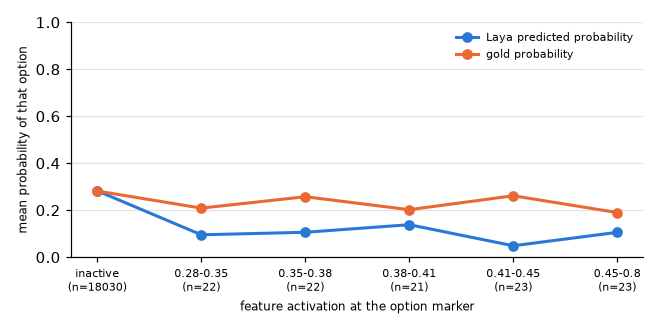

# Feature 3225

Critérios em que aparece: corr_error

**Interpretação (preencher):** 

---

## Maiores ativações

**tr_security_incidents_000215 / disposition** (choice, security_incidents) | ativação 4.160 em `estado` | opções ['close_benign', 'contain', 'investigate', 'monitor'] | Laya: **monitor** [0.225, 0.141, 0.054, 0.58] | gabarito: **investigate**

```
<bos> choice question: How should this security alert be dispositioned?<eos>
▸ <mask> close_benign: Expected, explainable activity; close without analyst time.
▸ <mask> contain: Contain the host or account immediately; do not wait for triage.
▸ <mask> investigate: Warrants an analyst opening an investigation.
▸ <mask> monitor: Not clearly malicious, but worth watching for recurrence.

<eos>

 {"alert": {"description": "audit logging was turned off on a host", "evidence": "System audit logging was deactivated on server PROD-DB-01 at 23:10 by a privileged administrator account. The action was performed from an unrecognized source using an account with a password age of 700 days during a period with⟦ no⟧ active change windows.", "rule": "disabled_logging"}, "context": {"asset_criticality": "low", "change_window_active": false, "source_on_allowlist": false}, "history": {"credential_rotation_days_ago": 700, "distinct_countries_30d": 2, "logins_30d": 633, "prior_alerts_90d": 0}, "principal": {"mfa_enrolled": true, "name": "usr-infra-797", "privileges": ["deploy:production", "secrets:read"], "type": "admin"}}<eos>
```

**tr_security_incidents_000215 / credential_compromise** (noul, security_incidents) | ativação 4.125 em `estado` | opções ['false', 'true'] | Laya: **true** [0.158, 0.842] | gabarito: **true**

```
<bos> noul question: The evidence indicates a credential or account has been compromised.<eos>
▸ <mask> false: no, the statement does not hold
▸ <mask> true: yes, the statement holds

<eos>

 {"alert": {"description": "audit logging was turned off on a host", "evidence": "System audit logging was deactivated on server PROD-DB-01 at 23:10 by a privileged administrator account. The action was performed from an unrecognized source using an account with a password age of 700 days during a period with⟦ no⟧ active change windows.", "rule": "disabled_logging"}, "context": {"asset_criticality": "low", "change_window_active": false, "source_on_allowlist": false}, "history": {"credential_rotation_days_ago": 700, "distinct_countries_30d": 2, "logins_30d": 633, "prior_alerts_90d": 0}, "principal": {"mfa_enrolled": true, "name": "usr-infra-797", "privileges": ["deploy:production", "secrets:read"], "type": "admin"}}<eos>
```

**tr_customer_service_000025 / needs_human** (noul, customer_service) | ativação 3.990 em `estado` | opções ['false', 'true'] | Laya: **true** [0.125, 0.875] | gabarito: **true**

```
<bos> noul question: This conversation requires a human agent rather than automated handling.<eos>
▸ <mask> false: Automation can carry this to resolution.
▸ <mask> true: A human must take over: judgement, authority or empathy is required.

<eos>

 {"account": {"lifetime_value_usd": 79, "prior_tickets_90d": 2, "seats": 1, "tenure_months": 5, "tier": "standard"}, "thread": [{"role": "customer", "text": "I am currently unable to log into my account. The system is rejecting my credentials even though they have not changed."}, {"role": "agent", "text": "I'm sorry to hear you're having trouble accessing the platform. Are you receiving a specific error message when you attempt to sign in?"}, {"role": "customer", "text": "It says 'Authentication Failed' in red text. This is the third time I've had to reach out about this same issue over the last five months, and it still isn't fixed."}, {"role": "agent", "text": "I see your previous tickets in the history. To help me narrow down the cause, have you tried clearing your browser cache or using an incognito window?"}, {"role": "customer", "text": "I have tried those steps and the result is the same. I have a hard deadline to submit my reports by the end of business today, so I need this resolved immediately."}, {"role": "agent", "text": "I understand the time constraint you are under. Could you tell me if you are using a VPN or a corporate firewall when trying to connect?"}, {"role": "customer", "text": "I am on a standard home network⟦ with⟧ no VPN. I am still locked out and I'm running out of time before my deadline."}]}<eos>
```

**tr_customer_service_000025 / action** (choice, customer_service) | ativação 3.945 em `estado` | opções ['answer_directly', 'close_no_action', 'escalate_to_human', 'execute_refund', 'request_information'] | Laya: **close_no_action** [0.011, 0.986, 0.0, 0.002, 0.0] | gabarito: **escalate_to_human**

```
<bos> choice question: What should the assistant do next with this conversation?<eos>
▸ <mask> answer_directly: The assistant can resolve this itself with information it already has.
▸ <mask> close_no_action: No further action is warranted; the matter is settled.
▸ <mask> escalate_to_human: Hand off to a human agent with the appropriate authority.
▸ <mask> execute_refund: Issue the refund or credit the customer is owed.
▸ <mask> request_information: More detail is needed from the customer before anything can be done.

<eos>

 {"account": {"lifetime_value_usd": 79, "prior_tickets_90d": 2, "seats": 1, "tenure_months": 5, "tier": "standard"}, "thread": [{"role": "customer", "text": "I am currently unable to log into my account. The system is rejecting my credentials even though they have not changed."}, {"role": "agent", "text": "I'm sorry to hear you're having trouble accessing the platform. Are you receiving a specific error message when you attempt to sign in?"}, {"role": "customer", "text": "It says 'Authentication Failed' in red text. This is the third time I've had to reach out about this same issue over the last five months, and it still isn't fixed."}, {"role": "agent", "text": "I see your previous tickets in the history. To help me narrow down the cause, have you tried clearing your browser cache or using an incognito window?"}, {"role": "customer", "text": "I have tried those steps and the result is the same. I have a hard deadline to submit my reports by the end of business today, so I need this resolved immediately."}, {"role": "agent", "text": "I understand the time constraint you are under. Could you tell me if you are using a VPN or a corporate firewall when trying to connect?"}, {"role": "customer", "text": "I am on a standard home network⟦ with⟧ no VPN. I am still locked out and I'm running out of time before my deadline."}]}<eos>
```

**tr_security_incidents_000215 / true_positive** (noul, security_incidents) | ativação 3.836 em `estado` | opções ['false', 'true'] | Laya: **true** [0.058, 0.942] | gabarito: **true**

```
<bos> noul question: This alert reflects genuinely malicious or unauthorised activity.<eos>
▸ <mask> false: Benign activity, a misconfiguration, or a known false positive.
▸ <mask> true: The underlying behaviour is malicious or unauthorised.

<eos>

 {"alert": {"description": "audit logging was turned off on a host", "evidence": "System audit logging was deactivated on server PROD-DB-01 at 23:10 by a privileged administrator account. The action was performed from an unrecognized source using an account with a password age of 700 days during a period with⟦ no⟧ active change windows.", "rule": "disabled_logging"}, "context": {"asset_criticality": "low", "change_window_active": false, "source_on_allowlist": false}, "history": {"credential_rotation_days_ago": 700, "distinct_countries_30d": 2, "logins_30d": 633, "prior_alerts_90d": 0}, "principal": {"mfa_enrolled": true, "name": "usr-infra-797", "privileges": ["deploy:production", "secrets:read"], "type": "admin"}}<eos>
```

## Ativações medianas (faixa 40-60%, mediana 0.847)

**tr_security_incidents_000279 / credential_compromise** (noul, security_incidents) | ativação 0.787 em `estado` | opções ['false', 'true'] | Laya: **false** [0.967, 0.033] | gabarito: **false**

```
<bos> noul question: The evidence indicates a credential or account has been compromised.<eos>
▸ <mask> false: no, the statement does not hold
▸ <mask> true: yes, the statement holds

<eos>

 {"alert": {"description": "a security group was opened to the public internet", "evidence": "At 2026-09-15 14:23 UTC an inbound rule allowing 0⟦.⟧0.0.0/0 on TCP port 22 was added to security group SG-7F9C3A by employee@example.com from source IP 203.0.113.45. The change occurred while the designated change window was open and the employee's credentials were last rotated 700 days prior.", "rule": "config_drift"}, "context": {"asset_criticality": "low", "change_window_active": true, "source_on_allowlist": false}, "history": {"credential_rotation_days_ago": 700, "distinct_countries_30d": 1, "logins_30d": 712, "prior_alerts_90d": 1}, "principal": {"mfa_enrolled": true, "name": "adm-support-918", "privileges": ["repo:read"], "type": "employee"}}<eos>
```

**tr_invoice_processing_000236 / matches_order** (noul, invoice_processing) | ativação 0.977 em `estado` | opções ['false', 'true'] | Laya: **true** [0.023, 0.977] | gabarito: **true**

```
<bos> noul question: The invoice reconciles with the purchase order and the recorded delivery.<eos>
▸ <mask> false: There is a discrepancy against the order or the delivery.
▸ <mask> true: Line items, quantities and amounts reconcile.

<eos>

 {"delivery": {"condition": "accepted", "date": "2026-03-12", "received_qty": 100}, "invoice": {"currency": "USD", "id": "INV-2026-1634", "lines": [{"qty": 1⟦0⟧0, "sku": "SKU-778", "total_usd": 10547.0, "unit_usd": 105.47}], "total_usd": 10547.0, "vendor": "Vantage Materials"}, "payment": {"days_until_due": 11, "discount_expires_in_days": null, "early_payment_discount_pct": null, "status": "scheduled", "terms": "net 30"}, "purchase_order": {"freight_terms": "freight prepaid by vendor, not separately billable", "id": "PO-9952", "lines": [{"qty": 100, "unit_usd": 105.47}], "total_usd": 10547.0}, "vendor_history": {"disputes_12m": 0, "invoices_12m": 23, "prior_invoice_ids": ["INV-2026-7453", "INV-2026-1696", "INV-2026-9853"]}}<eos>
```

**tr_customer_service_000191 / churn_risk** (score, customer_service) | ativação 0.782 em `opção` | opções ['0', '1', '2', '3'] | Laya: **1** [0.031, 0.841, 0.106, 0.022] | gabarito: **3**

```
<bos> score question: How likely is this customer to stop doing business with us because of this interaction?<eos>
▸ <mask> level 0: No sign of dissatisfaction.
▸ <mask> level 1: Mild frustration, but the relationship is intact.
▸ <mask> level 2: Clearly unhappy; repeat problems or explicit complaints.
▸ <mask>⟦ level⟧ 3: Imminent: threatening to cancel, dispute or leave.

<eos>

 {"account": {"lifetime_value_usd": 35, "prior_tickets_90d": 5, "seats": 1, "tenure_months": 1, "tier": "standard"}, "thread": [{"role": "customer", "text": "I’m done with this login nonsense. I’ve only been on the standard plan for a month, and already I can’t get into my dashboard. I’ve opened five tickets already that never got resolved, and I’m ready to cancel."}, {"role": "agent", "text": "I hear your frustration. Can you tell me the exact message you see when you attempt to sign in and the browser you’re using?"}, {"role": "customer", "text": "It just loops back to the login page with no error, even after clearing cookies. I’ve tried Chrome and Firefox, same thing."}]}<eos>
```

**tr_customer_service_000141 / action** (choice, customer_service) | ativação 0.976 em `estado` | opções ['answer_directly', 'close_no_action', 'escalate_to_human', 'execute_refund', 'request_information'] | Laya: **close_no_action** [0.221, 0.77, 0.004, 0.004, 0.002] | gabarito: **escalate_to_human**

```
<bos> choice question: What should the assistant do next with this conversation?<eos>
▸ <mask> answer_directly: The assistant can resolve this itself with information it already has.
▸ <mask> close_no_action: No further action is warranted; the matter is settled.
▸ <mask> escalate_to_human: Hand off to a human agent with the appropriate authority.
▸ <mask> execute_refund: Issue the refund or credit the customer is owed.
▸ <mask> request_information: More detail is needed from the customer before anything can be done.

<eos>

 {"account": {"lifetime_value_usd": 225, "prior_tickets_90d": 5, "seats⟦":⟧ 1, "tenure_months": 3, "tier": "standard"}, "orders": [{"amount_usd": 297, "date": "2026-01-07", "id": "A-98625", "status": "pending"}], "thread": [{"role": "customer", "text": "My service has been running significantly slower than usual over the last week, even though I'm paying $297 monthly."}, {"role": "agent", "text": "I am sorry to hear you are experiencing latency issues. Could you please run a speed test and share the results with me so I can review your connection logs?"}, {"role": "customer", "text": "I've already run three tests and they show speeds are at 10% of what I'm promised. I've logged five tickets about this already with no progress."}]}<eos>
```

**tr_customer_service_000191 / churn_risk** (score, customer_service) | ativação 0.922 em `opção` | opções ['0', '1', '2', '3'] | Laya: **1** [0.031, 0.841, 0.106, 0.022] | gabarito: **3**

```
<bos> score question: How likely is this customer to stop doing business with us because of this interaction?<eos>
▸ <mask> level 0: No sign of dissatisfaction.
▸ <mask> level 1: Mild frustration, but the relationship is intact.
▸ <mask> level 2: Clearly unhappy; repeat problems or explicit complaints.
▸ <mask> level 3: Imminent:⟦ threatening⟧ to cancel, dispute or leave.

<eos>

 {"account": {"lifetime_value_usd": 35, "prior_tickets_90d": 5, "seats": 1, "tenure_months": 1, "tier": "standard"}, "thread": [{"role": "customer", "text": "I’m done with this login nonsense. I’ve only been on the standard plan for a month, and already I can’t get into my dashboard. I’ve opened five tickets already that never got resolved, and I’m ready to cancel."}, {"role": "agent", "text": "I hear your frustration. Can you tell me the exact message you see when you attempt to sign in and the browser you’re using?"}, {"role": "customer", "text": "It just loops back to the login page with no error, even after clearing cookies. I’ve tried Chrome and Firefox, same thing."}]}<eos>
```

## Estatísticas (conjunto de descoberta, dev e teste)

**pred / error**

| split | decisões | ativas | ativas e Laya errou | taxa | lift | q (BH) | OR (CMH) | q (CMH) |
|---|---|---|---|---|---|---|---|---|
| discovery | 5100 | 3 | 3 | 1.000 | 1.55 | nan | nan | nan |
| dev | 900 | 3 | 3 | 1.000 | 1.49 | nan | nan | nan |
| test | 2000 | 2 | 2 | 1.000 | 1.54 | nan | nan | nan |

**corr / error**

| split | decisões | ativas | ativas e Laya errou | taxa | lift | q (BH) | OR (CMH) | q (CMH) |
|---|---|---|---|---|---|---|---|---|
| discovery | 5100 | 25 | 25 | 1.000 | 1.55 | 6.46e-05 | inf | 0.2 |
| dev | 900 | 5 | 5 | 1.000 | 1.49 | nan | nan | nan |
| test | 2000 | 8 | 8 | 1.000 | 1.54 | nan | nan | nan |

**state / error**

| split | decisões | ativas | ativas e Laya errou | taxa | lift | q (BH) | OR (CMH) | q (CMH) |
|---|---|---|---|---|---|---|---|---|
| discovery | 5100 | 1850 | 1175 | 0.635 | 0.99 | 0.512 | 1.11 | 0.449 |
| dev | 900 | 319 | 209 | 0.655 | 0.97 | 0.811 | 1.15 | 0.762 |
| test | 2000 | 701 | 451 | 0.643 | 0.99 | 0.882 | 1.12 | 0.686 |

**pred / probe_right_laya_wrong**

| split | decisões | ativas | ativas e Laya errou | taxa | lift | q (BH) | OR (CMH) | q (CMH) |
|---|---|---|---|---|---|---|---|---|
| discovery | 2932 | 2 | 2 | 1.000 | 1.65 | nan | nan | nan |
| dev | 523 | 1 | 1 | 1.000 | 1.55 | nan | nan | nan |
| test | 1149 | 1 | 1 | 1.000 | 1.64 | nan | nan | nan |

**corr / probe_right_laya_wrong**

| split | decisões | ativas | ativas e Laya errou | taxa | lift | q (BH) | OR (CMH) | q (CMH) |
|---|---|---|---|---|---|---|---|---|
| discovery | 2932 | 9 | 9 | 1.000 | 1.65 | nan | nan | nan |
| dev | 523 | 2 | 2 | 1.000 | 1.55 | nan | nan | nan |
| test | 1149 | 2 | 2 | 1.000 | 1.64 | nan | nan | nan |

**state / probe_right_laya_wrong**

| split | decisões | ativas | ativas e Laya errou | taxa | lift | q (BH) | OR (CMH) | q (CMH) |
|---|---|---|---|---|---|---|---|---|
| discovery | 2932 | 1054 | 617 | 0.585 | 0.97 | 0.186 | 1.18 | 0.267 |
| dev | 523 | 181 | 114 | 0.630 | 0.97 | 0.891 | 1.41 | 0.426 |
| test | 1149 | 403 | 245 | 0.608 | 1.00 | 1 | 1.35 | 0.249 |

Confusão mais sobre-representada (pred): `churn_risk|3>1` (n=1, lift 340.00, p=nan). Formato `pergunta|índice previsto>índice correto`.

Confusão mais sobre-representada (corr): `action|3>2` (n=22, lift 39.03, p=1.57e-34). Formato `pergunta|índice previsto>índice correto`.

Confusão mais sobre-representada (state): `action|1>2` (n=52, lift 2.02, p=1.95e-10). Formato `pergunta|índice previsto>índice correto`.



