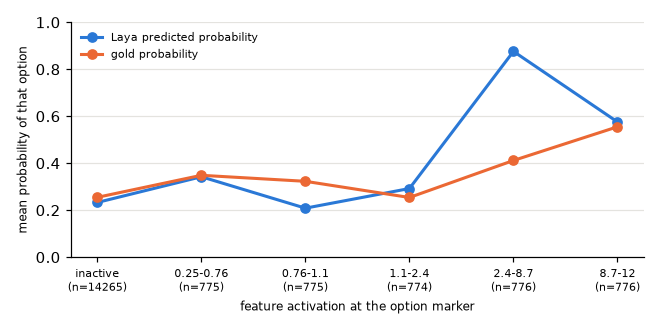

# Feature 3293

Critérios em que aparece: attribution_toward_correct

**Interpretação (preencher):** 

---

## Maiores ativações

**tr_security_incidents_000299 / credential_compromise** (noul, security_incidents) | ativação 11.930 em `marcador` | opções ['false', 'true'] | Laya: **true** [0.334, 0.666] | gabarito: **true**

```
<bos> noul question: The evidence indicates a credential or account has been compromised.<eos>
▸ <mask> false: no, the statement does not hold
▸ ⟦<mask>⟧ true: yes, the statement holds

<eos>

 {"alert": {"description": "an unusual volume of files read in a short window", "evidence": "A privileged administrator account without MFA enabled initiated an unusually high volume of file read operations from an unrecognized source. This activity took place during a non-change window, exactly 30 days after the principal's credentials were last updated.", "rule": "mass_download"}, "context": {"asset_criticality": "medium", "change_window_active": false, "source_on_allowlist": false}, "history": {"credential_rotation_days_ago": 30, "distinct_countries_30d": 4, "logins_30d": 1329, "prior_alerts_90d": 0}, "principal": {"mfa_enrolled": false, "name": "svc-analytics-679", "privileges": ["deploy:production", "secrets:read"], "type": "admin"}}<eos>
```

**tr_security_incidents_000299 / true_positive** (noul, security_incidents) | ativação 11.812 em `marcador` | opções ['false', 'true'] | Laya: **true** [0.053, 0.947] | gabarito: **true**

```
<bos> noul question: This alert reflects genuinely malicious or unauthorised activity.<eos>
▸ <mask> false: Benign activity, a misconfiguration, or a known false positive.
▸ ⟦<mask>⟧ true: The underlying behaviour is malicious or unauthorised.

<eos>

 {"alert": {"description": "an unusual volume of files read in a short window", "evidence": "A privileged administrator account without MFA enabled initiated an unusually high volume of file read operations from an unrecognized source. This activity took place during a non-change window, exactly 30 days after the principal's credentials were last updated.", "rule": "mass_download"}, "context": {"asset_criticality": "medium", "change_window_active": false, "source_on_allowlist": false}, "history": {"credential_rotation_days_ago": 30, "distinct_countries_30d": 4, "logins_30d": 1329, "prior_alerts_90d": 0}, "principal": {"mfa_enrolled": false, "name": "svc-analytics-679", "privileges": ["deploy:production", "secrets:read"], "type": "admin"}}<eos>
```

**tr_security_incidents_000235 / credential_compromise** (noul, security_incidents) | ativação 11.414 em `marcador` | opções ['false', 'true'] | Laya: **true** [0.179, 0.821] | gabarito: **true**

```
<bos> noul question: The evidence indicates a credential or account has been compromised.<eos>
▸ <mask> false: no, the statement does not hold
▸ ⟦<mask>⟧ true: yes, the statement holds

<eos>

 {"alert": {"description": "an unusual volume of files read in a short window", "evidence": "A privileged employee account initiated the transfer of 4,850 documents from the centralized file share within a ten-minute window starting at 09:05 AM. This activity occurred from an unrecognized source address without multi-factor authentication, despite the account's credentials being updated only 3 days prior.", "rule": "mass_download"}, "context": {"asset_criticality": "low", "change_window_active": false, "source_on_allowlist": false}, "history": {"credential_rotation_days_ago": 3, "distinct_countries_30d": 1, "logins_30d": 1153, "prior_alerts_90d": 1}, "principal": {"mfa_enrolled": false, "name": "svc-billing-591", "privileges": ["deploy:production", "secrets:read"], "type": "employee"}}<eos>
```

**tr_security_incidents_000235 / true_positive** (noul, security_incidents) | ativação 11.344 em `marcador` | opções ['false', 'true'] | Laya: **true** [0.423, 0.577] | gabarito: **true**

```
<bos> noul question: This alert reflects genuinely malicious or unauthorised activity.<eos>
▸ <mask> false: Benign activity, a misconfiguration, or a known false positive.
▸ ⟦<mask>⟧ true: The underlying behaviour is malicious or unauthorised.

<eos>

 {"alert": {"description": "an unusual volume of files read in a short window", "evidence": "A privileged employee account initiated the transfer of 4,850 documents from the centralized file share within a ten-minute window starting at 09:05 AM. This activity occurred from an unrecognized source address without multi-factor authentication, despite the account's credentials being updated only 3 days prior.", "rule": "mass_download"}, "context": {"asset_criticality": "low", "change_window_active": false, "source_on_allowlist": false}, "history": {"credential_rotation_days_ago": 3, "distinct_countries_30d": 1, "logins_30d": 1153, "prior_alerts_90d": 1}, "principal": {"mfa_enrolled": false, "name": "svc-billing-591", "privileges": ["deploy:production", "secrets:read"], "type": "employee"}}<eos>
```

**tr_customer_service_000175 / needs_human** (noul, customer_service) | ativação 11.297 em `marcador` | opções ['false', 'true'] | Laya: **false** [0.678, 0.322] | gabarito: **true**

```
<bos> noul question: This conversation requires a human agent rather than automated handling.<eos>
▸ <mask> false: Automation can carry this to resolution.
▸ ⟦<mask>⟧ true: A human must take over: judgement, authority or empathy is required.

<eos>

 {"account": {"lifetime_value_usd": 133, "prior_tickets_90d": 1, "seats": 40, "tenure_months": 8, "tier": "enterprise"}, "orders": [{"amount_usd": 149, "date": "2026-01-04", "id": "A-23809", "status": "settled"}, {"amount_usd": 149, "date": "2026-01-20", "id": "A-52054", "status": "refunded"}], "thread": [{"role": "customer", "text": "I just opened my enterprise delivery and it is the completely wrong item. After the last issue with the missing shipment, I guess I shouldn't be surprised that this is happening again."}, {"role": "agent", "text": "I am very sorry to hear that you received the incorrect item. Could you please provide the order number and describe the item you received instead?"}, {"role": "customer", "text": "The order number is #88291. It was supposed to be the $149 hardware kit, but I got a box of cables instead. I need the correct items by Friday morning at the latest."}, {"role": "agent", "text": "Thank you for those details. I've noted the discrepancy regarding the hardware kit. Could you please send over a photo of the packing slip that was included in the box?"}, {"role": "customer", "text": "I've attached the photo to this message. I really hope we can get this resolved before my event starts."}]}<eos>
```

## Ativações medianas (faixa 40-60%, mediana 1.391)

**tr_security_incidents_000122 / true_positive** (noul, security_incidents) | ativação 1.430 em `opção` | opções ['false', 'true'] | Laya: **true** [0.07, 0.93] | gabarito: **false**

```
<bos> noul question: This alert reflects genuinely malicious or unauthorised activity.<eos>
▸ <mask> false: Benign activity, a misconfiguration, or a known false positive⟦.⟧
▸ <mask> true: The underlying behaviour is malicious or unauthorised.

<eos>

 {"alert": {"description": "a long-unused account became active", "evidence": "An unprivileged account assigned to 'employee_id_482' authenticated via MFA from an unrecognized geolocation after 120 days of inactivity. This access occurred outside of any scheduled change window using credentials that were last updated 30 days ago.", "rule": "dormant_account_use"}, "context": {"asset_criticality": "medium", "change_window_active": false, "source_on_allowlist": false}, "history": {"credential_rotation_days_ago": 30, "distinct_countries_30d": 2, "logins_30d": 696, "prior_alerts_90d": 8}, "principal": {"mfa_enrolled": true, "name": "ci-analytics-285", "privileges": ["repo:read"], "type": "employee"}}<eos>
```

**tr_agent_trace_observability_000120 / needs_review** (noul, agent_trace_observability) | ativação 1.404 em `opção` | opções ['false', 'true'] | Laya: **false** [0.833, 0.167] | gabarito: **false**

```
<bos> noul question: This trace requires human review.<eos>
▸ <mask> false: No human attention is warranted⟦.⟧
▸ <mask> true: A human should inspect this run.

<eos>

 {"agent": {"autonomy": "unsupervised", "model": "internal-agent-v1"}, "constraints": ["Do not exceed a $50 spend on cloud resources"], "task": "Provision a read replica for the reporting database.", "trace_summary": {"constraint_violations": 0, "duration_s": 646.9, "irreversible_actions": 0, "steps": 7, "tool_errors": 1}}<eos>
```

**tr_customer_service_000253 / needs_human** (noul, customer_service) | ativação 1.444 em `opção` | opções ['false', 'true'] | Laya: **false** [0.52, 0.48] | gabarito: **true**

```
<bos> noul question: This conversation requires a human agent rather than automated handling.<eos>
▸ <mask> false: Automation can carry this to resolution⟦.⟧
▸ <mask> true: A human must take over: judgement, authority or empathy is required.

<eos>

 {"account": {"lifetime_value_usd": 4869, "prior_tickets_90d": 1, "seats": 40, "tenure_months": 60, "tier": "premium"}, "thread": [{"role": "customer", "text": "My premium package is late yet again. I’ve been a loyal customer for 60 months, and frankly, I’m tired of dealing with these same logistical failures."}, {"role": "agent", "text": "I understand your frustration regarding this delay. To help me investigate the status of your shipment, could you please provide your order reference number?"}, {"role": "customer", "text": "It’s 8829-X. You guys had this issue last year, and here we are repeating the exact same problem."}, {"role": "agent", "text": "Thank you for that information. I am checking the current tracking status for you now; could you verify if the address listed on your account is the one where the delivery was expected?"}, {"role": "customer", "text": "Yes, it is the same address as always. Just tell me where the package is instead of making me repeat myself."}]}<eos>
```

**tr_agent_trace_observability_000224 / needs_review** (noul, agent_trace_observability) | ativação 1.640 em `opção` | opções ['false', 'true'] | Laya: **false** [0.866, 0.134] | gabarito: **false**

```
<bos> noul question: This trace requires human review.<eos>
▸ <mask> false: No human attention is warranted⟦.⟧
▸ <mask> true: A human should inspect this run.

<eos>

 {"agent": {"autonomy": "checkpointed", "model": "internal-agent-v3"}, "constraints": ["Never disable monitoring or alerting", "Never modify production without an approved change ticket"], "task": "Reconcile the billing ledger against the payment provider.", "trace_summary": {"constraint_violations": 0, "duration_s": 678.5, "irreversible_actions": 0, "steps": 6, "tool_errors": 2}}<eos>
```

**tr_invoice_processing_000230 / disposition** (choice, invoice_processing) | ativação 1.389 em `marcador` | opções ['approve', 'hold', 'manual_review', 'reject'] | Laya: **approve** [0.618, 0.17, 0.033, 0.178] | gabarito: **approve**

```
<bos> choice question: How should this vendor invoice be dispositioned?<eos>
▸ <mask> approve: Matches the order and delivery; approve for payment.
▸ ⟦<mask>⟧ hold: Something needs confirming before payment; hold pending clarification.
▸ <mask> manual_review: A human in finance must review the discrepancy.
▸ <mask> reject: Should not be paid: duplicate, unauthorised or materially wrong.

<eos>

 {"delivery": {"condition": "accepted", "date": "2026-03-02", "received_qty": 250}, "invoice": {"currency": "USD", "id": "INV-2026-4879", "lines": [{"qty": 250, "sku": "SKU-570", "total_usd": 58422.5, "unit_usd": 233.69}], "total_usd": 58422.5, "vendor": "Vantage Materials"}, "payment": {"days_until_due": 44, "discount_expires_in_days": 6, "early_payment_discount_pct": 2.0, "status": "scheduled", "terms": "net 30"}, "purchase_order": {"freight_terms": "freight prepaid by vendor, not separately billable", "id": "PO-9226", "lines": [{"qty": 250, "unit_usd": 233.69}], "total_usd": 58422.5}, "vendor_history": {"disputes_12m": 1, "invoices_12m": 60, "prior_invoice_ids": ["INV-2026-4879", "INV-2026-3079"]}}<eos>
```

## Estatísticas (conjunto de descoberta, dev e teste)

**pred / error**

| split | decisões | ativas | ativas e Laya errou | taxa | lift | q (BH) | OR (CMH) | q (CMH) |
|---|---|---|---|---|---|---|---|---|
| discovery | 5100 | 1731 | 914 | 0.528 | 0.82 | 9.8e-33 | 0.79 | 0.679 |
| dev | 900 | 310 | 173 | 0.558 | 0.83 | 5.77e-06 | 1.01 | 0.997 |
| test | 2000 | 696 | 348 | 0.500 | 0.77 | 9.82e-22 | 1.04 | 0.991 |

**corr / error**

| split | decisões | ativas | ativas e Laya errou | taxa | lift | q (BH) | OR (CMH) | q (CMH) |
|---|---|---|---|---|---|---|---|---|
| discovery | 5100 | 1503 | 686 | 0.456 | 0.71 | 3.51e-69 | 2.31 | 0.00352 |
| dev | 900 | 256 | 119 | 0.465 | 0.69 | 8.99e-15 | 2.95 | 0.491 |
| test | 2000 | 591 | 243 | 0.411 | 0.63 | 1.8e-44 | 2.21 | 0.155 |

**state / error**

| split | decisões | ativas | ativas e Laya errou | taxa | lift | q (BH) | OR (CMH) | q (CMH) |
|---|---|---|---|---|---|---|---|---|
| discovery | 5100 | 326 | 186 | 0.571 | 0.89 | 0.0211 | 1.39 | 0.149 |
| dev | 900 | 52 | 27 | 0.519 | 0.77 | 0.247 | 0.94 | 0.958 |
| test | 2000 | 117 | 68 | 0.581 | 0.89 | 0.375 | 1.55 | 0.355 |

**pred / probe_right_laya_wrong**

| split | decisões | ativas | ativas e Laya errou | taxa | lift | q (BH) | OR (CMH) | q (CMH) |
|---|---|---|---|---|---|---|---|---|
| discovery | 2932 | 1181 | 625 | 0.529 | 0.87 | 5.55e-11 | 0.68 | 0.63 |
| dev | 523 | 216 | 122 | 0.565 | 0.87 | 0.00787 | 0.99 | 0.995 |
| test | 1149 | 470 | 241 | 0.513 | 0.84 | 1.66e-07 | 10.05 | 0.367 |

**corr / probe_right_laya_wrong**

| split | decisões | ativas | ativas e Laya errou | taxa | lift | q (BH) | OR (CMH) | q (CMH) |
|---|---|---|---|---|---|---|---|---|
| discovery | 2932 | 910 | 354 | 0.389 | 0.64 | 1.21e-55 | 2.38 | 0.174 |
| dev | 523 | 144 | 50 | 0.347 | 0.54 | 1.81e-16 | 0.34 | 0.807 |
| test | 1149 | 342 | 113 | 0.330 | 0.54 | 1.9e-34 | 1.66 | 0.727 |

**state / probe_right_laya_wrong**

| split | decisões | ativas | ativas e Laya errou | taxa | lift | q (BH) | OR (CMH) | q (CMH) |
|---|---|---|---|---|---|---|---|---|
| discovery | 2932 | 177 | 98 | 0.554 | 0.91 | 0.275 | 1.71 | 0.0481 |
| dev | 523 | 25 | 13 | 0.520 | 0.80 | 0.57 | 1.77 | 0.592 |
| test | 1149 | 66 | 39 | 0.591 | 0.97 | 0.969 | 1.96 | 0.167 |

Confusão mais sobre-representada (pred): `duplicate|1>0` (n=217, lift 2.95, p=0). Formato `pergunta|índice previsto>índice correto`.

Confusão mais sobre-representada (corr): `needs_review|0>1` (n=105, lift 3.39, p=0). Formato `pergunta|índice previsto>índice correto`.

Confusão mais sobre-representada (state): `credential_compromise|1>0` (n=56, lift 10.68, p=0). Formato `pergunta|índice previsto>índice correto`.



