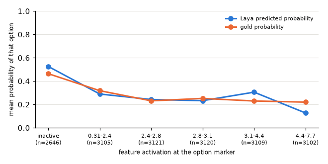

# Feature 3412

Critérios em que aparece: attribution_toward_correct

**Interpretação (preencher):** 

---

## Maiores ativações

**tr_customer_service_000171 / action** (choice, customer_service) | ativação 7.715 em `marcador` | opções ['answer_directly', 'close_no_action', 'escalate_to_human', 'execute_refund', 'request_information'] | Laya: **close_no_action** [0.236, 0.738, 0.013, 0.008, 0.005] | gabarito: **request_information**

```
<bos> choice question: What should the assistant do next with this conversation?<eos>
▸ <mask> answer_directly: The assistant can resolve this itself with information it already has.
▸ <mask> close_no_action: No further action is warranted; the matter is settled.
▸ <mask> escalate_to_human: Hand off to a human agent with the appropriate authority.
▸ <mask> execute_refund: Issue the refund or credit the customer is owed.
▸ ⟦<mask>⟧ request_information: More detail is needed from the customer before anything can be done.

<eos>

 {"account": {"lifetime_value_usd": 2300, "prior_tickets_90d": 0, "seats": 1, "tenure_months": 26, "tier": "standard"}, "orders": [{"amount_usd": 49, "date": "2026-02-14", "id": "A-88180", "status": "refunded"}, {"amount_usd": 49, "date": "2026-02-22", "id": "A-79800", "status": "settled"}, {"amount_usd": 49, "date": "2026-02-08", "id": "A-91927", "status": "refunded"}], "thread": [{"role": "customer", "text": "The service is painfully slow right now—I'm on a deadline and can't get anything done."}, {"role": "agent", "text": "I hear the urgency. Can you tell me which device and operating system you’re using?"}, {"role": "customer", "text": "It’s a Windows 10 desktop, and the slowdown started after the latest update."}, {"role": "agent", "text": "Thanks for the details. Have you tried clearing the application cache or restarting the app?"}, {"role": "customer", "text": "Yes, I cleared everything and rebooted, but it’s still crawling. I need this resolved quickly."}]}<eos>
```

**tr_customer_service_000297 / action** (choice, customer_service) | ativação 7.695 em `marcador` | opções ['answer_directly', 'close_no_action', 'escalate_to_human', 'execute_refund', 'request_information'] | Laya: **answer_directly** [0.508, 0.205, 0.246, 0.017, 0.024] | gabarito: **answer_directly**

```
<bos> choice question: What should the assistant do next with this conversation?<eos>
▸ <mask> answer_directly: The assistant can resolve this itself with information it already has.
▸ <mask> close_no_action: No further action is warranted; the matter is settled.
▸ <mask> escalate_to_human: Hand off to a human agent with the appropriate authority.
▸ ⟦<mask>⟧ execute_refund: Issue the refund or credit the customer is owed.
▸ <mask> request_information: More detail is needed from the customer before anything can be done.

<eos>

 {"account": {"lifetime_value_usd": 581, "prior_tickets_90d": 2, "seats": 40, "tenure_months": 11, "tier": "enterprise"}, "orders": [{"amount_usd": 299, "date": "2026-03-03", "id": "A-90996", "status": "settled"}], "thread": [{"role": "customer", "text": "I just opened the box and the hardware is cracked, but I'm not sure if this happened during shipping or if it was like this already? I have a hard deadline this Friday and really need this working."}, {"role": "agent", "text": "I'm sorry to hear about the damage. To help me look into this, could you please provide your order number and upload a few photos of the packaging?"}, {"role": "customer", "text": "I think I sent photos in my last two tickets, but I can't remember if they actually saw them. Where do I upload them again?"}]}<eos>
```

**tr_customer_service_000180 / action** (choice, customer_service) | ativação 7.695 em `marcador` | opções ['answer_directly', 'close_no_action', 'escalate_to_human', 'execute_refund', 'request_information'] | Laya: **close_no_action** [0.028, 0.962, 0.002, 0.004, 0.004] | gabarito: **escalate_to_human**

```
<bos> choice question: What should the assistant do next with this conversation?<eos>
▸ <mask> answer_directly: The assistant can resolve this itself with information it already has.
▸ <mask> close_no_action: No further action is warranted; the matter is settled.
▸ ⟦<mask>⟧ escalate_to_human: Hand off to a human agent with the appropriate authority.
▸ <mask> execute_refund: Issue the refund or credit the customer is owed.
▸ <mask> request_information: More detail is needed from the customer before anything can be done.

<eos>

 {"account": {"lifetime_value_usd": 1386, "prior_tickets_90d": 0, "seats": 5, "tenure_months": 33, "tier": "premium"}, "orders": [{"amount_usd": 29, "date": "2026-01-04", "id": "A-58867", "status": "settled"}], "thread": [{"role": "customer", "text": "I need you to fix our seat management right now – we can't add any new users and the dashboard keeps throwing a 500 error. If this isn’t sorted out immediately I’m pulling us off the platform."}, {"role": "agent", "text": "I’m sorry you’re seeing that, and I understand the urgency. Could you tell me which team or project you’re trying to add seats to?"}, {"role": "customer", "text": "It’s the Sales Ops group – the “Add Seats” button just spins forever after I enter the email addresses, and none of the new accounts appear."}, {"role": "agent", "text": "Thanks for the detail. Are you getting any specific error message besides the spinner, maybe in the console or an email notification?"}, {"role": "customer", "text": "No email, just the endless loading. I’ve tried clearing cache, different browsers, everything. I need this resolved today or we’re out."}]}<eos>
```

**tr_customer_service_000128 / action** (choice, customer_service) | ativação 7.688 em `marcador` | opções ['answer_directly', 'close_no_action', 'escalate_to_human', 'execute_refund', 'request_information'] | Laya: **answer_directly** [0.877, 0.082, 0.01, 0.022, 0.009] | gabarito: **escalate_to_human**

```
<bos> choice question: What should the assistant do next with this conversation?<eos>
▸ <mask> answer_directly: The assistant can resolve this itself with information it already has.
▸ <mask> close_no_action: No further action is warranted; the matter is settled.
▸ <mask> escalate_to_human: Hand off to a human agent with the appropriate authority.
▸ <mask> execute_refund: Issue the refund or credit the customer is owed.
▸ ⟦<mask>⟧ request_information: More detail is needed from the customer before anything can be done.

<eos>

 {"account": {"lifetime_value_usd": 820, "prior_tickets_90d": 5, "seats": 12, "tenure_months": 11, "tier": "enterprise"}, "thread": [{"role": "customer", "text": "Hello, I'm reaching out because the analytics dashboard we rely on has stopped updating. We've been on the enterprise plan for about 11 months, and I've already opened several tickets (five in total) where the issue was only partially resolved."}, {"role": "agent", "text": "I’m sorry to hear the dashboard isn’t updating. Could you let me know when you first noticed the problem and whether any error messages appear?"}, {"role": "customer", "text": "It started this morning; the page loads but the charts stay blank, and the console shows a 502 error. I’ve tried clearing caches and restarting the service, but nothing changes."}]}<eos>
```

**tr_customer_service_000207 / action** (choice, customer_service) | ativação 7.684 em `marcador` | opções ['answer_directly', 'close_no_action', 'escalate_to_human', 'execute_refund', 'request_information'] | Laya: **close_no_action** [0.256, 0.671, 0.015, 0.055, 0.003] | gabarito: **escalate_to_human**

```
<bos> choice question: What should the assistant do next with this conversation?<eos>
▸ <mask> answer_directly: The assistant can resolve this itself with information it already has.
▸ <mask> close_no_action: No further action is warranted; the matter is settled.
▸ <mask> escalate_to_human: Hand off to a human agent with the appropriate authority.
▸ <mask> execute_refund: Issue the refund or credit the customer is owed.
▸ ⟦<mask>⟧ request_information: More detail is needed from the customer before anything can be done.

<eos>

 {"account": {"lifetime_value_usd": 17, "prior_tickets_90d": 0, "seats": 1, "tenure_months": 1, "tier": "premium"}, "orders": [{"amount_usd": 149, "date": "2026-01-08", "id": "A-46380", "status": "settled"}], "thread": [{"role": "customer", "text": "I thought I could switch to the Basic plan, but my account still shows I'm on Premium and I'm being charged $149. I'm not sure what's happening."}, {"role": "agent", "text": "I’m sorry for the mix‑up. Just to double‑check, could you tell me the email address linked to your account and when you tried to make the change?"}, {"role": "customer", "text": "The email is jane.doe@example.com. I clicked the downgrade button in the dashboard yesterday evening, after being on Premium for a month."}, {"role": "agent", "text": "Got it, thank you. I see the downgrade request in the system, but it looks like the change didn’t finish processing. Have you received any confirmation email about the downgrade?"}, {"role": "customer", "text": "No, I didn’t get any email. The dashboard still says Premium, and my next payment of $149 is scheduled for tomorrow."}, {"role": "agent", "text": "Understood. I’ll look into why the request got stuck. Could you let me know if you made the change from a mobile app or the web portal?"}, {"role": "customer", "text": "I used the web portal on Chrome. I’m just hoping this can be sorted before the next charge hits."}]}<eos>
```

## Ativações medianas (faixa 40-60%, mediana 2.781)

**tr_customer_service_000146 / churn_risk** (score, customer_service) | ativação 2.789 em `marcador` | opções ['0', '1', '2', '3'] | Laya: **1** [0.078, 0.531, 0.287, 0.104] | gabarito: **0**

```
<bos> score question: How likely is this customer to stop doing business with us because of this interaction?<eos>
▸ ⟦<mask>⟧ level 0: No sign of dissatisfaction.
▸ <mask> level 1: Mild frustration, but the relationship is intact.
▸ <mask> level 2: Clearly unhappy; repeat problems or explicit complaints.
▸ <mask> level 3: Imminent: threatening to cancel, dispute or leave.

<eos>

 {"account": {"lifetime_value_usd": 114, "prior_tickets_90d": 0, "seats": 12, "tenure_months": 2, "tier": "premium"}, "thread": [{"role": "customer", "text": "Good afternoon, could you please send me a copy of my most recent invoice? I’m on the Premium plan and have only been a customer for two months, so I need it for my records."}, {"role": "agent", "text": "Certainly, I can help with that. Which invoice are you looking for—the one from May or the one from June 2026?"}, {"role": "customer", "text": "I need the June 2026 invoice, please."}]}<eos>
```

**tr_customer_service_000224 / category** (choice, customer_service) | ativação 2.709 em `marcador` | opções ['account', 'billing', 'delivery', 'refund', 'technical'] | Laya: **technical** [0.077, 0.004, 0.002, 0.002, 0.913] | gabarito: **technical**

```
<bos> choice question: What is this customer conversation primarily about?<eos>
▸ <mask> account: Login, plan changes, profile or access management.
▸ <mask> billing: A charge, invoice, subscription or payment problem.
▸ <mask> delivery: Shipping, fulfilment or delivery of a physical item.
▸ <mask> refund: The customer is explicitly asking for money back.
▸ ⟦<mask>⟧ technical: The product or service is not working as expected.

<eos>

 {"account": {"lifetime_value_usd": 3096, "prior_tickets_90d": 1, "seats": 1, "tenure_months": 60, "tier": "standard"}, "thread": [{"role": "customer", "text": "I’ve been on the standard plan for five years, but the bulk export feature has stopped working since the last update."}, {"role": "agent", "text": "I am sorry to hear you're experiencing trouble with the export tool. Could you please confirm if you're receiving a specific error code when you attempt the download?"}, {"role": "customer", "text": "There isn't an error code; the progress bar just freezes at 20% and stays there until the page times out."}, {"role": "agent", "text": "Thank you for that clarification. Have you attempted clearing your browser cache or trying a different browser to see if the export completes?"}, {"role": "customer", "text": "I tried both of those after our last ticket, but the result was the same."}]}<eos>
```

**tr_invoice_processing_000244 / disposition** (choice, invoice_processing) | ativação 2.666 em `marcador` | opções ['approve', 'hold', 'manual_review', 'reject'] | Laya: **approve** [0.61, 0.219, 0.036, 0.134] | gabarito: **approve**

```
<bos> choice question: How should this vendor invoice be dispositioned?<eos>
▸ <mask> approve: Matches the order and delivery; approve for payment.
▸ ⟦<mask>⟧ hold: Something needs confirming before payment; hold pending clarification.
▸ <mask> manual_review: A human in finance must review the discrepancy.
▸ <mask> reject: Should not be paid: duplicate, unauthorised or materially wrong.

<eos>

 {"delivery": {"condition": "accepted", "date": "2026-03-03", "received_qty": 25}, "invoice": {"currency": "USD", "id": "INV-2026-6816", "lines": [{"qty": 25, "sku": "SKU-219", "total_usd": 3414.75, "unit_usd": 136.59}], "total_usd": 3414.75, "vendor": "Vantage Materials"}, "payment": {"days_until_due": -21, "discount_expires_in_days": null, "early_payment_discount_pct": null, "status": "overdue", "terms": "net 60"}, "purchase_order": {"freight_terms": "freight prepaid by vendor, not separately billable", "id": "PO-2088", "lines": [{"qty": 25, "unit_usd": 136.59}], "total_usd": 3414.75}, "vendor_history": {"disputes_12m": 0, "invoices_12m": 51, "prior_invoice_ids": ["INV-2026-6621", "INV-2026-7698"]}}<eos>
```

**tr_customer_service_000150 / action** (choice, customer_service) | ativação 2.754 em `marcador` | opções ['answer_directly', 'close_no_action', 'escalate_to_human', 'execute_refund', 'request_information'] | Laya: **answer_directly** [0.588, 0.3, 0.004, 0.1, 0.008] | gabarito: **answer_directly**

```
<bos> choice question: What should the assistant do next with this conversation?<eos>
▸ ⟦<mask>⟧ answer_directly: The assistant can resolve this itself with information it already has.
▸ <mask> close_no_action: No further action is warranted; the matter is settled.
▸ <mask> escalate_to_human: Hand off to a human agent with the appropriate authority.
▸ <mask> execute_refund: Issue the refund or credit the customer is owed.
▸ <mask> request_information: More detail is needed from the customer before anything can be done.

<eos>

 {"account": {"lifetime_value_usd": 2738, "prior_tickets_90d": 3, "seats": 5, "tenure_months": 33, "tier": "premium"}, "orders": [{"amount_usd": 999, "date": "2026-01-12", "id": "A-50898", "status": "refunded"}], "thread": [{"role": "customer", "text": "I need an update on the $999 refund tied to my premium account; my case has been open for 33 months and I have three tickets already."}, {"role": "agent", "text": "I understand the frustration. Could you share the ticket IDs so I can locate the exact records?"}, {"role": "customer", "text": "The tickets are #98765, #98766, and #98767. I need this resolved by September 30, otherwise I’ll have to take further steps."}, {"role": "agent", "text": "Got it, thank you. I see the deadline you mentioned. Is there any additional documentation or proof of purchase you can send to expedite the review?"}, {"role": "customer", "text": "Just confirm the exact date the refund will be processed; I can’t wait beyond the 30th."}]}<eos>
```

**tr_agent_trace_observability_000016 / urgency** (score, agent_trace_observability) | ativação 2.672 em `marcador` | opções ['0', '1', '2', '3'] | Laya: **3** [0.191, 0.203, 0.209, 0.397] | gabarito: **0**

```
<bos> score question: How quickly does this trace need attention?<eos>
▸ <mask> level 0: No time pressure; can wait indefinitely.
▸ <mask> level 1: Routine; handle within the normal queue.
▸ ⟦<mask>⟧ level 2: Elevated; should be handled within the same week.
▸ <mask> level 3: Critical; requires action within the same day.

<eos>

 {"agent": {"autonomy": "checkpointed", "model": "internal-agent-v2"}, "constraints": ["Never disable monitoring or alerting", "Never delete anything matching release/*"], "task": "Migrate the user table to the new schema without downtime.", "trace_summary": {"constraint_violations": 0, "duration_s": 100.2, "irreversible_actions": 0, "steps": 4, "tool_errors": 0}}<eos>
```

## Estatísticas (conjunto de descoberta, dev e teste)

**pred / error**

| split | decisões | ativas | ativas e Laya errou | taxa | lift | q (BH) | OR (CMH) | q (CMH) |
|---|---|---|---|---|---|---|---|---|
| discovery | 5100 | 3634 | 2427 | 0.668 | 1.04 | 1.41e-07 | 0.88 | 0.772 |
| dev | 900 | 643 | 447 | 0.695 | 1.03 | 0.0781 | 0.91 | 0.997 |
| test | 2000 | 1429 | 986 | 0.690 | 1.06 | 1.15e-07 | 0.69 | 0.721 |

**corr / error**

| split | decisões | ativas | ativas e Laya errou | taxa | lift | q (BH) | OR (CMH) | q (CMH) |
|---|---|---|---|---|---|---|---|---|
| discovery | 5100 | 3874 | 2667 | 0.688 | 1.07 | 2.7e-30 | 1.64 | 0.035 |
| dev | 900 | 672 | 476 | 0.708 | 1.05 | 0.000439 | 1.00 | 0.833 |
| test | 2000 | 1498 | 1055 | 0.704 | 1.08 | 1.91e-16 | 1.24 | 0.531 |

**state / error**

| split | decisões | ativas | ativas e Laya errou | taxa | lift | q (BH) | OR (CMH) | q (CMH) |
|---|---|---|---|---|---|---|---|---|
| discovery | 5100 | 1178 | 739 | 0.627 | 0.97 | 0.333 | 0.84 | 0.209 |
| dev | 900 | 238 | 166 | 0.697 | 1.04 | 0.743 | 0.93 | 0.9 |
| test | 2000 | 515 | 303 | 0.588 | 0.90 | 0.0201 | 0.63 | 0.0452 |

**pred / probe_right_laya_wrong**

| split | decisões | ativas | ativas e Laya errou | taxa | lift | q (BH) | OR (CMH) | q (CMH) |
|---|---|---|---|---|---|---|---|---|
| discovery | 2932 | 1942 | 1183 | 0.609 | 1.01 | 0.652 | 1.00 | 0.92 |
| dev | 523 | 346 | 224 | 0.647 | 1.00 | 1 | 0.76 | 0.945 |
| test | 1149 | 774 | 480 | 0.620 | 1.02 | 0.532 | 0.80 | 0.789 |

**corr / probe_right_laya_wrong**

| split | decisões | ativas | ativas e Laya errou | taxa | lift | q (BH) | OR (CMH) | q (CMH) |
|---|---|---|---|---|---|---|---|---|
| discovery | 2932 | 2054 | 1295 | 0.630 | 1.04 | 5.35e-05 | 1.48 | 0.191 |
| dev | 523 | 361 | 239 | 0.662 | 1.02 | 0.38 | 0.56 | 0.82 |
| test | 1149 | 812 | 518 | 0.638 | 1.04 | 0.00797 | 0.83 | 0.891 |

**state / probe_right_laya_wrong**

| split | decisões | ativas | ativas e Laya errou | taxa | lift | q (BH) | OR (CMH) | q (CMH) |
|---|---|---|---|---|---|---|---|---|
| discovery | 2932 | 764 | 453 | 0.593 | 0.98 | 0.571 | 0.68 | 0.00792 |
| dev | 523 | 161 | 112 | 0.696 | 1.08 | 0.402 | 0.82 | 0.722 |
| test | 1149 | 358 | 197 | 0.550 | 0.90 | 0.0432 | 0.51 | 0.00723 |

Confusão mais sobre-representada (pred): `urgency|1>2` (n=209, lift 1.40, p=2.93e-32). Formato `pergunta|índice previsto>índice correto`.

Confusão mais sobre-representada (corr): `urgency|1>2` (n=209, lift 1.32, p=2.74e-26). Formato `pergunta|índice previsto>índice correto`.

Confusão mais sobre-representada (state): `duplicate|1>0` (n=129, lift 2.57, p=5.77e-32). Formato `pergunta|índice previsto>índice correto`.



