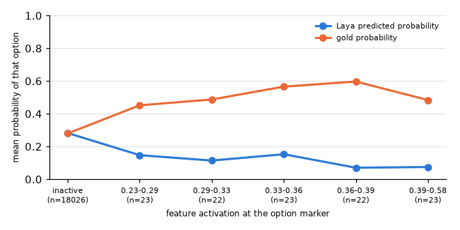

# Feature 3553

Critérios em que aparece: corr_error, corr_probe_right_laya_wrong

**Interpretação (preencher):** 

---

## Maiores ativações

**tr_customer_service_000114 / category** (choice, customer_service) | ativação 7.957 em `estado` | opções ['account', 'billing', 'delivery', 'refund', 'technical'] | Laya: **technical** [0.113, 0.017, 0.003, 0.012, 0.855] | gabarito: **technical**

```
<bos> choice question: What is this customer conversation primarily about?<eos>
▸ <mask> account: Login, plan changes, profile or access management.
▸ <mask> billing: A charge, invoice, subscription or payment problem.
▸ <mask> delivery: Shipping, fulfilment or delivery of a physical item.
▸ <mask> refund: The customer is explicitly asking for money back.
▸ <mask> technical: The product or service is not working as expected.

<eos>

 {"account": {"lifetime_value_usd": 483, "prior_tickets_90d": 2, "seats": 1, "tenure_months": 11, "tier": "standard"}, "orders":⟦ [⟧{"amount_usd": 18, "date": "2026-02-08", "id": "A-56150", "status": "settled"}, {"amount_usd": 18, "date": "2026-03-21", "id": "A-45857", "status": "settled"}], "thread": [{"role": "customer", "text": "The PDF export tool is failing to generate files again. I've been on the standard plan for 11 months now and this is the third time this specific feature has stopped working for me."}, {"role": "agent", "text": "I see that you've encountered issues with the PDF export previously. To help me triage this, could you let me know if you are seeing a specific error code when the generation fails?"}, {"role": "customer", "text": "There isn't an error code; the loading bar just hangs at 15% and then the browser times out. I'm paying about $18 a month for this and it's frustrating that a feature that was previously fixed has broken again."}, {"role": "agent", "text": "That sounds like a persistent hang in the rendering process. Does this happen with all of your documents, or is it only occurring with files that contain large images?"}, {"role": "customer", "text": "It's happening even with simple text-only documents. This is exactly what happened the last two times I reported this, so it seems like the old bug has returned."}]}<eos>
```

**tr_customer_service_000176 / urgency** (score, customer_service) | ativação 7.742 em `estado` | opções ['0', '1', '2', '3'] | Laya: **1** [0.199, 0.48, 0.106, 0.215] | gabarito: **2**

```
<bos> score question: How time-sensitive is this conversation?<eos>
▸ <mask> level 0: No time pressure; can wait indefinitely.
▸ <mask> level 1: Routine; handle within the normal queue.
▸ <mask> level 2: Elevated; should be handled within the same week.
▸ <mask> level 3: Critical; requires action within the same day.

<eos>

 {"account": {"lifetime_value_usd": 389, "prior_tickets_90d": 0, "seats": 1, "tenure_months": 8, "tier": "standard"}, "orders":⟦ [⟧{"amount_usd": 447, "date": "2026-03-17", "id": "A-79887", "status": "pending"}, {"amount_usd": 447, "date": "2026-02-17", "id": "A-28475", "status": "refunded"}], "thread": [{"role": "customer", "text": "I've been on the standard plan for eight months now, paying about $447, and I still can't get into my account."}, {"role": "agent", "text": "I’m sorry you’re experiencing this. Could you tell me what error message appears, or share the username you’re trying to sign in with?"}, {"role": "customer", "text": "It just says “invalid credentials” no matter what I type."}, {"role": "agent", "text": "Thanks for letting me know. Have you attempted a password reset, and if so, did you receive the reset email?"}, {"role": "customer", "text": "I tried resetting, but the reset email never arrives."}]}<eos>
```

**tr_customer_service_000114 / churn_risk** (score, customer_service) | ativação 7.535 em `estado` | opções ['0', '1', '2', '3'] | Laya: **1** [0.058, 0.622, 0.241, 0.079] | gabarito: **2**

```
<bos> score question: How likely is this customer to stop doing business with us because of this interaction?<eos>
▸ <mask> level 0: No sign of dissatisfaction.
▸ <mask> level 1: Mild frustration, but the relationship is intact.
▸ <mask> level 2: Clearly unhappy; repeat problems or explicit complaints.
▸ <mask> level 3: Imminent: threatening to cancel, dispute or leave.

<eos>

 {"account": {"lifetime_value_usd": 483, "prior_tickets_90d": 2, "seats": 1, "tenure_months": 11, "tier": "standard"}, "orders":⟦ [⟧{"amount_usd": 18, "date": "2026-02-08", "id": "A-56150", "status": "settled"}, {"amount_usd": 18, "date": "2026-03-21", "id": "A-45857", "status": "settled"}], "thread": [{"role": "customer", "text": "The PDF export tool is failing to generate files again. I've been on the standard plan for 11 months now and this is the third time this specific feature has stopped working for me."}, {"role": "agent", "text": "I see that you've encountered issues with the PDF export previously. To help me triage this, could you let me know if you are seeing a specific error code when the generation fails?"}, {"role": "customer", "text": "There isn't an error code; the loading bar just hangs at 15% and then the browser times out. I'm paying about $18 a month for this and it's frustrating that a feature that was previously fixed has broken again."}, {"role": "agent", "text": "That sounds like a persistent hang in the rendering process. Does this happen with all of your documents, or is it only occurring with files that contain large images?"}, {"role": "customer", "text": "It's happening even with simple text-only documents. This is exactly what happened the last two times I reported this, so it seems like the old bug has returned."}]}<eos>
```

**tr_customer_service_000089 / category** (choice, customer_service) | ativação 7.496 em `estado` | opções ['account', 'billing', 'delivery', 'refund', 'technical'] | Laya: **account** [0.703, 0.074, 0.022, 0.03, 0.172] | gabarito: **delivery**

```
<bos> choice question: What is this customer conversation primarily about?<eos>
▸ <mask> account: Login, plan changes, profile or access management.
▸ <mask> billing: A charge, invoice, subscription or payment problem.
▸ <mask> delivery: Shipping, fulfilment or delivery of a physical item.
▸ <mask> refund: The customer is explicitly asking for money back.
▸ <mask> technical: The product or service is not working as expected.

<eos>

 {"account": {"lifetime_value_usd": 166, "prior_tickets_90d": 1, "seats": 1, "tenure_months": 2, "tier": "standard"}, "orders":⟦ [⟧{"amount_usd": 57, "date": "2026-01-06", "id": "A-19796", "status": "settled"}, {"amount_usd": 57, "date": "2026-03-23", "id": "A-59627", "status": "settled"}, {"amount_usd": 57, "date": "2026-03-19", "id": "A-98751", "status": "settled"}], "thread": [{"role": "customer", "text": "I received the package today, but the item inside isn’t the one I ordered – I ordered the standard widget for $57, and I got the premium version instead."}, {"role": "agent", "text": "I understand. Could you share the order number so I can pull up the details?"}, {"role": "customer", "text": "Sure, the order number is 987654321. I’d like to know how we can get the correct item sent out."}]}<eos>
```

**tr_customer_service_000114 / needs_human** (noul, customer_service) | ativação 7.477 em `estado` | opções ['false', 'true'] | Laya: **false** [0.688, 0.312] | gabarito: **true**

```
<bos> noul question: This conversation requires a human agent rather than automated handling.<eos>
▸ <mask> false: Automation can carry this to resolution.
▸ <mask> true: A human must take over: judgement, authority or empathy is required.

<eos>

 {"account": {"lifetime_value_usd": 483, "prior_tickets_90d": 2, "seats": 1, "tenure_months": 11, "tier": "standard"}, "orders":⟦ [⟧{"amount_usd": 18, "date": "2026-02-08", "id": "A-56150", "status": "settled"}, {"amount_usd": 18, "date": "2026-03-21", "id": "A-45857", "status": "settled"}], "thread": [{"role": "customer", "text": "The PDF export tool is failing to generate files again. I've been on the standard plan for 11 months now and this is the third time this specific feature has stopped working for me."}, {"role": "agent", "text": "I see that you've encountered issues with the PDF export previously. To help me triage this, could you let me know if you are seeing a specific error code when the generation fails?"}, {"role": "customer", "text": "There isn't an error code; the loading bar just hangs at 15% and then the browser times out. I'm paying about $18 a month for this and it's frustrating that a feature that was previously fixed has broken again."}, {"role": "agent", "text": "That sounds like a persistent hang in the rendering process. Does this happen with all of your documents, or is it only occurring with files that contain large images?"}, {"role": "customer", "text": "It's happening even with simple text-only documents. This is exactly what happened the last two times I reported this, so it seems like the old bug has returned."}]}<eos>
```

## Ativações medianas (faixa 40-60%, mediana 3.609)

**tr_invoice_processing_000076 / duplicate** (noul, invoice_processing) | ativação 3.811 em `estado` | opções ['false', 'true'] | Laya: **true** [0.031, 0.969] | gabarito: **false**

```
<bos> noul question: This invoice appears to duplicate an invoice already submitted.<eos>
▸ <mask> false: no, the statement does not hold
▸ <mask> true: yes, the statement holds

<eos>

 {"delivery": {"condition": "accepted", "date": "2026-03-03", "received_qty": 50}, "invoice": {"currency": "USD", "id": "INV-2026-7325", "lines": [{"qty": 50, "sku": "SKU-282", "total_usd": 24438.5, "unit_usd": 488.77}], "total_usd": 24438.5, "vendor": "Pallas Industrial"}, "payment": {"days_until_due": 11, "discount_expires_in_days": null, "early_payment_discount_pct": null, "status": "scheduled", "terms": "net 30"}, "purchase_order": {"freight_terms": "freight prepaid by vendor, not separately billable", "id": "PO-3572", "lines": [⟦{"⟧qty": 50, "unit_usd": 436.4}], "total_usd": 21820.0}, "vendor_history": {"disputes_12m": 0, "invoices_12m": 20, "prior_invoice_ids": ["INV-2026-6186", "INV-2026-6194", "INV-2026-8302"]}}<eos>
```

**tr_invoice_processing_000281 / matches_order** (noul, invoice_processing) | ativação 3.609 em `estado` | opções ['false', 'true'] | Laya: **true** [0.032, 0.968] | gabarito: **false**

```
<bos> noul question: The invoice reconciles with the purchase order and the recorded delivery.<eos>
▸ <mask> false: There is a discrepancy against the order or the delivery.
▸ <mask> true: Line items, quantities and amounts reconcile.

<eos>

 {"delivery": {"condition": "accepted", "date": null, "received_qty": 0}, "invoice": {"currency": "USD", "id": "INV-2026-1417", "lines": [{"qty": 50, "sku": "SKU-310", "total_usd": 11531.0, "unit_usd": 230.62}], "total_usd": 11531.0, "vendor": "Orbit Logistics"}, "payment": {"days_until_due": 18, "discount_expires_in_days": null, "early_payment_discount_pct": null, "status": "scheduled", "terms": "net 30"}, "purchase_order": {"freight_terms": "freight prepaid by vendor, not separately billable", "id": "PO-4042", "lines": [⟦{"⟧qty": 50, "unit_usd": 230.62}], "total_usd": 11531.0}, "vendor_history": {"disputes_12m": 1, "invoices_12m": 20, "prior_invoice_ids": ["INV-2026-3644"]}}<eos>
```

**tr_invoice_processing_000207 / matches_order** (noul, invoice_processing) | ativação 3.352 em `estado` | opções ['false', 'true'] | Laya: **true** [0.017, 0.983] | gabarito: **false**

```
<bos> noul question: The invoice reconciles with the purchase order and the recorded delivery.<eos>
▸ <mask> false: There is a discrepancy against the order or the delivery.
▸ <mask> true: Line items, quantities and amounts reconcile.

<eos>

 {"delivery": {"condition": "accepted", "date": "2026-03-07", "received_qty": 50}, "invoice": {"currency": "USD", "id": "INV-2026-5896", "lines": [{"qty": 50, "sku": "SKU-476", "total_usd": 15168.0, "unit_usd": 303.36}, {"qty": 1, "sku": "FREIGHT", "total_usd": 536.15, "unit_usd": 536.15}], "total_usd": 15704.15, "vendor": "Orbit Logistics"}, "payment": {"days_until_due": 5, "discount_expires_in_days": 6, "early_payment_discount_pct": 2.0, "status": "scheduled", "terms": "net 45"}, "purchase_order": {"freight_terms": "freight prepaid by vendor, not separately billable", "id": "PO-9119", "lines": [⟦{"⟧qty": 50, "unit_usd": 303.36}], "total_usd": 15168.0}, "vendor_history": {"disputes_12m": 5, "invoices_12m": 7, "prior_invoice_ids": ["INV-2026-2237"]}}<eos>
```

**tr_invoice_processing_000080 / discrepancy_severity** (score, invoice_processing) | ativação 3.162 em `estado` | opções ['0', '1', '2', '3'] | Laya: **2** [0.079, 0.319, 0.534, 0.068] | gabarito: **0**

```
<bos> score question: How material is any discrepancy between the invoice, the order and the delivery?<eos>
▸ <mask> level 0: None: everything reconciles.
▸ <mask> level 1: Trivial: rounding or a cosmetic difference.
▸ <mask> level 2: Moderate: a real difference worth confirming.
▸ <mask> level 3: Material: a large or unexplained difference.

<eos>

 {"delivery": {"condition": "accepted", "date": "2026-03-28", "received_qty": 10}, "invoice": {"currency": "USD", "id": "INV-2026-1868", "lines": [{"qty": 10, "sku": "SKU-800", "total_usd": 3965.4, "unit_usd": 396.54}], "total_usd": 3965.4, "vendor": "Northwind Components"}, "payment": {"days_until_due": 27, "discount_expires_in_days": null, "early_payment_discount_pct": null, "status": "scheduled", "terms": "net 30"}, "purchase_order": {"freight_terms": "freight prepaid by vendor, not separately billable", "id": "PO-2745", "lines":⟦ [⟧{"qty": 10, "unit_usd": 396.54}], "total_usd": 3965.4}, "vendor_history": {"disputes_12m": 0, "invoices_12m": 47, "prior_invoice_ids": ["INV-2026-5326", "INV-2026-4195", "INV-2026-1644", "INV-2026-9397"]}}<eos>
```

**tr_invoice_processing_000100 / duplicate** (noul, invoice_processing) | ativação 3.162 em `estado` | opções ['false', 'true'] | Laya: **true** [0.013, 0.987] | gabarito: **false**

```
<bos> noul question: This invoice appears to duplicate an invoice already submitted.<eos>
▸ <mask> false: no, the statement does not hold
▸ <mask> true: yes, the statement holds

<eos>

 {"delivery": {"condition": "accepted", "date": "2026-03-06", "received_qty": 25}, "invoice": {"currency": "USD", "id": "INV-2026-3933", "lines": [{"qty": 25, "sku": "SKU-346", "total_usd": 5973.25, "unit_usd": 238.93}], "total_usd": 5973.25, "vendor": "Acme Fabrication"}, "payment": {"days_until_due": 44, "discount_expires_in_days": 3, "early_payment_discount_pct": 2.0, "status": "scheduled", "terms": "net 30"}, "purchase_order": {"freight_terms": "freight prepaid by vendor, not separately billable", "id": null, "lines": [⟦{"⟧qty": 25, "unit_usd": 238.93}], "total_usd": 5973.25}, "vendor_history": {"disputes_12m": 1, "invoices_12m": 6, "prior_invoice_ids": ["INV-2026-7649"]}}<eos>
```

## Estatísticas (conjunto de descoberta, dev e teste)

**pred / error**

| split | decisões | ativas | ativas e Laya errou | taxa | lift | q (BH) | OR (CMH) | q (CMH) |
|---|---|---|---|---|---|---|---|---|
| discovery | 5100 | 2 | 2 | 1.000 | 1.55 | nan | nan | nan |
| dev | 900 | 3 | 2 | 0.667 | 0.99 | nan | nan | nan |
| test | 2000 | 0 | 0 | nan | nan | nan | nan | nan |

**corr / error**

| split | decisões | ativas | ativas e Laya errou | taxa | lift | q (BH) | OR (CMH) | q (CMH) |
|---|---|---|---|---|---|---|---|---|
| discovery | 5100 | 55 | 55 | 1.000 | 1.55 | 1.92e-10 | inf | 0.00798 |
| dev | 900 | 11 | 10 | 0.909 | 1.35 | nan | nan | nan |
| test | 2000 | 18 | 18 | 1.000 | 1.54 | nan | nan | nan |

**state / error**

| split | decisões | ativas | ativas e Laya errou | taxa | lift | q (BH) | OR (CMH) | q (CMH) |
|---|---|---|---|---|---|---|---|---|
| discovery | 5100 | 2292 | 1438 | 0.627 | 0.97 | 0.0818 | 0.76 | 0.0118 |
| dev | 900 | 471 | 322 | 0.684 | 1.02 | 0.83 | 0.77 | 0.59 |
| test | 2000 | 878 | 572 | 0.651 | 1.00 | 1 | 0.77 | 0.329 |

**pred / probe_right_laya_wrong**

| split | decisões | ativas | ativas e Laya errou | taxa | lift | q (BH) | OR (CMH) | q (CMH) |
|---|---|---|---|---|---|---|---|---|
| discovery | 2932 | 2 | 2 | 1.000 | 1.65 | nan | nan | nan |
| dev | 523 | 1 | 1 | 1.000 | 1.55 | nan | nan | nan |
| test | 1149 | 0 | 0 | nan | nan | nan | nan | nan |

**corr / probe_right_laya_wrong**

| split | decisões | ativas | ativas e Laya errou | taxa | lift | q (BH) | OR (CMH) | q (CMH) |
|---|---|---|---|---|---|---|---|---|
| discovery | 2932 | 34 | 34 | 1.000 | 1.65 | 1.68e-07 | inf | 0.0589 |
| dev | 523 | 10 | 10 | 1.000 | 1.55 | nan | nan | nan |
| test | 1149 | 12 | 12 | 1.000 | 1.64 | nan | nan | nan |

**state / probe_right_laya_wrong**

| split | decisões | ativas | ativas e Laya errou | taxa | lift | q (BH) | OR (CMH) | q (CMH) |
|---|---|---|---|---|---|---|---|---|
| discovery | 2932 | 1395 | 834 | 0.598 | 0.99 | 0.583 | 0.66 | 0.00203 |
| dev | 523 | 302 | 201 | 0.666 | 1.03 | 0.651 | 0.70 | 0.539 |
| test | 1149 | 564 | 343 | 0.608 | 1.00 | 1 | 0.61 | 0.056 |

Confusão mais sobre-representada (pred): `true_positive|0>1` (n=2, lift 231.82, p=nan). Formato `pergunta|índice previsto>índice correto`.

Confusão mais sobre-representada (corr): `true_positive|1>0` (n=30, lift 39.74, p=2.38e-44). Formato `pergunta|índice previsto>índice correto`.

Confusão mais sobre-representada (state): `duplicate|1>0` (n=217, lift 2.23, p=0). Formato `pergunta|índice previsto>índice correto`.



