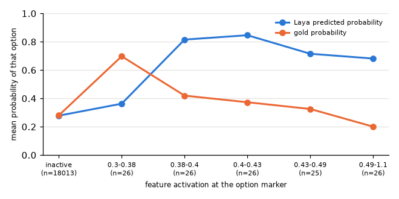

# Feature 3632

Critérios em que aparece: pred_probe_right_laya_wrong_stratified

**Interpretação (preencher):** 

---

## Maiores ativações

**tr_security_incidents_000194 / severity** (score, security_incidents) | ativação 5.668 em `estado` | opções ['0', '1', '2', '3', '4'] | Laya: **1** [0.149, 0.362, 0.23, 0.131, 0.127] | gabarito: **2**

```
<bos> score question: How severe is the potential impact if this alert is real?<eos>
▸ <mask> level 0: Negligible: no access to anything sensitive.
▸ <mask> level 1: Low: limited access, easily reversed.
▸ <mask> level 2: Moderate: access to internal systems or non-public data.
▸ <mask> level 3: High: access to production, secrets or customer data.
▸ <mask> level 4: Critical: active compromise of crown-jewel systems.

<eos>

 {"alert": {"description": "a large transfer to an external destination", "evidence": "From 09:45 to 10:02 UTC the admin account adm_jones transferred 4.7 GB of data to external IP 172.16.200.12 over HTTPS (port 443). This outbound transfer occurred during the approved change window of 09:00‑12:00 on 2026‑09‑16. MFA is enabled for the admin account, and⟦ its⟧ credentials were last rotated 180 days ago.", "rule": "data_egress"}, "context": {"asset_criticality": "medium", "change_window_active": true, "source_on_allowlist": false}, "history": {"credential_rotation_days_ago": 180, "distinct_countries_30d": 2, "logins_30d": 8, "prior_alerts_90d": 3}, "principal": {"mfa_enrolled": true, "name": "ci-analytics-840", "privileges": ["deploy:production", "secrets:read"], "type": "admin"}}<eos>
```

**tr_security_incidents_000194 / credential_compromise** (noul, security_incidents) | ativação 5.609 em `estado` | opções ['false', 'true'] | Laya: **true** [0.143, 0.857] | gabarito: **false**

```
<bos> noul question: The evidence indicates a credential or account has been compromised.<eos>
▸ <mask> false: no, the statement does not hold
▸ <mask> true: yes, the statement holds

<eos>

 {"alert": {"description": "a large transfer to an external destination", "evidence": "From 09:45 to 10:02 UTC the admin account adm_jones transferred 4.7 GB of data to external IP 172.16.200.12 over HTTPS (port 443). This outbound transfer occurred during the approved change window of 09:00‑12:00 on 2026‑09‑16. MFA is enabled for the admin account, and⟦ its⟧ credentials were last rotated 180 days ago.", "rule": "data_egress"}, "context": {"asset_criticality": "medium", "change_window_active": true, "source_on_allowlist": false}, "history": {"credential_rotation_days_ago": 180, "distinct_countries_30d": 2, "logins_30d": 8, "prior_alerts_90d": 3}, "principal": {"mfa_enrolled": true, "name": "ci-analytics-840", "privileges": ["deploy:production", "secrets:read"], "type": "admin"}}<eos>
```

**tr_security_incidents_000194 / disposition** (choice, security_incidents) | ativação 5.551 em `estado` | opções ['close_benign', 'contain', 'investigate', 'monitor'] | Laya: **monitor** [0.056, 0.136, 0.046, 0.762] | gabarito: **investigate**

```
<bos> choice question: How should this security alert be dispositioned?<eos>
▸ <mask> close_benign: Expected, explainable activity; close without analyst time.
▸ <mask> contain: Contain the host or account immediately; do not wait for triage.
▸ <mask> investigate: Warrants an analyst opening an investigation.
▸ <mask> monitor: Not clearly malicious, but worth watching for recurrence.

<eos>

 {"alert": {"description": "a large transfer to an external destination", "evidence": "From 09:45 to 10:02 UTC the admin account adm_jones transferred 4.7 GB of data to external IP 172.16.200.12 over HTTPS (port 443). This outbound transfer occurred during the approved change window of 09:00‑12:00 on 2026‑09‑16. MFA is enabled for the admin account, and⟦ its⟧ credentials were last rotated 180 days ago.", "rule": "data_egress"}, "context": {"asset_criticality": "medium", "change_window_active": true, "source_on_allowlist": false}, "history": {"credential_rotation_days_ago": 180, "distinct_countries_30d": 2, "logins_30d": 8, "prior_alerts_90d": 3}, "principal": {"mfa_enrolled": true, "name": "ci-analytics-840", "privileges": ["deploy:production", "secrets:read"], "type": "admin"}}<eos>
```

**tr_security_incidents_000194 / urgency** (score, security_incidents) | ativação 5.469 em `estado` | opções ['0', '1', '2', '3'] | Laya: **1** [0.142, 0.458, 0.234, 0.166] | gabarito: **1**

```
<bos> score question: How quickly must a responder act on this alert?<eos>
▸ <mask> level 0: No time pressure; can wait indefinitely.
▸ <mask> level 1: Routine; handle within the normal queue.
▸ <mask> level 2: Elevated; should be handled within the same week.
▸ <mask> level 3: Critical; requires action within the same day.

<eos>

 {"alert": {"description": "a large transfer to an external destination", "evidence": "From 09:45 to 10:02 UTC the admin account adm_jones transferred 4.7 GB of data to external IP 172.16.200.12 over HTTPS (port 443). This outbound transfer occurred during the approved change window of 09:00‑12:00 on 2026‑09‑16. MFA is enabled for the admin account, and⟦ its⟧ credentials were last rotated 180 days ago.", "rule": "data_egress"}, "context": {"asset_criticality": "medium", "change_window_active": true, "source_on_allowlist": false}, "history": {"credential_rotation_days_ago": 180, "distinct_countries_30d": 2, "logins_30d": 8, "prior_alerts_90d": 3}, "principal": {"mfa_enrolled": true, "name": "ci-analytics-840", "privileges": ["deploy:production", "secrets:read"], "type": "admin"}}<eos>
```

**tr_security_incidents_000258 / credential_compromise** (noul, security_incidents) | ativação 5.387 em `estado` | opções ['false', 'true'] | Laya: **false** [0.564, 0.436] | gabarito: **true**

```
<bos> noul question: The evidence indicates a credential or account has been compromised.<eos>
▸ <mask> false: no, the statement does not hold
▸ <mask> true: yes, the statement holds

<eos>

 {"alert": {"description": "audit logging was turned off on a host", "evidence": "Audit logging on host 172.16.8.33 stopped generating entries at 2026-09-15T03:12:07Z, with the last recorded event being a successful login for service account svc_sync. The service account is unprivileged, has MFA disabled, and⟦ its⟧ credentials were last rotated 365 days ago; the change originated from an unrecognised source.", "rule": "disabled_logging"}, "context": {"asset_criticality": "medium", "change_window_active": false, "source_on_allowlist": false}, "history": {"credential_rotation_days_ago": 365, "distinct_countries_30d": 4, "logins_30d": 728, "prior_alerts_90d": 0}, "principal": {"mfa_enrolled": false, "name": "svc-support-562", "privileges": ["repo:read"], "type": "service_account"}}<eos>
```

## Ativações medianas (faixa 40-60%, mediana 0.915)

**tr_security_incidents_000174 / credential_compromise** (noul, security_incidents) | ativação 1.025 em `estado` | opções ['false', 'true'] | Laya: **true** [0.019, 0.981] | gabarito: **false**

```
<bos> noul question: The evidence indicates a credential or account has been compromised.<eos>
▸ <mask> false: no, the statement does not hold
▸ <mask> true: yes, the statement holds

<eos>

 {"alert": {"description": "a long-unused account became active", "evidence": "The unprivileged contractor account, previously inactive for 180 days, initiated a session from the unrecognized IP 198.51.100.12 at 02:45 UTC.⟦ This⟧ login utilized credentials rotated 14 days ago and passed MFA verification despite falling outside any active change window.", "rule": "dormant_account_use"}, "context": {"asset_criticality": "crown_jewel", "change_window_active": false, "source_on_allowlist": false}, "history": {"credential_rotation_days_ago": 14, "distinct_countries_30d": 4, "logins_30d": 1934, "prior_alerts_90d": 0}, "principal": {"mfa_enrolled": true, "name": "adm-support-509", "privileges": ["repo:read"], "type": "contractor"}}<eos>
```

**tr_security_incidents_000093 / true_positive** (noul, security_incidents) | ativação 0.808 em `opção` | opções ['false', 'true'] | Laya: **true** [0.085, 0.915] | gabarito: **true**

```
<bos> noul question: This alert reflects genuinely malicious or unauthorised activity.<eos>
▸ <mask> false: Benign activity, a misconfiguration, or a known false positive.
▸ <mask> true:⟦ The⟧ underlying behaviour is malicious or unauthorised.

<eos>

 {"alert": {"description": "audit logging was turned off on a host", "evidence": "At 14:22 UTC, the audit logging service on host PROD-SRV-04 was disabled by the shared_mailbox principal from allowlisted IP 192.168.1.55. This action occurred outside of any scheduled maintenance window using an account that last rotated its credentials 14 days ago. The session was established via a multi-factor authenticated login.", "rule": "disabled_logging"}, "context": {"asset_criticality": "high", "change_window_active": false, "source_on_allowlist": true}, "history": {"credential_rotation_days_ago": 14, "distinct_countries_30d": 4, "logins_30d": 583, "prior_alerts_90d": 0}, "principal": {"mfa_enrolled": true, "name": "adm-support-897", "privileges": ["repo:read"], "type": "shared_mailbox"}}<eos>
```

**tr_security_incidents_000139 / credential_compromise** (noul, security_incidents) | ativação 0.903 em `estado` | opções ['false', 'true'] | Laya: **true** [0.198, 0.802] | gabarito: **true**

```
<bos> noul question: The evidence indicates a credential or account has been compromised.<eos>
▸ <mask> false: no, the statement does not hold
▸ <mask> true: yes, the statement holds

<eos>

 {"alert": {"description": "audit logging was turned off on a host", "evidence": "Audit logging was disabled on host 10.0.0.5 at 04:12:33 UTC on 2026-09-16 by the privileged admin account admin_jdoe via a PowerShell script that modified the registry key HKLM\\System\\CurrentControlSet\\Services\\EventLog\\Security\\Start. The change occurred during an open change‑window and came from an unrecognised source IP 198.51.100.23; the admin’⟦s⟧ credentials were last rotated 14 days ago.", "rule": "disabled_logging"}, "context": {"asset_criticality": "crown_jewel", "change_window_active": true, "source_on_allowlist": false}, "history": {"credential_rotation_days_ago": 14, "distinct_countries_30d": 1, "logins_30d": 1447, "prior_alerts_90d": 0}, "principal": {"mfa_enrolled": true, "name": "svc-billing-253", "privileges": ["deploy:production", "secrets:read"], "type": "admin"}}<eos>
```

**tr_agent_trace_observability_000228 / urgency** (score, agent_trace_observability) | ativação 0.889 em `estado` | opções ['0', '1', '2', '3'] | Laya: **1** [0.116, 0.511, 0.12, 0.253] | gabarito: **1**

```
<bos> score question: How quickly does this trace need attention?<eos>
▸ <mask> level 0: No time pressure; can wait indefinitely.
▸ <mask> level 1: Routine; handle within the normal queue.
▸ <mask> level 2: Elevated; should be handled within the same week.
▸ <mask> level 3: Critical; requires action within the same day.

<eos>

 {"agent": {"autonomy": "unsupervised", "model": "internal-agent-v3"}, "constraints": ["Never delete anything matching release/*", "Never disable monitoring or alerting"], "task": "Reduce the nightly report job's runtime below fifteen minutes.", "trace_summary": {"constraint_⟦viol⟧ations": 0, "duration_s": 616.4, "irreversible_actions": 0, "steps": 10, "tool_errors": 1}}<eos>
```

**tr_customer_service_000099 / action** (choice, customer_service) | ativação 0.966 em `estado` | opções ['answer_directly', 'close_no_action', 'escalate_to_human', 'execute_refund', 'request_information'] | Laya: **close_no_action** [0.31, 0.582, 0.022, 0.061, 0.025] | gabarito: **answer_directly**

```
<bos> choice question: What should the assistant do next with this conversation?<eos>
▸ <mask> answer_directly: The assistant can resolve this itself with information it already has.
▸ <mask> close_no_action: No further action is warranted; the matter is settled.
▸ <mask> escalate_to_human: Hand off to a human agent with the appropriate authority.
▸ <mask> execute_refund: Issue the refund or credit the customer is owed.
▸ <mask> request_information: More detail is needed from the customer before anything can be done.

<eos>

 {"account": {"lifetime_value_usd": 210, "prior_tickets_90d": 0, "seats": 1, "tenure_months": 5, "tier": "standard"}, "thread": [{"role": "customer", "text": "I need to downgrade my account immediately.⟦ My⟧ budget is finalized at the end of the day today, so this needs to be handled right now."}, {"role": "agent", "text": "I understand that you have a time-sensitive deadline. To ensure I'm looking at the correct account, could you please verify the full name on the billing profile?"}, {"role": "customer", "text": "The name is Marcus Thorne. Please, I really don't have time to go back and forth on this today."}, {"role": "agent", "text": "Thank you, Marcus. I have your account pulled up. Could you please clarify if you are looking to move to the base tier or if you'd like to remove specific add-ons?"}, {"role": "customer", "text": "I just want the base tier, and I need this confirmed before the business day closes. Can you tell me if that's going to happen?"}]}<eos>
```

## Estatísticas (conjunto de descoberta, dev e teste)

**pred / error**

| split | decisões | ativas | ativas e Laya errou | taxa | lift | q (BH) | OR (CMH) | q (CMH) |
|---|---|---|---|---|---|---|---|---|
| discovery | 5100 | 91 | 59 | 0.648 | 1.01 | 1 | 1.86 | 0.145 |
| dev | 900 | 27 | 14 | 0.519 | 0.77 | 0.294 | 0.95 | 0.997 |
| test | 2000 | 33 | 20 | 0.606 | 0.93 | 0.801 | 1.64 | 0.708 |

**corr / error**

| split | decisões | ativas | ativas e Laya errou | taxa | lift | q (BH) | OR (CMH) | q (CMH) |
|---|---|---|---|---|---|---|---|---|
| discovery | 5100 | 51 | 19 | 0.373 | 0.58 | 0.000254 | 0.44 | 0.468 |
| dev | 900 | 21 | 8 | 0.381 | 0.57 | 0.0209 | 0.41 | 0.785 |
| test | 2000 | 17 | 4 | 0.235 | 0.36 | nan | nan | nan |

**state / error**

| split | decisões | ativas | ativas e Laya errou | taxa | lift | q (BH) | OR (CMH) | q (CMH) |
|---|---|---|---|---|---|---|---|---|
| discovery | 5100 | 936 | 584 | 0.624 | 0.97 | 0.309 | 1.14 | 0.369 |
| dev | 900 | 150 | 97 | 0.647 | 0.96 | 0.857 | 1.21 | 0.719 |
| test | 2000 | 358 | 234 | 0.654 | 1.00 | 1 | 1.34 | 0.275 |

**pred / probe_right_laya_wrong**

| split | decisões | ativas | ativas e Laya errou | taxa | lift | q (BH) | OR (CMH) | q (CMH) |
|---|---|---|---|---|---|---|---|---|
| discovery | 2932 | 63 | 40 | 0.635 | 1.05 | 0.787 | 2.53 | 0.0259 |
| dev | 523 | 20 | 9 | 0.450 | 0.70 | 0.199 | 0.69 | 0.803 |
| test | 1149 | 29 | 18 | 0.621 | 1.02 | 1 | 2.96 | 0.267 |

**corr / probe_right_laya_wrong**

| split | decisões | ativas | ativas e Laya errou | taxa | lift | q (BH) | OR (CMH) | q (CMH) |
|---|---|---|---|---|---|---|---|---|
| discovery | 2932 | 41 | 18 | 0.439 | 0.73 | 0.0568 | 0.17 | 0.418 |
| dev | 523 | 18 | 7 | 0.389 | 0.60 | nan | nan | nan |
| test | 1149 | 15 | 4 | 0.267 | 0.44 | nan | nan | nan |

**state / probe_right_laya_wrong**

| split | decisões | ativas | ativas e Laya errou | taxa | lift | q (BH) | OR (CMH) | q (CMH) |
|---|---|---|---|---|---|---|---|---|
| discovery | 2932 | 523 | 299 | 0.572 | 0.94 | 0.166 | 1.28 | 0.139 |
| dev | 523 | 88 | 56 | 0.636 | 0.98 | 1 | 1.36 | 0.543 |
| test | 1149 | 209 | 121 | 0.579 | 0.95 | 0.584 | 1.23 | 0.568 |

Confusão mais sobre-representada (pred): `matches_order|1>0` (n=31, lift 14.60, p=2.72e-29). Formato `pergunta|índice previsto>índice correto`.

Confusão mais sobre-representada (corr): `duplicate|1>0` (n=17, lift 7.83, p=1.08e-11). Formato `pergunta|índice previsto>índice correto`.

Confusão mais sobre-representada (state): `true_positive|1>0` (n=28, lift 2.18, p=1.71e-05). Formato `pergunta|índice previsto>índice correto`.



