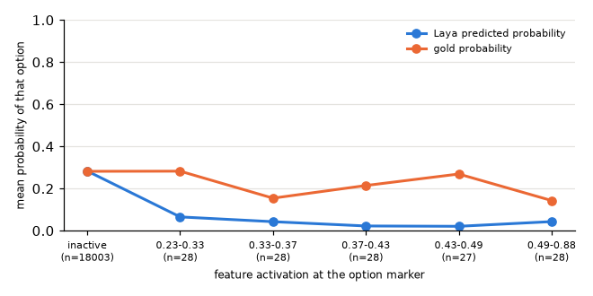

# Feature 3651

Critérios em que aparece: corr_error

**Interpretação (preencher):** 

---

## Maiores ativações

**tr_customer_service_000114 / action** (choice, customer_service) | ativação 3.654 em `estado` | opções ['answer_directly', 'close_no_action', 'escalate_to_human', 'execute_refund', 'request_information'] | Laya: **close_no_action** [0.184, 0.777, 0.018, 0.016, 0.005] | gabarito: **escalate_to_human**

```
<bos> choice question: What should the assistant do next with this conversation?<eos>
▸ <mask> answer_directly: The assistant can resolve this itself with information it already has.
▸ <mask> close_no_action: No further action is warranted; the matter is settled.
▸ <mask> escalate_to_human: Hand off to a human agent with the appropriate authority.
▸ <mask> execute_refund: Issue the refund or credit the customer is owed.
▸ <mask> request_information: More detail is needed from the customer before anything can be done.

<eos>

 {"account": {"lifetime_value_usd": 483, "prior_tickets_90d": 2, "seats": 1, "tenure_months": 11, "tier": "standard"}, "orders": [{"amount_usd": 18, "date": "2026-02-08", "id": "A-56150", "status": "settled"}, {"amount_usd": 18, "date": "2026-03-21", "id": "A-45857", "status": "settled"}], "thread": [{"role": "customer", "text": "The PDF export tool is failing to generate files again. I've been on the standard plan for 11 months now and this is the third time this specific feature has stopped working for me."}, {"role": "agent", "text": "I see that you've encountered issues with the PDF export previously. To help me triage this, could you let me know if you are seeing a specific error code when the generation fails?"}, {"role": "customer", "text": "There isn't an error code; the loading bar just hangs at 15% and then the browser times out. I'm paying about $18 a month for this and it's frustrating that a feature that was previously fixed has broken again."}, {"role": "agent", "text": "That sounds like a persistent hang in the rendering process. Does this happen with all of your documents, or is it only occurring with files that contain large images?"}, {"role": "customer", "text": "It's⟦ happening⟧ even with simple text-only documents. This is exactly what happened the last two times I reported this, so it seems like the old bug has returned."}]}<eos>
```

**tr_customer_service_000114 / needs_human** (noul, customer_service) | ativação 3.545 em `estado` | opções ['false', 'true'] | Laya: **false** [0.688, 0.312] | gabarito: **true**

```
<bos> noul question: This conversation requires a human agent rather than automated handling.<eos>
▸ <mask> false: Automation can carry this to resolution.
▸ <mask> true: A human must take over: judgement, authority or empathy is required.

<eos>

 {"account": {"lifetime_value_usd": 483, "prior_tickets_90d": 2, "seats": 1, "tenure_months": 11, "tier": "standard"}, "orders": [{"amount_usd": 18, "date": "2026-02-08", "id": "A-56150", "status": "settled"}, {"amount_usd": 18, "date": "2026-03-21", "id": "A-45857", "status": "settled"}], "thread": [{"role": "customer", "text": "The PDF export tool is failing to generate files again. I've been on the standard plan for 11 months now and this is the third time this specific feature has stopped working for me."}, {"role": "agent", "text": "I see that you've encountered issues with the PDF export previously. To help me triage this, could you let me know if you are seeing a specific error code when the generation fails?"}, {"role": "customer", "text": "There isn't an error code; the loading bar just hangs at 15% and then the browser times out. I'm paying about $18 a month for this and it's frustrating that a feature that was previously fixed has broken again."}, {"role": "agent", "text": "That sounds like a persistent hang in the rendering process. Does this happen with all of your documents, or is it only occurring with files that contain large images?"}, {"role": "customer", "text": "It's⟦ happening⟧ even with simple text-only documents. This is exactly what happened the last two times I reported this, so it seems like the old bug has returned."}]}<eos>
```

**tr_customer_service_000114 / urgency** (score, customer_service) | ativação 3.539 em `estado` | opções ['0', '1', '2', '3'] | Laya: **1** [0.058, 0.68, 0.096, 0.166] | gabarito: **2**

```
<bos> score question: How time-sensitive is this conversation?<eos>
▸ <mask> level 0: No time pressure; can wait indefinitely.
▸ <mask> level 1: Routine; handle within the normal queue.
▸ <mask> level 2: Elevated; should be handled within the same week.
▸ <mask> level 3: Critical; requires action within the same day.

<eos>

 {"account": {"lifetime_value_usd": 483, "prior_tickets_90d": 2, "seats": 1, "tenure_months": 11, "tier": "standard"}, "orders": [{"amount_usd": 18, "date": "2026-02-08", "id": "A-56150", "status": "settled"}, {"amount_usd": 18, "date": "2026-03-21", "id": "A-45857", "status": "settled"}], "thread": [{"role": "customer", "text": "The PDF export tool is failing to generate files again. I've been on the standard plan for 11 months now and this is the third time this specific feature has stopped working for me."}, {"role": "agent", "text": "I see that you've encountered issues with the PDF export previously. To help me triage this, could you let me know if you are seeing a specific error code when the generation fails?"}, {"role": "customer", "text": "There isn't an error code; the loading bar just hangs at 15% and then the browser times out. I'm paying about $18 a month for this and it's frustrating that a feature that was previously fixed has broken again."}, {"role": "agent", "text": "That sounds like a persistent hang in the rendering process. Does this happen with all of your documents, or is it only occurring with files that contain large images?"}, {"role": "customer", "text": "It's⟦ happening⟧ even with simple text-only documents. This is exactly what happened the last two times I reported this, so it seems like the old bug has returned."}]}<eos>
```

**tr_customer_service_000114 / churn_risk** (score, customer_service) | ativação 3.533 em `estado` | opções ['0', '1', '2', '3'] | Laya: **1** [0.058, 0.622, 0.241, 0.079] | gabarito: **2**

```
<bos> score question: How likely is this customer to stop doing business with us because of this interaction?<eos>
▸ <mask> level 0: No sign of dissatisfaction.
▸ <mask> level 1: Mild frustration, but the relationship is intact.
▸ <mask> level 2: Clearly unhappy; repeat problems or explicit complaints.
▸ <mask> level 3: Imminent: threatening to cancel, dispute or leave.

<eos>

 {"account": {"lifetime_value_usd": 483, "prior_tickets_90d": 2, "seats": 1, "tenure_months": 11, "tier": "standard"}, "orders": [{"amount_usd": 18, "date": "2026-02-08", "id": "A-56150", "status": "settled"}, {"amount_usd": 18, "date": "2026-03-21", "id": "A-45857", "status": "settled"}], "thread": [{"role": "customer", "text": "The PDF export tool is failing to generate files again. I've been on the standard plan for 11 months now and this is the third time this specific feature has stopped working for me."}, {"role": "agent", "text": "I see that you've encountered issues with the PDF export previously. To help me triage this, could you let me know if you are seeing a specific error code when the generation fails?"}, {"role": "customer", "text": "There isn't an error code; the loading bar just hangs at 15% and then the browser times out. I'm paying about $18 a month for this and it's frustrating that a feature that was previously fixed has broken again."}, {"role": "agent", "text": "That sounds like a persistent hang in the rendering process. Does this happen with all of your documents, or is it only occurring with files that contain large images?"}, {"role": "customer", "text": "It's⟦ happening⟧ even with simple text-only documents. This is exactly what happened the last two times I reported this, so it seems like the old bug has returned."}]}<eos>
```

**tr_customer_service_000114 / category** (choice, customer_service) | ativação 3.520 em `estado` | opções ['account', 'billing', 'delivery', 'refund', 'technical'] | Laya: **technical** [0.113, 0.017, 0.003, 0.012, 0.855] | gabarito: **technical**

```
<bos> choice question: What is this customer conversation primarily about?<eos>
▸ <mask> account: Login, plan changes, profile or access management.
▸ <mask> billing: A charge, invoice, subscription or payment problem.
▸ <mask> delivery: Shipping, fulfilment or delivery of a physical item.
▸ <mask> refund: The customer is explicitly asking for money back.
▸ <mask> technical: The product or service is not working as expected.

<eos>

 {"account": {"lifetime_value_usd": 483, "prior_tickets_90d": 2, "seats": 1, "tenure_months": 11, "tier": "standard"}, "orders": [{"amount_usd": 18, "date": "2026-02-08", "id": "A-56150", "status": "settled"}, {"amount_usd": 18, "date": "2026-03-21", "id": "A-45857", "status": "settled"}], "thread": [{"role": "customer", "text": "The PDF export tool is failing to generate files again. I've been on the standard plan for 11 months now and this is the third time this specific feature has stopped working for me."}, {"role": "agent", "text": "I see that you've encountered issues with the PDF export previously. To help me triage this, could you let me know if you are seeing a specific error code when the generation fails?"}, {"role": "customer", "text": "There isn't an error code; the loading bar just hangs at 15% and then the browser times out. I'm paying about $18 a month for this and it's frustrating that a feature that was previously fixed has broken again."}, {"role": "agent", "text": "That sounds like a persistent hang in the rendering process. Does this happen with all of your documents, or is it only occurring with files that contain large images?"}, {"role": "customer", "text": "It's⟦ happening⟧ even with simple text-only documents. This is exactly what happened the last two times I reported this, so it seems like the old bug has returned."}]}<eos>
```

## Ativações medianas (faixa 40-60%, mediana 0.606)

**tr_security_incidents_000210 / urgency** (score, security_incidents) | ativação 0.608 em `estado` | opções ['0', '1', '2', '3'] | Laya: **3** [0.102, 0.25, 0.242, 0.406] | gabarito: **3**

```
<bos> score question: How quickly must a responder act on this alert?<eos>
▸ <mask> level 0: No time pressure; can wait indefinitely.
▸ <mask> level 1: Routine; handle within the normal queue.
▸ <mask> level 2: Elevated; should be handled within the same week.
▸ <mask> level 3: Critical; requires action within the same day.

<eos>

 {"alert": {"description": "an account granted itself or received elevated permissions", "evidence": "At 14:22 UTC, service account `svc-prod-access` performed a self⟦-⟧assignment of the 'Owner' role from unrecognized IP address 198.51.100.12. This action occurred outside of an approved change window using credentials that were last rotated 365 days ago.", "rule": "privilege_escalation"}, "context": {"asset_criticality": "medium", "change_window_active": false, "source_on_allowlist": false}, "history": {"credential_rotation_days_ago": 365, "distinct_countries_30d": 2, "logins_30d": 577, "prior_alerts_90d": 0}, "principal": {"mfa_enrolled": false, "name": "adm-analytics-333", "privileges": ["repo:read"], "type": "service_account"}}<eos>
```

**tr_invoice_processing_000162 / disposition** (choice, invoice_processing) | ativação 0.620 em `pergunta` | opções ['approve', 'hold', 'manual_review', 'reject'] | Laya: **reject** [0.411, 0.127, 0.027, 0.434] | gabarito: **manual_review**

```
<bos> choice question: How⟦ should⟧ this vendor invoice be dispositioned?<eos>
▸ <mask> approve: Matches the order and delivery; approve for payment.
▸ <mask> hold: Something needs confirming before payment; hold pending clarification.
▸ <mask> manual_review: A human in finance must review the discrepancy.
▸ <mask> reject: Should not be paid: duplicate, unauthorised or materially wrong.

<eos>

 {"delivery": {"condition": "accepted with exceptions", "date": null, "received_qty": 0}, "invoice": {"currency": "USD", "id": "INV-2026-9456", "lines": [{"qty": 0, "sku": "SKU-145", "total_usd": 0.0, "unit_usd": 326.59}], "total_usd": 0.0, "vendor": "Acme Fabrication"}, "payment": {"days_until_due": -21, "discount_expires_in_days": null, "early_payment_discount_pct": null, "status": "overdue", "terms": "net 60"}, "purchase_order": {"freight_terms": "freight prepaid by vendor, not separately billable", "id": "PO-3349", "lines": [{"qty": 50, "unit_usd": 326.59}], "total_usd": 16329.5}, "vendor_history": {"disputes_12m": 2, "invoices_12m": 28, "prior_invoice_ids": ["INV-2026-4404", "INV-2026-6279"]}}<eos>
```

**tr_security_incidents_000218 / true_positive** (noul, security_incidents) | ativação 0.630 em `estado` | opções ['false', 'true'] | Laya: **true** [0.057, 0.943] | gabarito: **true**

```
<bos> noul question: This alert reflects genuinely malicious or unauthorised activity.<eos>
▸ <mask> false: Benign activity, a misconfiguration, or a known false positive.
▸ <mask> true: The underlying behaviour is malicious or unauthorised.

<eos>

 {"alert": {"description": "two successful logins from distant locations too close together", "evidence": "Contractor account `ext_dev_04` successfully logged in from London at 09:00 UTC and again from Singapore at 11:15 UTC. Both MFA-validated sessions originated from allowlisted access points during a period with no active change window.", "rule": "impossible_travel"}, "context": {"asset_criticality": "low", "change_window_active": false, "source_on_allowlist": true}, "history": {"credential_rotation_days_⟦ago⟧": 90, "distinct_countries_30d": 1, "logins_30d": 1029, "prior_alerts_90d": 3}, "principal": {"mfa_enrolled": true, "name": "usr-billing-374", "privileges": ["repo:read"], "type": "contractor"}}<eos>
```

**tr_security_incidents_000116 / credential_compromise** (noul, security_incidents) | ativação 0.651 em `estado` | opções ['false', 'true'] | Laya: **false** [0.988, 0.012] | gabarito: **true**

```
<bos> noul question: The evidence indicates a credential or account has been compromised.<eos>
▸ <mask> false: no, the statement does not hold
▸ <mask> true: yes, the statement holds

<eos>

 {"alert": {"description": "a large transfer to an external destination", "evidence": "Between 2026-09-16 04:55:12 UTC and 04:57:03 UTC an admin account transferred 4.2 GB of data to external endpoint 185.53.177.22 over HTTPS (port 443) using the rsync process. The transfer occurred while a change window was open, the source host is unrecognised, and the admin⟦’⟧s credentials have not been rotated for 700 days.", "rule": "data_egress"}, "context": {"asset_criticality": "high", "change_window_active": true, "source_on_allowlist": false}, "history": {"credential_rotation_days_ago": 700, "distinct_countries_30d": 3, "logins_30d": 690, "prior_alerts_90d": 8}, "principal": {"mfa_enrolled": true, "name": "ci-infra-262", "privileges": ["repo:read"], "type": "admin"}}<eos>
```

**tr_security_incidents_000115 / disposition** (choice, security_incidents) | ativação 0.573 em `estado` | opções ['close_benign', 'contain', 'investigate', 'monitor'] | Laya: **monitor** [0.134, 0.093, 0.033, 0.739] | gabarito: **investigate**

```
<bos> choice question: How should this security alert be dispositioned?<eos>
▸ <mask> close_benign: Expected, explainable activity; close without analyst time.
▸ <mask> contain: Contain the host or account immediately; do not wait for triage.
▸ <mask> investigate: Warrants an analyst opening an investigation.
▸ <mask> monitor: Not clearly malicious, but worth watching for recurrence.

<eos>

 {"alert": {"description": "a first-ever sign-in from an unfamiliar country", "evidence": "A sign‑in event was recorded at 2026-09-16 02:13:57 UTC from IP 203.0.113.45 located in Russia, marking the first login from that country for the contractor. The privileged account required MFA, succeeded, and the credentials were refreshed 3 days prior; the source IP is not on the recognized allowlist.", "rule": "new_country_login"}, "context": {"asset_critical⟦ity⟧": "medium", "change_window_active": false, "source_on_allowlist": false}, "history": {"credential_rotation_days_ago": 3, "distinct_countries_30d": 4, "logins_30d": 579, "prior_alerts_90d": 0}, "principal": {"mfa_enrolled": true, "name": "adm-billing-939", "privileges": ["deploy:production", "secrets:read"], "type": "contractor"}}<eos>
```

## Estatísticas (conjunto de descoberta, dev e teste)

**pred / error**

| split | decisões | ativas | ativas e Laya errou | taxa | lift | q (BH) | OR (CMH) | q (CMH) |
|---|---|---|---|---|---|---|---|---|
| discovery | 5100 | 1 | 1 | 1.000 | 1.55 | nan | nan | nan |
| dev | 900 | 0 | 0 | nan | nan | nan | nan | nan |
| test | 2000 | 2 | 2 | 1.000 | 1.54 | nan | nan | nan |

**corr / error**

| split | decisões | ativas | ativas e Laya errou | taxa | lift | q (BH) | OR (CMH) | q (CMH) |
|---|---|---|---|---|---|---|---|---|
| discovery | 5100 | 25 | 25 | 1.000 | 1.55 | 6.46e-05 | inf | 0.168 |
| dev | 900 | 6 | 6 | 1.000 | 1.49 | nan | nan | nan |
| test | 2000 | 10 | 10 | 1.000 | 1.54 | nan | nan | nan |

**state / error**

| split | decisões | ativas | ativas e Laya errou | taxa | lift | q (BH) | OR (CMH) | q (CMH) |
|---|---|---|---|---|---|---|---|---|
| discovery | 5100 | 908 | 548 | 0.604 | 0.94 | 0.0224 | 1.22 | 0.184 |
| dev | 900 | 187 | 130 | 0.695 | 1.03 | 0.846 | 2.19 | 0.0898 |
| test | 2000 | 389 | 249 | 0.640 | 0.98 | 0.892 | 1.43 | 0.189 |

**pred / probe_right_laya_wrong**

| split | decisões | ativas | ativas e Laya errou | taxa | lift | q (BH) | OR (CMH) | q (CMH) |
|---|---|---|---|---|---|---|---|---|
| discovery | 2932 | 0 | 0 | nan | nan | nan | nan | nan |
| dev | 523 | 0 | 0 | nan | nan | nan | nan | nan |
| test | 1149 | 1 | 1 | 1.000 | 1.64 | nan | nan | nan |

**corr / probe_right_laya_wrong**

| split | decisões | ativas | ativas e Laya errou | taxa | lift | q (BH) | OR (CMH) | q (CMH) |
|---|---|---|---|---|---|---|---|---|
| discovery | 2932 | 8 | 8 | 1.000 | 1.65 | nan | nan | nan |
| dev | 523 | 4 | 4 | 1.000 | 1.55 | nan | nan | nan |
| test | 1149 | 4 | 4 | 1.000 | 1.64 | nan | nan | nan |

**state / probe_right_laya_wrong**

| split | decisões | ativas | ativas e Laya errou | taxa | lift | q (BH) | OR (CMH) | q (CMH) |
|---|---|---|---|---|---|---|---|---|
| discovery | 2932 | 553 | 318 | 0.575 | 0.95 | 0.202 | 1.53 | 0.00594 |
| dev | 523 | 114 | 79 | 0.693 | 1.07 | 0.608 | 2.99 | 0.0157 |
| test | 1149 | 233 | 141 | 0.605 | 0.99 | 1 | 1.65 | 0.085 |

Confusão mais sobre-representada (pred): `urgency|1>2` (n=1, lift 24.40, p=nan). Formato `pergunta|índice previsto>índice correto`.

Confusão mais sobre-representada (corr): `risk|2>0` (n=12, lift 59.71, p=6.01e-20). Formato `pergunta|índice previsto>índice correto`.

Confusão mais sobre-representada (state): `credential_compromise|1>0` (n=48, lift 3.29, p=9.69e-17). Formato `pergunta|índice previsto>índice correto`.



