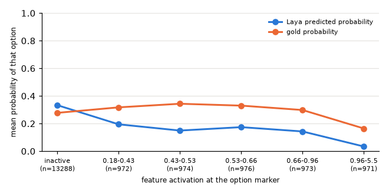

# Feature 3684

Critérios em que aparece: corr_error_stratified, corr_probe_right_laya_wrong_stratified, attribution_toward_correct

**Interpretação (preencher):** 

---

## Maiores ativações

**tr_customer_service_000273 / category** (choice, customer_service) | ativação 7.586 em `opção` | opções ['account', 'billing', 'delivery', 'refund', 'technical'] | Laya: **billing** [0.0, 1.0, 0.0, 0.0, 0.0] | gabarito: **account**

```
<bos> choice question: What is this customer conversation primarily about?<eos>
▸ <mask> account:⟦ Login⟧, plan changes, profile or access management.
▸ <mask> billing: A charge, invoice, subscription or payment problem.
▸ <mask> delivery: Shipping, fulfilment or delivery of a physical item.
▸ <mask> refund: The customer is explicitly asking for money back.
▸ <mask> technical: The product or service is not working as expected.

<eos>

 {"account": {"lifetime_value_usd": 278, "prior_tickets_90d": 2, "seats": 1, "tenure_months": 8, "tier": "free"}, "orders": [{"amount_usd": 598, "date": "2026-02-17", "id": "A-18443", "status": "pending"}, {"amount_usd": 598, "date": "2026-02-01", "id": "A-75942", "status": "refunded"}], "thread": [{"role": "customer", "text": "I’d like to cancel the account. I’ve been on the free plan for about eight months, and there’s roughly $598 tied up. There are two older tickets that haven’t been resolved."}, {"role": "agent", "text": "I’m sorry to hear that. Could you confirm the account email so I can look at the open items?"}, {"role": "customer", "text": "It’s the email on the billing page. I’m not in a hurry, but I need the cancellation request to stay open until those tickets are handled."}]}<eos>
```

**tr_customer_service_000098 / category** (choice, customer_service) | ativação 7.113 em `opção` | opções ['account', 'billing', 'delivery', 'refund', 'technical'] | Laya: **billing** [0.0, 1.0, 0.0, 0.0, 0.0] | gabarito: **account**

```
<bos> choice question: What is this customer conversation primarily about?<eos>
▸ <mask> account:⟦ Login⟧, plan changes, profile or access management.
▸ <mask> billing: A charge, invoice, subscription or payment problem.
▸ <mask> delivery: Shipping, fulfilment or delivery of a physical item.
▸ <mask> refund: The customer is explicitly asking for money back.
▸ <mask> technical: The product or service is not working as expected.

<eos>

 {"account": {"lifetime_value_usd": 1673, "prior_tickets_90d": 1, "seats": 1, "tenure_months": 19, "tier": "free"}, "orders": [{"amount_usd": 29, "date": "2026-01-08", "id": "A-60719", "status": "settled"}, {"amount_usd": 29, "date": "2026-02-01", "id": "A-84709", "status": "pending"}], "thread": [{"role": "customer", "text": "I am beyond annoyed. I’ve been trying to downgrade my plan for weeks, yet you’re still charging me $29. I have an unresolved ticket sitting there and now you’re taking more money out of my account."}, {"role": "agent", "text": "I sincerely apologize for the frustration this billing issue has caused you. To help me pull up your account and review the status of your previous request, could you please share your account ID?"}, {"role": "customer", "text": "It’s 88392-AX. This has been going on for way too long and I’m tired of waiting for someone to actually help me with this."}]}<eos>
```

**tr_customer_service_000031 / category** (choice, customer_service) | ativação 6.781 em `opção` | opções ['account', 'billing', 'delivery', 'refund', 'technical'] | Laya: **billing** [0.0, 1.0, 0.0, 0.0, 0.0] | gabarito: **billing**

```
<bos> choice question: What is this customer conversation primarily about?<eos>
▸ <mask> account:⟦ Login⟧, plan changes, profile or access management.
▸ <mask> billing: A charge, invoice, subscription or payment problem.
▸ <mask> delivery: Shipping, fulfilment or delivery of a physical item.
▸ <mask> refund: The customer is explicitly asking for money back.
▸ <mask> technical: The product or service is not working as expected.

<eos>

 {"account": {"lifetime_value_usd": 581, "prior_tickets_90d": 0, "seats": 3, "tenure_months": 14, "tier": "enterprise"}, "thread": [{"role": "customer", "text": "I noticed two identical charges on my bank statement for this month's enterprise subscription. I suppose I'm not surprised, but I'd like to know why this happened."}, {"role": "agent", "text": "I am sorry to hear that you are seeing duplicate charges. To help me investigate this further, could you please share the transaction IDs associated with those charges?"}, {"role": "customer", "text": "I'm not sure where to find those IDs. I just see the two lines on my dashboard history that match the ones on my bank app."}, {"role": "agent", "text": "No problem at all. If you could send over a screenshot of your billing history page or the exact timestamps listed for those two transactions, I can start looking into the account logs."}, {"role": "customer", "text": "Here is the screenshot. It’s the same amount charged twice on the same day, which seems like a bit of a mess."}, {"role": "agent", "text": "Thank you for attaching that file. I’ve received the document, and I’m going to begin reviewing our payment processing records to see how these entries were generated."}, {"role": "customer", "text": "Alright, let me know what you find whenever you get around to it, I guess."}]}<eos>
```

**tr_customer_service_000273 / category** (choice, customer_service) | ativação 6.652 em `pergunta` | opções ['account', 'billing', 'delivery', 'refund', 'technical'] | Laya: **billing** [0.0, 1.0, 0.0, 0.0, 0.0] | gabarito: **account**

```
<bos> choice question: What is⟦ this⟧ customer conversation primarily about?<eos>
▸ <mask> account: Login, plan changes, profile or access management.
▸ <mask> billing: A charge, invoice, subscription or payment problem.
▸ <mask> delivery: Shipping, fulfilment or delivery of a physical item.
▸ <mask> refund: The customer is explicitly asking for money back.
▸ <mask> technical: The product or service is not working as expected.

<eos>

 {"account": {"lifetime_value_usd": 278, "prior_tickets_90d": 2, "seats": 1, "tenure_months": 8, "tier": "free"}, "orders": [{"amount_usd": 598, "date": "2026-02-17", "id": "A-18443", "status": "pending"}, {"amount_usd": 598, "date": "2026-02-01", "id": "A-75942", "status": "refunded"}], "thread": [{"role": "customer", "text": "I’d like to cancel the account. I’ve been on the free plan for about eight months, and there’s roughly $598 tied up. There are two older tickets that haven’t been resolved."}, {"role": "agent", "text": "I’m sorry to hear that. Could you confirm the account email so I can look at the open items?"}, {"role": "customer", "text": "It’s the email on the billing page. I’m not in a hurry, but I need the cancellation request to stay open until those tickets are handled."}]}<eos>
```

**tr_customer_service_000273 / category** (choice, customer_service) | ativação 6.578 em `opção` | opções ['account', 'billing', 'delivery', 'refund', 'technical'] | Laya: **billing** [0.0, 1.0, 0.0, 0.0, 0.0] | gabarito: **account**

```
<bos> choice question: What is this customer conversation primarily about?<eos>
▸ <mask> account: Login,⟦ plan⟧ changes, profile or access management.
▸ <mask> billing: A charge, invoice, subscription or payment problem.
▸ <mask> delivery: Shipping, fulfilment or delivery of a physical item.
▸ <mask> refund: The customer is explicitly asking for money back.
▸ <mask> technical: The product or service is not working as expected.

<eos>

 {"account": {"lifetime_value_usd": 278, "prior_tickets_90d": 2, "seats": 1, "tenure_months": 8, "tier": "free"}, "orders": [{"amount_usd": 598, "date": "2026-02-17", "id": "A-18443", "status": "pending"}, {"amount_usd": 598, "date": "2026-02-01", "id": "A-75942", "status": "refunded"}], "thread": [{"role": "customer", "text": "I’d like to cancel the account. I’ve been on the free plan for about eight months, and there’s roughly $598 tied up. There are two older tickets that haven’t been resolved."}, {"role": "agent", "text": "I’m sorry to hear that. Could you confirm the account email so I can look at the open items?"}, {"role": "customer", "text": "It’s the email on the billing page. I’m not in a hurry, but I need the cancellation request to stay open until those tickets are handled."}]}<eos>
```

## Ativações medianas (faixa 40-60%, mediana 1.058)

**tr_customer_service_000115 / category** (choice, customer_service) | ativação 0.999 em `opção` | opções ['account', 'billing', 'delivery', 'refund', 'technical'] | Laya: **technical** [0.059, 0.082, 0.003, 0.008, 0.849] | gabarito: **technical**

```
<bos> choice question: What is this customer conversation primarily about?<eos>
▸ <mask> account: Login, plan changes, profile or access management.
▸ <mask> billing: A charge,⟦ invoice⟧, subscription or payment problem.
▸ <mask> delivery: Shipping, fulfilment or delivery of a physical item.
▸ <mask> refund: The customer is explicitly asking for money back.
▸ <mask> technical: The product or service is not working as expected.

<eos>

 {"account": {"lifetime_value_usd": 173, "prior_tickets_90d": 3, "seats": 5, "tenure_months": 11, "tier": "enterprise"}, "orders": [{"amount_usd": 98, "date": "2026-01-16", "id": "A-50500", "status": "settled"}, {"amount_usd": 98, "date": "2026-01-22", "id": "A-56044", "status": "settled"}, {"amount_usd": 98, "date": "2026-02-10", "id": "A-31954", "status": "refunded"}], "thread": [{"role": "customer", "text": "I am beyond frustrated that our enterprise API is down for the third time this quarter after I was told it was 'partially' fixed last week. We pay nearly $100 a month for a service that is currently blocking a massive deployment we have scheduled for noon today, and I need a real status update right now!"}]}<eos>
```

**tr_invoice_processing_000003 / disposition** (choice, invoice_processing) | ativação 1.203 em `estado` | opções ['approve', 'hold', 'manual_review', 'reject'] | Laya: **approve** [0.404, 0.314, 0.045, 0.237] | gabarito: **approve**

```
<bos> choice question: How should this vendor invoice be dispositioned?<eos>
▸ <mask> approve: Matches the order and delivery; approve for payment.
▸ <mask> hold: Something needs confirming before payment; hold pending clarification.
▸ <mask> manual_review: A human in finance must review the discrepancy.
▸ <mask> reject: Should not be paid: duplicate, unauthorised or materially wrong.

<eos>

 {"delivery": {"condition": "accepted", "date": "2026-03-10", "received_qty": 10}, "invoice": {"currency": "USD", "id": "INV-2026-1469", "lines": [{"qty": 10, "sku": "SKU-250", "total_usd": 2323.3, "unit_usd": 232.33}], "total_usd": 2323.3, "vendor": "Northwind Components"}, "payment": {"days_until_due": 0, "discount_expires_⟦in⟧_days": null, "early_payment_discount_pct": null, "status": "scheduled", "terms": "net 30"}, "purchase_order": {"freight_terms": "freight prepaid by vendor, not separately billable", "id": "PO-3194", "lines": [{"qty": 10, "unit_usd": 232.33}], "total_usd": 2323.3}, "vendor_history": {"disputes_12m": 5, "invoices_12m": 36, "prior_invoice_ids": ["INV-2026-9839"]}}<eos>
```

**tr_invoice_processing_000240 / matches_order** (noul, invoice_processing) | ativação 0.993 em `estado` | opções ['false', 'true'] | Laya: **true** [0.033, 0.967] | gabarito: **false**

```
<bos> noul question: The invoice reconciles with the purchase order and the recorded delivery.<eos>
▸ <mask> false: There is a discrepancy against the order or the delivery.
▸ <mask> true: Line items, quantities and amounts reconcile.

<eos>

 {"delivery": {"condition": "accepted with exceptions", "date": "2026-03-01", "received_qty": 400}, "invoice": {"currency": "USD", "id": "INV-2026-7564", "lines": [{"qty": 400, "sku": "SKU-444", "total_usd": 113636.0, "unit_usd": 284.09}], "total_usd": 113636.0, "vendor": "Orbit Logistics"}, "payment": {"days_until_due": 0, "discount_expires_in_days⟦":⟧ null, "early_payment_discount_pct": null, "status": "scheduled", "terms": "net 60"}, "purchase_order": {"freight_terms": "freight prepaid by vendor, not separately billable", "id": "PO-7772", "lines": [{"qty": 400, "unit_usd": 284.09}], "total_usd": 113636.0}, "vendor_history": {"disputes_12m": 2, "invoices_12m": 47, "prior_invoice_ids": ["INV-2026-9066"]}}<eos>
```

**tr_customer_service_000243 / needs_human** (noul, customer_service) | ativação 1.154 em `estado` | opções ['false', 'true'] | Laya: **true** [0.383, 0.617] | gabarito: **true**

```
<bos> noul question: This conversation requires a human agent rather than automated handling.<eos>
▸ <mask> false: Automation can carry this to resolution.
▸ <mask> true: A human must take over: judgement, authority or empathy is required.

<eos>

 {"account": {"lifetime_value_usd": 2942, "prior_tickets_90d": 0, "seats": 1, "tenure_months": 49, "tier": "standard"}, "orders": [{"amount_usd": 299, "date": "2026-01-20", "id": "A-16271", "status": "pending"}], "thread": [{"role": "customer", "text": "Look, I've been using this service for over four years now and I have never seen it this slow. Every time I try to load a report, the screen just hangs for nearly a minute. It’s making it impossible to get through my daily tasks."}, {"role": "agent", "text": "I understand how frustrating it is when the system isn't responsive. To better assist you, are you noticing this lag on all pages of the dashboard or just when running specific reports?"}, {"role": "customer", "text": "It’s pretty much everywhere, but the billing section is particularly painful. I spent almost $300 this month and I can't even view my own data without a massive delay. I've already tried restarting my router and it didn't help one bit."}, {"role": "agent", "text": "Thank you for that information. Could you please let me know if you are using a VPN or any specific browser extensions that might be active while you're accessing the site?"}, {"role": "customer", "⟦text⟧": "No VPN, just standard Chrome. I've even tried incognito mode and the performance is still abysmal. What are the next steps to get this actually looked at?"}]}<eos>
```

**tr_invoice_processing_000221 / discrepancy_severity** (score, invoice_processing) | ativação 1.060 em `estado` | opções ['0', '1', '2', '3'] | Laya: **2** [0.051, 0.31, 0.552, 0.087] | gabarito: **2**

```
<bos> score question: How material is any discrepancy between the invoice, the order and the delivery?<eos>
▸ <mask> level 0: None: everything reconciles.
▸ <mask> level 1: Trivial: rounding or a cosmetic difference.
▸ <mask> level 2: Moderate: a real difference worth confirming.
▸ <mask> level 3: Material: a large or unexplained difference.

<eos>

 {"delivery": {"condition": "accepted with exceptions", "date": "2026-03-03", "received_qty": 45}, "invoice": {"currency": "USD", "id": "INV-2026-7507", "lines": [{"qty": 45, "sku": "SKU-681", "total_usd": 11008.8, "unit_usd": 244.64}], "total_usd": 11008.8, "vendor": "Vantage Materials"}, "payment": {"days_until_due": -21, "discount_expires_in_days": null, "early_payment_discount_pct": null, "status": "overdue", "terms": "net 45"}, "purchase_order": {"freight_terms": "freight prepaid by vendor, not separately billable", "id": "PO-3942", "lines": [{"qty": 50, "unit_usd": 244.64}], "total_usd": 12232.0}, "vendor_history": {"disputes_12m":⟦ ⟧0, "invoices_12m": 36, "prior_invoice_ids": ["INV-2026-8402", "INV-2026-7111", "INV-2026-7653", "INV-2026-6427"]}}<eos>
```

## Estatísticas (conjunto de descoberta, dev e teste)

**pred / error**

| split | decisões | ativas | ativas e Laya errou | taxa | lift | q (BH) | OR (CMH) | q (CMH) |
|---|---|---|---|---|---|---|---|---|
| discovery | 5100 | 464 | 240 | 0.517 | 0.80 | 4.45e-08 | 1.02 | 0.943 |
| dev | 900 | 69 | 34 | 0.493 | 0.73 | 0.0105 | 0.57 | 0.625 |
| test | 2000 | 193 | 87 | 0.451 | 0.69 | 5.7e-08 | 0.80 | 0.721 |

**corr / error**

| split | decisões | ativas | ativas e Laya errou | taxa | lift | q (BH) | OR (CMH) | q (CMH) |
|---|---|---|---|---|---|---|---|---|
| discovery | 5100 | 1432 | 1208 | 0.844 | 1.31 | 3.93e-82 | 3.55 | 4.82e-25 |
| dev | 900 | 270 | 235 | 0.870 | 1.29 | 1.84e-16 | 2.63 | 0.0299 |
| test | 2000 | 583 | 477 | 0.818 | 1.26 | 7.01e-24 | 2.71 | 2.05e-06 |

**state / error**

| split | decisões | ativas | ativas e Laya errou | taxa | lift | q (BH) | OR (CMH) | q (CMH) |
|---|---|---|---|---|---|---|---|---|
| discovery | 5100 | 5062 | 3252 | 0.642 | 1.00 | 0.0886 | 0.55 | 0.523 |
| dev | 900 | 890 | 596 | 0.670 | 1.00 | 0.585 | 0.22 | 0.545 |
| test | 2000 | 1984 | 1288 | 0.649 | 1.00 | 0.557 | 0.68 | 0.865 |

**pred / probe_right_laya_wrong**

| split | decisões | ativas | ativas e Laya errou | taxa | lift | q (BH) | OR (CMH) | q (CMH) |
|---|---|---|---|---|---|---|---|---|
| discovery | 2932 | 287 | 134 | 0.467 | 0.77 | 3.06e-06 | 1.17 | 0.658 |
| dev | 523 | 46 | 22 | 0.478 | 0.74 | 0.0566 | 0.58 | 0.633 |
| test | 1149 | 120 | 41 | 0.342 | 0.56 | 8.43e-09 | 0.64 | 0.516 |

**corr / probe_right_laya_wrong**

| split | decisões | ativas | ativas e Laya errou | taxa | lift | q (BH) | OR (CMH) | q (CMH) |
|---|---|---|---|---|---|---|---|---|
| discovery | 2932 | 818 | 665 | 0.813 | 1.34 | 7.54e-48 | 4.05 | 1.91e-14 |
| dev | 523 | 156 | 132 | 0.846 | 1.31 | 1.44e-09 | 2.30 | 0.224 |
| test | 1149 | 338 | 259 | 0.766 | 1.25 | 1.09e-11 | 1.99 | 0.0588 |

**state / probe_right_laya_wrong**

| split | decisões | ativas | ativas e Laya errou | taxa | lift | q (BH) | OR (CMH) | q (CMH) |
|---|---|---|---|---|---|---|---|---|
| discovery | 2932 | 2914 | 1762 | 0.605 | 1.00 | 0.578 | 1.06 | 0.974 |
| dev | 523 | 519 | 334 | 0.644 | 1.00 | 0.668 | 0.00 | 0.543 |
| test | 1149 | 1140 | 693 | 0.608 | 0.99 | 0.11 | 0.00 | 0.389 |

Confusão mais sobre-representada (pred): `true_positive|1>0` (n=61, lift 9.58, p=0). Formato `pergunta|índice previsto>índice correto`.

Confusão mais sobre-representada (corr): `action|3>2` (n=101, lift 3.13, p=6.89e-42). Formato `pergunta|índice previsto>índice correto`.

Confusão mais sobre-representada (state): `duplicate|1>0` (n=217, lift 1.01, p=0.19). Formato `pergunta|índice previsto>índice correto`.



