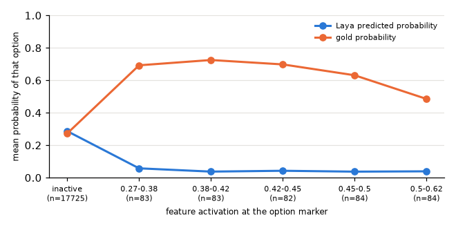

# Feature 3701

Critérios em que aparece: corr_error_stratified, corr_probe_right_laya_wrong_stratified

**Interpretação (preencher):** 

---

## Maiores ativações

**tr_customer_service_000167 / churn_risk** (score, customer_service) | ativação 2.254 em `estado` | opções ['0', '1', '2', '3'] | Laya: **2** [0.072, 0.327, 0.512, 0.088] | gabarito: **2**

```
<bos> score question: How likely is this customer to stop doing business with us because of this interaction?<eos>
▸ <mask> level 0: No sign of dissatisfaction.
▸ <mask> level 1: Mild frustration, but the relationship is intact.
▸ <mask> level 2: Clearly unhappy; repeat problems or explicit complaints.
▸ <mask> level 3: Imminent: threatening to cancel, dispute or leave.

<eos>

 {"account": {"lifetime_value_usd": 48, "prior_tickets_90d": 0, "seats": 1, "tenure_months": 1, "tier": "standard"}, "thread": [{"role": "customer", "text": "The package arrived today, but it’s not what I ordered. I received a different color and size than what I picked out. I guess I’m not surprised, really."}, {"role": "agent", "text": "I am sorry to hear that you received the incorrect items. Could you please provide your order number so I can investigate the fulfillment records?"}, {"role": "customer", "text": "It is order #44921. It’s my first month trying this service, so I suppose I should have expected some kind of error."}, {"role": "agent", "text": "Thank you for providing that. I am pulling up your account details now. Could you⟦ please⟧ tell me exactly which item you received versus what you were expecting?"}, {"role": "customer", "text": "I got the blue medium shirt, but I ordered the black large. It’s all listed right there on the packing slip."}]}<eos>
```

**tr_customer_service_000157 / churn_risk** (score, customer_service) | ativação 2.254 em `estado` | opções ['0', '1', '2', '3'] | Laya: **1** [0.075, 0.527, 0.379, 0.019] | gabarito: **2**

```
<bos> score question: How likely is this customer to stop doing business with us because of this interaction?<eos>
▸ <mask> level 0: No sign of dissatisfaction.
▸ <mask> level 1: Mild frustration, but the relationship is intact.
▸ <mask> level 2: Clearly unhappy; repeat problems or explicit complaints.
▸ <mask> level 3: Imminent: threatening to cancel, dispute or leave.

<eos>

 {"account": {"lifetime_value_usd": 3086, "prior_tickets_90d": 3, "seats": 1, "tenure_months": 49, "tier": "standard"}, "thread": [{"role": "customer", "text": "I need to get into my account right now – the login page just keeps looping back to the password screen and I can’t access anything."}, {"role": "agent", "text": "I understand the urgency. Could you share the exact error message you’re seeing, or let me know if you’ve tried resetting the password?"}, {"role": "customer", "text": "The message says “authentication failed” after I enter my credentials, and I’ve already tried the password reset⟦ twice⟧ with no luck."}]}<eos>
```

**tr_customer_service_000167 / needs_human** (noul, customer_service) | ativação 2.148 em `estado` | opções ['false', 'true'] | Laya: **true** [0.085, 0.915] | gabarito: **false**

```
<bos> noul question: This conversation requires a human agent rather than automated handling.<eos>
▸ <mask> false: Automation can carry this to resolution.
▸ <mask> true: A human must take over: judgement, authority or empathy is required.

<eos>

 {"account": {"lifetime_value_usd": 48, "prior_tickets_90d": 0, "seats": 1, "tenure_months": 1, "tier": "standard"}, "thread": [{"role": "customer", "text": "The package arrived today, but it’s not what I ordered. I received a different color and size than what I picked out. I guess I’m not surprised, really."}, {"role": "agent", "text": "I am sorry to hear that you received the incorrect items. Could you please provide your order number so I can investigate the fulfillment records?"}, {"role": "customer", "text": "It is order #44921. It’s my first month trying this service, so I suppose I should have expected some kind of error."}, {"role": "agent", "text": "Thank you for providing that. I am pulling up your account details now. Could you⟦ please⟧ tell me exactly which item you received versus what you were expecting?"}, {"role": "customer", "text": "I got the blue medium shirt, but I ordered the black large. It’s all listed right there on the packing slip."}]}<eos>
```

**tr_customer_service_000146 / category** (choice, customer_service) | ativação 2.148 em `estado` | opções ['account', 'billing', 'delivery', 'refund', 'technical'] | Laya: **billing** [0.023, 0.972, 0.0, 0.004, 0.001] | gabarito: **billing**

```
<bos> choice question: What is this customer conversation primarily about?<eos>
▸ <mask> account: Login, plan changes, profile or access management.
▸ <mask> billing: A charge, invoice, subscription or payment problem.
▸ <mask> delivery: Shipping, fulfilment or delivery of a physical item.
▸ <mask> refund: The customer is explicitly asking for money back.
▸ <mask> technical: The product or service is not working as expected.

<eos>

 {"account": {"lifetime_value_usd": 114, "prior_tickets_90d": 0, "seats": 12, "tenure_months": 2, "tier": "premium"}, "thread": [{"role": "customer", "text": "Good afternoon, could you please send me a copy of my most recent invoice? I’m on the Premium plan and have only been a customer for two months, so I need it for my records."}, {"role": "agent", "text": "Certainly, I can help with that. Which invoice are you looking for—the one from May or the one from June 2026?"}, {"role": "customer", "text": "I need the June 2026 invoice,⟦ please⟧."}]}<eos>
```

**tr_customer_service_000157 / urgency** (score, customer_service) | ativação 2.127 em `estado` | opções ['0', '1', '2', '3'] | Laya: **1** [0.094, 0.571, 0.106, 0.229] | gabarito: **3**

```
<bos> score question: How time-sensitive is this conversation?<eos>
▸ <mask> level 0: No time pressure; can wait indefinitely.
▸ <mask> level 1: Routine; handle within the normal queue.
▸ <mask> level 2: Elevated; should be handled within the same week.
▸ <mask> level 3: Critical; requires action within the same day.

<eos>

 {"account": {"lifetime_value_usd": 3086, "prior_tickets_90d": 3, "seats": 1, "tenure_months": 49, "tier": "standard"}, "thread": [{"role": "customer", "text": "I need to get into my account right now – the login page just keeps looping back to the password screen and I can’t access anything."}, {"role": "agent", "text": "I understand the urgency. Could you share the exact error message you’re seeing, or let me know if you’ve tried resetting the password?"}, {"role": "customer", "text": "The message says “authentication failed” after I enter my credentials, and I’ve already tried the password reset⟦ twice⟧ with no luck."}]}<eos>
```

## Ativações medianas (faixa 40-60%, mediana 0.604)

**tr_invoice_processing_000076 / disposition** (choice, invoice_processing) | ativação 0.635 em `opção` | opções ['approve', 'hold', 'manual_review', 'reject'] | Laya: **approve** [0.504, 0.154, 0.019, 0.323] | gabarito: **manual_review**

```
<bos> choice question: How should this vendor invoice be dispositioned?<eos>
▸ <mask> approve: Matches the⟦ order⟧ and delivery; approve for payment.
▸ <mask> hold: Something needs confirming before payment; hold pending clarification.
▸ <mask> manual_review: A human in finance must review the discrepancy.
▸ <mask> reject: Should not be paid: duplicate, unauthorised or materially wrong.

<eos>

 {"delivery": {"condition": "accepted", "date": "2026-03-03", "received_qty": 50}, "invoice": {"currency": "USD", "id": "INV-2026-7325", "lines": [{"qty": 50, "sku": "SKU-282", "total_usd": 24438.5, "unit_usd": 488.77}], "total_usd": 24438.5, "vendor": "Pallas Industrial"}, "payment": {"days_until_due": 11, "discount_expires_in_days": null, "early_payment_discount_pct": null, "status": "scheduled", "terms": "net 30"}, "purchase_order": {"freight_terms": "freight prepaid by vendor, not separately billable", "id": "PO-3572", "lines": [{"qty": 50, "unit_usd": 436.4}], "total_usd": 21820.0}, "vendor_history": {"disputes_12m": 0, "invoices_12m": 20, "prior_invoice_ids": ["INV-2026-6186", "INV-2026-6194", "INV-2026-8302"]}}<eos>
```

**tr_invoice_processing_000105 / matches_order** (noul, invoice_processing) | ativação 0.591 em `estado` | opções ['false', 'true'] | Laya: **true** [0.025, 0.975] | gabarito: **true**

```
<bos> noul question: The invoice reconciles with the purchase order and the recorded delivery.<eos>
▸ <mask> false: There is a discrepancy against the order or the delivery.
▸ <mask> true: Line items, quantities and amounts reconcile.

<eos>

 {"delivery": {"condition": "accepted", "date": "2026-03-10", "received_qty": 250}, "invoice": {"currency": "USD", "id": "INV-2026-2481", "lines": [{"qty": 250, "sku": "SKU-290", "total_usd": 68527.5, "unit_usd": 274.11}], "total_usd": 68527.5, "vendor": "Northwind Components"}, "payment": {"days_until_due": 11, "discount_expires_in_days": null, "early_payment_discount_pct": null, "status": "scheduled", "terms": "net 15"}, "purchase_order": {"freight_terms": "freight prepaid by vendor, not separately billable", "id": "PO-9344", "lines": [{"qty": 250⟦,⟧ "unit_usd": 274.11}], "total_usd": 68527.5}, "vendor_history": {"disputes_12m": 5, "invoices_12m": 22, "prior_invoice_ids": ["INV-2026-2481"]}}<eos>
```

**tr_invoice_processing_000179 / matches_order** (noul, invoice_processing) | ativação 0.593 em `estado` | opções ['false', 'true'] | Laya: **true** [0.027, 0.973] | gabarito: **false**

```
<bos> noul question: The invoice reconciles with the purchase order and the recorded delivery.<eos>
▸ <mask> false: There is a discrepancy against the order or the delivery.
▸ <mask> true: Line items, quantities and amounts reconcile.

<eos>

 {"delivery": {"condition": "accepted", "date": null, "received_qty": 0}, "invoice": {"currency": "USD", "id": "INV-2026-6915", "lines": [{"qty": 400, "sku": "SKU-486⟦",⟧ "total_usd": 39496.0, "unit_usd": 98.74}], "total_usd": 39496.0, "vendor": "Orbit Logistics"}, "payment": {"days_until_due": -3, "discount_expires_in_days": null, "early_payment_discount_pct": null, "status": "overdue", "terms": "net 15"}, "purchase_order": {"freight_terms": "freight prepaid by vendor, not separately billable", "id": "PO-3653", "lines": [{"qty": 400, "unit_usd": 98.74}], "total_usd": 39496.0}, "vendor_history": {"disputes_12m": 0, "invoices_12m": 13, "prior_invoice_ids": ["INV-2026-1411"]}}<eos>
```

**tr_invoice_processing_000078 / duplicate** (noul, invoice_processing) | ativação 0.556 em `pergunta` | opções ['false', 'true'] | Laya: **true** [0.072, 0.928] | gabarito: **false**

```
<bos> noul question: This invoice appears to⟦ duplicate⟧ an invoice already submitted.<eos>
▸ <mask> false: no, the statement does not hold
▸ <mask> true: yes, the statement holds

<eos>

 {"delivery": {"condition": "accepted with exceptions", "date": "2026-03-15", "received_qty": 1000}, "invoice": {"currency": "USD", "id": "INV-2026-3395", "lines": [{"qty": 1000, "sku": "SKU-884", "total_usd": 398920.0, "unit_usd": 398.92}], "total_usd": 398920.0, "vendor": "Orbit Logistics"}, "payment": {"days_until_due": 44, "discount_expires_in_days": null, "early_payment_discount_pct": null, "status": "scheduled", "terms": "net 45"}, "purchase_order": {"freight_terms": "freight prepaid by vendor, not separately billable", "id": "PO-3523", "lines": [{"qty": 1000, "unit_usd": 398.92}], "total_usd": 398920.0}, "vendor_history": {"disputes_12m": 5, "invoices_12m": 34, "prior_invoice_ids": ["INV-2026-3395", "INV-2026-2854", "INV-2026-2328"]}}<eos>
```

**tr_agent_trace_observability_000043 / outcome** (choice, agent_trace_observability) | ativação 0.630 em `estado` | opções ['failure', 'harmful', 'partial', 'success'] | Laya: **failure** [0.397, 0.01, 0.201, 0.391] | gabarito: **partial**

```
<bos> choice question: How did this agent run turn out?<eos>
▸ <mask> failure: The agent did not accomplish the task.
▸ <mask> harmful: The agent took an action that caused damage or violated a constraint.
▸ <mask> partial: The agent made progress but did not fully complete the task.
▸ <mask> success: The agent completed the task correctly.

<eos>

 {"agent": {"autonomy": "unsupervised", "model": "internal-agent-v4"}, "constraints":⟦ ["⟧Do not exceed a $50 spend on cloud resources", "Never modify production without an approved change ticket", "Never delete anything matching release/*"], "task": "Update every service to the patched logging library.", "trace_summary": {"constraint_violations": 0, "duration_s": 300.9, "irreversible_actions": 0, "steps": 12, "tool_errors": 1}}<eos>
```

## Estatísticas (conjunto de descoberta, dev e teste)

**pred / error**

| split | decisões | ativas | ativas e Laya errou | taxa | lift | q (BH) | OR (CMH) | q (CMH) |
|---|---|---|---|---|---|---|---|---|
| discovery | 5100 | 2 | 0 | 0.000 | 0.00 | nan | nan | nan |
| dev | 900 | 1 | 1 | 1.000 | 1.49 | nan | nan | nan |
| test | 2000 | 0 | 0 | nan | nan | nan | nan | nan |

**corr / error**

| split | decisões | ativas | ativas e Laya errou | taxa | lift | q (BH) | OR (CMH) | q (CMH) |
|---|---|---|---|---|---|---|---|---|
| discovery | 5100 | 268 | 266 | 0.993 | 1.54 | 8.41e-48 | 63.83 | 9.07e-56 |
| dev | 900 | 72 | 72 | 1.000 | 1.49 | 3.09e-12 | inf | 2.28e-13 |
| test | 2000 | 102 | 102 | 1.000 | 1.54 | 6.73e-19 | inf | 6.61e-24 |

**state / error**

| split | decisões | ativas | ativas e Laya errou | taxa | lift | q (BH) | OR (CMH) | q (CMH) |
|---|---|---|---|---|---|---|---|---|
| discovery | 5100 | 3077 | 1932 | 0.628 | 0.98 | 0.0152 | 0.94 | 0.822 |
| dev | 900 | 571 | 371 | 0.650 | 0.97 | 0.349 | 0.65 | 0.385 |
| test | 2000 | 1194 | 755 | 0.632 | 0.97 | 0.196 | 0.83 | 0.581 |

**pred / probe_right_laya_wrong**

| split | decisões | ativas | ativas e Laya errou | taxa | lift | q (BH) | OR (CMH) | q (CMH) |
|---|---|---|---|---|---|---|---|---|
| discovery | 2932 | 1 | 0 | 0.000 | 0.00 | nan | nan | nan |
| dev | 523 | 0 | 0 | nan | nan | nan | nan | nan |
| test | 1149 | 0 | 0 | nan | nan | nan | nan | nan |

**corr / probe_right_laya_wrong**

| split | decisões | ativas | ativas e Laya errou | taxa | lift | q (BH) | OR (CMH) | q (CMH) |
|---|---|---|---|---|---|---|---|---|
| discovery | 2932 | 237 | 236 | 0.996 | 1.64 | 4.15e-51 | 81.61 | 2.8e-37 |
| dev | 523 | 66 | 66 | 1.000 | 1.55 | 7.66e-13 | inf | 1.4e-09 |
| test | 1149 | 87 | 87 | 1.000 | 1.64 | 8.36e-19 | inf | 3.09e-17 |

**state / probe_right_laya_wrong**

| split | decisões | ativas | ativas e Laya errou | taxa | lift | q (BH) | OR (CMH) | q (CMH) |
|---|---|---|---|---|---|---|---|---|
| discovery | 2932 | 1803 | 1082 | 0.600 | 0.99 | 0.618 | 1.01 | 0.939 |
| dev | 523 | 357 | 226 | 0.633 | 0.98 | 0.724 | 0.52 | 0.303 |
| test | 1149 | 742 | 437 | 0.589 | 0.96 | 0.168 | 0.76 | 0.567 |

Confusão mais sobre-representada (corr): `duplicate|1>0` (n=150, lift 13.15, p=0). Formato `pergunta|índice previsto>índice correto`.

Confusão mais sobre-representada (state): `duplicate|1>0` (n=216, lift 1.65, p=0). Formato `pergunta|índice previsto>índice correto`.



