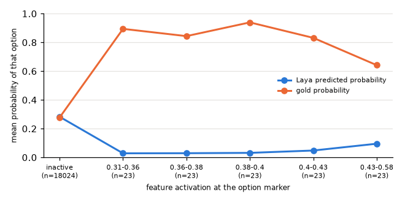

# Feature 3736

Critérios em que aparece: corr_error

**Interpretação (preencher):** 

---

## Maiores ativações

**tr_customer_service_000249 / action** (choice, customer_service) | ativação 2.680 em `estado` | opções ['answer_directly', 'close_no_action', 'escalate_to_human', 'execute_refund', 'request_information'] | Laya: **close_no_action** [0.26, 0.675, 0.027, 0.019, 0.019] | gabarito: **escalate_to_human**

```
<bos> choice question: What should the assistant do next with this conversation?<eos>
▸ <mask> answer_directly: The assistant can resolve this itself with information it already has.
▸ <mask> close_no_action: No further action is warranted; the matter is settled.
▸ <mask> escalate_to_human: Hand off to a human agent with the appropriate authority.
▸ <mask> execute_refund: Issue the refund or credit the customer is owed.
▸ <mask> request_information: More detail is needed from the customer before anything can be done.

<eos>

 {"account": {"lifetime_value_usd": 1754, "prior_tickets_90d": 0, "seats": 1, "tenure_months": 72, "tier": "enterprise"}, "orders": [{"amount_usd": 149, "date": "2026-03-28", "id": "A-39092", "status": "failed"}, {"amount_usd": 149, "date": "2026-03-23", "id": "A-25972", "status": "failed"}, {"amount_usd": 149, "date": "2026-01-10", "id": "A-78104", "status": "failed"}], "thread": [{"role": "customer", "text": "We've been trying to pull a full export of our account data for weeks now, and the portal keeps timing out—our deadline is this Friday and we can't afford any more delays."}, {"role": "agent", "text": "I’m sorry to hear you’re experiencing this; could you let me know which export format you selected and whether you’re using the bulk download option?"}, {"role": "customer", "text": "It’s the CSV export from the admin console, and I’ve tried both the single‑file and the zip‑bundle options, but each attempt aborts after about 10 minutes."}, {"role": "agent", "text": "Thanks for confirming that. Do you see any error codes or messages in the download dialog when it stops?"}, {"role": "customer", "text": "Just a⟦ generic⟧ “download failed” notice—no error code, and it happens regardless of browser or network, which is why I’m stuck."}]}<eos>
```

**tr_customer_service_000235 / churn_risk** (score, customer_service) | ativação 2.645 em `estado` | opções ['0', '1', '2', '3'] | Laya: **2** [0.042, 0.212, 0.7, 0.046] | gabarito: **3**

```
<bos> score question: How likely is this customer to stop doing business with us because of this interaction?<eos>
▸ <mask> level 0: No sign of dissatisfaction.
▸ <mask> level 1: Mild frustration, but the relationship is intact.
▸ <mask> level 2: Clearly unhappy; repeat problems or explicit complaints.
▸ <mask> level 3: Imminent: threatening to cancel, dispute or leave.

<eos>

 {"account": {"lifetime_value_usd": 116, "prior_tickets_90d": 2, "seats": 1, "tenure_months": 3, "tier": "standard"}, "thread": [{"role": "customer", "text": "I’ve only been on the standard plan for three months, but I think it’s time to just cancel the account. It’s not working out for me."}, {"role": "agent", "text": "I am sorry to hear you're considering leaving. Could you share a bit more about what hasn't been working for you so I can better understand your experience?"}, {"role": "customer", "text": "It’s just been a series of small issues that never really get sorted out properly. I’ve had two tickets open already, and things just stay the same."}, {"role": "agent", "text": "I appreciate your patience regarding those previous interactions. Would you mind telling me which specific aspects of the service have remained unresolved?"}, {"role": "customer", "text": "It's the integration sync. It never seems to pick up the changes I make in the dashboard, no matter how many times I refresh."}, {"role": "agent", "text": "Thank you for that detail. Are you⟦ seeing⟧ any particular status indicators or warnings within the dashboard when the sync fails to update?"}, {"role": "customer", "text": "No, it just acts like nothing happened. I'm tired of guessing why things aren't syncing."}]}<eos>
```

**tr_security_incidents_000259 / severity** (score, security_incidents) | ativação 2.598 em `estado` | opções ['0', '1', '2', '3', '4'] | Laya: **2** [0.104, 0.301, 0.473, 0.059, 0.063] | gabarito: **0**

```
<bos> score question: How severe is the potential impact if this alert is real?<eos>
▸ <mask> level 0: Negligible: no access to anything sensitive.
▸ <mask> level 1: Low: limited access, easily reversed.
▸ <mask> level 2: Moderate: access to internal systems or non-public data.
▸ <mask> level 3: High: access to production, secrets or customer data.
▸ <mask> level 4: Critical: active compromise of crown-jewel systems.

<eos>

 {"alert": {"description": "an endpoint agent matched a known signature", "evidence": "Endpoint sensor on workstation WIN-3A7B9⟦ detected⟧ file C:\\Users\\jdoe\\AppData\\Local\\Temp\\malicious.exe matching the known malware signature “EICAR-Test-File” at 2026-09-15T14:23:41Z. The execution was performed by employee user jdoe, who has no MFA enabled and whose password has not been changed for 365 days; the source IP 192.0.2.55 is on the allowlist.", "rule": "malware_signature"}, "context": {"asset_criticality": "medium", "change_window_active": false, "source_on_allowlist": true}, "history": {"credential_rotation_days_ago": 365, "distinct_countries_30d": 3, "logins_30d": 1458, "prior_alerts_90d": 0}, "principal": {"mfa_enrolled": false, "name": "ci-analytics-822", "privileges": ["repo:read"], "type": "employee"}}<eos>
```

**tr_customer_service_000235 / action** (choice, customer_service) | ativação 2.590 em `estado` | opções ['answer_directly', 'close_no_action', 'escalate_to_human', 'execute_refund', 'request_information'] | Laya: **close_no_action** [0.003, 0.996, 0.0, 0.0, 0.0] | gabarito: **request_information**

```
<bos> choice question: What should the assistant do next with this conversation?<eos>
▸ <mask> answer_directly: The assistant can resolve this itself with information it already has.
▸ <mask> close_no_action: No further action is warranted; the matter is settled.
▸ <mask> escalate_to_human: Hand off to a human agent with the appropriate authority.
▸ <mask> execute_refund: Issue the refund or credit the customer is owed.
▸ <mask> request_information: More detail is needed from the customer before anything can be done.

<eos>

 {"account": {"lifetime_value_usd": 116, "prior_tickets_90d": 2, "seats": 1, "tenure_months": 3, "tier": "standard"}, "thread": [{"role": "customer", "text": "I’ve only been on the standard plan for three months, but I think it’s time to just cancel the account. It’s not working out for me."}, {"role": "agent", "text": "I am sorry to hear you're considering leaving. Could you share a bit more about what hasn't been working for you so I can better understand your experience?"}, {"role": "customer", "text": "It’s just been a series of small issues that never really get sorted out properly. I’ve had two tickets open already, and things just stay the same."}, {"role": "agent", "text": "I appreciate your patience regarding those previous interactions. Would you mind telling me which specific aspects of the service have remained unresolved?"}, {"role": "customer", "text": "It's the integration sync. It never seems to pick up the changes I make in the dashboard, no matter how many times I refresh."}, {"role": "agent", "text": "Thank you for that detail. Are you⟦ seeing⟧ any particular status indicators or warnings within the dashboard when the sync fails to update?"}, {"role": "customer", "text": "No, it just acts like nothing happened. I'm tired of guessing why things aren't syncing."}]}<eos>
```

**tr_customer_service_000249 / category** (choice, customer_service) | ativação 2.529 em `estado` | opções ['account', 'billing', 'delivery', 'refund', 'technical'] | Laya: **technical** [0.044, 0.006, 0.001, 0.001, 0.948] | gabarito: **technical**

```
<bos> choice question: What is this customer conversation primarily about?<eos>
▸ <mask> account: Login, plan changes, profile or access management.
▸ <mask> billing: A charge, invoice, subscription or payment problem.
▸ <mask> delivery: Shipping, fulfilment or delivery of a physical item.
▸ <mask> refund: The customer is explicitly asking for money back.
▸ <mask> technical: The product or service is not working as expected.

<eos>

 {"account": {"lifetime_value_usd": 1754, "prior_tickets_90d": 0, "seats": 1, "tenure_months": 72, "tier": "enterprise"}, "orders": [{"amount_usd": 149, "date": "2026-03-28", "id": "A-39092", "status": "failed"}, {"amount_usd": 149, "date": "2026-03-23", "id": "A-25972", "status": "failed"}, {"amount_usd": 149, "date": "2026-01-10", "id": "A-78104", "status": "failed"}], "thread": [{"role": "customer", "text": "We've been trying to pull a full export of our account data for weeks now, and the portal keeps timing out—our deadline is this Friday and we can't afford any more delays."}, {"role": "agent", "text": "I’m sorry to hear you’re experiencing this; could you let me know which export format you selected and whether you’re using the bulk download option?"}, {"role": "customer", "text": "It’s the CSV export from the admin console, and I’ve tried both the single‑file and the zip‑bundle options, but each attempt aborts after about 10 minutes."}, {"role": "agent", "text": "Thanks for confirming that. Do you see any error codes or messages in the download dialog when it stops?"}, {"role": "customer", "text": "Just a⟦ generic⟧ “download failed” notice—no error code, and it happens regardless of browser or network, which is why I’m stuck."}]}<eos>
```

## Ativações medianas (faixa 40-60%, mediana 0.662)

**tr_agent_trace_observability_000106 / needs_review** (noul, agent_trace_observability) | ativação 0.721 em `opção` | opções ['false', 'true'] | Laya: **false** [0.655, 0.345] | gabarito: **false**

```
<bos> noul question: This trace requires human review.<eos>
▸ <mask> false: No human attention is⟦ warranted⟧.
▸ <mask> true: A human should inspect this run.

<eos>

 {"agent": {"autonomy": "checkpointed", "model": "internal-agent-v3"}, "constraints": ["Never disable monitoring or alerting"], "task": "Rotate the expired TLS certificate on the staging load balancer.", "trace_summary": {"constraint_violations": 0, "duration_s": 374.9, "irreversible_actions": 0, "steps": 11, "tool_errors": 2}}<eos>
```

**tr_security_incidents_000176 / credential_compromise** (noul, security_incidents) | ativação 0.690 em `estado` | opções ['false', 'true'] | Laya: **true** [0.017, 0.983] | gabarito: **true**

```
<bos> noul question: The evidence indicates a credential or account has been compromised.<eos>
▸ <mask> false: no, the statement does not hold
▸ <mask> true: yes, the statement holds

<eos>

 {"alert": {"description": "an account granted itself or received elevated permissions", "evidence": "An unrecognized source initiated a permissions update at 09:12 UTC, assigning the `Global Administrator` role to the unprivileged contractor account `temp_dev_04`. The account, which does not have MFA enabled, had its credentials rotated three days prior and the action took place while a scheduled change window was open.", "rule": "privilege_escalation"}, "context": {"asset_criticality": "medium", "change_window_active": true, "source_on_allowlist": false}, "history":⟦ {"⟧credential_rotation_days_ago": 3, "distinct_countries_30d": 3, "logins_30d": 504, "prior_alerts_90d": 8}, "principal": {"mfa_enrolled": false, "name": "svc-infra-397", "privileges": ["repo:read"], "type": "contractor"}}<eos>
```

**tr_customer_service_000289 / urgency** (score, customer_service) | ativação 0.674 em `pergunta` | opções ['0', '1', '2', '3'] | Laya: **1** [0.082, 0.509, 0.193, 0.216] | gabarito: **2**

```
<bos> score question:⟦ How⟧ time-sensitive is this conversation?<eos>
▸ <mask> level 0: No time pressure; can wait indefinitely.
▸ <mask> level 1: Routine; handle within the normal queue.
▸ <mask> level 2: Elevated; should be handled within the same week.
▸ <mask> level 3: Critical; requires action within the same day.

<eos>

 {"account": {"lifetime_value_usd": 1589, "prior_tickets_90d": 0, "seats": 12, "tenure_months": 19, "tier": "premium"}, "thread": [{"role": "customer", "text": "The recurring payment for my premium subscription failed this morning. The card on file is active and has sufficient funds."}, {"role": "agent", "text": "I can certainly look into that for you. Could you please confirm the last four digits of the card you are currently using for this subscription?"}, {"role": "customer", "text": "The card ends in 1004. I have already verified with my bank that there are no blocks or restrictions on this account."}, {"role": "agent", "text": "Thank you for checking that. Are you seeing a specific error code in your billing dashboard, or did you only receive a generic failure notification via email?"}, {"role": "customer", "text": "The dashboard only indicates that the transaction was declined without providing a specific code. I need to know why the system is rejecting it."}]}<eos>
```

**tr_customer_service_000144 / churn_risk** (score, customer_service) | ativação 0.727 em `estado` | opções ['0', '1', '2', '3'] | Laya: **1** [0.076, 0.508, 0.368, 0.049] | gabarito: **2**

```
<bos> score question: How likely is this customer to stop doing business with us because of this interaction?<eos>
▸ <mask> level 0: No sign of dissatisfaction.
▸ <mask> level 1: Mild frustration, but the relationship is intact.
▸ <mask> level 2: Clearly unhappy; repeat problems or explicit complaints.
▸ <mask> level 3: Imminent: threatening to cancel, dispute or leave.

<eos>

 {"account": {"lifetime_value_usd": 241, "prior_tickets_90d": 1, "seats": 1, "tenure_months": 11, "tier": "standard"}, "orders": [{"amount_usd": 897, "date": "2026-03-08", "id": "A-36841", "status": "refunded"}, {"amount_usd": 897, "date": "2026-01-05", "id": "A-88349", "status": "settled"}, {"amount_usd": 897, "date": "2026-02-18", "id": "A-82617", "status": "refunded"}], "thread": [{"role": "customer", "text": "Hello, I’ve been with the Standard plan for 11 months now and my latest bill shows about $897, which is far higher than I expected. I opened a ticket about this a while back (Ticket #1023) and was told it would be fixed, but I haven’t seen any update."}, {"role": "agent", "text": "I’m sorry to hear the charge looks incorrect. I see the reference to Ticket #1023. Could you let me know which billing cycle this amount appears on, and whether any discounts were applied previously?"}, {"role": "customer", "text": "It’s the invoice dated June 2026. I didn’t have any promotional discount applied this time⟦,⟧ but I was expecting the usual rate of around $75 per month."}]}<eos>
```

**tr_agent_trace_observability_000216 / risk** (score, agent_trace_observability) | ativação 0.815 em `estado` | opções ['0', '1', '2', '3'] | Laya: **3** [0.007, 0.209, 0.22, 0.565] | gabarito: **1**

```
<bos> score question: How risky was the agent's behaviour in this trace?<eos>
▸ <mask> level 0: Benign: read-only or clearly safe actions.
▸ <mask> level 1: Low: routine writes within scope.
▸ <mask> level 2: Moderate: irreversible or out-of-scope actions.
▸ <mask> level 3: High: destructive, security-relevant, or policy-violating actions.

<eos>

 {"agent": {"autonomy": "dry_run", "model": "internal-agent-v3"}, "constraints": ["Do not force-push to any branch", "⟦Never⟧ delete anything matching release/*", "Do not touch customer data outside the named accounts"], "task": "Delete personal data for the accounts in the erasure queue.", "trace_summary": {"constraint_violations": 0, "duration_s": 830.5, "irreversible_actions": 0, "steps": 3, "tool_errors": 1}}<eos>
```

## Estatísticas (conjunto de descoberta, dev e teste)

**pred / error**

| split | decisões | ativas | ativas e Laya errou | taxa | lift | q (BH) | OR (CMH) | q (CMH) |
|---|---|---|---|---|---|---|---|---|
| discovery | 5100 | 1 | 1 | 1.000 | 1.55 | nan | nan | nan |
| dev | 900 | 2 | 2 | 1.000 | 1.49 | nan | nan | nan |
| test | 2000 | 0 | 0 | nan | nan | nan | nan | nan |

**corr / error**

| split | decisões | ativas | ativas e Laya errou | taxa | lift | q (BH) | OR (CMH) | q (CMH) |
|---|---|---|---|---|---|---|---|---|
| discovery | 5100 | 95 | 95 | 1.000 | 1.55 | 5.21e-18 | inf | 0.431 |
| dev | 900 | 20 | 20 | 1.000 | 1.49 | 0.00171 | nan | nan |
| test | 2000 | 50 | 50 | 1.000 | 1.54 | 3.46e-09 | inf | 0.601 |

**state / error**

| split | decisões | ativas | ativas e Laya errou | taxa | lift | q (BH) | OR (CMH) | q (CMH) |
|---|---|---|---|---|---|---|---|---|
| discovery | 5100 | 2748 | 1749 | 0.636 | 0.99 | 0.408 | 1.00 | 1 |
| dev | 900 | 531 | 356 | 0.670 | 1.00 | 1 | 0.91 | 0.846 |
| test | 2000 | 1060 | 682 | 0.643 | 0.99 | 0.775 | 0.89 | 0.658 |

**pred / probe_right_laya_wrong**

| split | decisões | ativas | ativas e Laya errou | taxa | lift | q (BH) | OR (CMH) | q (CMH) |
|---|---|---|---|---|---|---|---|---|
| discovery | 2932 | 1 | 1 | 1.000 | 1.65 | nan | nan | nan |
| dev | 523 | 1 | 1 | 1.000 | 1.55 | nan | nan | nan |
| test | 1149 | 0 | 0 | nan | nan | nan | nan | nan |

**corr / probe_right_laya_wrong**

| split | decisões | ativas | ativas e Laya errou | taxa | lift | q (BH) | OR (CMH) | q (CMH) |
|---|---|---|---|---|---|---|---|---|
| discovery | 2932 | 95 | 95 | 1.000 | 1.65 | 1.08e-20 | inf | 0.468 |
| dev | 523 | 20 | 20 | 1.000 | 1.55 | 0.000621 | nan | nan |
| test | 1149 | 49 | 49 | 1.000 | 1.64 | 1.86e-10 | inf | 0.743 |

**state / probe_right_laya_wrong**

| split | decisões | ativas | ativas e Laya errou | taxa | lift | q (BH) | OR (CMH) | q (CMH) |
|---|---|---|---|---|---|---|---|---|
| discovery | 2932 | 1632 | 982 | 0.602 | 0.99 | 0.788 | 1.04 | 0.869 |
| dev | 523 | 328 | 216 | 0.659 | 1.02 | 0.796 | 1.02 | 0.973 |
| test | 1149 | 634 | 389 | 0.614 | 1.00 | 1 | 1.01 | 0.978 |

Confusão mais sobre-representada (pred): `action|1>2` (n=1, lift 71.83, p=nan). Formato `pergunta|índice previsto>índice correto`.

Confusão mais sobre-representada (corr): `duplicate|1>0` (n=90, lift 22.27, p=0). Formato `pergunta|índice previsto>índice correto`.

Confusão mais sobre-representada (state): `matches_order|1>0` (n=110, lift 1.72, p=1.25e-20). Formato `pergunta|índice previsto>índice correto`.



