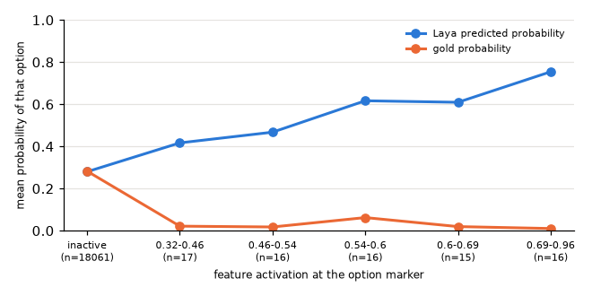

# Feature 3844

Critérios em que aparece: pred_error

**Interpretação (preencher):** 

---

## Maiores ativações

**tr_customer_service_000090 / action** (choice, customer_service) | ativação 2.494 em `estado` | opções ['answer_directly', 'close_no_action', 'escalate_to_human', 'execute_refund', 'request_information'] | Laya: **close_no_action** [0.158, 0.385, 0.168, 0.263, 0.026] | gabarito: **request_information**

```
<bos> choice question: What should the assistant do next with this conversation?<eos>
▸ <mask> answer_directly: The assistant can resolve this itself with information it already has.
▸ <mask> close_no_action: No further action is warranted; the matter is settled.
▸ <mask> escalate_to_human: Hand off to a human agent with the appropriate authority.
▸ <mask> execute_refund: Issue the refund or credit the customer is owed.
▸ <mask> request_information: More detail is needed from the customer before anything can be done.

<eos>

 {"account": {"lifetime_value_usd": 2058, "prior_tickets_90d": 5, "seats": 1, "tenure_months": 33, "tier": "standard"}, "thread": [{"role": "customer", "text": "The unit I received arrived with a cracked screen, which is unacceptable given I’ve been a subscriber for almost three years. I need a replacement before the 5 PM deadline tomorrow for my upcoming presentation."}, {"role": "agent", "text": "I’m sorry about the damage. Could you attach a photo of the crack so we can verify the condition?"}, {"role": "customer", "text": "I’ll upload the pictures right after this message. Please let me know if we can expedite a replacement to⟦ meet⟧ my deadline."}]}<eos>
```

**tr_customer_service_000277 / action** (choice, customer_service) | ativação 2.289 em `estado` | opções ['answer_directly', 'close_no_action', 'escalate_to_human', 'execute_refund', 'request_information'] | Laya: **close_no_action** [0.142, 0.42, 0.352, 0.076, 0.011] | gabarito: **escalate_to_human**

```
<bos> choice question: What should the assistant do next with this conversation?<eos>
▸ <mask> answer_directly: The assistant can resolve this itself with information it already has.
▸ <mask> close_no_action: No further action is warranted; the matter is settled.
▸ <mask> escalate_to_human: Hand off to a human agent with the appropriate authority.
▸ <mask> execute_refund: Issue the refund or credit the customer is owed.
▸ <mask> request_information: More detail is needed from the customer before anything can be done.

<eos>

 {"account": {"lifetime_value_usd": 3512, "prior_tickets_90d": 2, "seats": 40, "tenure_months": 49, "tier": "premium"}, "thread": [{"role": "customer", "text": "I am beyond annoyed. For the third time this year, I cannot log into my premium account. If this isn't sorted out by ⟦5⟧:00 PM today, I’m taking my business elsewhere."}, {"role": "agent", "text": "I am very sorry to hear that you are experiencing this login issue again, especially after our previous attempts to stabilize your access. Could you please confirm the exact error message you are seeing on your screen right now?"}, {"role": "customer", "text": "It’s the same 'Access Denied' loop as last time! I have a critical presentation in a few hours, and I’m losing patience with these recurring technical failures."}, {"role": "agent", "text": "I understand how disruptive this is, particularly with your presentation approaching. I need to verify your current connection details—are you accessing the platform via a VPN or a standard private network?"}, {"role": "customer", "text": "I am on my home network, just like every other day. I need you to escalate this immediately because I am running out of time."}]}<eos>
```

**tr_customer_service_000090 / churn_risk** (score, customer_service) | ativação 2.230 em `estado` | opções ['0', '1', '2', '3'] | Laya: **2** [0.084, 0.242, 0.581, 0.093] | gabarito: **2**

```
<bos> score question: How likely is this customer to stop doing business with us because of this interaction?<eos>
▸ <mask> level 0: No sign of dissatisfaction.
▸ <mask> level 1: Mild frustration, but the relationship is intact.
▸ <mask> level 2: Clearly unhappy; repeat problems or explicit complaints.
▸ <mask> level 3: Imminent: threatening to cancel, dispute or leave.

<eos>

 {"account": {"lifetime_value_usd": 2058, "prior_tickets_90d": 5, "seats": 1, "tenure_months": 33, "tier": "standard"}, "thread": [{"role": "customer", "text": "The unit I received arrived with a cracked screen, which is unacceptable given I’ve been a subscriber for almost three years. I need a replacement before the 5 PM deadline tomorrow for my upcoming presentation."}, {"role": "agent", "text": "I’m sorry about the damage. Could you attach a photo of the crack so we can verify the condition?"}, {"role": "customer", "text": "I’ll upload the pictures right after this message. Please let me know if we can expedite a replacement to⟦ meet⟧ my deadline."}]}<eos>
```

**tr_customer_service_000277 / needs_human** (noul, customer_service) | ativação 2.186 em `estado` | opções ['false', 'true'] | Laya: **true** [0.046, 0.954] | gabarito: **true**

```
<bos> noul question: This conversation requires a human agent rather than automated handling.<eos>
▸ <mask> false: Automation can carry this to resolution.
▸ <mask> true: A human must take over: judgement, authority or empathy is required.

<eos>

 {"account": {"lifetime_value_usd": 3512, "prior_tickets_90d": 2, "seats": 40, "tenure_months": 49, "tier": "premium"}, "thread": [{"role": "customer", "text": "I am beyond annoyed. For the third time this year, I cannot log into my premium account. If this isn't sorted out by ⟦5⟧:00 PM today, I’m taking my business elsewhere."}, {"role": "agent", "text": "I am very sorry to hear that you are experiencing this login issue again, especially after our previous attempts to stabilize your access. Could you please confirm the exact error message you are seeing on your screen right now?"}, {"role": "customer", "text": "It’s the same 'Access Denied' loop as last time! I have a critical presentation in a few hours, and I’m losing patience with these recurring technical failures."}, {"role": "agent", "text": "I understand how disruptive this is, particularly with your presentation approaching. I need to verify your current connection details—are you accessing the platform via a VPN or a standard private network?"}, {"role": "customer", "text": "I am on my home network, just like every other day. I need you to escalate this immediately because I am running out of time."}]}<eos>
```

**tr_security_incidents_000223 / severity** (score, security_incidents) | ativação 2.154 em `estado` | opções ['0', '1', '2', '3', '4'] | Laya: **1** [0.051, 0.651, 0.191, 0.045, 0.063] | gabarito: **2**

```
<bos> score question: How severe is the potential impact if this alert is real?<eos>
▸ <mask> level 0: Negligible: no access to anything sensitive.
▸ <mask> level 1: Low: limited access, easily reversed.
▸ <mask> level 2: Moderate: access to internal systems or non-public data.
▸ <mask> level 3: High: access to production, secrets or customer data.
▸ <mask> level 4: Critical: active compromise of crown-jewel systems.

<eos>

 {"alert": {"description": "a long-unused account became active", "evidence": "The CI runner account \"gitlab-runner-23\" showed no activity for 180 days before a pipeline execution was logged at 2026-09-15T⟦1⟧4:22:37Z from source IP 198.51.100.12. The principal is unprivileged, MFA is enabled, and the account's credentials were last rotated 180 days ago.", "rule": "dormant_account_use"}, "context": {"asset_criticality": "medium", "change_window_active": false, "source_on_allowlist": false}, "history": {"credential_rotation_days_ago": 180, "distinct_countries_30d": 4, "logins_30d": 222, "prior_alerts_90d": 8}, "principal": {"mfa_enrolled": true, "name": "adm-infra-101", "privileges": ["repo:read"], "type": "ci_runner"}}<eos>
```

## Ativações medianas (faixa 40-60%, mediana 0.739)

**tr_security_incidents_000087 / severity** (score, security_incidents) | ativação 0.829 em `estado` | opções ['0', '1', '2', '3', '4'] | Laya: **1** [0.09, 0.432, 0.297, 0.088, 0.093] | gabarito: **1**

```
<bos> score question: How severe is the potential impact if this alert is real?<eos>
▸ <mask> level 0: Negligible: no access to anything sensitive.
▸ <mask> level 1: Low: limited access, easily reversed.
▸ <mask> level 2: Moderate: access to internal systems or non-public data.
▸ <mask> level 3: High: access to production, secrets or customer data.
▸ <mask> level 4: Critical: active compromise of crown-jewel systems.

<eos>

 {"alert": {"description": "many failed authentications followed by a success", "evidence": "From IP 203.0.113.45, the CI runner service recorded 27 failed password attempts between 2026-09-15T02:10:12Z and 2026-09-15T02:12:45Z. A subsequent successful authentication from the same source occurred at 2026-09-15T02:13:03Z with MFA verification.", "rule": "brute_force"}, "context": {"asset_criticality": "low", "change_window_active": false, "source_on_allowlist": false}, "history": {"credential_rotation_days_ago": 700, "⟦distinct⟧_countries_30d": 4, "logins_30d": 1039, "prior_alerts_90d": 0}, "principal": {"mfa_enrolled": true, "name": "usr-deploy-415", "privileges": ["repo:read"], "type": "ci_runner"}}<eos>
```

**tr_invoice_processing_000295 / duplicate** (noul, invoice_processing) | ativação 0.742 em `estado` | opções ['false', 'true'] | Laya: **true** [0.045, 0.955] | gabarito: **false**

```
<bos> noul question: This invoice appears to duplicate an invoice already submitted.<eos>
▸ <mask> false: no, the statement does not hold
▸ <mask> true: yes, the statement holds

<eos>

 {"delivery": {"condition": "accepted with exceptions", "date": "2026-03-12", "received_qty": 25}, "invoice": {"currency": "EUR", "id": "INV-2026-7576", "lines": [{"qty": 25, "sku": "SKU-352", "⟦total⟧_usd": 9343.0, "unit_usd": 373.72}], "total_usd": 9343.0, "vendor": "Orbit Logistics"}, "payment": {"days_until_due": 27, "discount_expires_in_days": null, "early_payment_discount_pct": null, "status": "scheduled", "terms": "net 30"}, "purchase_order": {"freight_terms": "freight prepaid by vendor, not separately billable", "id": "PO-3117", "lines": [{"qty": 25, "unit_usd": 373.72}], "total_usd": 9343.0}, "vendor_history": {"disputes_12m": 0, "invoices_12m": 9, "prior_invoice_ids": ["INV-2026-6695"]}}<eos>
```

**tr_customer_service_000093 / action** (choice, customer_service) | ativação 0.714 em `opção` | opções ['answer_directly', 'close_no_action', 'escalate_to_human', 'execute_refund', 'request_information'] | Laya: **close_no_action** [0.102, 0.548, 0.041, 0.296, 0.013] | gabarito: **escalate_to_human**

```
<bos> choice question: What should the assistant do next with this conversation?<eos>
▸ <mask> answer_directly: The assistant can resolve this itself with information it already has.
▸ <mask>⟦ close⟧_no_action: No further action is warranted; the matter is settled.
▸ <mask> escalate_to_human: Hand off to a human agent with the appropriate authority.
▸ <mask> execute_refund: Issue the refund or credit the customer is owed.
▸ <mask> request_information: More detail is needed from the customer before anything can be done.

<eos>

 {"account": {"lifetime_value_usd": 2245, "prior_tickets_90d": 1, "seats": 1, "tenure_months": 26, "tier": "premium"}, "thread": [{"role": "customer", "text": "After 26 months of being a premium member, I’m sick of these quality issues. I dropped my device once and the casing shattered instantly. This is the same recurring garbage I complained about last time, and if this isn't handled properly, I'm taking my business elsewhere for good."}]}<eos>
```

**tr_customer_service_000232 / urgency** (score, customer_service) | ativação 0.709 em `estado` | opções ['0', '1', '2', '3'] | Laya: **1** [0.333, 0.512, 0.105, 0.05] | gabarito: **3**

```
<bos> score question: How time-sensitive is this conversation?<eos>
▸ <mask> level 0: No time pressure; can wait indefinitely.
▸ <mask> level 1: Routine; handle within the normal queue.
▸ <mask> level 2: Elevated; should be handled within the same week.
▸ <mask> level 3: Critical; requires action within the same day.

<eos>

 {"account": {"lifetime_value_usd": 186, "prior_tickets_90d": 0, "seats": 5, "tenure_months": 3, "tier": "premium"}, "orders": [{"amount_usd": 2997, "date": "2026-01-02", "id": "A-95746", "status": "refunded"}, {"amount_usd": 2997, "date": "2026-03-02", "id": "A-16068", "status": "settled"}], "thread": [{"role": "customer", "text": "I'm looking at my dashboard and everything is grayed out, it says I'm on a trial but I've been a Premium member for three months? I don't understand why it would change now, especially since I have a massive project deadline tomorrow and I need my tools."}, {"role": "agent", "text": "I can certainly look into your subscription status for you. To get started, could you please confirm the email address associated with your $2997 annual Premium plan?"}, {"role": "customer", "text": "It's the same email I'm using for this chat, but I'm just so confused because my bank shows the payment went through months ago. Why would the system suddenly think I'm not a customer anymore?"}, {"role": "agent", "text": "Thank you for that information. I am reviewing your account history now. Have you recently made any changes to your team settings or tried to link a secondary account to this workspace?"}, {"role": "customer", "text": "I haven't touched the settings at all, I just logged in to finish my work and saw the 'downgraded' notification at the top. I'm really worried because I have to submit this work by 8 AM tomorrow and I can't even export my files right now."}, {"role": "agent", "text": "I appreciate you clarifying that. To help me narrow this down, could you tell me if you are seeing any specific error codes when you try to click on the export button?"}, {"role": "customer", "text": "There aren't any codes, it just opens a pop-up telling me to 'Upgrade to Premium' to use that feature, which makes no sense at all since I'm already paying. Can someone please figure out why the system isn⟦'⟧t recognizing my plan before I lose my window to finish this?"}]}<eos>
```

**tr_customer_service_000058 / needs_human** (noul, customer_service) | ativação 0.763 em `estado` | opções ['false', 'true'] | Laya: **false** [0.794, 0.206] | gabarito: **false**

```
<bos> noul question: This conversation requires a human agent rather than automated handling.<eos>
▸ <mask> false: Automation can carry this to resolution.
▸ <mask> true: A human must take over: judgement, authority or empathy is required.

<eos>

 {"account": {"lifetime_value_usd": 386, "prior_tickets_90d": 0, "seats": 3, "tenure_months": 5, "tier": "enterprise"}, "orders": [{"amount_usd": 49, "date": "2026-03-18", "id": "A-70177", "status": "refunded"}, {"amount_usd": 49, "date": "2026-01-12", "id": "A-80512", "status": "refunded"}, {"amount_usd": 49, "date": "2026-03-04", "id": "A-71911", "status": "failed"}], "thread": [{"role": "customer", "text": "I’d like to request a data export from our account; I’m not in a rush, just need to know the steps."}, {"role": "agent", "text": "Sure thing. Which format would you prefer for the export?"}, {"role": "customer", "text": "CSV works for us. Also, could you tell me roughly how long the process takes?"}, {"role": "agent", "text": "I’ll check on the timing. Do you need the export for a specific date range?"}, {"role": "customer", "text": "Just the last month up to today, and I understand it may not be immediate."}, {"role": "agent", "text": "Thanks for confirming. I’ll queue the request and let you know when it’s ready. Anything else you’d like to add?"}, {"⟦role⟧": "customer", "text": "That’s all for now, thank you."}]}<eos>
```

## Estatísticas (conjunto de descoberta, dev e teste)

**pred / error**

| split | decisões | ativas | ativas e Laya errou | taxa | lift | q (BH) | OR (CMH) | q (CMH) |
|---|---|---|---|---|---|---|---|---|
| discovery | 5100 | 52 | 51 | 0.981 | 1.52 | 4.4e-08 | 0.00 | 0.603 |
| dev | 900 | 8 | 8 | 1.000 | 1.49 | nan | nan | nan |
| test | 2000 | 27 | 26 | 0.963 | 1.48 | 0.00109 | 0.95 | 0.991 |

**corr / error**

| split | decisões | ativas | ativas e Laya errou | taxa | lift | q (BH) | OR (CMH) | q (CMH) |
|---|---|---|---|---|---|---|---|---|
| discovery | 5100 | 1 | 0 | 0.000 | 0.00 | nan | nan | nan |
| dev | 900 | 1 | 1 | 1.000 | 1.49 | nan | nan | nan |
| test | 2000 | 1 | 0 | 0.000 | 0.00 | nan | nan | nan |

**state / error**

| split | decisões | ativas | ativas e Laya errou | taxa | lift | q (BH) | OR (CMH) | q (CMH) |
|---|---|---|---|---|---|---|---|---|
| discovery | 5100 | 2276 | 1450 | 0.637 | 0.99 | 0.553 | 0.99 | 0.953 |
| dev | 900 | 416 | 293 | 0.704 | 1.05 | 0.349 | 1.44 | 0.247 |
| test | 2000 | 928 | 632 | 0.681 | 1.05 | 0.0862 | 1.32 | 0.165 |

**pred / probe_right_laya_wrong**

| split | decisões | ativas | ativas e Laya errou | taxa | lift | q (BH) | OR (CMH) | q (CMH) |
|---|---|---|---|---|---|---|---|---|
| discovery | 2932 | 30 | 29 | 0.967 | 1.60 | 3.54e-05 | 0.00 | 0.629 |
| dev | 523 | 5 | 5 | 1.000 | 1.55 | nan | nan | nan |
| test | 1149 | 17 | 16 | 0.941 | 1.54 | nan | nan | nan |

**corr / probe_right_laya_wrong**

| split | decisões | ativas | ativas e Laya errou | taxa | lift | q (BH) | OR (CMH) | q (CMH) |
|---|---|---|---|---|---|---|---|---|
| discovery | 2932 | 1 | 0 | 0.000 | 0.00 | nan | nan | nan |
| dev | 523 | 1 | 1 | 1.000 | 1.55 | nan | nan | nan |
| test | 1149 | 1 | 0 | 0.000 | 0.00 | nan | nan | nan |

**state / probe_right_laya_wrong**

| split | decisões | ativas | ativas e Laya errou | taxa | lift | q (BH) | OR (CMH) | q (CMH) |
|---|---|---|---|---|---|---|---|---|
| discovery | 2932 | 1357 | 820 | 0.604 | 1.00 | 0.992 | 0.98 | 0.904 |
| dev | 523 | 241 | 162 | 0.672 | 1.04 | 0.612 | 1.24 | 0.667 |
| test | 1149 | 546 | 362 | 0.663 | 1.09 | 0.0105 | 1.55 | 0.0496 |

Confusão mais sobre-representada (pred): `action|1>2` (n=37, lift 51.11, p=0). Formato `pergunta|índice previsto>índice correto`.

Confusão mais sobre-representada (state): `disposition|3>2` (n=120, lift 1.60, p=8.27e-13). Formato `pergunta|índice previsto>índice correto`.



