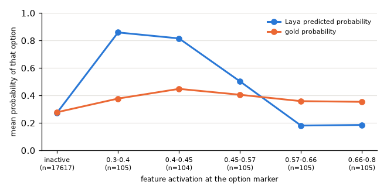

# Feature 3873

Critérios em que aparece: pred_probe_right_laya_wrong_stratified

**Interpretação (preencher):** 

---

## Maiores ativações

**tr_customer_service_000196 / action** (choice, customer_service) | ativação 1.880 em `estado` | opções ['answer_directly', 'close_no_action', 'escalate_to_human', 'execute_refund', 'request_information'] | Laya: **close_no_action** [0.269, 0.483, 0.163, 0.066, 0.02] | gabarito: **escalate_to_human**

```
<bos> choice question: What should the assistant do next with this conversation?<eos>
▸ <mask> answer_directly: The assistant can resolve this itself with information it already has.
▸ <mask> close_no_action: No further action is warranted; the matter is settled.
▸ <mask> escalate_to_human: Hand off to a human agent with the appropriate authority.
▸ <mask> execute_refund: Issue the refund or credit the customer is owed.
▸ <mask> request_information: More detail is needed from the customer before anything can be done.

<eos>

 {"account": {"lifetime_value_usd": 167, "prior_tickets_90d": 2, "seats": 1, "tenure_months": 5, "tier": "standard"}, "orders": [{"amount_usd": 149, "date": "2026-01-12", "id": "A-65487", "status": "settled"}], "thread": [{"role": "customer", "text": "I’m honestly at my wit's end here. It’s been five months of paying for this standard plan, and I’m still waiting on that $149 refund. I’ve opened two tickets already and nothing has changed—if you guys can't get this sorted, I’m just going to take my business elsewhere."}, {"role": "agent", "text": "I’m sorry to hear that you haven't received your refund yet. Could you please provide the ticket numbers from your previous interactions so I can look into the status of those requests for you?"}, {"role": "customer", "text": "I don't have time to dig through my archives for ticket numbers that should be attached to my account profile. This is exactly why I'm considering leaving; you have all my information, so why is this⟦ still⟧ pending?"}]}<eos>
```

**tr_security_incidents_000027 / true_positive** (noul, security_incidents) | ativação 1.854 em `estado` | opções ['false', 'true'] | Laya: **false** [0.659, 0.341] | gabarito: **true**

```
<bos> noul question: This alert reflects genuinely malicious or unauthorised activity.<eos>
▸ <mask> false: Benign activity, a misconfiguration, or a known false positive.
▸ <mask> true: The underlying behaviour is malicious or unauthorised.

<eos>

 {"alert": {"description": "a long-unused account⟦ became⟧ active", "evidence": "At 2026-09-15 03:42 UTC, the CI runner account \"ci-runner-112\" (privileged, MFA disabled) logged in successfully from IP 203.0.113.45 after having no activity since 2024-02-01. The source host is on the allowlist, the credentials were last rotated 700 days ago, and the event occurred outside any defined change window.", "rule": "dormant_account_use"}, "context": {"asset_criticality": "high", "change_window_active": false, "source_on_allowlist": true}, "history": {"credential_rotation_days_ago": 700, "distinct_countries_30d": 4, "logins_30d": 587, "prior_alerts_90d": 3}, "principal": {"mfa_enrolled": false, "name": "ci-billing-618", "privileges": ["deploy:production", "secrets:read"], "type": "ci_runner"}}<eos>
```

**tr_customer_service_000196 / category** (choice, customer_service) | ativação 1.775 em `estado` | opções ['account', 'billing', 'delivery', 'refund', 'technical'] | Laya: **account** [0.979, 0.01, 0.0, 0.004, 0.007] | gabarito: **refund**

```
<bos> choice question: What is this customer conversation primarily about?<eos>
▸ <mask> account: Login, plan changes, profile or access management.
▸ <mask> billing: A charge, invoice, subscription or payment problem.
▸ <mask> delivery: Shipping, fulfilment or delivery of a physical item.
▸ <mask> refund: The customer is explicitly asking for money back.
▸ <mask> technical: The product or service is not working as expected.

<eos>

 {"account": {"lifetime_value_usd": 167, "prior_tickets_90d": 2, "seats": 1, "tenure_months": 5, "tier": "standard"}, "orders": [{"amount_usd": 149, "date": "2026-01-12", "id": "A-65487", "status": "settled"}], "thread": [{"role": "customer", "text": "I’m honestly at my wit's end here. It’s been five months of paying for this standard plan, and I’m still waiting on that $149 refund. I’ve opened two tickets already and nothing has changed—if you guys can't get this sorted, I’m just going to take my business elsewhere."}, {"role": "agent", "text": "I’m sorry to hear that you haven't received your refund yet. Could you please provide the ticket numbers from your previous interactions so I can look into the status of those requests for you?"}, {"role": "customer", "text": "I don't have time to dig through my archives for ticket numbers that should be attached to my account profile. This is exactly why I'm considering leaving; you have all my information, so why is this⟦ still⟧ pending?"}]}<eos>
```

**tr_security_incidents_000173 / true_positive** (noul, security_incidents) | ativação 1.745 em `estado` | opções ['false', 'true'] | Laya: **true** [0.088, 0.912] | gabarito: **false**

```
<bos> noul question: This alert reflects genuinely malicious or unauthorised activity.<eos>
▸ <mask> false: Benign activity, a misconfiguration, or a known false positive.
▸ <mask> true: The underlying behaviour is malicious or unauthorised.

<eos>

 {"alert": {"description": "a session token was presented from a second address", "evidence": "An active session token belonging⟦ to⟧ an unprivileged employee was observed being utilized by a second allowlisted network address during an open change window. The account involved has MFA active and reached a credential age of 90 days at the time of the duplicate session presentation.", "rule": "token_reuse"}, "context": {"asset_criticality": "low", "change_window_active": true, "source_on_allowlist": true}, "history": {"credential_rotation_days_ago": 90, "distinct_countries_30d": 4, "logins_30d": 474, "prior_alerts_90d": 0}, "principal": {"mfa_enrolled": true, "name": "svc-analytics-220", "privileges": ["repo:read"], "type": "employee"}}<eos>
```

**tr_security_incidents_000173 / credential_compromise** (noul, security_incidents) | ativação 1.720 em `estado` | opções ['false', 'true'] | Laya: **true** [0.153, 0.847] | gabarito: **false**

```
<bos> noul question: The evidence indicates a credential or account has been compromised.<eos>
▸ <mask> false: no, the statement does not hold
▸ <mask> true: yes, the statement holds

<eos>

 {"alert": {"description": "a session token was presented from a second address", "evidence": "An active session token belonging to an unprivileged employee was observed being utilized by a second allowlisted network address during an open change window. The account⟦ involved⟧ has MFA active and reached a credential age of 90 days at the time of the duplicate session presentation.", "rule": "token_reuse"}, "context": {"asset_criticality": "low", "change_window_active": true, "source_on_allowlist": true}, "history": {"credential_rotation_days_ago": 90, "distinct_countries_30d": 4, "logins_30d": 474, "prior_alerts_90d": 0}, "principal": {"mfa_enrolled": true, "name": "svc-analytics-220", "privileges": ["repo:read"], "type": "employee"}}<eos>
```

## Ativações medianas (faixa 40-60%, mediana 0.537)

**tr_invoice_processing_000034 / urgency** (score, invoice_processing) | ativação 0.484 em `estado` | opções ['0', '1', '2', '3'] | Laya: **1** [0.09, 0.564, 0.226, 0.119] | gabarito: **1**

```
<bos> score question: How time-sensitive is processing this invoice?<eos>
▸ <mask> level 0: No time pressure; can wait indefinitely.
▸ <mask> level 1: Routine; handle within the normal queue.
▸ <mask> level 2: Elevated; should be handled within the same week.
▸ <mask> level 3: Critical; requires action within the same day.

<eos>

 {"delivery": {"condition": "accepted", "date": "2026-03-16", "received_qty": 25⟦},⟧ "invoice": {"currency": "USD", "id": "INV-2026-2701", "lines": [{"qty": 25, "sku": "SKU-886", "total_usd": 2944.25, "unit_usd": 117.77}, {"qty": 1, "sku": "FREIGHT", "total_usd": 276.83, "unit_usd": 276.83}], "total_usd": 3221.08, "vendor": "Vantage Materials"}, "payment": {"days_until_due": 11, "discount_expires_in_days": null, "early_payment_discount_pct": null, "status": "scheduled", "terms": "net 30"}, "purchase_order": {"freight_terms": "freight prepaid by vendor, not separately billable", "id": "PO-3751", "lines": [{"qty": 25, "unit_usd": 117.77}], "total_usd": 2944.25}, "vendor_history": {"disputes_12m": 0, "invoices_12m": 9, "prior_invoice_ids": ["INV-2026-5941", "INV-2026-9758", "INV-2026-7863", "INV-2026-5149"]}}<eos>
```

**tr_invoice_processing_000296 / urgency** (score, invoice_processing) | ativação 0.503 em `opção` | opções ['0', '1', '2', '3'] | Laya: **1** [0.104, 0.526, 0.247, 0.122] | gabarito: **3**

```
<bos> score question: How time-sensitive is processing this invoice?<eos>
▸ <mask>⟦ level⟧ 0: No time pressure; can wait indefinitely.
▸ <mask> level 1: Routine; handle within the normal queue.
▸ <mask> level 2: Elevated; should be handled within the same week.
▸ <mask> level 3: Critical; requires action within the same day.

<eos>

 {"delivery": {"condition": "accepted", "date": "2026-03-05", "received_qty": 80}, "invoice": {"currency": "USD", "id": "INV-2026-8797", "lines": [{"qty": 80, "sku": "SKU-804", "total_usd": 33680.0, "unit_usd": 421.0}], "total_usd": 33680.0, "vendor": "Vantage Materials"}, "payment": {"days_until_due": -3, "discount_expires_in_days": 6, "early_payment_discount_pct": 2.0, "status": "overdue", "terms": "net 15"}, "purchase_order": {"freight_terms": "freight prepaid by vendor, not separately billable", "id": "PO-9142", "lines": [{"qty": 100, "unit_usd": 421.0}], "total_usd": 42100.0}, "vendor_history": {"disputes_12m": 0, "invoices_12m": 20, "prior_invoice_ids": ["INV-2026-8855", "INV-2026-4201", "INV-2026-5650", "INV-2026-8977"]}}<eos>
```

**tr_invoice_processing_000164 / urgency** (score, invoice_processing) | ativação 0.482 em `opção` | opções ['0', '1', '2', '3'] | Laya: **1** [0.116, 0.461, 0.275, 0.147] | gabarito: **2**

```
<bos> score question: How time-sensitive is processing this invoice?<eos>
▸ <mask> level 0: No time pressure; can wait indefinitely.
▸ <mask>⟦ level⟧ 1: Routine; handle within the normal queue.
▸ <mask> level 2: Elevated; should be handled within the same week.
▸ <mask> level 3: Critical; requires action within the same day.

<eos>

 {"delivery": {"condition": "accepted", "date": "2026-03-19", "received_qty": 1000}, "invoice": {"currency": "USD", "id": "INV-2026-3652", "lines": [{"qty": 1000, "sku": "SKU-103", "total_usd": 299850.0, "unit_usd": 299.85}], "total_usd": 299850.0, "vendor": "Northwind Components"}, "payment": {"days_until_due": 5, "discount_expires_in_days": null, "early_payment_discount_pct": null, "status": "scheduled", "terms": "net 30"}, "purchase_order": {"freight_terms": "freight prepaid by vendor, not separately billable", "id": "PO-1013", "lines": [{"qty": 1000, "unit_usd": 299.85}], "total_usd": 299850.0}, "vendor_history": {"disputes_12m": 0, "invoices_12m": 56, "prior_invoice_ids": ["INV-2026-9880", "INV-2026-6717", "INV-2026-5969"]}}<eos>
```

**tr_invoice_processing_000044 / matches_order** (noul, invoice_processing) | ativação 0.587 em `estado` | opções ['false', 'true'] | Laya: **true** [0.021, 0.979] | gabarito: **true**

```
<bos> noul question: The invoice reconciles with the purchase order and the recorded delivery.<eos>
▸ <mask> false: There is a discrepancy against the order or the delivery.
▸ <mask> true: Line items, quantities and amounts reconcile.

<eos>

 {"delivery": {"condition": "accepted with exceptions", "date": "2026-03-10", "received_qty": 250}, "invoice": {"currency": "USD", "id": "INV-2026-6702", "lines": [{"qty": 250, "sku": "SKU-507", "total_usd": 101050.0, "unit_usd": 404.2}], "total_usd": 101050.0, "vendor": "Kestrel Supply"}, "payment": {"days_until_due": 2, "discount_expires_in_days": 1, "early_payment_discount_pct": 2.0, "status": "scheduled", "terms": "net 60"}, "purchase_order": {"freight_terms": "freight prepaid by vendor, not⟦ separately⟧ billable", "id": "PO-1900", "lines": [{"qty": 250, "unit_usd": 404.2}], "total_usd": 101050.0}, "vendor_history": {"disputes_12m": 2, "invoices_12m": 34, "prior_invoice_ids": ["INV-2026-6702"]}}<eos>
```

**tr_invoice_processing_000181 / urgency** (score, invoice_processing) | ativação 0.482 em `estado` | opções ['0', '1', '2', '3'] | Laya: **1** [0.074, 0.515, 0.261, 0.151] | gabarito: **2**

```
<bos> score question: How time-sensitive is processing this invoice?<eos>
▸ <mask> level 0: No time pressure; can wait indefinitely.
▸ <mask> level 1: Routine; handle within the normal queue.
▸ <mask> level 2: Elevated; should be handled within the same week.
▸ <mask> level 3: Critical; requires action within the same day.

<eos>

 {"delivery": {"condition": "accepted with exceptions", "date": "2026-03-27", "received_qty": 1000}, "invoice": {"currency": "USD", "id": "INV-2026-4638", "lines": [{"qty": 1000, "sku": "SKU-503", "total_usd": 151490.0, "unit_usd": 151.49}], "total_usd": 151490.0, "vendor": "Acme Fabrication"}, "payment": {"days_until_due": 2, "discount_expires_in_days": null, "early_payment_discount_pct": null, "status": "scheduled", "terms": "net 30"}, "purchase_order": {"freight_terms": "freight prepaid by vendor, not separately billable", "id": "PO-2215", "lines": [{"qty": 1000, "unit_usd": 151.49}], "total_usd": 151490.0}, "vendor_history": {"disputes_12m": 5⟦,⟧ "invoices_12m": 12, "prior_invoice_ids": ["INV-2026-4638", "INV-2026-9285", "INV-2026-4100", "INV-2026-2909"]}}<eos>
```

## Estatísticas (conjunto de descoberta, dev e teste)

**pred / error**

| split | decisões | ativas | ativas e Laya errou | taxa | lift | q (BH) | OR (CMH) | q (CMH) |
|---|---|---|---|---|---|---|---|---|
| discovery | 5100 | 247 | 154 | 0.623 | 0.97 | 0.66 | 1.77 | 0.0813 |
| dev | 900 | 43 | 27 | 0.628 | 0.93 | 0.797 | 1.60 | 0.751 |
| test | 2000 | 95 | 54 | 0.568 | 0.87 | 0.174 | 1.86 | 0.496 |

**corr / error**

| split | decisões | ativas | ativas e Laya errou | taxa | lift | q (BH) | OR (CMH) | q (CMH) |
|---|---|---|---|---|---|---|---|---|
| discovery | 5100 | 224 | 131 | 0.585 | 0.91 | 0.094 | 0.23 | 0.00303 |
| dev | 900 | 36 | 20 | 0.556 | 0.83 | 0.261 | 0.00 | 0.204 |
| test | 2000 | 73 | 32 | 0.438 | 0.67 | 0.000526 | 0.43 | 0.396 |

**state / error**

| split | decisões | ativas | ativas e Laya errou | taxa | lift | q (BH) | OR (CMH) | q (CMH) |
|---|---|---|---|---|---|---|---|---|
| discovery | 5100 | 1783 | 1136 | 0.637 | 0.99 | 0.648 | 0.92 | 0.586 |
| dev | 900 | 333 | 215 | 0.646 | 0.96 | 0.586 | 0.71 | 0.318 |
| test | 2000 | 679 | 428 | 0.630 | 0.97 | 0.465 | 0.80 | 0.355 |

**pred / probe_right_laya_wrong**

| split | decisões | ativas | ativas e Laya errou | taxa | lift | q (BH) | OR (CMH) | q (CMH) |
|---|---|---|---|---|---|---|---|---|
| discovery | 2932 | 175 | 123 | 0.703 | 1.16 | 0.0136 | 2.47 | 0.00711 |
| dev | 523 | 25 | 18 | 0.720 | 1.11 | 0.709 | 3.01 | 0.434 |
| test | 1149 | 63 | 42 | 0.667 | 1.09 | 0.56 | 2.58 | 0.235 |

**corr / probe_right_laya_wrong**

| split | decisões | ativas | ativas e Laya errou | taxa | lift | q (BH) | OR (CMH) | q (CMH) |
|---|---|---|---|---|---|---|---|---|
| discovery | 2932 | 140 | 88 | 0.629 | 1.04 | 0.674 | 0.27 | 0.0949 |
| dev | 523 | 21 | 14 | 0.667 | 1.03 | 1 | 0.00 | 0.509 |
| test | 1149 | 46 | 25 | 0.543 | 0.89 | 0.488 | 0.80 | 0.884 |

**state / probe_right_laya_wrong**

| split | decisões | ativas | ativas e Laya errou | taxa | lift | q (BH) | OR (CMH) | q (CMH) |
|---|---|---|---|---|---|---|---|---|
| discovery | 2932 | 1096 | 676 | 0.617 | 1.02 | 0.479 | 0.90 | 0.565 |
| dev | 523 | 215 | 140 | 0.651 | 1.01 | 1 | 0.72 | 0.461 |
| test | 1149 | 429 | 250 | 0.583 | 0.95 | 0.362 | 0.63 | 0.075 |

Confusão mais sobre-representada (pred): `needs_review|0>1` (n=86, lift 16.91, p=0). Formato `pergunta|índice previsto>índice correto`.

Confusão mais sobre-representada (corr): `outcome|3>2` (n=86, lift 22.77, p=0). Formato `pergunta|índice previsto>índice correto`.

Confusão mais sobre-representada (state): `duplicate|1>0` (n=168, lift 2.21, p=5.31e-39). Formato `pergunta|índice previsto>índice correto`.



