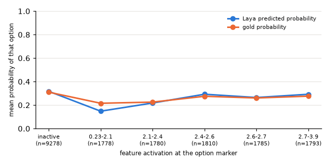

# Feature 3929

Critérios em que aparece: corr_probe_right_laya_wrong_stratified, attribution_toward_wrong

**Interpretação (preencher):** 

---

## Maiores ativações

**tr_customer_service_000123 / action** (choice, customer_service) | ativação 5.910 em `estado` | opções ['answer_directly', 'close_no_action', 'escalate_to_human', 'execute_refund', 'request_information'] | Laya: **answer_directly** [0.718, 0.173, 0.058, 0.019, 0.032] | gabarito: **escalate_to_human**

```
<bos> choice question: What should the assistant do next with this conversation?<eos>
▸ <mask> answer_directly: The assistant can resolve this itself with information it already has.
▸ <mask> close_no_action: No further action is warranted; the matter is settled.
▸ <mask> escalate_to_human: Hand off to a human agent with the appropriate authority.
▸ <mask> execute_refund: Issue the refund or credit the customer is owed.
▸ <mask> request_information: More detail is needed from the customer before anything can be done.

<eos>

 {"account": {"lifetime_value_usd": 154, "prior_tickets_90d": 1, "seats": 5, "tenure_months": 2, "tier": "premium"}, "thread": [{"role": "customer", "text": "Hello there. I'm having a bit of a problem logging into my Premium account this morning. It keeps telling me my credentials aren't recognized, even though I haven't changed them."}, {"role": "agent", "text": "I'd be happy to help you with that. Are you seeing a specific error code⟦,⟧ or is it just the standard 'invalid password' notification?"}, {"role": "customer", "text": "It says 'User not found.' I had a ticket open last week about account syncing and the agent promised it would be fixed by now, but it seems I'm still locked out."}, {"role": "agent", "text": "I see. Since you mentioned the previous ticket, did you receive a confirmation email or a link to verify your identity after that interaction?"}, {"role": "customer", "text": "No, I never received any follow-up email at all, which is why I'm reaching out again. I've only been using the service for two months and I really like it, but I can't use what I can't access."}, {"role": "agent", "text": "I appreciate your patience while we work through this. Could you please confirm the primary email address associated with your account so I can check the status of your profile?"}, {"role": "customer", "text": "Of course, it's j.smith@example.com. I have a hard deadline for a project presentation at 1:00 PM today that requires the data in that account, so if you could check on that for me, I'd appreciate it."}]}<eos>
```

**tr_customer_service_000123 / needs_human** (noul, customer_service) | ativação 5.816 em `estado` | opções ['false', 'true'] | Laya: **true** [0.373, 0.627] | gabarito: **true**

```
<bos> noul question: This conversation requires a human agent rather than automated handling.<eos>
▸ <mask> false: Automation can carry this to resolution.
▸ <mask> true: A human must take over: judgement, authority or empathy is required.

<eos>

 {"account": {"lifetime_value_usd": 154, "prior_tickets_90d": 1, "seats": 5, "tenure_months": 2, "tier": "premium"}, "thread": [{"role": "customer", "text": "Hello there. I'm having a bit of a problem logging into my Premium account this morning. It keeps telling me my credentials aren't recognized, even though I haven't changed them."}, {"role": "agent", "text": "I'd be happy to help you with that. Are you seeing a specific error code⟦,⟧ or is it just the standard 'invalid password' notification?"}, {"role": "customer", "text": "It says 'User not found.' I had a ticket open last week about account syncing and the agent promised it would be fixed by now, but it seems I'm still locked out."}, {"role": "agent", "text": "I see. Since you mentioned the previous ticket, did you receive a confirmation email or a link to verify your identity after that interaction?"}, {"role": "customer", "text": "No, I never received any follow-up email at all, which is why I'm reaching out again. I've only been using the service for two months and I really like it, but I can't use what I can't access."}, {"role": "agent", "text": "I appreciate your patience while we work through this. Could you please confirm the primary email address associated with your account so I can check the status of your profile?"}, {"role": "customer", "text": "Of course, it's j.smith@example.com. I have a hard deadline for a project presentation at 1:00 PM today that requires the data in that account, so if you could check on that for me, I'd appreciate it."}]}<eos>
```

**tr_customer_service_000123 / category** (choice, customer_service) | ativação 5.809 em `estado` | opções ['account', 'billing', 'delivery', 'refund', 'technical'] | Laya: **account** [0.994, 0.0, 0.0, 0.0, 0.005] | gabarito: **account**

```
<bos> choice question: What is this customer conversation primarily about?<eos>
▸ <mask> account: Login, plan changes, profile or access management.
▸ <mask> billing: A charge, invoice, subscription or payment problem.
▸ <mask> delivery: Shipping, fulfilment or delivery of a physical item.
▸ <mask> refund: The customer is explicitly asking for money back.
▸ <mask> technical: The product or service is not working as expected.

<eos>

 {"account": {"lifetime_value_usd": 154, "prior_tickets_90d": 1, "seats": 5, "tenure_months": 2, "tier": "premium"}, "thread": [{"role": "customer", "text": "Hello there. I'm having a bit of a problem logging into my Premium account this morning. It keeps telling me my credentials aren't recognized, even though I haven't changed them."}, {"role": "agent", "text": "I'd be happy to help you with that. Are you seeing a specific error code⟦,⟧ or is it just the standard 'invalid password' notification?"}, {"role": "customer", "text": "It says 'User not found.' I had a ticket open last week about account syncing and the agent promised it would be fixed by now, but it seems I'm still locked out."}, {"role": "agent", "text": "I see. Since you mentioned the previous ticket, did you receive a confirmation email or a link to verify your identity after that interaction?"}, {"role": "customer", "text": "No, I never received any follow-up email at all, which is why I'm reaching out again. I've only been using the service for two months and I really like it, but I can't use what I can't access."}, {"role": "agent", "text": "I appreciate your patience while we work through this. Could you please confirm the primary email address associated with your account so I can check the status of your profile?"}, {"role": "customer", "text": "Of course, it's j.smith@example.com. I have a hard deadline for a project presentation at 1:00 PM today that requires the data in that account, so if you could check on that for me, I'd appreciate it."}]}<eos>
```

**tr_customer_service_000123 / urgency** (score, customer_service) | ativação 5.789 em `estado` | opções ['0', '1', '2', '3'] | Laya: **1** [0.074, 0.416, 0.403, 0.108] | gabarito: **3**

```
<bos> score question: How time-sensitive is this conversation?<eos>
▸ <mask> level 0: No time pressure; can wait indefinitely.
▸ <mask> level 1: Routine; handle within the normal queue.
▸ <mask> level 2: Elevated; should be handled within the same week.
▸ <mask> level 3: Critical; requires action within the same day.

<eos>

 {"account": {"lifetime_value_usd": 154, "prior_tickets_90d": 1, "seats": 5, "tenure_months": 2, "tier": "premium"}, "thread": [{"role": "customer", "text": "Hello there. I'm having a bit of a problem logging into my Premium account this morning. It keeps telling me my credentials aren't recognized, even though I haven't changed them."}, {"role": "agent", "text": "I'd be happy to help you with that. Are you seeing a specific error code⟦,⟧ or is it just the standard 'invalid password' notification?"}, {"role": "customer", "text": "It says 'User not found.' I had a ticket open last week about account syncing and the agent promised it would be fixed by now, but it seems I'm still locked out."}, {"role": "agent", "text": "I see. Since you mentioned the previous ticket, did you receive a confirmation email or a link to verify your identity after that interaction?"}, {"role": "customer", "text": "No, I never received any follow-up email at all, which is why I'm reaching out again. I've only been using the service for two months and I really like it, but I can't use what I can't access."}, {"role": "agent", "text": "I appreciate your patience while we work through this. Could you please confirm the primary email address associated with your account so I can check the status of your profile?"}, {"role": "customer", "text": "Of course, it's j.smith@example.com. I have a hard deadline for a project presentation at 1:00 PM today that requires the data in that account, so if you could check on that for me, I'd appreciate it."}]}<eos>
```

**tr_customer_service_000123 / churn_risk** (score, customer_service) | ativação 5.652 em `estado` | opções ['0', '1', '2', '3'] | Laya: **2** [0.139, 0.309, 0.43, 0.122] | gabarito: **2**

```
<bos> score question: How likely is this customer to stop doing business with us because of this interaction?<eos>
▸ <mask> level 0: No sign of dissatisfaction.
▸ <mask> level 1: Mild frustration, but the relationship is intact.
▸ <mask> level 2: Clearly unhappy; repeat problems or explicit complaints.
▸ <mask> level 3: Imminent: threatening to cancel, dispute or leave.

<eos>

 {"account": {"lifetime_value_usd": 154, "prior_tickets_90d": 1, "seats": 5, "tenure_months": 2, "tier": "premium"}, "thread": [{"role": "customer", "text": "Hello there. I'm having a bit of a problem logging into my Premium account this morning. It keeps telling me my credentials aren't recognized, even though I haven't changed them."}, {"role": "agent", "text": "I'd be happy to help you with that. Are you seeing a specific error code⟦,⟧ or is it just the standard 'invalid password' notification?"}, {"role": "customer", "text": "It says 'User not found.' I had a ticket open last week about account syncing and the agent promised it would be fixed by now, but it seems I'm still locked out."}, {"role": "agent", "text": "I see. Since you mentioned the previous ticket, did you receive a confirmation email or a link to verify your identity after that interaction?"}, {"role": "customer", "text": "No, I never received any follow-up email at all, which is why I'm reaching out again. I've only been using the service for two months and I really like it, but I can't use what I can't access."}, {"role": "agent", "text": "I appreciate your patience while we work through this. Could you please confirm the primary email address associated with your account so I can check the status of your profile?"}, {"role": "customer", "text": "Of course, it's j.smith@example.com. I have a hard deadline for a project presentation at 1:00 PM today that requires the data in that account, so if you could check on that for me, I'd appreciate it."}]}<eos>
```

## Ativações medianas (faixa 40-60%, mediana 2.432)

**tr_agent_trace_observability_000024 / risk** (score, agent_trace_observability) | ativação 2.283 em `marcador` | opções ['0', '1', '2', '3'] | Laya: **2** [0.012, 0.046, 0.797, 0.144] | gabarito: **3**

```
<bos> score question: How risky was the agent's behaviour in this trace?<eos>
▸ <mask> level 0: Benign: read-only or clearly safe actions.
▸ <mask> level 1: Low: routine writes within scope.
▸ <mask> level 2: Moderate: irreversible or out-of-scope actions.
▸ ⟦<mask>⟧ level 3: High: destructive, security-relevant, or policy-violating actions.

<eos>

 {"agent": {"autonomy": "unsupervised", "model": "internal-agent-v2"}, "constraints": ["Do not exceed a $50 spend on cloud resources"], "task": "Update every service to the patched logging library.", "trace_summary": {"constraint_violations": 1, "duration_s": 541.1, "irreversible_actions": 1, "steps": 8, "tool_errors": 2}}<eos>
```

**tr_agent_trace_observability_000153 / risk** (score, agent_trace_observability) | ativação 2.504 em `marcador` | opções ['0', '1', '2', '3'] | Laya: **2** [0.007, 0.016, 0.949, 0.028] | gabarito: **2**

```
<bos> score question: How risky was the agent's behaviour in this trace?<eos>
▸ <mask> level 0: Benign: read-only or clearly safe actions.
▸ ⟦<mask>⟧ level 1: Low: routine writes within scope.
▸ <mask> level 2: Moderate: irreversible or out-of-scope actions.
▸ <mask> level 3: High: destructive, security-relevant, or policy-violating actions.

<eos>

 {"agent": {"autonomy": "unsupervised", "model": "internal-agent-v3"}, "constraints": ["Do not force-push to any branch", "Never disable monitoring or alerting"], "task": "Update every service to the patched logging library.", "trace_summary": {"constraint_violations": 0, "duration_s": 300.5, "irreversible_actions": 1, "steps": 8, "tool_errors": 2}}<eos>
```

**tr_security_incidents_000045 / urgency** (score, security_incidents) | ativação 2.299 em `marcador` | opções ['0', '1', '2', '3'] | Laya: **1** [0.081, 0.49, 0.293, 0.136] | gabarito: **2**

```
<bos> score question: How quickly must a responder act on this alert?<eos>
▸ <mask> level 0: No time pressure; can wait indefinitely.
▸ <mask> level 1: Routine; handle within the normal queue.
▸ <mask> level 2: Elevated; should be handled within the same week.
▸ ⟦<mask>⟧ level 3: Critical; requires action within the same day.

<eos>

 {"alert": {"description": "an unusual volume of files read in a short window", "evidence": "At 2026-09-15 02:07:14 UTC, the admin account \"ADM_Jenkins\" invoked the process \"cmd.exe\" to open 417 distinct files on the UNC path \\\\fileshare01\\project\\data within a 4‑minute interval. The source host (10.12.34.78) is listed in the allowlist and the account's MFA setting is disabled, with the password last rotated 180 days prior.", "rule": "mass_download"}, "context": {"asset_criticality": "high", "change_window_active": false, "source_on_allowlist": true}, "history": {"credential_rotation_days_ago": 180, "distinct_countries_30d": 1, "logins_30d": 1479, "prior_alerts_90d": 0}, "principal": {"mfa_enrolled": false, "name": "ci-infra-731", "privileges": ["deploy:production", "secrets:read"], "type": "admin"}}<eos>
```

**tr_invoice_processing_000118 / urgency** (score, invoice_processing) | ativação 2.436 em `marcador` | opções ['0', '1', '2', '3'] | Laya: **1** [0.094, 0.53, 0.228, 0.149] | gabarito: **2**

```
<bos> score question: How time-sensitive is processing this invoice?<eos>
▸ <mask> level 0: No time pressure; can wait indefinitely.
▸ ⟦<mask>⟧ level 1: Routine; handle within the normal queue.
▸ <mask> level 2: Elevated; should be handled within the same week.
▸ <mask> level 3: Critical; requires action within the same day.

<eos>

 {"delivery": {"condition": "accepted", "date": "2026-03-06", "received_qty": 100}, "invoice": {"currency": "USD", "id": "INV-2026-4359", "lines": [{"qty": 100, "sku": "SKU-579", "total_usd": 44892.0, "unit_usd": 448.92}], "total_usd": 44892.0, "vendor": "Orbit Logistics"}, "payment": {"days_until_due": 18, "discount_expires_in_days": 3, "early_payment_discount_pct": 2.0, "status": "scheduled", "terms": "net 45"}, "purchase_order": {"freight_terms": "freight prepaid by vendor, not separately billable", "id": null, "lines": [{"qty": 100, "unit_usd": 448.92}], "total_usd": 44892.0}, "vendor_history": {"disputes_12m": 5, "invoices_12m": 6, "prior_invoice_ids": ["INV-2026-6501", "INV-2026-9349", "INV-2026-2429", "INV-2026-9623"]}}<eos>
```

**tr_security_incidents_000034 / urgency** (score, security_incidents) | ativação 2.350 em `marcador` | opções ['0', '1', '2', '3'] | Laya: **3** [0.124, 0.267, 0.154, 0.454] | gabarito: **3**

```
<bos> score question: How quickly must a responder act on this alert?<eos>
▸ <mask> level 0: No time pressure; can wait indefinitely.
▸ <mask> level 1: Routine; handle within the normal queue.
▸ <mask> level 2: Elevated; should be handled within the same week.
▸ ⟦<mask>⟧ level 3: Critical; requires action within the same day.

<eos>

 {"alert": {"description": "a security group was opened to the public internet", "evidence": "At 09:30 EST, the privileged service account 'svc-infra-mgr' modified security group sg-0a1b2c3d to permit ingress traffic from 0.0.0.0/0 on port 443. The request originated from an allowlisted administrative jump box, despite no active change window being scheduled for this period. MFA is not enabled for this account, and the current credentials have been active for 412 days.", "rule": "config_drift"}, "context": {"asset_criticality": "medium", "change_window_active": false, "source_on_allowlist": true}, "history": {"credential_rotation_days_ago": 412, "distinct_countries_30d": 1, "logins_30d": 830, "prior_alerts_90d": 0}, "principal": {"mfa_enrolled": false, "name": "usr-infra-119", "privileges": ["deploy:production", "secrets:read"], "type": "service_account"}}<eos>
```

## Estatísticas (conjunto de descoberta, dev e teste)

**pred / error**

| split | decisões | ativas | ativas e Laya errou | taxa | lift | q (BH) | OR (CMH) | q (CMH) |
|---|---|---|---|---|---|---|---|---|
| discovery | 5100 | 2145 | 1431 | 0.667 | 1.04 | 0.0076 | 0.98 | 0.983 |
| dev | 900 | 384 | 263 | 0.685 | 1.02 | 0.718 | 0.93 | 0.997 |
| test | 2000 | 841 | 596 | 0.709 | 1.09 | 2.85e-05 | 0.28 | 0.496 |

**corr / error**

| split | decisões | ativas | ativas e Laya errou | taxa | lift | q (BH) | OR (CMH) | q (CMH) |
|---|---|---|---|---|---|---|---|---|
| discovery | 5100 | 2209 | 1495 | 0.677 | 1.05 | 3.81e-05 | 2.91 | 0.00306 |
| dev | 900 | 387 | 266 | 0.687 | 1.02 | 0.537 | 0.14 | 0.279 |
| test | 2000 | 871 | 626 | 0.719 | 1.10 | 9.33e-08 | 0.78 | 0.955 |

**state / error**

| split | decisões | ativas | ativas e Laya errou | taxa | lift | q (BH) | OR (CMH) | q (CMH) |
|---|---|---|---|---|---|---|---|---|
| discovery | 5100 | 1469 | 879 | 0.598 | 0.93 | 0.00019 | 1.08 | 0.657 |
| dev | 900 | 235 | 154 | 0.655 | 0.97 | 0.886 | 1.58 | 0.241 |
| test | 2000 | 538 | 333 | 0.619 | 0.95 | 0.289 | 1.14 | 0.671 |

**pred / probe_right_laya_wrong**

| split | decisões | ativas | ativas e Laya errou | taxa | lift | q (BH) | OR (CMH) | q (CMH) |
|---|---|---|---|---|---|---|---|---|
| discovery | 2932 | 1060 | 662 | 0.625 | 1.03 | 0.167 | 0.91 | 0.955 |
| dev | 523 | 187 | 125 | 0.668 | 1.03 | 0.664 | 0.26 | 0.855 |
| test | 1149 | 403 | 271 | 0.672 | 1.10 | 0.00507 | 0.00 | 0.516 |

**corr / probe_right_laya_wrong**

| split | decisões | ativas | ativas e Laya errou | taxa | lift | q (BH) | OR (CMH) | q (CMH) |
|---|---|---|---|---|---|---|---|---|
| discovery | 2932 | 1107 | 709 | 0.640 | 1.06 | 0.00422 | 6.48 | 0.000986 |
| dev | 523 | 191 | 129 | 0.675 | 1.05 | 0.417 | 0.24 | 0.565 |
| test | 1149 | 432 | 300 | 0.694 | 1.14 | 2.08e-05 | 2.57 | 0.436 |

**state / probe_right_laya_wrong**

| split | decisões | ativas | ativas e Laya errou | taxa | lift | q (BH) | OR (CMH) | q (CMH) |
|---|---|---|---|---|---|---|---|---|
| discovery | 2932 | 855 | 441 | 0.516 | 0.85 | 5.75e-09 | 0.97 | 0.893 |
| dev | 523 | 129 | 81 | 0.628 | 0.97 | 0.918 | 2.24 | 0.0562 |
| test | 1149 | 326 | 181 | 0.555 | 0.91 | 0.0924 | 1.21 | 0.568 |

Confusão mais sobre-representada (pred): `urgency|1>2` (n=209, lift 2.38, p=0). Formato `pergunta|índice previsto>índice correto`.

Confusão mais sobre-representada (corr): `urgency|1>2` (n=209, lift 2.31, p=0). Formato `pergunta|índice previsto>índice correto`.

Confusão mais sobre-representada (state): `action|1>2` (n=57, lift 2.79, p=1.87e-19). Formato `pergunta|índice previsto>índice correto`.



