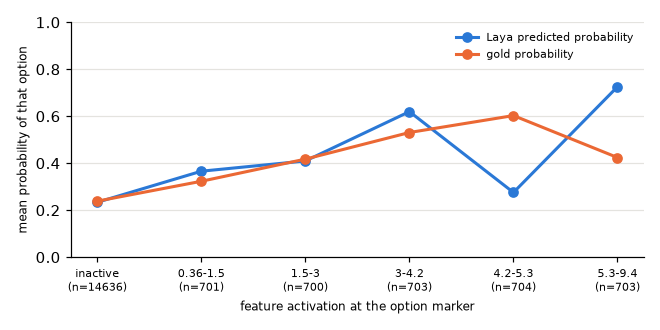

# Feature 4001

Critérios em que aparece: attribution_toward_wrong

**Interpretação (preencher):** 

---

## Maiores ativações

**tr_invoice_processing_000153 / duplicate** (noul, invoice_processing) | ativação 9.445 em `marcador` | opções ['false', 'true'] | Laya: **true** [0.019, 0.981] | gabarito: **false**

```
<bos> noul question: This invoice appears to duplicate an invoice already submitted.<eos>
▸ <mask> false: no, the statement does not hold
▸ ⟦<mask>⟧ true: yes, the statement holds

<eos>

 {"delivery": {"condition": "accepted with exceptions", "date": null, "received_qty": 0}, "invoice": {"currency": "USD", "id": "INV-2026-9865", "lines": [{"qty": 1000, "sku": "SKU-844", "total_usd": 237850.0, "unit_usd": 237.85}], "total_usd": 237850.0, "vendor": "Kestrel Supply"}, "payment": {"days_until_due": 18, "discount_expires_in_days": 4, "early_payment_discount_pct": 2.0, "status": "scheduled", "terms": "net 15"}, "purchase_order": {"freight_terms": "freight prepaid by vendor, not separately billable", "id": "PO-9394", "lines": [{"qty": 1000, "unit_usd": 237.85}], "total_usd": 237850.0}, "vendor_history": {"disputes_12m": 1, "invoices_12m": 13, "prior_invoice_ids": ["INV-2026-5658", "INV-2026-4550", "INV-2026-8891"]}}<eos>
```

**tr_invoice_processing_000061 / duplicate** (noul, invoice_processing) | ativação 9.352 em `marcador` | opções ['false', 'true'] | Laya: **true** [0.029, 0.971] | gabarito: **false**

```
<bos> noul question: This invoice appears to duplicate an invoice already submitted.<eos>
▸ <mask> false: no, the statement does not hold
▸ ⟦<mask>⟧ true: yes, the statement holds

<eos>

 {"delivery": {"condition": "accepted with exceptions", "date": null, "received_qty": 0}, "invoice": {"currency": "USD", "id": "INV-2026-6615", "lines": [{"qty": 400, "sku": "SKU-909", "total_usd": 127980.0, "unit_usd": 319.95}], "total_usd": 127980.0, "vendor": "Acme Fabrication"}, "payment": {"days_until_due": 44, "discount_expires_in_days": null, "early_payment_discount_pct": null, "status": "scheduled", "terms": "net 45"}, "purchase_order": {"freight_terms": "freight prepaid by vendor, not separately billable", "id": "PO-9226", "lines": [{"qty": 400, "unit_usd": 319.95}], "total_usd": 127980.0}, "vendor_history": {"disputes_12m": 2, "invoices_12m": 5, "prior_invoice_ids": ["INV-2026-5422", "INV-2026-8931", "INV-2026-8502"]}}<eos>
```

**tr_invoice_processing_000125 / duplicate** (noul, invoice_processing) | ativação 9.328 em `marcador` | opções ['false', 'true'] | Laya: **true** [0.025, 0.975] | gabarito: **false**

```
<bos> noul question: This invoice appears to duplicate an invoice already submitted.<eos>
▸ <mask> false: no, the statement does not hold
▸ ⟦<mask>⟧ true: yes, the statement holds

<eos>

 {"delivery": {"condition": "accepted with exceptions", "date": null, "received_qty": 0}, "invoice": {"currency": "USD", "id": "INV-2026-9806", "lines": [{"qty": 50, "sku": "SKU-429", "total_usd": 7214.0, "unit_usd": 144.28}], "total_usd": 7214.0, "vendor": "Acme Fabrication"}, "payment": {"days_until_due": 27, "discount_expires_in_days": null, "early_payment_discount_pct": null, "status": "scheduled", "terms": "net 30"}, "purchase_order": {"freight_terms": "freight prepaid by vendor, not separately billable", "id": "PO-3759", "lines": [{"qty": 50, "unit_usd": 144.28}], "total_usd": 7214.0}, "vendor_history": {"disputes_12m": 0, "invoices_12m": 30, "prior_invoice_ids": ["INV-2026-3577", "INV-2026-6921", "INV-2026-4997"]}}<eos>
```

**tr_invoice_processing_000229 / duplicate** (noul, invoice_processing) | ativação 9.320 em `marcador` | opções ['false', 'true'] | Laya: **true** [0.022, 0.978] | gabarito: **false**

```
<bos> noul question: This invoice appears to duplicate an invoice already submitted.<eos>
▸ <mask> false: no, the statement does not hold
▸ ⟦<mask>⟧ true: yes, the statement holds

<eos>

 {"delivery": {"condition": "accepted with exceptions", "date": null, "received_qty": 0}, "invoice": {"currency": "USD", "id": "INV-2026-3885", "lines": [{"qty": 250, "sku": "SKU-557", "total_usd": 16032.5, "unit_usd": 64.13}], "total_usd": 16032.5, "vendor": "Pallas Industrial"}, "payment": {"days_until_due": 11, "discount_expires_in_days": null, "early_payment_discount_pct": null, "status": "scheduled", "terms": "net 45"}, "purchase_order": {"freight_terms": "freight prepaid by vendor, not separately billable", "id": "PO-6240", "lines": [{"qty": 250, "unit_usd": 64.13}], "total_usd": 16032.5}, "vendor_history": {"disputes_12m": 5, "invoices_12m": 31, "prior_invoice_ids": ["INV-2026-5043"]}}<eos>
```

**tr_invoice_processing_000038 / duplicate** (noul, invoice_processing) | ativação 9.234 em `marcador` | opções ['false', 'true'] | Laya: **true** [0.02, 0.98] | gabarito: **false**

```
<bos> noul question: This invoice appears to duplicate an invoice already submitted.<eos>
▸ <mask> false: no, the statement does not hold
▸ ⟦<mask>⟧ true: yes, the statement holds

<eos>

 {"delivery": {"condition": "accepted with exceptions", "date": "2026-03-01", "received_qty": 50}, "invoice": {"currency": "USD", "id": "INV-2026-3588", "lines": [{"qty": 50, "sku": "SKU-203", "total_usd": 11633.5, "unit_usd": 232.67}], "total_usd": 11633.5, "vendor": "Acme Fabrication"}, "payment": {"days_until_due": 5, "discount_expires_in_days": null, "early_payment_discount_pct": null, "status": "scheduled", "terms": "net 30"}, "purchase_order": {"freight_terms": "freight prepaid by vendor, not separately billable", "id": "PO-6472", "lines": [{"qty": 50, "unit_usd": 232.67}], "total_usd": 11633.5}, "vendor_history": {"disputes_12m": 0, "invoices_12m": 3, "prior_invoice_ids": ["INV-2026-7693", "INV-2026-1074", "INV-2026-5345", "INV-2026-5454"]}}<eos>
```

## Ativações medianas (faixa 40-60%, mediana 3.338)

**tr_security_incidents_000113 / credential_compromise** (noul, security_incidents) | ativação 3.596 em `marcador` | opções ['false', 'true'] | Laya: **false** [0.868, 0.132] | gabarito: **true**

```
<bos> noul question: The evidence indicates a credential or account has been compromised.<eos>
▸ <mask> false: no, the statement does not hold
▸ ⟦<mask>⟧ true: yes, the statement holds

<eos>

 {"alert": {"description": "audit logging was turned off on a host", "evidence": "At 2026-09-15 09:03:12 UTC the process \"auditctl\" executed on host \"win-01.example.com\" with arguments \"-e 0\" and disabled audit logging for the system. The command was issued by the shared_mailbox account \"audit_monitor\" from an allow‑listed source, and MFA was disabled for this principal.", "rule": "disabled_logging"}, "context": {"asset_criticality": "crown_jewel", "change_window_active": false, "source_on_allowlist": true}, "history": {"credential_rotation_days_ago": 412, "distinct_countries_30d": 2, "logins_30d": 491, "prior_alerts_90d": 8}, "principal": {"mfa_enrolled": false, "name": "adm-support-214", "privileges": ["repo:read"], "type": "shared_mailbox"}}<eos>
```

**tr_security_incidents_000158 / credential_compromise** (noul, security_incidents) | ativação 3.732 em `marcador` | opções ['false', 'true'] | Laya: **true** [0.005, 0.995] | gabarito: **true**

```
<bos> noul question: The evidence indicates a credential or account has been compromised.<eos>
▸ <mask> false: no, the statement does not hold
▸ ⟦<mask>⟧ true: yes, the statement holds

<eos>

 {"alert": {"description": "many failed authentications followed by a success", "evidence": "Between 2026-09-16 11:02 UTC and 11:07 UTC, a contractor account experienced 27 consecutive failed authentication attempts from 198.51.100.22, after which a successful login occurred at 11:09 UTC using MFA. The originating address is absent from the approved source list, and the account's credentials were last rotated on 2026‑08‑17.", "rule": "brute_force"}, "context": {"asset_criticality": "medium", "change_window_active": false, "source_on_allowlist": false}, "history": {"credential_rotation_days_ago": 30, "distinct_countries_30d": 2, "logins_30d": 1639, "prior_alerts_90d": 3}, "principal": {"mfa_enrolled": true, "name": "ci-analytics-833", "privileges": ["repo:read"], "type": "contractor"}}<eos>
```

**tr_security_incidents_000208 / credential_compromise** (noul, security_incidents) | ativação 3.832 em `marcador` | opções ['false', 'true'] | Laya: **true** [0.187, 0.813] | gabarito: **true**

```
<bos> noul question: The evidence indicates a credential or account has been compromised.<eos>
▸ <mask> false: no, the statement does not hold
▸ ⟦<mask>⟧ true: yes, the statement holds

<eos>

 {"alert": {"description": "a large transfer to an external destination", "evidence": "At 04:03 UTC on 2026-09-15, a service account named svc_backup transferred 4.8 GB of data to external IP 198.51.100.77 over port 443 using the process rsync.exe. The transfer completed in 7 minutes and originated from an unrecognised host in the DMZ. The event took place during an open change window.", "rule": "data_egress"}, "context": {"asset_criticality": "low", "change_window_active": true, "source_on_allowlist": false}, "history": {"credential_rotation_days_ago": 30, "distinct_countries_30d": 3, "logins_30d": 873, "prior_alerts_90d": 3}, "principal": {"mfa_enrolled": false, "name": "ci-support-613", "privileges": ["deploy:production", "secrets:read"], "type": "service_account"}}<eos>
```

**tr_security_incidents_000110 / true_positive** (noul, security_incidents) | ativação 2.775 em `marcador` | opções ['false', 'true'] | Laya: **true** [0.008, 0.992] | gabarito: **true**

```
<bos> noul question: This alert reflects genuinely malicious or unauthorised activity.<eos>
▸ <mask> false: Benign activity, a misconfiguration, or a known false positive.
▸ ⟦<mask>⟧ true: The underlying behaviour is malicious or unauthorised.

<eos>

 {"alert": {"description": "many failed authentications followed by a success", "evidence": "Fifty‑seven failed RDP authentication attempts were logged against host WIN-DB01 (192.168.5.22) between 2026-09-15 14:10 and 14:18 UTC, followed by a successful login from the same source IP 172.16.8.44 at 14:19 UTC. The login used a shared_mailbox account with MFA enabled, unprivileged status, and a password that has not been rotated for 700 days; the source IP is present on the allowlist.", "rule": "brute_force"}, "context": {"asset_criticality": "high", "change_window_active": false, "source_on_allowlist": true}, "history": {"credential_rotation_days_ago": 700, "distinct_countries_30d": 1, "logins_30d": 1558, "prior_alerts_90d": 1}, "principal": {"mfa_enrolled": true, "name": "svc-billing-899", "privileges": ["repo:read"], "type": "shared_mailbox"}}<eos>
```

**tr_customer_service_000226 / needs_human** (noul, customer_service) | ativação 3.594 em `marcador` | opções ['false', 'true'] | Laya: **true** [0.134, 0.866] | gabarito: **true**

```
<bos> noul question: This conversation requires a human agent rather than automated handling.<eos>
▸ ⟦<mask>⟧ false: Automation can carry this to resolution.
▸ <mask> true: A human must take over: judgement, authority or empathy is required.

<eos>

 {"account": {"lifetime_value_usd": 2324, "prior_tickets_90d": 1, "seats": 1, "tenure_months": 26, "tier": "free"}, "orders": [{"amount_usd": 99, "date": "2026-01-19", "id": "A-44962", "status": "pending"}], "thread": [{"role": "customer", "text": "I have been using this free service for over two years, but the current lag makes it impossible to work, and I have a hard deadline in two hours that I am going to miss because of this $99 billable project!"}]}<eos>
```

## Estatísticas (conjunto de descoberta, dev e teste)

**pred / error**

| split | decisões | ativas | ativas e Laya errou | taxa | lift | q (BH) | OR (CMH) | q (CMH) |
|---|---|---|---|---|---|---|---|---|
| discovery | 5100 | 1724 | 905 | 0.525 | 0.82 | 3.39e-34 | 0.70 | 0.459 |
| dev | 900 | 322 | 182 | 0.565 | 0.84 | 1.08e-05 | 0.49 | 0.678 |
| test | 2000 | 695 | 350 | 0.504 | 0.77 | 6.59e-21 | 0.80 | 0.875 |

**corr / error**

| split | decisões | ativas | ativas e Laya errou | taxa | lift | q (BH) | OR (CMH) | q (CMH) |
|---|---|---|---|---|---|---|---|---|
| discovery | 5100 | 1614 | 795 | 0.493 | 0.77 | 2.47e-50 | 0.58 | 0.0238 |
| dev | 900 | 306 | 166 | 0.542 | 0.81 | 4.79e-08 | 0.36 | 0.279 |
| test | 2000 | 658 | 313 | 0.476 | 0.73 | 3.78e-28 | 1.18 | 0.833 |

**state / error**

| split | decisões | ativas | ativas e Laya errou | taxa | lift | q (BH) | OR (CMH) | q (CMH) |
|---|---|---|---|---|---|---|---|---|
| discovery | 5100 | 53 | 28 | 0.528 | 0.82 | 0.219 | 1.04 | 0.968 |
| dev | 900 | 8 | 3 | 0.375 | 0.56 | nan | nan | nan |
| test | 2000 | 35 | 21 | 0.600 | 0.92 | 0.87 | 1.35 | 0.786 |

**pred / probe_right_laya_wrong**

| split | decisões | ativas | ativas e Laya errou | taxa | lift | q (BH) | OR (CMH) | q (CMH) |
|---|---|---|---|---|---|---|---|---|
| discovery | 2932 | 1192 | 621 | 0.521 | 0.86 | 1.86e-13 | 0.41 | 0.0781 |
| dev | 523 | 221 | 123 | 0.557 | 0.86 | 0.0025 | 0.15 | 0.268 |
| test | 1149 | 473 | 241 | 0.510 | 0.83 | 5.58e-08 | 0.60 | 0.661 |

**corr / probe_right_laya_wrong**

| split | decisões | ativas | ativas e Laya errou | taxa | lift | q (BH) | OR (CMH) | q (CMH) |
|---|---|---|---|---|---|---|---|---|
| discovery | 2932 | 1117 | 546 | 0.489 | 0.81 | 6.7e-23 | 1.33 | 0.642 |
| dev | 523 | 210 | 112 | 0.533 | 0.83 | 5.58e-05 | 0.58 | 0.82 |
| test | 1149 | 447 | 215 | 0.481 | 0.79 | 6.62e-12 | 3.63 | 0.456 |

**state / probe_right_laya_wrong**

| split | decisões | ativas | ativas e Laya errou | taxa | lift | q (BH) | OR (CMH) | q (CMH) |
|---|---|---|---|---|---|---|---|---|
| discovery | 2932 | 31 | 11 | 0.355 | 0.59 | 0.0219 | 0.42 | 0.241 |
| dev | 523 | 4 | 3 | 0.750 | 1.16 | nan | nan | nan |
| test | 1149 | 29 | 17 | 0.586 | 0.96 | 1 | 1.45 | 0.718 |

Confusão mais sobre-representada (pred): `duplicate|1>0` (n=217, lift 2.96, p=0). Formato `pergunta|índice previsto>índice correto`.

Confusão mais sobre-representada (corr): `duplicate|1>0` (n=217, lift 3.16, p=0). Formato `pergunta|índice previsto>índice correto`.

Confusão mais sobre-representada (state): `credential_compromise|1>0` (n=7, lift 8.21, p=1.82e-05). Formato `pergunta|índice previsto>índice correto`.



