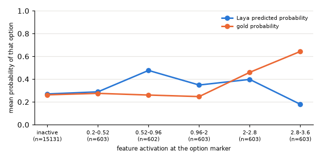

# Feature 4219

Critérios em que aparece: corr_error_stratified, corr_probe_right_laya_wrong_stratified

**Interpretação (preencher):** 

---

## Maiores ativações

**tr_security_incidents_000109 / credential_compromise** (noul, security_incidents) | ativação 5.398 em `opção` | opções ['false', 'true'] | Laya: **true** [0.007, 0.993] | gabarito: **true**

```
<bos> noul question: The evidence indicates a credential or account has been compromised.<eos>
▸ <mask> false⟦:⟧ no, the statement does not hold
▸ <mask> true: yes, the statement holds

<eos>

 {"alert": {"description": "two successful logins from distant locations too close together", "evidence": "Successful VPN logins were observed for the contractor account \"jdoe_cont\" at 2026-09-16 08:02 UTC from IP 198.51.100.22 (Chicago) and again at 08:07 UTC from IP 203.0.113.77 (Tokyo), representing a distance of over 9,000 km within a five‑minute interval. The account is unprivileged, MFA is active, credentials were rotated 14 days prior, and the source devices are not on the recognized inventory list.", "rule": "impossible_travel"}, "context": {"asset_criticality": "medium", "change_window_active": false, "source_on_allowlist": false}, "history": {"credential_rotation_days_ago": 14, "distinct_countries_30d": 2, "logins_30d": 650, "prior_alerts_90d": 0}, "principal": {"mfa_enrolled": true, "name": "adm-billing-167", "privileges": ["repo:read"], "type": "contractor"}}<eos>
```

**tr_security_incidents_000236 / credential_compromise** (noul, security_incidents) | ativação 5.344 em `opção` | opções ['false', 'true'] | Laya: **true** [0.186, 0.814] | gabarito: **false**

```
<bos> noul question: The evidence indicates a credential or account has been compromised.<eos>
▸ <mask> false⟦:⟧ no, the statement does not hold
▸ <mask> true: yes, the statement holds

<eos>

 {"alert": {"description": "a long-unused account became active", "evidence": "The privileged admin_01 account, which had shown no activity for 120 consecutive days, successfully authenticated from allowlisted IP 10.0.4.55 at 02:00 AM. This session was established with MFA enabled and used credentials rotated 30 days ago, though no change tickets were active at the time.", "rule": "dormant_account_use"}, "context": {"asset_criticality": "medium", "change_window_active": false, "source_on_allowlist": true}, "history": {"credential_rotation_days_ago": 30, "distinct_countries_30d": 3, "logins_30d": 15, "prior_alerts_90d": 0}, "principal": {"mfa_enrolled": true, "name": "ci-infra-266", "privileges": ["deploy:production", "secrets:read"], "type": "admin"}}<eos>
```

**tr_security_incidents_000290 / credential_compromise** (noul, security_incidents) | ativação 5.320 em `opção` | opções ['false', 'true'] | Laya: **true** [0.204, 0.796] | gabarito: **false**

```
<bos> noul question: The evidence indicates a credential or account has been compromised.<eos>
▸ <mask> false⟦:⟧ no, the statement does not hold
▸ <mask> true: yes, the statement holds

<eos>

 {"alert": {"description": "a first-ever sign-in from an unfamiliar country", "evidence": "A privileged service account named svc_backup_01 logged in from IP 185.12.34.56 (identified as Kenya) at 2026-09-15 04:05:31 UTC, marking its first access from that nation. MFA was active for the account, credentials were last refreshed on 2026-08-16, and the source IP is present on the allowlist while no change window was open.", "rule": "new_country_login"}, "context": {"asset_criticality": "medium", "change_window_active": false, "source_on_allowlist": true}, "history": {"credential_rotation_days_ago": 30, "distinct_countries_30d": 3, "logins_30d": 724, "prior_alerts_90d": 0}, "principal": {"mfa_enrolled": true, "name": "ci-support-122", "privileges": ["deploy:production", "secrets:read"], "type": "service_account"}}<eos>
```

**tr_security_incidents_000127 / credential_compromise** (noul, security_incidents) | ativação 5.316 em `opção` | opções ['false', 'true'] | Laya: **false** [0.985, 0.015] | gabarito: **false**

```
<bos> noul question: The evidence indicates a credential or account has been compromised.<eos>
▸ <mask> false⟦:⟧ no, the statement does not hold
▸ <mask> true: yes, the statement holds

<eos>

 {"alert": {"description": "a security group was opened to the public internet", "evidence": "On 2026‑09‑14 at 10:07 UTC, security group sg-0a1b2c3d was modified to allow inbound traffic from 0.0.0.0/0, exposing the associated resources publicly. The change was applied by an admin account with privileged access, MFA enabled, from an unknown source IP, and the account’s password last rotation occurred 180 days ago.", "rule": "config_drift"}, "context": {"asset_criticality": "low", "change_window_active": false, "source_on_allowlist": false}, "history": {"credential_rotation_days_ago": 180, "distinct_countries_30d": 1, "logins_30d": 1581, "prior_alerts_90d": 0}, "principal": {"mfa_enrolled": true, "name": "adm-analytics-822", "privileges": ["deploy:production", "secrets:read"], "type": "admin"}}<eos>
```

**tr_security_incidents_000177 / credential_compromise** (noul, security_incidents) | ativação 5.215 em `opção` | opções ['false', 'true'] | Laya: **true** [0.35, 0.65] | gabarito: **false**

```
<bos> noul question: The evidence indicates a credential or account has been compromised.<eos>
▸ <mask> false⟦:⟧ no, the statement does not hold
▸ <mask> true: yes, the statement holds

<eos>

 {"alert": {"description": "a first-ever sign-in from an unfamiliar country", "evidence": "At 2026-09-15 02:13:47 UTC, employee user jdoe performed a sign‑in from IP 203.0.113.45 located in Brazil, a country not seen in prior login history for this account. The authentication succeeded with MFA, and the account's password was last rotated on 2026-09-01. No change window was active at the time of the event.", "rule": "new_country_login"}, "context": {"asset_criticality": "medium", "change_window_active": false, "source_on_allowlist": false}, "history": {"credential_rotation_days_ago": 14, "distinct_countries_30d": 3, "logins_30d": 1743, "prior_alerts_90d": 0}, "principal": {"mfa_enrolled": true, "name": "adm-analytics-183", "privileges": ["repo:read"], "type": "employee"}}<eos>
```

## Ativações medianas (faixa 40-60%, mediana 0.706)

**tr_invoice_processing_000204 / disposition** (choice, invoice_processing) | ativação 0.614 em `opção` | opções ['approve', 'hold', 'manual_review', 'reject'] | Laya: **approve** [0.326, 0.314, 0.041, 0.319] | gabarito: **hold**

```
<bos> choice question: How should this vendor invoice be dispositioned?<eos>
▸ <mask> approve: Matches the order and delivery; approve for payment.
▸ <mask> hold: Something needs confirming before payment; hold pending clarification.
▸ <mask> manual_review: A human in finance must review the discrepancy.
▸ <mask> reject⟦:⟧ Should not be paid: duplicate, unauthorised or materially wrong.

<eos>

 {"delivery": {"condition": "accepted", "date": null, "received_qty": 0}, "invoice": {"currency": "USD", "id": "INV-2026-9161", "lines": [{"qty": 250, "sku": "SKU-830", "total_usd": 11167.5, "unit_usd": 44.67}], "total_usd": 11167.5, "vendor": "Kestrel Supply"}, "payment": {"days_until_due": 18, "discount_expires_in_days": null, "early_payment_discount_pct": null, "status": "scheduled", "terms": "net 60"}, "purchase_order": {"freight_terms": "freight prepaid by vendor, not separately billable", "id": "PO-1261", "lines": [{"qty": 250, "unit_usd": 44.67}], "total_usd": 11167.5}, "vendor_history": {"disputes_12m": 0, "invoices_12m": 39, "prior_invoice_ids": ["INV-2026-1929"]}}<eos>
```

**tr_invoice_processing_000113 / discrepancy_severity** (score, invoice_processing) | ativação 0.741 em `opção` | opções ['0', '1', '2', '3'] | Laya: **2** [0.054, 0.229, 0.683, 0.034] | gabarito: **3**

```
<bos> score question: How material is any discrepancy between the invoice, the order and the delivery?<eos>
▸ <mask> level 0: None: everything reconciles.
▸ <mask> level 1: Trivial: rounding or a cosmetic difference.
▸ <mask> level 2⟦:⟧ Moderate: a real difference worth confirming.
▸ <mask> level 3: Material: a large or unexplained difference.

<eos>

 {"delivery": {"condition": "accepted", "date": "2026-03-13", "received_qty": 25}, "invoice": {"currency": "USD", "id": "INV-2026-5107", "lines": [{"qty": 25, "sku": "SKU-215", "total_usd": 7696.5, "unit_usd": 307.86}], "total_usd": 7696.5, "vendor": "Kestrel Supply"}, "payment": {"days_until_due": 11, "discount_expires_in_days": null, "early_payment_discount_pct": null, "status": "scheduled", "terms": "net 30"}, "purchase_order": {"freight_terms": "freight prepaid by vendor, not separately billable", "id": "PO-3793", "lines": [{"qty": 25, "unit_usd": 219.9}], "total_usd": 5497.5}, "vendor_history": {"disputes_12m": 0, "invoices_12m": 20, "prior_invoice_ids": ["INV-2026-8132", "INV-2026-8642"]}}<eos>
```

**tr_customer_service_000052 / category** (choice, customer_service) | ativação 0.658 em `estado` | opções ['account', 'billing', 'delivery', 'refund', 'technical'] | Laya: **account** [1.0, 0.0, 0.0, 0.0, 0.0] | gabarito: **account**

```
<bos> choice question: What is this customer conversation primarily about?<eos>
▸ <mask> account: Login, plan changes, profile or access management.
▸ <mask> billing: A charge, invoice, subscription or payment problem.
▸ <mask> delivery: Shipping, fulfilment or delivery of a physical item.
▸ <mask> refund: The customer is explicitly asking for money back.
▸ <mask> technical: The product or service is not working as expected.

<eos>

 {"account": {"lifetime_value_usd": 1015, "prior_tickets_90d": 3,⟦ "⟧seats": 1, "tenure_months": 11, "tier": "standard"}, "orders": [{"amount_usd": 149, "date": "2026-01-24", "id": "A-11891", "status": "refunded"}, {"amount_usd": 149, "date": "2026-02-03", "id": "A-76056", "status": "failed"}], "thread": [{"role": "customer", "text": "Hello, I'm having trouble logging into my account. I've been a subscriber for 11 months on the standard plan, paying about $149, and I've already opened three tickets that haven't been resolved. Could you please look into this?"}, {"role": "agent", "text": "I’m sorry you’re still experiencing this. Could you let me know the exact error message you see when you try to sign in, and whether you’ve tried resetting your password?"}, {"role": "customer", "text": "Sure, the page just says 'Invalid credentials' even after I reset the password. I’m using the same email as before."}, {"role": "agent", "text": "Thank you for confirming that. I’ll need to check the status of your account and the recent password reset attempts. May I have the email address associated with the account?"}, {"role": "customer", "text": "The email is john.doe@example.com. Please let me know what you find."}]}<eos>
```

**tr_customer_service_000177 / urgency** (score, customer_service) | ativação 0.625 em `estado` | opções ['0', '1', '2', '3'] | Laya: **0** [0.528, 0.198, 0.185, 0.089] | gabarito: **3**

```
<bos> score question: How time-sensitive is this conversation?<eos>
▸ <mask> level 0: No time pressure; can wait indefinitely.
▸ <mask> level 1: Routine; handle within the normal queue.
▸ <mask> level 2: Elevated; should be handled within the same week.
▸ <mask> level 3: Critical; requires action within the same day.

<eos>

 {"account": {"lifetime_value_usd": 1494, "prior_tickets_90d": 3,⟦ "⟧seats": 1, "tenure_months": 26, "tier": "enterprise"}, "orders": [{"amount_usd": 49, "date": "2026-01-07", "id": "A-11099", "status": "failed"}, {"amount_usd": 49, "date": "2026-02-23", "id": "A-83844", "status": "refunded"}], "thread": [{"role": "customer", "text": "I'm furious that my data export still isn't ready. My deadline is tomorrow and I've been waiting for weeks!"}, {"role": "agent", "text": "I understand how frustrating this is. Could you provide your enterprise account ID and specify the exact export format you need?"}, {"role": "customer", "text": "My account is the enterprise one, 26 months with you, and I need the full CSV of all transactions, not this half‑baked JSON you sent before."}, {"role": "agent", "text": "Got it. Please confirm the date range for the export and the email address where you’d like us to send it."}, {"role": "customer", "text": "Send it to my corporate email now; I don't have time for more back‑and‑forth."}]}<eos>
```

**tr_agent_trace_observability_000292 / needs_review** (noul, agent_trace_observability) | ativação 0.668 em `pergunta` | opções ['false', 'true'] | Laya: **false** [0.742, 0.258] | gabarito: **true**

```
<bos> noul question: This trace requires human review⟦.⟧<eos>
▸ <mask> false: No human attention is warranted.
▸ <mask> true: A human should inspect this run.

<eos>

 {"agent": {"autonomy": "unsupervised", "model": "internal-agent-v3"}, "constraints": ["Never modify production without an approved change ticket", "Do not exceed a $50 spend on cloud resources"], "task": "Triage and close duplicate issues in the support tracker.", "trace_summary": {"constraint_violations": 0, "duration_s": 602.5, "irreversible_actions": 1, "steps": 8, "tool_errors": 1}}<eos>
```

## Estatísticas (conjunto de descoberta, dev e teste)

**pred / error**

| split | decisões | ativas | ativas e Laya errou | taxa | lift | q (BH) | OR (CMH) | q (CMH) |
|---|---|---|---|---|---|---|---|---|
| discovery | 5100 | 936 | 685 | 0.732 | 1.14 | 2.82e-09 | 0.96 | 0.922 |
| dev | 900 | 193 | 145 | 0.751 | 1.12 | 0.0362 | 1.33 | 0.837 |
| test | 2000 | 370 | 272 | 0.735 | 1.13 | 0.00069 | 1.31 | 0.771 |

**corr / error**

| split | decisões | ativas | ativas e Laya errou | taxa | lift | q (BH) | OR (CMH) | q (CMH) |
|---|---|---|---|---|---|---|---|---|
| discovery | 5100 | 1091 | 840 | 0.770 | 1.20 | 9.95e-23 | 2.48 | 2.12e-49 |
| dev | 900 | 224 | 176 | 0.786 | 1.17 | 0.000109 | 2.30 | 1.66e-08 |
| test | 2000 | 428 | 330 | 0.771 | 1.19 | 1.08e-08 | 2.44 | 1.62e-19 |

**state / error**

| split | decisões | ativas | ativas e Laya errou | taxa | lift | q (BH) | OR (CMH) | q (CMH) |
|---|---|---|---|---|---|---|---|---|
| discovery | 5100 | 2053 | 1235 | 0.602 | 0.93 | 4.99e-06 | 0.90 | 0.579 |
| dev | 900 | 371 | 235 | 0.633 | 0.94 | 0.306 | 0.69 | 0.471 |
| test | 2000 | 789 | 485 | 0.615 | 0.94 | 0.0801 | 0.87 | 0.727 |

**pred / probe_right_laya_wrong**

| split | decisões | ativas | ativas e Laya errou | taxa | lift | q (BH) | OR (CMH) | q (CMH) |
|---|---|---|---|---|---|---|---|---|
| discovery | 2932 | 622 | 491 | 0.789 | 1.30 | 5.41e-26 | 1.38 | 0.574 |
| dev | 523 | 123 | 99 | 0.805 | 1.25 | 0.000277 | 2.80 | 0.458 |
| test | 1149 | 226 | 188 | 0.832 | 1.36 | 2.05e-13 | 2.86 | 0.399 |

**corr / probe_right_laya_wrong**

| split | decisões | ativas | ativas e Laya errou | taxa | lift | q (BH) | OR (CMH) | q (CMH) |
|---|---|---|---|---|---|---|---|---|
| discovery | 2932 | 742 | 611 | 0.823 | 1.36 | 1.04e-46 | 2.76 | 1.1e-39 |
| dev | 523 | 159 | 135 | 0.849 | 1.31 | 4.87e-10 | 4.12 | 6.43e-11 |
| test | 1149 | 271 | 233 | 0.860 | 1.41 | 2.37e-22 | 3.64 | 2.15e-20 |

**state / probe_right_laya_wrong**

| split | decisões | ativas | ativas e Laya errou | taxa | lift | q (BH) | OR (CMH) | q (CMH) |
|---|---|---|---|---|---|---|---|---|
| discovery | 2932 | 1282 | 722 | 0.563 | 0.93 | 0.000249 | 0.81 | 0.308 |
| dev | 523 | 238 | 147 | 0.618 | 0.96 | 0.564 | 0.54 | 0.273 |
| test | 1149 | 496 | 286 | 0.577 | 0.94 | 0.165 | 0.92 | 0.89 |

Confusão mais sobre-representada (pred): `duplicate|1>0` (n=217, lift 5.45, p=0). Formato `pergunta|índice previsto>índice correto`.

Confusão mais sobre-representada (corr): `credential_compromise|1>0` (n=82, lift 4.67, p=0). Formato `pergunta|índice previsto>índice correto`.

Confusão mais sobre-representada (state): `duplicate|1>0` (n=166, lift 1.90, p=1.38e-28). Formato `pergunta|índice previsto>índice correto`.



