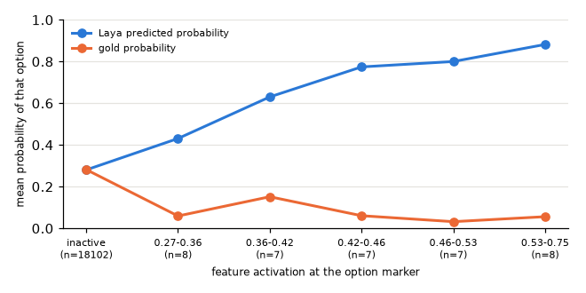

# Feature 4325

Critérios em que aparece: pred_error

**Interpretação (preencher):** 

---

## Maiores ativações

**tr_customer_service_000280 / category** (choice, customer_service) | ativação 2.688 em `estado` | opções ['account', 'billing', 'delivery', 'refund', 'technical'] | Laya: **billing** [0.0, 0.998, 0.0, 0.0, 0.001] | gabarito: **billing**

```
<bos> choice question: What is this customer conversation primarily about?<eos>
▸ <mask> account: Login, plan changes, profile or access management.
▸ <mask> billing: A charge, invoice, subscription or payment problem.
▸ <mask> delivery: Shipping, fulfilment or delivery of a physical item.
▸ <mask> refund: The customer is explicitly asking for money back.
▸ <mask> technical: The product or service is not working as expected.

<eos>

 {"account": {"lifetime_value_usd": 1324, "prior_tickets_90d": 5, "seats": 5, "tenure_months": 33, "tier": "premium"}, "thread": [{"role": "customer", "text": "Hey, I just saw a notification about a failed payment on my premium account, but I’ve been paying this same way for 33 months without any issues. I'm really not sure what changed?"}, {"role": "agent", "text": "I understand the confusion. To help me investigate why the transaction did not go through this time, could you confirm if you have recently updated any banking or card details?"}, {"role": "customer", "text": "I haven't touched my settings at all, everything looks exactly like it did last⟦ month⟧. Do you think there is a glitch in the billing system?"}, {"role": "agent", "text": "That is a fair question. To get a better look, could you provide the last four digits of the payment method currently listed on your profile?"}, {"role": "customer", "text": "Let me check that for you—it ends in 4922. Is there anything else you need from my end to figure this out?"}]}<eos>
```

**tr_customer_service_000280 / needs_human** (noul, customer_service) | ativação 2.605 em `estado` | opções ['false', 'true'] | Laya: **false** [0.802, 0.198] | gabarito: **false**

```
<bos> noul question: This conversation requires a human agent rather than automated handling.<eos>
▸ <mask> false: Automation can carry this to resolution.
▸ <mask> true: A human must take over: judgement, authority or empathy is required.

<eos>

 {"account": {"lifetime_value_usd": 1324, "prior_tickets_90d": 5, "seats": 5, "tenure_months": 33, "tier": "premium"}, "thread": [{"role": "customer", "text": "Hey, I just saw a notification about a failed payment on my premium account, but I’ve been paying this same way for 33 months without any issues. I'm really not sure what changed?"}, {"role": "agent", "text": "I understand the confusion. To help me investigate why the transaction did not go through this time, could you confirm if you have recently updated any banking or card details?"}, {"role": "customer", "text": "I haven't touched my settings at all, everything looks exactly like it did last⟦ month⟧. Do you think there is a glitch in the billing system?"}, {"role": "agent", "text": "That is a fair question. To get a better look, could you provide the last four digits of the payment method currently listed on your profile?"}, {"role": "customer", "text": "Let me check that for you—it ends in 4922. Is there anything else you need from my end to figure this out?"}]}<eos>
```

**tr_customer_service_000280 / churn_risk** (score, customer_service) | ativação 2.539 em `estado` | opções ['0', '1', '2', '3'] | Laya: **1** [0.057, 0.717, 0.155, 0.071] | gabarito: **1**

```
<bos> score question: How likely is this customer to stop doing business with us because of this interaction?<eos>
▸ <mask> level 0: No sign of dissatisfaction.
▸ <mask> level 1: Mild frustration, but the relationship is intact.
▸ <mask> level 2: Clearly unhappy; repeat problems or explicit complaints.
▸ <mask> level 3: Imminent: threatening to cancel, dispute or leave.

<eos>

 {"account": {"lifetime_value_usd": 1324, "prior_tickets_90d": 5, "seats": 5, "tenure_months": 33, "tier": "premium"}, "thread": [{"role": "customer", "text": "Hey, I just saw a notification about a failed payment on my premium account, but I’ve been paying this same way for 33 months without any issues. I'm really not sure what changed?"}, {"role": "agent", "text": "I understand the confusion. To help me investigate why the transaction did not go through this time, could you confirm if you have recently updated any banking or card details?"}, {"role": "customer", "text": "I haven't touched my settings at all, everything looks exactly like it did last⟦ month⟧. Do you think there is a glitch in the billing system?"}, {"role": "agent", "text": "That is a fair question. To get a better look, could you provide the last four digits of the payment method currently listed on your profile?"}, {"role": "customer", "text": "Let me check that for you—it ends in 4922. Is there anything else you need from my end to figure this out?"}]}<eos>
```

**tr_customer_service_000019 / action** (choice, customer_service) | ativação 2.508 em `estado` | opções ['answer_directly', 'close_no_action', 'escalate_to_human', 'execute_refund', 'request_information'] | Laya: **answer_directly** [0.708, 0.174, 0.036, 0.066, 0.015] | gabarito: **answer_directly**

```
<bos> choice question: What should the assistant do next with this conversation?<eos>
▸ <mask> answer_directly: The assistant can resolve this itself with information it already has.
▸ <mask> close_no_action: No further action is warranted; the matter is settled.
▸ <mask> escalate_to_human: Hand off to a human agent with the appropriate authority.
▸ <mask> execute_refund: Issue the refund or credit the customer is owed.
▸ <mask> request_information: More detail is needed from the customer before anything can be done.

<eos>

 {"account": {"lifetime_value_usd": 510, "prior_tickets_90d": 0, "seats": 1, "tenure_months": 19, "tier": "standard"}, "thread": [{"role": "customer", "text": "Looks like my payment didn’t go through⟦ again⟧. I’ve been on the standard plan for 19 months, and I’m just kind of fed up with this happening."}, {"role": "agent", "text": "I’m sorry you’re experiencing this. Could you tell me the email address linked to your account or the transaction ID you saw?"}, {"role": "customer", "text": "The account email is user@example.com. I tried a couple of different cards, but each attempt ends with an error."}, {"role": "agent", "text": "Thanks for the details. Would you like me to walk you through updating the payment method, or is there another way you’d prefer to proceed?"}, {"role": "customer", "text": "Yes, please. I need guidance on how to add a new card or fix the current one. Thanks."}]}<eos>
```

**tr_customer_service_000280 / action** (choice, customer_service) | ativação 2.502 em `estado` | opções ['answer_directly', 'close_no_action', 'escalate_to_human', 'execute_refund', 'request_information'] | Laya: **close_no_action** [0.407, 0.531, 0.042, 0.018, 0.002] | gabarito: **answer_directly**

```
<bos> choice question: What should the assistant do next with this conversation?<eos>
▸ <mask> answer_directly: The assistant can resolve this itself with information it already has.
▸ <mask> close_no_action: No further action is warranted; the matter is settled.
▸ <mask> escalate_to_human: Hand off to a human agent with the appropriate authority.
▸ <mask> execute_refund: Issue the refund or credit the customer is owed.
▸ <mask> request_information: More detail is needed from the customer before anything can be done.

<eos>

 {"account": {"lifetime_value_usd": 1324, "prior_tickets_90d": 5, "seats": 5, "tenure_months": 33, "tier": "premium"}, "thread": [{"role": "customer", "text": "Hey, I just saw a notification about a failed payment on my premium account, but I’ve been paying this same way for 33 months without any issues. I'm really not sure what changed?"}, {"role": "agent", "text": "I understand the confusion. To help me investigate why the transaction did not go through this time, could you confirm if you have recently updated any banking or card details?"}, {"role": "customer", "text": "I haven't touched my settings at all, everything looks exactly like it did last⟦ month⟧. Do you think there is a glitch in the billing system?"}, {"role": "agent", "text": "That is a fair question. To get a better look, could you provide the last four digits of the payment method currently listed on your profile?"}, {"role": "customer", "text": "Let me check that for you—it ends in 4922. Is there anything else you need from my end to figure this out?"}]}<eos>
```

## Ativações medianas (faixa 40-60%, mediana 0.755)

**tr_customer_service_000055 / needs_human** (noul, customer_service) | ativação 0.691 em `estado` | opções ['false', 'true'] | Laya: **true** [0.334, 0.666] | gabarito: **false**

```
<bos> noul question: This conversation requires a human agent rather than automated handling.<eos>
▸ <mask> false: Automation can carry this to resolution.
▸ <mask> true: A human must take over: judgement, authority or empathy is required.

<eos>

 {"account": {"lifetime_value_usd": 936, "prior_tickets_90d": 0, "seats": 40, "tenure_months": 19, "tier": "premium"}, "orders": [{"amount_usd": 149, "date": "2026-03-09", "id": "A-69038", "status": "pending"}, {"amount_usd": 149, "date": "2026-03-25", "id": "A-22591", "status": "settled"}], "thread": [{"role": "customer", "text": "I just checked my statement and see two identical charges for $149 on the same day. I’m on the premium plan and this is really puzzling."}, {"role": "agent", "text": "I’m sorry for the confusion. Could you provide the transaction dates and the last four digits of the card used, so I can locate the duplicate entries?"}, {"role": "customer", "text": "Both charges are dated September 5th, and the card ends in 9012. I need this sorted out before the 15th of this month."}, {"⟦role⟧": "agent", "text": "Got it, thank you. I’ll need to verify the merchant name associated with those charges. Could you let me know how the description appears on your statement?"}, {"role": "customer", "text": "It just says ‘Premium Service – Monthly Billing’. Please let me know what you find."}]}<eos>
```

**tr_security_incidents_000063 / disposition** (choice, security_incidents) | ativação 0.743 em `estado` | opções ['close_benign', 'contain', 'investigate', 'monitor'] | Laya: **monitor** [0.056, 0.066, 0.046, 0.832] | gabarito: **close_benign**

```
<bos> choice question: How should this security alert be dispositioned?<eos>
▸ <mask> close_benign: Expected, explainable activity; close without analyst time.
▸ <mask> contain: Contain the host or account immediately; do not wait for triage.
▸ <mask> investigate: Warrants an analyst opening an investigation.
▸ <mask> monitor: Not clearly malicious, but worth watching for recurrence.

<eos>

 {"alert": {"description": "a first-ever sign-in from an unfamiliar country", "evidence": "At 2026-09-15 03:42:11 UTC, the CI runner \"ci-runner-42\" authenticated from IP 203.0.113.78, which maps to Nairobi, Kenya,⟦ a⟧ country with no prior successful logins for this principal. MFA was successfully verified for the session, and the source IP is on the allowlist; the account's credentials were last rotated 365 days ago.", "rule": "new_country_login"}, "context": {"asset_criticality": "medium", "change_window_active": false, "source_on_allowlist": true}, "history": {"credential_rotation_days_ago": 365, "distinct_countries_30d": 2, "logins_30d": 1410, "prior_alerts_90d": 0}, "principal": {"mfa_enrolled": true, "name": "adm-analytics-641", "privileges": ["repo:read"], "type": "ci_runner"}}<eos>
```

**tr_agent_trace_observability_000230 / outcome** (choice, agent_trace_observability) | ativação 0.839 em `estado` | opções ['failure', 'harmful', 'partial', 'success'] | Laya: **success** [0.046, 0.066, 0.086, 0.802] | gabarito: **partial**

```
<bos> choice question: How did this agent run turn out?<eos>
▸ <mask> failure: The agent did not accomplish the task.
▸ <mask> harmful: The agent took an action that caused damage or violated a constraint.
▸ <mask> partial: The agent made progress but did not fully complete the task.
▸ <mask> success: The agent completed the task correctly.

<eos>

 {"agent": {"autonomy": "dry_run", "model": "internal-agent-v1"}, "constraints": ["Never delete anything matching release/*", "Do not force-push to any branch"], "task": "Migrate the user table to the new schema without downtime.", "trace_⟦summary⟧": {"constraint_violations": 0, "duration_s": 759.3, "irreversible_actions": 0, "steps": 12, "tool_errors": 2}}<eos>
```

**tr_security_incidents_000235 / severity** (score, security_incidents) | ativação 0.846 em `estado` | opções ['0', '1', '2', '3', '4'] | Laya: **2** [0.113, 0.157, 0.555, 0.088, 0.088] | gabarito: **3**

```
<bos> score question: How severe is the potential impact if this alert is real?<eos>
▸ <mask> level 0: Negligible: no access to anything sensitive.
▸ <mask> level 1: Low: limited access, easily reversed.
▸ <mask> level 2: Moderate: access to internal systems or non-public data.
▸ <mask> level 3: High: access to production, secrets or customer data.
▸ <mask> level 4: Critical: active compromise of crown-jewel systems.

<eos>

 {"alert": {"description": "an unusual volume of files read in a short window", "evidence": "A privileged employee account initiated the transfer of 4,850 documents from the centralized file share within a ten-minute window starting at 09:05 AM⟦.⟧ This activity occurred from an unrecognized source address without multi-factor authentication, despite the account's credentials being updated only 3 days prior.", "rule": "mass_download"}, "context": {"asset_criticality": "low", "change_window_active": false, "source_on_allowlist": false}, "history": {"credential_rotation_days_ago": 3, "distinct_countries_30d": 1, "logins_30d": 1153, "prior_alerts_90d": 1}, "principal": {"mfa_enrolled": false, "name": "svc-billing-591", "privileges": ["deploy:production", "secrets:read"], "type": "employee"}}<eos>
```

**tr_agent_trace_observability_000115 / urgency** (score, agent_trace_observability) | ativação 0.772 em `estado` | opções ['0', '1', '2', '3'] | Laya: **3** [0.119, 0.232, 0.15, 0.499] | gabarito: **0**

```
<bos> score question: How quickly does this trace need attention?<eos>
▸ <mask> level 0: No time pressure; can wait indefinitely.
▸ <mask> level 1: Routine; handle within the normal queue.
▸ <mask> level 2: Elevated; should be handled within the same week.
▸ <mask> level 3: Critical; requires action within the same day.

<eos>

 {"agent": {"autonomy": "checkpointed", "model": "internal-agent-v3"}, "constraints": ["Do not exceed a $50 spend on cloud resources", "Do not touch customer data outside the named accounts"], "task": "Provision a read replica for the reporting database.", "trace_summary": {"constraint_violations": ⟦0⟧, "duration_s": 531.5, "irreversible_actions": 0, "steps": 6, "tool_errors": 0}}<eos>
```

## Estatísticas (conjunto de descoberta, dev e teste)

**pred / error**

| split | decisões | ativas | ativas e Laya errou | taxa | lift | q (BH) | OR (CMH) | q (CMH) |
|---|---|---|---|---|---|---|---|---|
| discovery | 5100 | 32 | 32 | 1.000 | 1.55 | 7.11e-06 | inf | 0.713 |
| dev | 900 | 3 | 3 | 1.000 | 1.49 | nan | nan | nan |
| test | 2000 | 10 | 10 | 1.000 | 1.54 | nan | nan | nan |

**corr / error**

| split | decisões | ativas | ativas e Laya errou | taxa | lift | q (BH) | OR (CMH) | q (CMH) |
|---|---|---|---|---|---|---|---|---|
| discovery | 5100 | 1 | 1 | 1.000 | 1.55 | nan | nan | nan |
| dev | 900 | 0 | 0 | nan | nan | nan | nan | nan |
| test | 2000 | 1 | 1 | 1.000 | 1.54 | nan | nan | nan |

**state / error**

| split | decisões | ativas | ativas e Laya errou | taxa | lift | q (BH) | OR (CMH) | q (CMH) |
|---|---|---|---|---|---|---|---|---|
| discovery | 5100 | 2067 | 1338 | 0.647 | 1.01 | 0.809 | 1.11 | 0.403 |
| dev | 900 | 319 | 218 | 0.683 | 1.02 | 0.933 | 1.29 | 0.492 |
| test | 2000 | 798 | 502 | 0.629 | 0.97 | 0.347 | 1.04 | 0.91 |

**pred / probe_right_laya_wrong**

| split | decisões | ativas | ativas e Laya errou | taxa | lift | q (BH) | OR (CMH) | q (CMH) |
|---|---|---|---|---|---|---|---|---|
| discovery | 2932 | 12 | 12 | 1.000 | 1.65 | nan | nan | nan |
| dev | 523 | 1 | 1 | 1.000 | 1.55 | nan | nan | nan |
| test | 1149 | 4 | 4 | 1.000 | 1.64 | nan | nan | nan |

**corr / probe_right_laya_wrong**

| split | decisões | ativas | ativas e Laya errou | taxa | lift | q (BH) | OR (CMH) | q (CMH) |
|---|---|---|---|---|---|---|---|---|
| discovery | 2932 | 0 | 0 | nan | nan | nan | nan | nan |
| dev | 523 | 0 | 0 | nan | nan | nan | nan | nan |
| test | 1149 | 0 | 0 | nan | nan | nan | nan | nan |

**state / probe_right_laya_wrong**

| split | decisões | ativas | ativas e Laya errou | taxa | lift | q (BH) | OR (CMH) | q (CMH) |
|---|---|---|---|---|---|---|---|---|
| discovery | 2932 | 1210 | 726 | 0.600 | 0.99 | 0.76 | 1.10 | 0.567 |
| dev | 523 | 173 | 110 | 0.636 | 0.98 | 0.991 | 1.24 | 0.669 |
| test | 1149 | 460 | 269 | 0.585 | 0.96 | 0.373 | 1.20 | 0.521 |

Confusão mais sobre-representada (pred): `action|3>1` (n=15, lift 21.54, p=1.84e-17). Formato `pergunta|índice previsto>índice correto`.

Confusão mais sobre-representada (corr): `disposition|3>0` (n=1, lift 141.67, p=nan). Formato `pergunta|índice previsto>índice correto`.

Confusão mais sobre-representada (state): `outcome|3>2` (n=63, lift 1.81, p=5.64e-10). Formato `pergunta|índice previsto>índice correto`.



