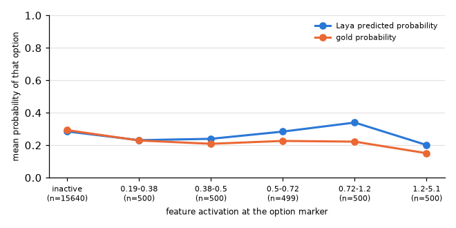

# Feature 4340

Critérios em que aparece: attribution_toward_correct

**Interpretação (preencher):** 

---

## Maiores ativações

**tr_customer_service_000053 / churn_risk** (score, customer_service) | ativação 6.926 em `opção` | opções ['0', '1', '2', '3'] | Laya: **2** [0.048, 0.349, 0.537, 0.066] | gabarito: **1**

```
<bos> score question: How likely is this customer to stop doing business with us because of this interaction?<eos>
▸ <mask> level 0⟦:⟧ No sign of dissatisfaction.
▸ <mask> level 1: Mild frustration, but the relationship is intact.
▸ <mask> level 2: Clearly unhappy; repeat problems or explicit complaints.
▸ <mask> level 3: Imminent: threatening to cancel, dispute or leave.

<eos>

 {"account": {"lifetime_value_usd": 3557, "prior_tickets_90d": 0, "seats": 1, "tenure_months": 72, "tier": "standard"}, "orders": [{"amount_usd": 58, "date": "2026-02-03", "id": "A-39815", "status": "settled"}], "thread": [{"role": "customer", "text": "Looks like my payment didn't go through again. I've been on the standard plan for six years, paying about $58 each month. I'm not sure what's happening."}, {"role": "agent", "text": "I’m sorry to hear that. Could you tell me which payment method you attempted to use and the date of the failed transaction?"}, {"role": "customer", "text": "It was my Visa ending in 1234 on the 12th of this month. The charge just shows as declined. I’d appreciate any help you can give."}]}<eos>
```

**tr_customer_service_000159 / churn_risk** (score, customer_service) | ativação 6.773 em `opção` | opções ['0', '1', '2', '3'] | Laya: **2** [0.038, 0.33, 0.464, 0.168] | gabarito: **2**

```
<bos> score question: How likely is this customer to stop doing business with us because of this interaction?<eos>
▸ <mask> level 0⟦:⟧ No sign of dissatisfaction.
▸ <mask> level 1: Mild frustration, but the relationship is intact.
▸ <mask> level 2: Clearly unhappy; repeat problems or explicit complaints.
▸ <mask> level 3: Imminent: threatening to cancel, dispute or leave.

<eos>

 {"account": {"lifetime_value_usd": 89, "prior_tickets_90d": 1, "seats": 1, "tenure_months": 5, "tier": "enterprise"}, "orders": [{"amount_usd": 87, "date": "2026-01-01", "id": "A-56225", "status": "settled"}, {"amount_usd": 87, "date": "2026-03-06", "id": "A-51942", "status": "settled"}], "thread": [{"role": "customer", "text": "I’m really frustrated – I can’t log in and I have a client presentation in two hours. Every time I try, the system says my credentials are invalid."}, {"role": "agent", "text": "I’m sorry you’re dealing with this, especially with the deadline. Could you let me know if you’re using single‑sign‑on or the standard login, and whether you’ve cleared your cache recently?"}, {"role": "customer", "text": "I’m using the standard login, and I cleared the cache this morning, but the same message appears. I need this fixed before my meeting."}]}<eos>
```

**tr_customer_service_000275 / churn_risk** (score, customer_service) | ativação 6.770 em `opção` | opções ['0', '1', '2', '3'] | Laya: **3** [0.009, 0.017, 0.065, 0.909] | gabarito: **3**

```
<bos> score question: How likely is this customer to stop doing business with us because of this interaction?<eos>
▸ <mask> level 0⟦:⟧ No sign of dissatisfaction.
▸ <mask> level 1: Mild frustration, but the relationship is intact.
▸ <mask> level 2: Clearly unhappy; repeat problems or explicit complaints.
▸ <mask> level 3: Imminent: threatening to cancel, dispute or leave.

<eos>

 {"account": {"lifetime_value_usd": 51, "prior_tickets_90d": 3, "seats": 1, "tenure_months": 1, "tier": "standard"}, "orders": [{"amount_usd": 149, "date": "2026-01-08", "id": "A-29936", "status": "failed"}], "thread": [{"role": "customer", "text": "I need the standard account canceled by Friday at 5 p.m. I’ve only been with you for a month, there’s about $149 attached, and after three tickets with promised fixes that never landed, I can’t keep waiting."}]}<eos>
```

**tr_customer_service_000233 / churn_risk** (score, customer_service) | ativação 6.770 em `opção` | opções ['0', '1', '2', '3'] | Laya: **1** [0.074, 0.428, 0.24, 0.258] | gabarito: **2**

```
<bos> score question: How likely is this customer to stop doing business with us because of this interaction?<eos>
▸ <mask> level 0⟦:⟧ No sign of dissatisfaction.
▸ <mask> level 1: Mild frustration, but the relationship is intact.
▸ <mask> level 2: Clearly unhappy; repeat problems or explicit complaints.
▸ <mask> level 3: Imminent: threatening to cancel, dispute or leave.

<eos>

 {"account": {"lifetime_value_usd": 273, "prior_tickets_90d": 2, "seats": 1, "tenure_months": 14, "tier": "free"}, "orders": [{"amount_usd": 29, "date": "2026-02-02", "id": "A-72334", "status": "settled"}, {"amount_usd": 29, "date": "2026-01-16", "id": "A-43421", "status": "settled"}], "thread": [{"role": "customer", "text": "I just opened my delivery and you sent me the wrong replacement part, I ordered the $29 filter kit but I received a pack of gaskets instead. I have an inspection scheduled for tomorrow morning and I absolutely must have the right parts installed by then."}, {"role": "agent", "text": "I'm sorry to hear that the incorrect items were delivered. Could you please provide the order number located on your packing slip so I can check the shipment details?"}, {"role": "customer", "text": "The order number is 44921-A. This is the third time I've had to reach out about shipping errors in the last year and I'm really in a bind here. Is there any way to get the correct filter kit to me today?"}, {"role": "agent", "text": "I've pulled up the order and see the filter kit listed. For our records, could you please describe any labels or SKU numbers visible on the packaging of the gaskets you received by mistake?"}, {"role": "customer", "text": "The sticker says G-992-X, but I really don't have time for a back-and-forth investigation. I need to know immediately how we can fix this because the inspector will be here at 9 AM and the system won't pass without those specific filters."}]}<eos>
```

**tr_customer_service_000172 / churn_risk** (score, customer_service) | ativação 6.730 em `opção` | opções ['0', '1', '2', '3'] | Laya: **3** [0.071, 0.292, 0.252, 0.385] | gabarito: **2**

```
<bos> score question: How likely is this customer to stop doing business with us because of this interaction?<eos>
▸ <mask> level 0⟦:⟧ No sign of dissatisfaction.
▸ <mask> level 1: Mild frustration, but the relationship is intact.
▸ <mask> level 2: Clearly unhappy; repeat problems or explicit complaints.
▸ <mask> level 3: Imminent: threatening to cancel, dispute or leave.

<eos>

 {"account": {"lifetime_value_usd": 131, "prior_tickets_90d": 0, "seats": 5, "tenure_months": 5, "tier": "premium"}, "thread": [{"role": "customer", "text": "Hi, I'm really scratching my head here. My package says it was delivered yesterday, but I've been checking my porch all morning and there's absolutely nothing. I've been with you for five months on the premium plan and this has never happened."}, {"role": "agent", "text": "I’m sorry to hear that you haven't received your package yet. Could you please confirm the tracking number you are referring to so I can take a look?"}, {"role": "customer", "text": "The tracking number is 94001000. I'm just so confused because the status hasn't updated since yesterday morning. I really need this by tomorrow afternoon for a presentation."}, {"role": "agent", "text": "Thank you for providing that number. I am pulling up your account details now. Could you tell me if you have checked with any neighbors or a building manager in the meantime?"}, {"role": "customer", "text": "I did check with my neighbor, but they didn't see anything. I'm worried because I'm on a tight timeline here. Is there any way to see exactly where the driver left it?"}, {"role": "agent", "text": "I understand your concern given your upcoming deadline. I need to reach out to our logistics partner to get more information on the delivery scan; could you confirm the exact address on file?"}, {"role": "customer", "text": "It's 442 Maple Drive. I just hope this gets sorted out quickly because I really can't miss this deadline."}]}<eos>
```

## Ativações medianas (faixa 40-60%, mediana 0.850)

**tr_customer_service_000280 / category** (choice, customer_service) | ativação 0.865 em `opção` | opções ['account', 'billing', 'delivery', 'refund', 'technical'] | Laya: **billing** [0.0, 0.998, 0.0, 0.0, 0.001] | gabarito: **billing**

```
<bos> choice question: What is this customer conversation primarily about?<eos>
▸ <mask>⟦ account⟧: Login, plan changes, profile or access management.
▸ <mask> billing: A charge, invoice, subscription or payment problem.
▸ <mask> delivery: Shipping, fulfilment or delivery of a physical item.
▸ <mask> refund: The customer is explicitly asking for money back.
▸ <mask> technical: The product or service is not working as expected.

<eos>

 {"account": {"lifetime_value_usd": 1324, "prior_tickets_90d": 5, "seats": 5, "tenure_months": 33, "tier": "premium"}, "thread": [{"role": "customer", "text": "Hey, I just saw a notification about a failed payment on my premium account, but I’ve been paying this same way for 33 months without any issues. I'm really not sure what changed?"}, {"role": "agent", "text": "I understand the confusion. To help me investigate why the transaction did not go through this time, could you confirm if you have recently updated any banking or card details?"}, {"role": "customer", "text": "I haven't touched my settings at all, everything looks exactly like it did last month. Do you think there is a glitch in the billing system?"}, {"role": "agent", "text": "That is a fair question. To get a better look, could you provide the last four digits of the payment method currently listed on your profile?"}, {"role": "customer", "text": "Let me check that for you—it ends in 4922. Is there anything else you need from my end to figure this out?"}]}<eos>
```

**tr_customer_service_000296 / urgency** (score, customer_service) | ativação 0.878 em `marcador` | opções ['0', '1', '2', '3'] | Laya: **1** [0.268, 0.344, 0.15, 0.237] | gabarito: **3**

```
<bos> score question: How time-sensitive is this conversation?<eos>
▸ <mask> level 0: No time pressure; can wait indefinitely.
▸ ⟦<mask>⟧ level 1: Routine; handle within the normal queue.
▸ <mask> level 2: Elevated; should be handled within the same week.
▸ <mask> level 3: Critical; requires action within the same day.

<eos>

 {"account": {"lifetime_value_usd": 154, "prior_tickets_90d": 0, "seats": 1, "tenure_months": 2, "tier": "free"}, "thread": [{"role": "customer", "text": "We have a launch in two hours and need to reassign seats on our free plan—add three new users and remove two that left. This has to happen now."}, {"role": "agent", "text": "I understand the timing is tight. Could you give me the email addresses of the users you’d like to add and the ones you want removed?"}, {"role": "customer", "text": "Add: alice@example.com, bob@example.com, carol@example.com. Remove: dave@example.com and eve@example.com. I need the changes reflected instantly."}, {"role": "agent", "text": "Thanks for the list. I’ll process those seat changes right away. Would you like a confirmation email once the updates are applied?"}, {"role": "customer", "text": "Yes, send the confirmation now and make sure the seats are active before our launch; we can’t afford any delay."}]}<eos>
```

**tr_customer_service_000286 / urgency** (score, customer_service) | ativação 0.796 em `marcador` | opções ['0', '1', '2', '3'] | Laya: **3** [0.043, 0.117, 0.102, 0.739] | gabarito: **3**

```
<bos> score question: How time-sensitive is this conversation?<eos>
▸ ⟦<mask>⟧ level 0: No time pressure; can wait indefinitely.
▸ <mask> level 1: Routine; handle within the normal queue.
▸ <mask> level 2: Elevated; should be handled within the same week.
▸ <mask> level 3: Critical; requires action within the same day.

<eos>

 {"account": {"lifetime_value_usd": 2881, "prior_tickets_90d": 1, "seats": 1, "tenure_months": 49, "tier": "premium"}, "orders": [{"amount_usd": 9, "date": "2026-01-14", "id": "A-85515", "status": "failed"}], "thread": [{"role": "customer", "text": "My package was supposed to arrive yesterday and it still isn’t here—this is a hard deadline for me and I need it today!"}]}<eos>
```

**tr_customer_service_000237 / category** (choice, customer_service) | ativação 0.911 em `opção` | opções ['account', 'billing', 'delivery', 'refund', 'technical'] | Laya: **delivery** [0.101, 0.149, 0.38, 0.007, 0.363] | gabarito: **delivery**

```
<bos> choice question: What is this customer conversation primarily about?<eos>
▸ <mask>⟦ account⟧: Login, plan changes, profile or access management.
▸ <mask> billing: A charge, invoice, subscription or payment problem.
▸ <mask> delivery: Shipping, fulfilment or delivery of a physical item.
▸ <mask> refund: The customer is explicitly asking for money back.
▸ <mask> technical: The product or service is not working as expected.

<eos>

 {"account": {"lifetime_value_usd": 644, "prior_tickets_90d": 2, "seats": 1, "tenure_months": 19, "tier": "standard"}, "orders": [{"amount_usd": 27, "date": "2026-02-12", "id": "A-69429", "status": "settled"}], "thread": [{"role": "customer", "text": "My package just arrived, but you sent me the blue charging cable instead of the black one I ordered. This is a mess."}, {"role": "agent", "text": "I apologize for the mix-up with your order. Could you please confirm the order number from your confirmation email so I can pull up the shipping details?"}, {"role": "customer", "text": "The order number is 88291. You guys messed up the last two shipments too, and I’m tired of having to reach out about this."}, {"role": "agent", "text": "Thank you for providing that. I’m reviewing the order logs now; could you also send over a quick photo of the incorrect item you received?"}, {"role": "customer", "text": "I’ve already attached the photo to this chat. I’ve been a customer for nineteen months, so I really expected a smoother experience than this."}]}<eos>
```

**tr_customer_service_000116 / urgency** (score, customer_service) | ativação 0.818 em `marcador` | opções ['0', '1', '2', '3'] | Laya: **3** [0.078, 0.206, 0.226, 0.49] | gabarito: **2**

```
<bos> score question: How time-sensitive is this conversation?<eos>
▸ ⟦<mask>⟧ level 0: No time pressure; can wait indefinitely.
▸ <mask> level 1: Routine; handle within the normal queue.
▸ <mask> level 2: Elevated; should be handled within the same week.
▸ <mask> level 3: Critical; requires action within the same day.

<eos>

 {"account": {"lifetime_value_usd": 720, "prior_tickets_90d": 2, "seats": 1, "tenure_months": 11, "tier": "standard"}, "orders": [{"amount_usd": 149, "date": "2026-03-09", "id": "A-35212", "status": "failed"}, {"amount_usd": 149, "date": "2026-01-13", "id": "A-58845", "status": "settled"}], "thread": [{"role": "customer", "text": "I just checked my statement and saw a charge for $149, which is completely unexpected! I've been on the standard plan for 11 months and it's never been this high before. Can you explain why this happened?"}, {"role": "agent", "text": "I see the charge you're referring to. Could you please provide the billing date listed on that transaction so I can pull up the specific invoice details for you?"}, {"role": "customer", "text": "It’s dated for the 14th. This is the third time I’ve had to reach out about billing discrepancies, and I really need to get to the bottom of why these charges keep fluctuating."}]}<eos>
```

## Estatísticas (conjunto de descoberta, dev e teste)

**pred / error**

| split | decisões | ativas | ativas e Laya errou | taxa | lift | q (BH) | OR (CMH) | q (CMH) |
|---|---|---|---|---|---|---|---|---|
| discovery | 5100 | 655 | 466 | 0.711 | 1.11 | 0.000343 | 1.37 | 0.16 |
| dev | 900 | 116 | 85 | 0.733 | 1.09 | 0.331 | 1.51 | 0.66 |
| test | 2000 | 269 | 194 | 0.721 | 1.11 | 0.0235 | 1.12 | 0.85 |

**corr / error**

| split | decisões | ativas | ativas e Laya errou | taxa | lift | q (BH) | OR (CMH) | q (CMH) |
|---|---|---|---|---|---|---|---|---|
| discovery | 5100 | 489 | 300 | 0.613 | 0.95 | 0.195 | 1.50 | 0.0211 |
| dev | 900 | 74 | 43 | 0.581 | 0.86 | 0.17 | 1.32 | 0.634 |
| test | 2000 | 208 | 133 | 0.639 | 0.98 | 0.827 | 1.61 | 0.126 |

**state / error**

| split | decisões | ativas | ativas e Laya errou | taxa | lift | q (BH) | OR (CMH) | q (CMH) |
|---|---|---|---|---|---|---|---|---|
| discovery | 5100 | 1189 | 692 | 0.582 | 0.90 | 8.41e-06 | 0.99 | 0.981 |
| dev | 900 | 192 | 120 | 0.625 | 0.93 | 0.467 | 1.23 | 0.733 |
| test | 2000 | 467 | 252 | 0.540 | 0.83 | 5.31e-05 | 0.56 | 0.016 |

**pred / probe_right_laya_wrong**

| split | decisões | ativas | ativas e Laya errou | taxa | lift | q (BH) | OR (CMH) | q (CMH) |
|---|---|---|---|---|---|---|---|---|
| discovery | 2932 | 294 | 202 | 0.687 | 1.13 | 0.00542 | 1.40 | 0.274 |
| dev | 523 | 57 | 41 | 0.719 | 1.11 | 0.44 | 2.45 | 0.385 |
| test | 1149 | 126 | 91 | 0.722 | 1.18 | 0.0168 | 1.75 | 0.379 |

**corr / probe_right_laya_wrong**

| split | decisões | ativas | ativas e Laya errou | taxa | lift | q (BH) | OR (CMH) | q (CMH) |
|---|---|---|---|---|---|---|---|---|
| discovery | 2932 | 219 | 127 | 0.580 | 0.96 | 0.513 | 1.52 | 0.133 |
| dev | 523 | 34 | 18 | 0.529 | 0.82 | 0.268 | 1.97 | 0.62 |
| test | 1149 | 95 | 60 | 0.632 | 1.03 | 0.835 | 1.82 | 0.264 |

**state / probe_right_laya_wrong**

| split | decisões | ativas | ativas e Laya errou | taxa | lift | q (BH) | OR (CMH) | q (CMH) |
|---|---|---|---|---|---|---|---|---|
| discovery | 2932 | 683 | 342 | 0.501 | 0.83 | 5.58e-09 | 1.07 | 0.784 |
| dev | 523 | 111 | 61 | 0.550 | 0.85 | 0.149 | 1.61 | 0.431 |
| test | 1149 | 283 | 131 | 0.463 | 0.76 | 6.24e-06 | 0.60 | 0.0746 |

Confusão mais sobre-representada (pred): `churn_risk|1>2` (n=55, lift 7.65, p=0). Formato `pergunta|índice previsto>índice correto`.

Confusão mais sobre-representada (corr): `risk|2>1` (n=52, lift 6.78, p=2.11e-34). Formato `pergunta|índice previsto>índice correto`.

Confusão mais sobre-representada (state): `action|1>2` (n=53, lift 3.20, p=4.26e-20). Formato `pergunta|índice previsto>índice correto`.



