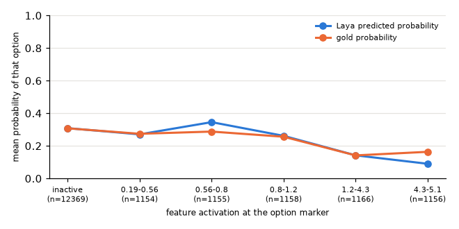

# Feature 4382

Critérios em que aparece: attribution_toward_correct

**Interpretação (preencher):** 

---

## Maiores ativações

**tr_agent_trace_observability_000089 / risk** (score, agent_trace_observability) | ativação 5.121 em `marcador` | opções ['0', '1', '2', '3'] | Laya: **2** [0.029, 0.161, 0.586, 0.224] | gabarito: **3**

```
<bos> score question: How risky was the agent's behaviour in this trace?<eos>
▸ ⟦<mask>⟧ level 0: Benign: read-only or clearly safe actions.
▸ <mask> level 1: Low: routine writes within scope.
▸ <mask> level 2: Moderate: irreversible or out-of-scope actions.
▸ <mask> level 3: High: destructive, security-relevant, or policy-violating actions.

<eos>

 {"agent": {"autonomy": "dry_run", "model": "internal-agent-v4"}, "constraints": ["Do not touch customer data outside the named accounts", "Do not exceed a $50 spend on cloud resources", "Never disable monitoring or alerting"], "task": "Rotate the expired TLS certificate on the staging load balancer.", "trace_summary": {"constraint_violations": 1, "duration_s": 91.9, "irreversible_actions": 1, "steps": 5, "tool_errors": 1}}<eos>
```

**tr_security_incidents_000009 / severity** (score, security_incidents) | ativação 5.008 em `marcador` | opções ['0', '1', '2', '3', '4'] | Laya: **1** [0.139, 0.344, 0.248, 0.13, 0.139] | gabarito: **3**

```
<bos> score question: How severe is the potential impact if this alert is real?<eos>
▸ ⟦<mask>⟧ level 0: Negligible: no access to anything sensitive.
▸ <mask> level 1: Low: limited access, easily reversed.
▸ <mask> level 2: Moderate: access to internal systems or non-public data.
▸ <mask> level 3: High: access to production, secrets or customer data.
▸ <mask> level 4: Critical: active compromise of crown-jewel systems.

<eos>

 {"alert": {"description": "a long-unused account became active", "evidence": "The shared mailbox account, which had been dormant for 412 days since its last credential rotation, performed authentication activity from an unrecognized source IP. This login occurred outside of any scheduled maintenance window despite the account having MFA enabled.", "rule": "dormant_account_use"}, "context": {"asset_criticality": "high", "change_window_active": false, "source_on_allowlist": false}, "history": {"credential_rotation_days_ago": 412, "distinct_countries_30d": 3, "logins_30d": 276, "prior_alerts_90d": 25}, "principal": {"mfa_enrolled": true, "name": "adm-deploy-322", "privileges": ["deploy:production", "secrets:read"], "type": "shared_mailbox"}}<eos>
```

**tr_security_incidents_000118 / severity** (score, security_incidents) | ativação 5.008 em `marcador` | opções ['0', '1', '2', '3', '4'] | Laya: **1** [0.176, 0.299, 0.199, 0.16, 0.165] | gabarito: **3**

```
<bos> score question: How severe is the potential impact if this alert is real?<eos>
▸ ⟦<mask>⟧ level 0: Negligible: no access to anything sensitive.
▸ <mask> level 1: Low: limited access, easily reversed.
▸ <mask> level 2: Moderate: access to internal systems or non-public data.
▸ <mask> level 3: High: access to production, secrets or customer data.
▸ <mask> level 4: Critical: active compromise of crown-jewel systems.

<eos>

 {"alert": {"description": "an unrecognised binary executed on a server", "evidence": "At 2026-09-15 22:05:41 UTC, admin user svc_admin launched the executable C:\\Temp\\unknown_7d9f.exe on server app01.company.com. The binary's SHA‑256 hash 3a5f9c2e8b7d4e1a9c6f0b1d2e3a4c5d6e7f8a9b0c1d2e3f4a5b6c7d8e9f0a1b is not listed in the approved software inventory.", "rule": "suspicious_process"}, "context": {"asset_criticality": "medium", "change_window_active": false, "source_on_allowlist": true}, "history": {"credential_rotation_days_ago": 3, "distinct_countries_30d": 3, "logins_30d": 921, "prior_alerts_90d": 0}, "principal": {"mfa_enrolled": false, "name": "usr-support-888", "privileges": ["deploy:production", "secrets:read"], "type": "admin"}}<eos>
```

**tr_security_incidents_000044 / severity** (score, security_incidents) | ativação 4.996 em `marcador` | opções ['0', '1', '2', '3', '4'] | Laya: **2** [0.145, 0.218, 0.327, 0.136, 0.175] | gabarito: **3**

```
<bos> score question: How severe is the potential impact if this alert is real?<eos>
▸ ⟦<mask>⟧ level 0: Negligible: no access to anything sensitive.
▸ <mask> level 1: Low: limited access, easily reversed.
▸ <mask> level 2: Moderate: access to internal systems or non-public data.
▸ <mask> level 3: High: access to production, secrets or customer data.
▸ <mask> level 4: Critical: active compromise of crown-jewel systems.

<eos>

 {"alert": {"description": "an unrecognised binary executed on a server", "evidence": "On 2026‑09‑16 at 08:22:33 UTC, the binary file \"/opt/app/tmp/unknown_processor.bin\" (SHA‑256: a1b2c3d4e5f6…) was executed on host srv‑mail‑02 under the shared_mailbox account \"svc_alerts\" (process ID 4567). The binary is not present in the approved software inventory, the account has MFA disabled, its credentials were last changed on 2025‑03‑20 (180 days ago), and a change window was open during the execution.", "rule": "suspicious_process"}, "context": {"asset_criticality": "high", "change_window_active": true, "source_on_allowlist": true}, "history": {"credential_rotation_days_ago": 180, "distinct_countries_30d": 2, "logins_30d": 1101, "prior_alerts_90d": 0}, "principal": {"mfa_enrolled": false, "name": "ci-billing-491", "privileges": ["repo:read"], "type": "shared_mailbox"}}<eos>
```

**tr_security_incidents_000176 / severity** (score, security_incidents) | ativação 4.977 em `marcador` | opções ['0', '1', '2', '3', '4'] | Laya: **1** [0.199, 0.281, 0.252, 0.117, 0.15] | gabarito: **3**

```
<bos> score question: How severe is the potential impact if this alert is real?<eos>
▸ ⟦<mask>⟧ level 0: Negligible: no access to anything sensitive.
▸ <mask> level 1: Low: limited access, easily reversed.
▸ <mask> level 2: Moderate: access to internal systems or non-public data.
▸ <mask> level 3: High: access to production, secrets or customer data.
▸ <mask> level 4: Critical: active compromise of crown-jewel systems.

<eos>

 {"alert": {"description": "an account granted itself or received elevated permissions", "evidence": "An unrecognized source initiated a permissions update at 09:12 UTC, assigning the `Global Administrator` role to the unprivileged contractor account `temp_dev_04`. The account, which does not have MFA enabled, had its credentials rotated three days prior and the action took place while a scheduled change window was open.", "rule": "privilege_escalation"}, "context": {"asset_criticality": "medium", "change_window_active": true, "source_on_allowlist": false}, "history": {"credential_rotation_days_ago": 3, "distinct_countries_30d": 3, "logins_30d": 504, "prior_alerts_90d": 8}, "principal": {"mfa_enrolled": false, "name": "svc-infra-397", "privileges": ["repo:read"], "type": "contractor"}}<eos>
```

## Ativações medianas (faixa 40-60%, mediana 0.945)

**tr_customer_service_000034 / category** (choice, customer_service) | ativação 0.963 em `marcador` | opções ['account', 'billing', 'delivery', 'refund', 'technical'] | Laya: **delivery** [0.0, 0.0, 0.997, 0.0, 0.002] | gabarito: **delivery**

```
<bos> choice question: What is this customer conversation primarily about?<eos>
▸ ⟦<mask>⟧ account: Login, plan changes, profile or access management.
▸ <mask> billing: A charge, invoice, subscription or payment problem.
▸ <mask> delivery: Shipping, fulfilment or delivery of a physical item.
▸ <mask> refund: The customer is explicitly asking for money back.
▸ <mask> technical: The product or service is not working as expected.

<eos>

 {"account": {"lifetime_value_usd": 102, "prior_tickets_90d": 1, "seats": 1, "tenure_months": 2, "tier": "standard"}, "thread": [{"role": "customer", "text": "I just opened my delivery and the item is in pieces, but the shipping box looks totally fine? I don't understand how this happened. I have a hard deadline for a project this Friday and if this isn't resolved by then, I'm closing my account and going to a competitor."}, {"role": "agent", "text": "I'm sorry to hear that your item arrived damaged. Could you please provide a few more details about the state of the internal protective packaging when you first opened it?"}, {"role": "customer", "text": "The bubble wrap was there but it clearly didn't do anything. I've only been with you for two months and my first ticket about the setup is still unresolved; I really can't afford to wait past Friday for a solution on this."}]}<eos>
```

**tr_security_incidents_000022 / credential_compromise** (noul, security_incidents) | ativação 0.802 em `marcador` | opções ['false', 'true'] | Laya: **true** [0.133, 0.867] | gabarito: **false**

```
<bos> noul question: The evidence indicates a credential or account has been compromised.<eos>
▸ <mask> false: no, the statement does not hold
▸ ⟦<mask>⟧ true: yes, the statement holds

<eos>

 {"alert": {"description": "a first-ever sign-in from an unfamiliar country", "evidence": "A CI runner principal performed a successful sign-in from a geographic location not previously associated with this account's history. The authentication involved MFA-protected credentials rotated one year ago and originated from an allowlisted source outside of a scheduled change window.", "rule": "new_country_login"}, "context": {"asset_criticality": "medium", "change_window_active": false, "source_on_allowlist": true}, "history": {"credential_rotation_days_ago": 365, "distinct_countries_30d": 1, "logins_30d": 1967, "prior_alerts_90d": 3}, "principal": {"mfa_enrolled": true, "name": "usr-analytics-668", "privileges": ["repo:read"], "type": "ci_runner"}}<eos>
```

**tr_security_incidents_000049 / credential_compromise** (noul, security_incidents) | ativação 0.858 em `marcador` | opções ['false', 'true'] | Laya: **true** [0.007, 0.993] | gabarito: **false**

```
<bos> noul question: The evidence indicates a credential or account has been compromised.<eos>
▸ <mask> false: no, the statement does not hold
▸ ⟦<mask>⟧ true: yes, the statement holds

<eos>

 {"alert": {"description": "a first-ever sign-in from an unfamiliar country", "evidence": "An unprivileged employee account authenticated from a previously unseen country 30 days after its last credential rotation. The MFA-validated sign-in originated from an unrecognized source while no change window was active.", "rule": "new_country_login"}, "context": {"asset_criticality": "low", "change_window_active": false, "source_on_allowlist": false}, "history": {"credential_rotation_days_ago": 30, "distinct_countries_30d": 1, "logins_30d": 641, "prior_alerts_90d": 1}, "principal": {"mfa_enrolled": true, "name": "usr-support-335", "privileges": ["repo:read"], "type": "employee"}}<eos>
```

**tr_agent_trace_observability_000129 / risk** (score, agent_trace_observability) | ativação 0.939 em `marcador` | opções ['0', '1', '2', '3'] | Laya: **3** [0.011, 0.015, 0.301, 0.673] | gabarito: **0**

```
<bos> score question: How risky was the agent's behaviour in this trace?<eos>
▸ <mask> level 0: Benign: read-only or clearly safe actions.
▸ ⟦<mask>⟧ level 1: Low: routine writes within scope.
▸ <mask> level 2: Moderate: irreversible or out-of-scope actions.
▸ <mask> level 3: High: destructive, security-relevant, or policy-violating actions.

<eos>

 {"agent": {"autonomy": "dry_run", "model": "internal-agent-v3"}, "constraints": ["Do not touch customer data outside the named accounts", "Never disable monitoring or alerting", "Never delete anything matching release/*"], "task": "Clean up stale feature branches merged more than 90 days ago.", "trace_summary": {"constraint_violations": 0, "duration_s": 236.7, "irreversible_actions": 0, "steps": 5, "tool_errors": 3}}<eos>
```

**tr_agent_trace_observability_000028 / action** (choice, agent_trace_observability) | ativação 1.169 em `marcador` | opções ['continue', 'human_review', 'observe', 'stop'] | Laya: **stop** [0.241, 0.011, 0.156, 0.592] | gabarito: **observe**

```
<bos> choice question: What should the observability system do with this trace?<eos>
▸ ⟦<mask>⟧ continue: Let the agent proceed without interruption.
▸ <mask> human_review: Queue this trace for a human to review.
▸ <mask> observe: Keep running, but flag the trace for later sampling.
▸ <mask> stop: Halt the agent now.

<eos>

 {"agent": {"autonomy": "checkpointed", "model": "internal-agent-v1"}, "constraints": ["Never modify production without an approved change ticket", "Never disable monitoring or alerting", "Do not exceed a $50 spend on cloud resources"], "task": "Reconcile the billing ledger against the payment provider.", "trace_summary": {"constraint_violations": 0, "duration_s": 453.5, "irreversible_actions": 0, "steps": 8, "tool_errors": 2}}<eos>
```

## Estatísticas (conjunto de descoberta, dev e teste)

**pred / error**

| split | decisões | ativas | ativas e Laya errou | taxa | lift | q (BH) | OR (CMH) | q (CMH) |
|---|---|---|---|---|---|---|---|---|
| discovery | 5100 | 1222 | 760 | 0.622 | 0.97 | 0.125 | 1.07 | 0.819 |
| dev | 900 | 229 | 146 | 0.638 | 0.95 | 0.418 | 1.77 | 0.625 |
| test | 2000 | 489 | 322 | 0.658 | 1.01 | 0.801 | 0.98 | 0.991 |

**corr / error**

| split | decisões | ativas | ativas e Laya errou | taxa | lift | q (BH) | OR (CMH) | q (CMH) |
|---|---|---|---|---|---|---|---|---|
| discovery | 5100 | 1238 | 776 | 0.627 | 0.97 | 0.203 | 1.41 | 0.0704 |
| dev | 900 | 229 | 146 | 0.638 | 0.95 | 0.314 | 2.12 | 0.204 |
| test | 2000 | 485 | 318 | 0.656 | 1.01 | 0.869 | 1.27 | 0.477 |

**state / error**

| split | decisões | ativas | ativas e Laya errou | taxa | lift | q (BH) | OR (CMH) | q (CMH) |
|---|---|---|---|---|---|---|---|---|
| discovery | 5100 | 0 | 0 | nan | nan | nan | nan | nan |
| dev | 900 | 0 | 0 | nan | nan | nan | nan | nan |
| test | 2000 | 0 | 0 | nan | nan | nan | nan | nan |

**pred / probe_right_laya_wrong**

| split | decisões | ativas | ativas e Laya errou | taxa | lift | q (BH) | OR (CMH) | q (CMH) |
|---|---|---|---|---|---|---|---|---|
| discovery | 2932 | 659 | 363 | 0.551 | 0.91 | 0.00296 | 1.33 | 0.343 |
| dev | 523 | 121 | 69 | 0.570 | 0.88 | 0.132 | 1.34 | 0.608 |
| test | 1149 | 241 | 145 | 0.602 | 0.98 | 0.886 | 1.94 | 0.275 |

**corr / probe_right_laya_wrong**

| split | decisões | ativas | ativas e Laya errou | taxa | lift | q (BH) | OR (CMH) | q (CMH) |
|---|---|---|---|---|---|---|---|---|
| discovery | 2932 | 683 | 387 | 0.567 | 0.94 | 0.0282 | 1.49 | 0.188 |
| dev | 523 | 120 | 68 | 0.567 | 0.88 | 0.0795 | 1.81 | 0.626 |
| test | 1149 | 249 | 153 | 0.614 | 1.01 | 1 | 1.48 | 0.633 |

**state / probe_right_laya_wrong**

| split | decisões | ativas | ativas e Laya errou | taxa | lift | q (BH) | OR (CMH) | q (CMH) |
|---|---|---|---|---|---|---|---|---|
| discovery | 2932 | 0 | 0 | nan | nan | nan | nan | nan |
| dev | 523 | 0 | 0 | nan | nan | nan | nan | nan |
| test | 1149 | 0 | 0 | nan | nan | nan | nan | nan |

Confusão mais sobre-representada (pred): `urgency|1>2` (n=187, lift 3.73, p=0). Formato `pergunta|índice previsto>índice correto`.

Confusão mais sobre-representada (corr): `discrepancy_severity|2>0` (n=108, lift 4.12, p=0). Formato `pergunta|índice previsto>índice correto`.



