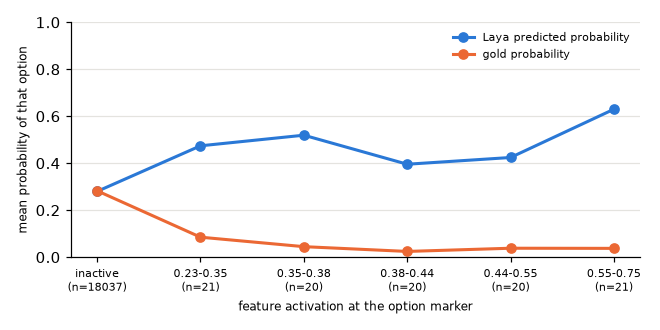

# Feature 4417

Critérios em que aparece: pred_error, pred_probe_right_laya_wrong

**Interpretação (preencher):** 

---

## Maiores ativações

**tr_customer_service_000000 / action** (choice, customer_service) | ativação 4.180 em `estado` | opções ['answer_directly', 'close_no_action', 'escalate_to_human', 'execute_refund', 'request_information'] | Laya: **close_no_action** [0.047, 0.831, 0.111, 0.007, 0.004] | gabarito: **answer_directly**

```
<bos> choice question: What should the assistant do next with this conversation?<eos>
▸ <mask> answer_directly: The assistant can resolve this itself with information it already has.
▸ <mask> close_no_action: No further action is warranted; the matter is settled.
▸ <mask> escalate_to_human: Hand off to a human agent with the appropriate authority.
▸ <mask> execute_refund: Issue the refund or credit the customer is owed.
▸ <mask> request_information: More detail is needed from the customer before anything can be done.

<eos>

 {"account": {"lifetime_value_usd": 4642, "prior_tickets_90d": 2, "seats": 3, "tenure_months": 60, "tier": "enterprise"}, "thread": [{"role": "customer", "text": "Hello, after five years on the Enterprise plan I’ve⟦ decided⟧ it’s time to close my account. Could you please start the cancellation process?"}, {"role": "agent", "text": "I’m sorry to hear you want to leave. May I have the account number or the email associated with the subscription so I can locate it?"}, {"role": "customer", "text": "Sure, the account is registered to alice.smith@example.com, and the reference number is 987654. I’d appreciate a confirmation once the cancellation is underway."}, {"role": "agent", "text": "Thank you for that information. I’ve flagged the request; could you let me know if there’s any specific reason you’re closing, or any final data you need from us?"}, {"role": "customer", "text": "No particular issue, just moving to a different provider. I’ll wait for your follow‑up confirming the account is scheduled for termination."}]}<eos>
```

**tr_customer_service_000000 / category** (choice, customer_service) | ativação 4.148 em `estado` | opções ['account', 'billing', 'delivery', 'refund', 'technical'] | Laya: **account** [0.892, 0.038, 0.004, 0.028, 0.038] | gabarito: **account**

```
<bos> choice question: What is this customer conversation primarily about?<eos>
▸ <mask> account: Login, plan changes, profile or access management.
▸ <mask> billing: A charge, invoice, subscription or payment problem.
▸ <mask> delivery: Shipping, fulfilment or delivery of a physical item.
▸ <mask> refund: The customer is explicitly asking for money back.
▸ <mask> technical: The product or service is not working as expected.

<eos>

 {"account": {"lifetime_value_usd": 4642, "prior_tickets_90d": 2, "seats": 3, "tenure_months": 60, "tier": "enterprise"}, "thread": [{"role": "customer", "text": "Hello, after five years on the Enterprise plan I’ve⟦ decided⟧ it’s time to close my account. Could you please start the cancellation process?"}, {"role": "agent", "text": "I’m sorry to hear you want to leave. May I have the account number or the email associated with the subscription so I can locate it?"}, {"role": "customer", "text": "Sure, the account is registered to alice.smith@example.com, and the reference number is 987654. I’d appreciate a confirmation once the cancellation is underway."}, {"role": "agent", "text": "Thank you for that information. I’ve flagged the request; could you let me know if there’s any specific reason you’re closing, or any final data you need from us?"}, {"role": "customer", "text": "No particular issue, just moving to a different provider. I’ll wait for your follow‑up confirming the account is scheduled for termination."}]}<eos>
```

**tr_customer_service_000000 / needs_human** (noul, customer_service) | ativação 3.764 em `estado` | opções ['false', 'true'] | Laya: **true** [0.09, 0.91] | gabarito: **true**

```
<bos> noul question: This conversation requires a human agent rather than automated handling.<eos>
▸ <mask> false: Automation can carry this to resolution.
▸ <mask> true: A human must take over: judgement, authority or empathy is required.

<eos>

 {"account": {"lifetime_value_usd": 4642, "prior_tickets_90d": 2, "seats": 3, "tenure_months": 60, "tier": "enterprise"}, "thread": [{"role": "customer", "text": "Hello, after five years on the Enterprise plan I’ve⟦ decided⟧ it’s time to close my account. Could you please start the cancellation process?"}, {"role": "agent", "text": "I’m sorry to hear you want to leave. May I have the account number or the email associated with the subscription so I can locate it?"}, {"role": "customer", "text": "Sure, the account is registered to alice.smith@example.com, and the reference number is 987654. I’d appreciate a confirmation once the cancellation is underway."}, {"role": "agent", "text": "Thank you for that information. I’ve flagged the request; could you let me know if there’s any specific reason you’re closing, or any final data you need from us?"}, {"role": "customer", "text": "No particular issue, just moving to a different provider. I’ll wait for your follow‑up confirming the account is scheduled for termination."}]}<eos>
```

**tr_customer_service_000000 / churn_risk** (score, customer_service) | ativação 3.660 em `estado` | opções ['0', '1', '2', '3'] | Laya: **1** [0.184, 0.487, 0.108, 0.222] | gabarito: **3**

```
<bos> score question: How likely is this customer to stop doing business with us because of this interaction?<eos>
▸ <mask> level 0: No sign of dissatisfaction.
▸ <mask> level 1: Mild frustration, but the relationship is intact.
▸ <mask> level 2: Clearly unhappy; repeat problems or explicit complaints.
▸ <mask> level 3: Imminent: threatening to cancel, dispute or leave.

<eos>

 {"account": {"lifetime_value_usd": 4642, "prior_tickets_90d": 2, "seats": 3, "tenure_months": 60, "tier": "enterprise"}, "thread": [{"role": "customer", "text": "Hello, after five years on the Enterprise plan I’ve⟦ decided⟧ it’s time to close my account. Could you please start the cancellation process?"}, {"role": "agent", "text": "I’m sorry to hear you want to leave. May I have the account number or the email associated with the subscription so I can locate it?"}, {"role": "customer", "text": "Sure, the account is registered to alice.smith@example.com, and the reference number is 987654. I’d appreciate a confirmation once the cancellation is underway."}, {"role": "agent", "text": "Thank you for that information. I’ve flagged the request; could you let me know if there’s any specific reason you’re closing, or any final data you need from us?"}, {"role": "customer", "text": "No particular issue, just moving to a different provider. I’ll wait for your follow‑up confirming the account is scheduled for termination."}]}<eos>
```

**tr_customer_service_000000 / urgency** (score, customer_service) | ativação 3.561 em `estado` | opções ['0', '1', '2', '3'] | Laya: **1** [0.29, 0.309, 0.11, 0.29] | gabarito: **3**

```
<bos> score question: How time-sensitive is this conversation?<eos>
▸ <mask> level 0: No time pressure; can wait indefinitely.
▸ <mask> level 1: Routine; handle within the normal queue.
▸ <mask> level 2: Elevated; should be handled within the same week.
▸ <mask> level 3: Critical; requires action within the same day.

<eos>

 {"account": {"lifetime_value_usd": 4642, "prior_tickets_90d": 2, "seats": 3, "tenure_months": 60, "tier": "enterprise"}, "thread": [{"role": "customer", "text": "Hello, after five years on the Enterprise plan I’ve⟦ decided⟧ it’s time to close my account. Could you please start the cancellation process?"}, {"role": "agent", "text": "I’m sorry to hear you want to leave. May I have the account number or the email associated with the subscription so I can locate it?"}, {"role": "customer", "text": "Sure, the account is registered to alice.smith@example.com, and the reference number is 987654. I’d appreciate a confirmation once the cancellation is underway."}, {"role": "agent", "text": "Thank you for that information. I’ve flagged the request; could you let me know if there’s any specific reason you’re closing, or any final data you need from us?"}, {"role": "customer", "text": "No particular issue, just moving to a different provider. I’ll wait for your follow‑up confirming the account is scheduled for termination."}]}<eos>
```

## Ativações medianas (faixa 40-60%, mediana 0.775)

**tr_invoice_processing_000284 / discrepancy_severity** (score, invoice_processing) | ativação 0.816 em `estado` | opções ['0', '1', '2', '3'] | Laya: **2** [0.057, 0.429, 0.457, 0.058] | gabarito: **0**

```
<bos> score question: How material is any discrepancy between the invoice, the order and the delivery?<eos>
▸ <mask> level 0: None: everything reconciles.
▸ <mask> level 1: Trivial: rounding or a cosmetic difference.
▸ <mask> level 2: Moderate: a real difference worth confirming.
▸ <mask> level 3: Material: a large or unexplained difference.

<eos>

 {"delivery": {"condition":⟦ "⟧accepted", "date": "2026-03-20", "received_qty": 1000}, "invoice": {"currency": "USD", "id": "INV-2026-7786", "lines": [{"qty": 1000, "sku": "SKU-874", "total_usd": 320730.0, "unit_usd": 320.73}], "total_usd": 320730.0, "vendor": "Kestrel Supply"}, "payment": {"days_until_due": 11, "discount_expires_in_days": null, "early_payment_discount_pct": null, "status": "scheduled", "terms": "net 15"}, "purchase_order": {"freight_terms": "freight prepaid by vendor, not separately billable", "id": "PO-7733", "lines": [{"qty": 1000, "unit_usd": 320.73}], "total_usd": 320730.0}, "vendor_history": {"disputes_12m": 1, "invoices_12m": 31, "prior_invoice_ids": ["INV-2026-3295", "INV-2026-5889", "INV-2026-7594"]}}<eos>
```

**tr_invoice_processing_000210 / disposition** (choice, invoice_processing) | ativação 0.785 em `opção` | opções ['approve', 'hold', 'manual_review', 'reject'] | Laya: **approve** [0.564, 0.198, 0.023, 0.214] | gabarito: **approve**

```
<bos> choice question: How should this vendor invoice be dispositioned?<eos>
▸ <mask> approve⟦:⟧ Matches the order and delivery; approve for payment.
▸ <mask> hold: Something needs confirming before payment; hold pending clarification.
▸ <mask> manual_review: A human in finance must review the discrepancy.
▸ <mask> reject: Should not be paid: duplicate, unauthorised or materially wrong.

<eos>

 {"delivery": {"condition": "accepted", "date": "2026-03-05", "received_qty": 80}, "invoice": {"currency": "USD", "id": "INV-2026-6684", "lines": [{"qty": 80, "sku": "SKU-630", "total_usd": 33030.4, "unit_usd": 412.88}], "total_usd": 33030.4, "vendor": "Kestrel Supply"}, "payment": {"days_until_due": -21, "discount_expires_in_days": null, "early_payment_discount_pct": null, "status": "overdue", "terms": "net 15"}, "purchase_order": {"freight_terms": "freight prepaid by vendor, not separately billable", "id": "PO-6644", "lines": [{"qty": 100, "unit_usd": 412.88}], "total_usd": 41288.0}, "vendor_history": {"disputes_12m": 0, "invoices_12m": 4, "prior_invoice_ids": ["INV-2026-1588"]}}<eos>
```

**tr_customer_service_000015 / needs_human** (noul, customer_service) | ativação 0.848 em `estado` | opções ['false', 'true'] | Laya: **false** [0.898, 0.102] | gabarito: **true**

```
<bos> noul question: This conversation requires a human agent rather than automated handling.<eos>
▸ <mask> false: Automation can carry this to resolution.
▸ <mask> true: A human must take over: judgement, authority or empathy is required.

<eos>

 {"account": {"lifetime_value_usd": 261, "prior_tickets_90d": 0, "seats": 1, "tenure_months": 3, "tier": "free"}, "thread": [{"role": "customer", "text": "My statement shows two identical $45 charges from yesterday for the free plan, and I need this cleared by Friday."}, {"role": "agent", "⟦text⟧": "I see. Can you confirm the last four digits of the card used and forward a screenshot of the statement?"}, {"role": "customer", "text": "The card ends in 1234, and I’ve attached the screenshot. I’m not sure why this happened, but I need it fixed before Friday."}, {"role": "agent", "text": "Thanks for that. Have you noticed any other duplicate transactions in the past month?"}, {"role": "customer", "text": "No, this is the first time it’s occurred, and the deadline is firm—if it isn’t resolved by Friday, I’ll have to dispute the charge."}, {"role": "agent", "text": "Understood. While I investigate, could you let me know if the merchant name appears the same on both entries?"}, {"role": "customer", "text": "Both entries list the same merchant, ‘CloudServe’, and I’m still waiting for you to tell me what will happen before Friday."}]}<eos>
```

**tr_security_incidents_000005 / urgency** (score, security_incidents) | ativação 0.808 em `pergunta` | opções ['0', '1', '2', '3'] | Laya: **3** [0.063, 0.347, 0.152, 0.438] | gabarito: **2**

```
<bos> score question: How quickly must a responder⟦ act⟧ on this alert?<eos>
▸ <mask> level 0: No time pressure; can wait indefinitely.
▸ <mask> level 1: Routine; handle within the normal queue.
▸ <mask> level 2: Elevated; should be handled within the same week.
▸ <mask> level 3: Critical; requires action within the same day.

<eos>

 {"alert": {"description": "a session token was presented from a second address", "evidence": "Session token XYZ123 was presented to the API from internal address 10.0.0.5 at 2026-09-15 01:05:17 UTC, and the identical token was subsequently used from external address 198.51.100.22 at 01:06:12 UTC. The principal is an unprivileged CI runner with MFA active, the event occurred during an open change window, and the source is not on the recognised list. Credential rotation for this token occurred 700 days ago.", "rule": "token_reuse"}, "context": {"asset_criticality": "low", "change_window_active": true, "source_on_allowlist": false}, "history": {"credential_rotation_days_ago": 700, "distinct_countries_30d": 1, "logins_30d": 1701, "prior_alerts_90d": 1}, "principal": {"mfa_enrolled": true, "name": "ci-deploy-438", "privileges": ["repo:read"], "type": "ci_runner"}}<eos>
```

**tr_invoice_processing_000009 / discrepancy_severity** (score, invoice_processing) | ativação 0.708 em `estado` | opções ['0', '1', '2', '3'] | Laya: **2** [0.034, 0.363, 0.567, 0.036] | gabarito: **2**

```
<bos> score question: How material is any discrepancy between the invoice, the order and the delivery?<eos>
▸ <mask> level 0: None: everything reconciles.
▸ <mask> level 1: Trivial: rounding or a cosmetic difference.
▸ <mask> level 2: Moderate: a real difference worth confirming.
▸ <mask> level 3: Material: a large or unexplained difference.

<eos>

 {"delivery": {"condition": "⟦accepted⟧", "date": "2026-03-15", "received_qty": 25}, "invoice": {"currency": "USD", "id": "INV-2026-2176", "lines": [{"qty": 25, "sku": "SKU-343", "total_usd": 6149.5, "unit_usd": 245.98}], "total_usd": 6149.5, "vendor": "Northwind Components"}, "payment": {"days_until_due": -21, "discount_expires_in_days": 5, "early_payment_discount_pct": 2.0, "status": "overdue", "terms": "net 45"}, "purchase_order": {"freight_terms": "freight prepaid by vendor, not separately billable", "id": "PO-8647", "lines": [{"qty": 25, "unit_usd": 238.82}], "total_usd": 5970.5}, "vendor_history": {"disputes_12m": 1, "invoices_12m": 8, "prior_invoice_ids": ["INV-2026-4845"]}}<eos>
```

## Estatísticas (conjunto de descoberta, dev e teste)

**pred / error**

| split | decisões | ativas | ativas e Laya errou | taxa | lift | q (BH) | OR (CMH) | q (CMH) |
|---|---|---|---|---|---|---|---|---|
| discovery | 5100 | 59 | 59 | 1.000 | 1.55 | 9.75e-11 | inf | 0.53 |
| dev | 900 | 8 | 8 | 1.000 | 1.49 | nan | nan | nan |
| test | 2000 | 29 | 28 | 0.966 | 1.48 | 0.000538 | 0.51 | 0.875 |

**corr / error**

| split | decisões | ativas | ativas e Laya errou | taxa | lift | q (BH) | OR (CMH) | q (CMH) |
|---|---|---|---|---|---|---|---|---|
| discovery | 5100 | 1 | 1 | 1.000 | 1.55 | nan | nan | nan |
| dev | 900 | 0 | 0 | nan | nan | nan | nan | nan |
| test | 2000 | 1 | 0 | 0.000 | 0.00 | nan | nan | nan |

**state / error**

| split | decisões | ativas | ativas e Laya errou | taxa | lift | q (BH) | OR (CMH) | q (CMH) |
|---|---|---|---|---|---|---|---|---|
| discovery | 5100 | 2739 | 1733 | 0.633 | 0.98 | 0.176 | 0.91 | 0.548 |
| dev | 900 | 518 | 348 | 0.672 | 1.00 | 1 | 0.78 | 0.558 |
| test | 2000 | 1010 | 650 | 0.644 | 0.99 | 0.8 | 0.78 | 0.304 |

**pred / probe_right_laya_wrong**

| split | decisões | ativas | ativas e Laya errou | taxa | lift | q (BH) | OR (CMH) | q (CMH) |
|---|---|---|---|---|---|---|---|---|
| discovery | 2932 | 30 | 30 | 1.000 | 1.65 | 2.04e-06 | inf | 0.588 |
| dev | 523 | 2 | 2 | 1.000 | 1.55 | nan | nan | nan |
| test | 1149 | 15 | 15 | 1.000 | 1.64 | nan | nan | nan |

**corr / probe_right_laya_wrong**

| split | decisões | ativas | ativas e Laya errou | taxa | lift | q (BH) | OR (CMH) | q (CMH) |
|---|---|---|---|---|---|---|---|---|
| discovery | 2932 | 0 | 0 | nan | nan | nan | nan | nan |
| dev | 523 | 0 | 0 | nan | nan | nan | nan | nan |
| test | 1149 | 0 | 0 | nan | nan | nan | nan | nan |

**state / probe_right_laya_wrong**

| split | decisões | ativas | ativas e Laya errou | taxa | lift | q (BH) | OR (CMH) | q (CMH) |
|---|---|---|---|---|---|---|---|---|
| discovery | 2932 | 1688 | 1017 | 0.602 | 1.00 | 0.84 | 0.80 | 0.138 |
| dev | 523 | 329 | 217 | 0.660 | 1.02 | 0.768 | 0.73 | 0.541 |
| test | 1149 | 644 | 396 | 0.615 | 1.01 | 0.954 | 0.83 | 0.586 |

Confusão mais sobre-representada (pred): `action|1>2` (n=16, lift 19.48, p=2.31e-17). Formato `pergunta|índice previsto>índice correto`.

Confusão mais sobre-representada (corr): `true_positive|1>0` (n=1, lift 72.86, p=nan). Formato `pergunta|índice previsto>índice correto`.

Confusão mais sobre-representada (state): `duplicate|1>0` (n=211, lift 1.81, p=0). Formato `pergunta|índice previsto>índice correto`.



