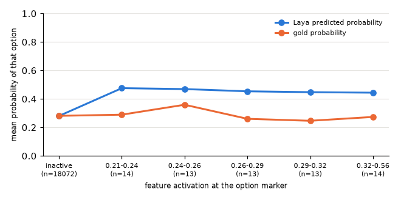

# Feature 4444

Critérios em que aparece: pred_probe_right_laya_wrong_stratified

**Interpretação (preencher):** 

---

## Maiores ativações

**tr_customer_service_000002 / category** (choice, customer_service) | ativação 5.762 em `estado` | opções ['account', 'billing', 'delivery', 'refund', 'technical'] | Laya: **billing** [0.034, 0.939, 0.002, 0.001, 0.025] | gabarito: **account**

```
<bos> choice question: What is this customer conversation primarily about?<eos>
▸ <mask> account: Login, plan changes, profile or access management.
▸ <mask> billing: A charge, invoice, subscription or payment problem.
▸ <mask> delivery: Shipping, fulfilment or delivery of a physical item.
▸ <mask> refund: The customer is explicitly asking for money back.
▸ <mask> technical: The product or service is not working as expected.

<eos>

 {"account": {"lifetime_value_usd": 37, "prior_tickets_90d": 0, "seats": 1, "tenure_months": 1, "tier": "standard"}, "thread": [{"role": "customer", "text": "Good afternoon, could you please arrange for a full export⟦ of⟧ all my data from the Standard plan? I’d like it in CSV format."}, {"role": "agent", "text": "Certainly, I can help with that. May I confirm the email address on the account and whether you need the export within a particular timeframe?"}, {"role": "customer", "text": "The account is under michael.brown@example.com, and I’d like to receive the file by the end of the week if possible."}, {"role": "agent", "text": "Got it, thank you. I’ll queue the export and will need to verify your identity – could you provide the last four digits of the payment method on file?"}, {"role": "customer", "text": "The last four digits are 4321. Please let me know when the download link is ready."}]}<eos>
```

**tr_customer_service_000002 / churn_risk** (score, customer_service) | ativação 5.727 em `estado` | opções ['0', '1', '2', '3'] | Laya: **1** [0.064, 0.483, 0.272, 0.18] | gabarito: **0**

```
<bos> score question: How likely is this customer to stop doing business with us because of this interaction?<eos>
▸ <mask> level 0: No sign of dissatisfaction.
▸ <mask> level 1: Mild frustration, but the relationship is intact.
▸ <mask> level 2: Clearly unhappy; repeat problems or explicit complaints.
▸ <mask> level 3: Imminent: threatening to cancel, dispute or leave.

<eos>

 {"account": {"lifetime_value_usd": 37, "prior_tickets_90d": 0, "seats": 1, "tenure_months": 1, "tier": "standard"}, "thread": [{"role": "customer", "text": "Good afternoon, could you please arrange for a full export⟦ of⟧ all my data from the Standard plan? I’d like it in CSV format."}, {"role": "agent", "text": "Certainly, I can help with that. May I confirm the email address on the account and whether you need the export within a particular timeframe?"}, {"role": "customer", "text": "The account is under michael.brown@example.com, and I’d like to receive the file by the end of the week if possible."}, {"role": "agent", "text": "Got it, thank you. I’ll queue the export and will need to verify your identity – could you provide the last four digits of the payment method on file?"}, {"role": "customer", "text": "The last four digits are 4321. Please let me know when the download link is ready."}]}<eos>
```

**tr_customer_service_000134 / action** (choice, customer_service) | ativação 5.641 em `estado` | opções ['answer_directly', 'close_no_action', 'escalate_to_human', 'execute_refund', 'request_information'] | Laya: **answer_directly** [0.99, 0.009, 0.001, 0.0, 0.0] | gabarito: **escalate_to_human**

```
<bos> choice question: What should the assistant do next with this conversation?<eos>
▸ <mask> answer_directly: The assistant can resolve this itself with information it already has.
▸ <mask> close_no_action: No further action is warranted; the matter is settled.
▸ <mask> escalate_to_human: Hand off to a human agent with the appropriate authority.
▸ <mask> execute_refund: Issue the refund or credit the customer is owed.
▸ <mask> request_information: More detail is needed from the customer before anything can be done.

<eos>

 {"account": {"lifetime_value_usd": 1659, "prior_tickets_90d": 0, "seats": 3, "tenure_months": 19, "tier": "enterprise"}, "thread": [{"role": "customer", "text": "I’m requesting a full export⟦ of⟧ all my company’s data by the end of the week; otherwise I’ll have to consider moving to a different platform."}, {"role": "agent", "text": "I understand the urgency. Could you specify which date range you need and whether you prefer CSV or JSON format?"}, {"role": "customer", "text": "We need everything from January 1 2023 through today, and CSV would be best. The deadline is Friday at 5 PM GMT."}, {"role": "agent", "text": "Got it. To ensure we’re exporting the correct records, could you confirm the primary account email you’d like the files sent to?"}, {"role": "customer", "text": "Please send the export to dataadmin@ourcompany.com. I’ll also be ready to verify my identity if you need any additional confirmation."}, {"role": "agent", "text": "Thank you for confirming. I’ll begin preparing the export and will follow up with any further questions."}, {"role": "customer", "text": "Great, just let me know the exact time you expect to have the files ready; we really can’t miss that Friday deadline."}]}<eos>
```

**tr_customer_service_000002 / needs_human** (noul, customer_service) | ativação 5.641 em `estado` | opções ['false', 'true'] | Laya: **false** [0.58, 0.42] | gabarito: **false**

```
<bos> noul question: This conversation requires a human agent rather than automated handling.<eos>
▸ <mask> false: Automation can carry this to resolution.
▸ <mask> true: A human must take over: judgement, authority or empathy is required.

<eos>

 {"account": {"lifetime_value_usd": 37, "prior_tickets_90d": 0, "seats": 1, "tenure_months": 1, "tier": "standard"}, "thread": [{"role": "customer", "text": "Good afternoon, could you please arrange for a full export⟦ of⟧ all my data from the Standard plan? I’d like it in CSV format."}, {"role": "agent", "text": "Certainly, I can help with that. May I confirm the email address on the account and whether you need the export within a particular timeframe?"}, {"role": "customer", "text": "The account is under michael.brown@example.com, and I’d like to receive the file by the end of the week if possible."}, {"role": "agent", "text": "Got it, thank you. I’ll queue the export and will need to verify your identity – could you provide the last four digits of the payment method on file?"}, {"role": "customer", "text": "The last four digits are 4321. Please let me know when the download link is ready."}]}<eos>
```

**tr_customer_service_000002 / action** (choice, customer_service) | ativação 5.613 em `estado` | opções ['answer_directly', 'close_no_action', 'escalate_to_human', 'execute_refund', 'request_information'] | Laya: **answer_directly** [0.576, 0.256, 0.011, 0.046, 0.11] | gabarito: **answer_directly**

```
<bos> choice question: What should the assistant do next with this conversation?<eos>
▸ <mask> answer_directly: The assistant can resolve this itself with information it already has.
▸ <mask> close_no_action: No further action is warranted; the matter is settled.
▸ <mask> escalate_to_human: Hand off to a human agent with the appropriate authority.
▸ <mask> execute_refund: Issue the refund or credit the customer is owed.
▸ <mask> request_information: More detail is needed from the customer before anything can be done.

<eos>

 {"account": {"lifetime_value_usd": 37, "prior_tickets_90d": 0, "seats": 1, "tenure_months": 1, "tier": "standard"}, "thread": [{"role": "customer", "text": "Good afternoon, could you please arrange for a full export⟦ of⟧ all my data from the Standard plan? I’d like it in CSV format."}, {"role": "agent", "text": "Certainly, I can help with that. May I confirm the email address on the account and whether you need the export within a particular timeframe?"}, {"role": "customer", "text": "The account is under michael.brown@example.com, and I’d like to receive the file by the end of the week if possible."}, {"role": "agent", "text": "Got it, thank you. I’ll queue the export and will need to verify your identity – could you provide the last four digits of the payment method on file?"}, {"role": "customer", "text": "The last four digits are 4321. Please let me know when the download link is ready."}]}<eos>
```

## Ativações medianas (faixa 40-60%, mediana 1.313)

**tr_customer_service_000178 / urgency** (score, customer_service) | ativação 1.240 em `estado` | opções ['0', '1', '2', '3'] | Laya: **1** [0.097, 0.63, 0.117, 0.156] | gabarito: **2**

```
<bos> score question: How time-sensitive is this conversation?<eos>
▸ <mask> level 0: No time pressure; can wait indefinitely.
▸ <mask> level 1: Routine; handle within the normal queue.
▸ <mask> level 2: Elevated; should be handled within the same week.
▸ <mask> level 3: Critical; requires action within the same day.

<eos>

 {"account": {"lifetime_value_usd": 337, "prior_tickets_90d": 2, "seats": 1, "tenure_months": 5, "tier": "premium"}, "thread": [{"role": "customer", "text": "Good morning, I hope you can help—I'm unable to log into my premium account."}, {"role": "agent", "text": "Good morning! Could you let me know what you see on the screen when you try to sign in?"}, {"role": "customer", "text": "When I enter my password, the system just reloads⟦ the⟧ login page without an error."}, {"role": "agent", "text": "Thanks for the detail. Are you using two‑factor authentication, and have you tried clearing your browser cache?"}, {"role": "customer", "text": "I do have 2FA enabled, and I've cleared my browser cache, but the issue persists."}, {"role": "agent", "text": "Understood. When was the last time you successfully logged in, and have you changed your phone number or authentication app recently?"}, {"role": "customer", "text": "The last time I logged in was about a week ago, and I haven't changed my phone; I really need access before Friday's meeting."}]}<eos>
```

**tr_security_incidents_000045 / true_positive** (noul, security_incidents) | ativação 1.116 em `estado` | opções ['false', 'true'] | Laya: **false** [0.984, 0.016] | gabarito: **false**

```
<bos> noul question: This alert reflects genuinely malicious or unauthorised activity.<eos>
▸ <mask> false: Benign activity, a misconfiguration, or a known false positive.
▸ <mask> true: The underlying behaviour is malicious or unauthorised.

<eos>

 {"alert": {"description": "an unusual volume⟦ of⟧ files read in a short window", "evidence": "At 2026-09-15 02:07:14 UTC, the admin account \"ADM_Jenkins\" invoked the process \"cmd.exe\" to open 417 distinct files on the UNC path \\\\fileshare01\\project\\data within a 4‑minute interval. The source host (10.12.34.78) is listed in the allowlist and the account's MFA setting is disabled, with the password last rotated 180 days prior.", "rule": "mass_download"}, "context": {"asset_criticality": "high", "change_window_active": false, "source_on_allowlist": true}, "history": {"credential_rotation_days_ago": 180, "distinct_countries_30d": 1, "logins_30d": 1479, "prior_alerts_90d": 0}, "principal": {"mfa_enrolled": false, "name": "ci-infra-731", "privileges": ["deploy:production", "secrets:read"], "type": "admin"}}<eos>
```

**tr_security_incidents_000090 / urgency** (score, security_incidents) | ativação 1.245 em `estado` | opções ['0', '1', '2', '3'] | Laya: **1** [0.087, 0.498, 0.151, 0.264] | gabarito: **3**

```
<bos> score question: How quickly must a responder act on this alert?<eos>
▸ <mask> level 0: No time pressure; can wait indefinitely.
▸ <mask> level 1: Routine; handle within the normal queue.
▸ <mask> level 2: Elevated; should be handled within the same week.
▸ <mask> level 3: Critical; requires action within the same day.

<eos>

 {"alert": {"description": "two successful logins from distant locations too close together", "evidence": "At 2026-09-14 03:12:04 UTC a successful authentication⟦ for⟧ the CI_Runner service was logged from IP 203.0.113.45 (Paris, FR). A second successful login for the same principal occurred 6 minutes later from IP 198.51.100.22 (Tokyo, JP), and the system flagged the source as not present in the allowlist. The change‑window flag was active and the associated credentials were last rotated on 2026-08-15.", "rule": "impossible_travel"}, "context": {"asset_criticality": "high", "change_window_active": true, "source_on_allowlist": false}, "history": {"credential_rotation_days_ago": 30, "distinct_countries_30d": 1, "logins_30d": 587, "prior_alerts_90d": 0}, "principal": {"mfa_enrolled": true, "name": "adm-billing-542", "privileges": ["deploy:production", "secrets:read"], "type": "ci_runner"}}<eos>
```

**tr_customer_service_000225 / category** (choice, customer_service) | ativação 1.459 em `estado` | opções ['account', 'billing', 'delivery', 'refund', 'technical'] | Laya: **technical** [0.392, 0.086, 0.004, 0.032, 0.486] | gabarito: **technical**

```
<bos> choice question: What is this customer conversation primarily about?<eos>
▸ <mask> account: Login, plan changes, profile or access management.
▸ <mask> billing: A charge, invoice, subscription or payment problem.
▸ <mask> delivery: Shipping, fulfilment or delivery of a physical item.
▸ <mask> refund: The customer is explicitly asking for money back.
▸ <mask> technical: The product or service is not working as expected.

<eos>

 {"account": {"lifetime_value_usd": 419, "prior_tickets_90d": 1, "seats": 1, "tenure_months": 5, "tier": "standard"}, "orders": [{"amount_usd": 99, "date": "2026-01-07", "id": "A-67520", "status": "settled"}, {"amount_usd": 99, "date": "2026-03-11", "id": "A-78780", "status": "settled"}, {"amount_usd": 99, "date": "2026-02-08", "id": "A-39325", "status": "settled"}], "thread": [{"role": "customer", "text": "Hello, I’m writing because I accidentally dropped the $99 device I bought five months ago, and the screen is now completely cracked."}, {"role": "agent", "text": "I’m sorry to hear that your device was damaged. Could you please provide your order number and a brief description⟦ of⟧ the current display functionality?"}, {"role": "customer", "text": "The order number is #88291, and while the touch screen is unresponsive, the device still powers on."}, {"role": "agent", "text": "Thank you for providing those details. Just to ensure I have the full picture, could you tell me if there is any visible damage to the charging port or the frame?"}, {"role": "customer", "text": "No, the frame and charging port look perfectly fine, it is just the screen."}]}<eos>
```

**tr_customer_service_000233 / action** (choice, customer_service) | ativação 1.577 em `estado` | opções ['answer_directly', 'close_no_action', 'escalate_to_human', 'execute_refund', 'request_information'] | Laya: **close_no_action** [0.052, 0.897, 0.013, 0.024, 0.014] | gabarito: **escalate_to_human**

```
<bos> choice question: What should the assistant do next with this conversation?<eos>
▸ <mask> answer_directly: The assistant can resolve this itself with information it already has.
▸ <mask> close_no_action: No further action is warranted; the matter is settled.
▸ <mask> escalate_to_human: Hand off to a human agent with the appropriate authority.
▸ <mask> execute_refund: Issue the refund or credit the customer is owed.
▸ <mask> request_information: More detail is needed from the customer before anything can be done.

<eos>

 {"account": {"lifetime_value_usd": 273, "prior_tickets_90d": 2, "seats": 1, "tenure_months": 14, "tier": "free"}, "orders": [{"amount_usd": 29, "date": "2026-02-02", "id": "A-72334", "status": "settled"}, {"amount_usd": 29, "date": "2026-01-16", "id": "A-43421", "status": "settled"}], "thread": [{"role": "customer", "text": "I just opened my delivery and you sent me the wrong replacement part, I ordered the $29 filter kit but I received a pack of gaskets instead. I have an inspection scheduled for tomorrow morning and I absolutely must have the right parts installed by then."}, {"role": "agent", "text": "I'm sorry to hear that the incorrect items were delivered. Could you please provide the order number located on your packing slip so I can check the shipment details?"}, {"role": "customer", "text": "The order number is 44921-A. This is the third time I've had to reach out about shipping errors in the last year and I'm really in a bind here. Is there any way to get the correct filter kit to me today?"}, {"role": "agent", "text": "I've pulled up the order and see the filter kit listed. For our records, could you please describe any labels or SKU numbers visible on the packaging⟦ of⟧ the gaskets you received by mistake?"}, {"role": "customer", "text": "The sticker says G-992-X, but I really don't have time for a back-and-forth investigation. I need to know immediately how we can fix this because the inspector will be here at 9 AM and the system won't pass without those specific filters."}]}<eos>
```

## Estatísticas (conjunto de descoberta, dev e teste)

**pred / error**

| split | decisões | ativas | ativas e Laya errou | taxa | lift | q (BH) | OR (CMH) | q (CMH) |
|---|---|---|---|---|---|---|---|---|
| discovery | 5100 | 50 | 33 | 0.660 | 1.03 | 0.994 | 1.09 | 0.909 |
| dev | 900 | 9 | 6 | 0.667 | 0.99 | nan | nan | nan |
| test | 2000 | 19 | 16 | 0.842 | 1.29 | nan | nan | nan |

**corr / error**

| split | decisões | ativas | ativas e Laya errou | taxa | lift | q (BH) | OR (CMH) | q (CMH) |
|---|---|---|---|---|---|---|---|---|
| discovery | 5100 | 20 | 3 | 0.150 | 0.23 | 3.27e-05 | 0.30 | 0.113 |
| dev | 900 | 3 | 0 | 0.000 | 0.00 | nan | nan | nan |
| test | 2000 | 4 | 1 | 0.250 | 0.38 | nan | nan | nan |

**state / error**

| split | decisões | ativas | ativas e Laya errou | taxa | lift | q (BH) | OR (CMH) | q (CMH) |
|---|---|---|---|---|---|---|---|---|
| discovery | 5100 | 744 | 448 | 0.602 | 0.94 | 0.0391 | 1.01 | 0.986 |
| dev | 900 | 102 | 62 | 0.608 | 0.90 | 0.525 | 0.83 | 0.748 |
| test | 2000 | 227 | 149 | 0.656 | 1.01 | 1 | 1.31 | 0.399 |

**pred / probe_right_laya_wrong**

| split | decisões | ativas | ativas e Laya errou | taxa | lift | q (BH) | OR (CMH) | q (CMH) |
|---|---|---|---|---|---|---|---|---|
| discovery | 2932 | 27 | 22 | 0.815 | 1.35 | 0.0554 | 4.37 | 0.0201 |
| dev | 523 | 4 | 3 | 0.750 | 1.16 | nan | nan | nan |
| test | 1149 | 8 | 7 | 0.875 | 1.43 | nan | nan | nan |

**corr / probe_right_laya_wrong**

| split | decisões | ativas | ativas e Laya errou | taxa | lift | q (BH) | OR (CMH) | q (CMH) |
|---|---|---|---|---|---|---|---|---|
| discovery | 2932 | 5 | 0 | 0.000 | 0.00 | nan | nan | nan |
| dev | 523 | 1 | 0 | 0.000 | 0.00 | nan | nan | nan |
| test | 1149 | 1 | 0 | 0.000 | 0.00 | nan | nan | nan |

**state / probe_right_laya_wrong**

| split | decisões | ativas | ativas e Laya errou | taxa | lift | q (BH) | OR (CMH) | q (CMH) |
|---|---|---|---|---|---|---|---|---|
| discovery | 2932 | 411 | 208 | 0.506 | 0.84 | 8.68e-05 | 0.90 | 0.655 |
| dev | 523 | 51 | 30 | 0.588 | 0.91 | 0.752 | 1.01 | 0.996 |
| test | 1149 | 128 | 76 | 0.594 | 0.97 | 0.914 | 1.42 | 0.319 |

Confusão mais sobre-representada (pred): `urgency|1>2` (n=29, lift 14.15, p=2.65e-28). Formato `pergunta|índice previsto>índice correto`.

Confusão mais sobre-representada (corr): `urgency|2>1` (n=2, lift 14.17, p=0.0085). Formato `pergunta|índice previsto>índice correto`.

Confusão mais sobre-representada (state): `needs_human|0>1` (n=28, lift 3.55, p=1.05e-10). Formato `pergunta|índice previsto>índice correto`.



