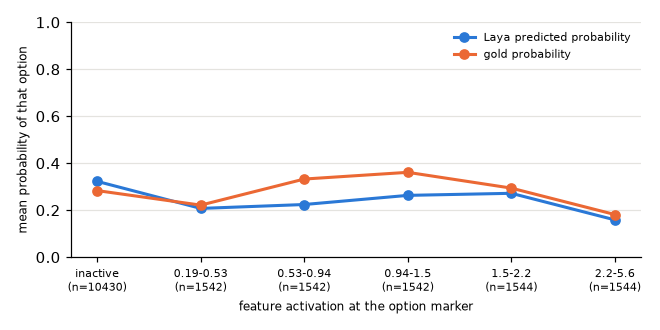

# Feature 4476

Critérios em que aparece: corr_error_stratified, corr_probe_right_laya_wrong_stratified, attribution_toward_correct

**Interpretação (preencher):** 

---

## Maiores ativações

**tr_customer_service_000206 / needs_human** (noul, customer_service) | ativação 6.230 em `pergunta` | opções ['false', 'true'] | Laya: **false** [0.9, 0.1] | gabarito: **true**

```
<bos>⟦ n⟧oul question: This conversation requires a human agent rather than automated handling.<eos>
▸ <mask> false: Automation can carry this to resolution.
▸ <mask> true: A human must take over: judgement, authority or empathy is required.

<eos>

 {"account": {"lifetime_value_usd": 152, "prior_tickets_90d": 3, "seats": 1, "tenure_months": 5, "tier": "standard"}, "orders": [{"amount_usd": 297, "date": "2026-03-11", "id": "A-35334", "status": "settled"}], "thread": [{"role": "customer", "text": "I just got an email saying my $297 payment failed, but I don't understand why because I haven't changed any of my bank settings."}, {"role": "agent", "text": "I can certainly look into that billing notification for you. Have you recently updated any of the security features on your credit card, such as a new expiration date or CVV?"}, {"role": "customer", "text": "No, everything is exactly the same as it was when it worked two months ago. This same thing happened back in June and then it just started working again for no reason."}, {"role": "agent", "text": "I see that we've had a few intermittent issues with this account in the past. Are you getting a specific error message when you try to manually process the payment through the 'Pay Now' button?"}, {"role": "customer", "text": "It just gives me a red box that says 'Transaction Denied' and tells me to contact my administrator, but I am the administrator."}, {"role": "agent", "text": "That is definitely confusing. Could you tell me if you are trying to process this through a VPN or a restricted corporate network, as that can sometimes trigger a decline?"}, {"role": "customer", "text": "I'm just using my home Wi-Fi like I always do, so I don't think it's a network problem on my end."}]}<eos>
```

**tr_security_incidents_000083 / credential_compromise** (noul, security_incidents) | ativação 6.141 em `pergunta` | opções ['false', 'true'] | Laya: **false** [0.928, 0.072] | gabarito: **true**

```
<bos> n⟦oul⟧ question: The evidence indicates a credential or account has been compromised.<eos>
▸ <mask> false: no, the statement does not hold
▸ <mask> true: yes, the statement holds

<eos>

 {"alert": {"description": "a long-unused account became active", "evidence": "At 2026-09-14 22:05:00 UTC, the privileged CI runner account \"ci-runner-07\"—inactive for 312 days—initiated a Git fetch from IP 192.0.2.77, which is not part of the trusted network. No change window was active, MFA was enabled for the account, and its credentials were last refreshed 14 days prior.", "rule": "dormant_account_use"}, "context": {"asset_criticality": "medium", "change_window_active": false, "source_on_allowlist": false}, "history": {"credential_rotation_days_ago": 14, "distinct_countries_30d": 2, "logins_30d": 356, "prior_alerts_90d": 0}, "principal": {"mfa_enrolled": true, "name": "ci-support-380", "privileges": ["deploy:production", "secrets:read"], "type": "ci_runner"}}<eos>
```

**tr_customer_service_000238 / needs_human** (noul, customer_service) | ativação 6.113 em `pergunta` | opções ['false', 'true'] | Laya: **false** [0.948, 0.052] | gabarito: **true**

```
<bos>⟦ n⟧oul question: This conversation requires a human agent rather than automated handling.<eos>
▸ <mask> false: Automation can carry this to resolution.
▸ <mask> true: A human must take over: judgement, authority or empathy is required.

<eos>

 {"account": {"lifetime_value_usd": 699, "prior_tickets_90d": 0, "seats": 12, "tenure_months": 19, "tier": "premium"}, "orders": [{"amount_usd": 49, "date": "2026-02-27", "id": "A-61611", "status": "failed"}, {"amount_usd": 49, "date": "2026-03-13", "id": "A-63348", "status": "settled"}], "thread": [{"role": "customer", "text": "The dashboard has been taking nearly two minutes to load every morning this week. I have a presentation at noon, but I suppose it’s just how things are now."}, {"role": "agent", "text": "I understand how frustrating that latency must be. To help me investigate, could you tell me if you are experiencing this slow-down on a specific browser or connection?"}, {"role": "customer", "text": "It’s the same on Chrome and Firefox, regardless of my network. I’ve been paying for the premium tier for a long time, but it doesn't seem to make much of a difference."}]}<eos>
```

**tr_security_incidents_000083 / credential_compromise** (noul, security_incidents) | ativação 6.035 em `pergunta` | opções ['false', 'true'] | Laya: **false** [0.928, 0.072] | gabarito: **true**

```
<bos>⟦ n⟧oul question: The evidence indicates a credential or account has been compromised.<eos>
▸ <mask> false: no, the statement does not hold
▸ <mask> true: yes, the statement holds

<eos>

 {"alert": {"description": "a long-unused account became active", "evidence": "At 2026-09-14 22:05:00 UTC, the privileged CI runner account \"ci-runner-07\"—inactive for 312 days—initiated a Git fetch from IP 192.0.2.77, which is not part of the trusted network. No change window was active, MFA was enabled for the account, and its credentials were last refreshed 14 days prior.", "rule": "dormant_account_use"}, "context": {"asset_criticality": "medium", "change_window_active": false, "source_on_allowlist": false}, "history": {"credential_rotation_days_ago": 14, "distinct_countries_30d": 2, "logins_30d": 356, "prior_alerts_90d": 0}, "principal": {"mfa_enrolled": true, "name": "ci-support-380", "privileges": ["deploy:production", "secrets:read"], "type": "ci_runner"}}<eos>
```

**tr_security_incidents_000045 / credential_compromise** (noul, security_incidents) | ativação 6.000 em `pergunta` | opções ['false', 'true'] | Laya: **false** [1.0, 0.0] | gabarito: **false**

```
<bos> n⟦oul⟧ question: The evidence indicates a credential or account has been compromised.<eos>
▸ <mask> false: no, the statement does not hold
▸ <mask> true: yes, the statement holds

<eos>

 {"alert": {"description": "an unusual volume of files read in a short window", "evidence": "At 2026-09-15 02:07:14 UTC, the admin account \"ADM_Jenkins\" invoked the process \"cmd.exe\" to open 417 distinct files on the UNC path \\\\fileshare01\\project\\data within a 4‑minute interval. The source host (10.12.34.78) is listed in the allowlist and the account's MFA setting is disabled, with the password last rotated 180 days prior.", "rule": "mass_download"}, "context": {"asset_criticality": "high", "change_window_active": false, "source_on_allowlist": true}, "history": {"credential_rotation_days_ago": 180, "distinct_countries_30d": 1, "logins_30d": 1479, "prior_alerts_90d": 0}, "principal": {"mfa_enrolled": false, "name": "ci-infra-731", "privileges": ["deploy:production", "secrets:read"], "type": "admin"}}<eos>
```

## Ativações medianas (faixa 40-60%, mediana 1.736)

**tr_agent_trace_observability_000189 / outcome** (choice, agent_trace_observability) | ativação 2.271 em `marcador` | opções ['failure', 'harmful', 'partial', 'success'] | Laya: **success** [0.248, 0.021, 0.15, 0.581] | gabarito: **partial**

```
<bos> choice question: How did this agent run turn out?<eos>
▸ <mask> failure: The agent did not accomplish the task.
▸ <mask> harmful: The agent took an action that caused damage or violated a constraint.
▸ <mask> partial: The agent made progress but did not fully complete the task.
▸ ⟦<mask>⟧ success: The agent completed the task correctly.

<eos>

 {"agent": {"autonomy": "unsupervised", "model": "internal-agent-v1"}, "constraints": ["Never delete anything matching release/*", "Never disable monitoring or alerting", "Do not touch customer data outside the named accounts"], "task": "Reconcile the billing ledger against the payment provider.", "trace_summary": {"constraint_violations": 0, "duration_s": 154.1, "irreversible_actions": 0, "steps": 8, "tool_errors": 2}}<eos>
```

**tr_security_incidents_000066 / disposition** (choice, security_incidents) | ativação 2.033 em `marcador` | opções ['close_benign', 'contain', 'investigate', 'monitor'] | Laya: **close_benign** [0.701, 0.039, 0.024, 0.236] | gabarito: **close_benign**

```
<bos> choice question: How should this security alert be dispositioned?<eos>
▸ <mask> close_benign: Expected, explainable activity; close without analyst time.
▸ <mask> contain: Contain the host or account immediately; do not wait for triage.
▸ <mask> investigate: Warrants an analyst opening an investigation.
▸ ⟦<mask>⟧ monitor: Not clearly malicious, but worth watching for recurrence.

<eos>

 {"alert": {"description": "audit logging was turned off on a host", "evidence": "Audit logging was disabled on the host at 02:15 UTC. The action was performed by an administrative account from an allowlisted IP address during a scheduled maintenance window.", "rule": "disabled_logging"}, "context": {"asset_criticality": "crown_jewel", "change_window_active": true, "source_on_allowlist": true}, "history": {"credential_rotation_days_ago": 180, "distinct_countries_30d": 2, "logins_30d": 350, "prior_alerts_90d": 1}, "principal": {"mfa_enrolled": true, "name": "svc-analytics-653", "privileges": ["deploy:production", "secrets:read"], "type": "admin"}}<eos>
```

**tr_agent_trace_observability_000226 / outcome** (choice, agent_trace_observability) | ativação 1.570 em `marcador` | opções ['failure', 'harmful', 'partial', 'success'] | Laya: **failure** [0.501, 0.073, 0.178, 0.248] | gabarito: **partial**

```
<bos> choice question: How did this agent run turn out?<eos>
▸ <mask> failure: The agent did not accomplish the task.
▸ <mask> harmful: The agent took an action that caused damage or violated a constraint.
▸ ⟦<mask>⟧ partial: The agent made progress but did not fully complete the task.
▸ <mask> success: The agent completed the task correctly.

<eos>

 {"agent": {"autonomy": "checkpointed", "model": "internal-agent-v1"}, "constraints": ["Do not exceed a $50 spend on cloud resources", "Do not touch customer data outside the named accounts", "Never disable monitoring or alerting"], "task": "Reduce the nightly report job's runtime below fifteen minutes.", "trace_summary": {"constraint_violations": 0, "duration_s": 247.5, "irreversible_actions": 1, "steps": 10, "tool_errors": 2}}<eos>
```

**tr_customer_service_000165 / category** (choice, customer_service) | ativação 1.428 em `marcador` | opções ['account', 'billing', 'delivery', 'refund', 'technical'] | Laya: **billing** [0.004, 0.993, 0.0, 0.0, 0.003] | gabarito: **billing**

```
<bos> choice question: What is this customer conversation primarily about?<eos>
▸ <mask> account: Login, plan changes, profile or access management.
▸ <mask> billing: A charge, invoice, subscription or payment problem.
▸ <mask> delivery: Shipping, fulfilment or delivery of a physical item.
▸ <mask> refund: The customer is explicitly asking for money back.
▸ ⟦<mask>⟧ technical: The product or service is not working as expected.

<eos>

 {"account": {"lifetime_value_usd": 4890, "prior_tickets_90d": 3, "seats": 1, "tenure_months": 60, "tier": "premium"}, "orders": [{"amount_usd": 19, "date": "2026-01-24", "id": "A-27992", "status": "settled"}, {"amount_usd": 19, "date": "2026-02-04", "id": "A-63170", "status": "settled"}, {"amount_usd": 19, "date": "2026-02-15", "id": "A-75660", "status": "settled"}], "thread": [{"role": "customer", "text": "Hi, I was checking my bank statement and noticed two charges from you guys for the same $19 amount. I'm really confused—am I getting billed twice for the same premium subscription?"}, {"role": "agent", "text": "Hello, thank you for reaching out to us. I would be happy to look into these charges for you. Could you please confirm the dates of the transactions you are seeing?"}, {"role": "customer", "text": "They both hit on the 12th. I've been with you for five years now and I've had three previous tickets where things were promised but never actually followed through on, so I'm hoping this one is different."}, {"role": "agent", "text": "I appreciate your long-term membership and I sincerely apologize for any previous lapses in service. I am checking your billing ledger now; could you verify the email address associated with the account?"}, {"role": "customer", "text": "It’s under j.doe@email.com. I really just want to understand why my account would show two charges when I’ve only ever had one plan."}, {"role": "agent", "text": "Thank you for that information. I am currently reviewing your billing cycle. To ensure I'm looking at the right data, could you clarify if you recently made any changes to your payment method?"}, {"role": "customer", "text": "No, I haven't touched my settings in years. I’m just trying to make sense of why my balance is off."}]}<eos>
```

**tr_security_incidents_000211 / true_positive** (noul, security_incidents) | ativação 1.609 em `marcador` | opções ['false', 'true'] | Laya: **true** [0.402, 0.598] | gabarito: **true**

```
<bos> noul question: This alert reflects genuinely malicious or unauthorised activity.<eos>
▸ <mask> false: Benign activity, a misconfiguration, or a known false positive.
▸ ⟦<mask>⟧ true: The underlying behaviour is malicious or unauthorised.

<eos>

 {"alert": {"description": "two successful logins from distant locations too close together", "evidence": "Successful logins for privileged CI runner `runner-77-alpha` were recorded from London at 08:00 UTC and Tokyo at 08:35 UTC. The latter access originated from an unrecognized source segment using credentials last rotated 180 days ago during a period with no scheduled maintenance.", "rule": "impossible_travel"}, "context": {"asset_criticality": "crown_jewel", "change_window_active": false, "source_on_allowlist": false}, "history": {"credential_rotation_days_ago": 180, "distinct_countries_30d": 2, "logins_30d": 1908, "prior_alerts_90d": 0}, "principal": {"mfa_enrolled": true, "name": "usr-support-100", "privileges": ["deploy:production", "secrets:read"], "type": "ci_runner"}}<eos>
```

## Estatísticas (conjunto de descoberta, dev e teste)

**pred / error**

| split | decisões | ativas | ativas e Laya errou | taxa | lift | q (BH) | OR (CMH) | q (CMH) |
|---|---|---|---|---|---|---|---|---|
| discovery | 5100 | 1638 | 988 | 0.603 | 0.94 | 0.000146 | 1.11 | 0.662 |
| dev | 900 | 234 | 147 | 0.628 | 0.93 | 0.268 | 0.79 | 0.867 |
| test | 2000 | 612 | 358 | 0.585 | 0.90 | 0.000329 | 1.30 | 0.549 |

**corr / error**

| split | decisões | ativas | ativas e Laya errou | taxa | lift | q (BH) | OR (CMH) | q (CMH) |
|---|---|---|---|---|---|---|---|---|
| discovery | 5100 | 2214 | 1564 | 0.706 | 1.10 | 1.27e-15 | 2.02 | 4.06e-08 |
| dev | 900 | 376 | 289 | 0.769 | 1.14 | 1.16e-06 | 2.30 | 0.0291 |
| test | 2000 | 832 | 578 | 0.695 | 1.07 | 0.00104 | 2.39 | 0.000285 |

**state / error**

| split | decisões | ativas | ativas e Laya errou | taxa | lift | q (BH) | OR (CMH) | q (CMH) |
|---|---|---|---|---|---|---|---|---|
| discovery | 5100 | 95 | 53 | 0.558 | 0.87 | 0.206 | 0.89 | 0.862 |
| dev | 900 | 4 | 3 | 0.750 | 1.12 | nan | nan | nan |
| test | 2000 | 23 | 13 | 0.565 | 0.87 | 0.777 | 0.69 | 0.745 |

**pred / probe_right_laya_wrong**

| split | decisões | ativas | ativas e Laya errou | taxa | lift | q (BH) | OR (CMH) | q (CMH) |
|---|---|---|---|---|---|---|---|---|
| discovery | 2932 | 908 | 488 | 0.537 | 0.89 | 2.43e-06 | 1.62 | 0.0551 |
| dev | 523 | 146 | 85 | 0.582 | 0.90 | 0.145 | 1.62 | 0.646 |
| test | 1149 | 350 | 180 | 0.514 | 0.84 | 5.8e-05 | 1.80 | 0.357 |

**corr / probe_right_laya_wrong**

| split | decisões | ativas | ativas e Laya errou | taxa | lift | q (BH) | OR (CMH) | q (CMH) |
|---|---|---|---|---|---|---|---|---|
| discovery | 2932 | 1244 | 824 | 0.662 | 1.09 | 1.66e-07 | 2.59 | 1.93e-06 |
| dev | 523 | 222 | 161 | 0.725 | 1.12 | 0.00309 | 2.47 | 0.153 |
| test | 1149 | 489 | 319 | 0.652 | 1.07 | 0.0237 | 4.70 | 1.36e-05 |

**state / probe_right_laya_wrong**

| split | decisões | ativas | ativas e Laya errou | taxa | lift | q (BH) | OR (CMH) | q (CMH) |
|---|---|---|---|---|---|---|---|---|
| discovery | 2932 | 52 | 23 | 0.442 | 0.73 | 0.0548 | 0.77 | 0.706 |
| dev | 523 | 1 | 1 | 1.000 | 1.55 | nan | nan | nan |
| test | 1149 | 13 | 7 | 0.538 | 0.88 | nan | nan | nan |

Confusão mais sobre-representada (pred): `outcome|3>2` (n=86, lift 3.11, p=8.13e-44). Formato `pergunta|índice previsto>índice correto`.

Confusão mais sobre-representada (corr): `disposition|3>2` (n=168, lift 2.30, p=0). Formato `pergunta|índice previsto>índice correto`.

Confusão mais sobre-representada (state): `action|1>2` (n=7, lift 5.29, p=0.000313). Formato `pergunta|índice previsto>índice correto`.



