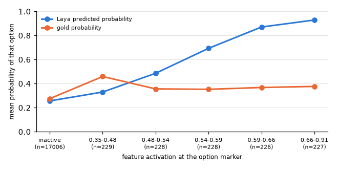

# Feature 4611

Critérios em que aparece: attribution_toward_wrong

**Interpretação (preencher):** 

---

## Maiores ativações

**tr_customer_service_000238 / action** (choice, customer_service) | ativação 2.613 em `estado` | opções ['answer_directly', 'close_no_action', 'escalate_to_human', 'execute_refund', 'request_information'] | Laya: **close_no_action** [0.042, 0.936, 0.009, 0.008, 0.004] | gabarito: **escalate_to_human**

```
<bos> choice question: What should the assistant do next with this conversation?<eos>
▸ <mask> answer_directly: The assistant can resolve this itself with information it already has.
▸ <mask> close_no_action: No further action is warranted; the matter is settled.
▸ <mask> escalate_to_human: Hand off to a human agent with the appropriate authority.
▸ <mask> execute_refund: Issue the refund or credit the customer is owed.
▸ <mask> request_information: More detail is needed from the customer before anything can be done.

<eos>

 {"account": {"lifetime_value_usd": 699, "prior_tickets_90d": 0, "seats": 12, "tenure_months": 19, "tier": "premium"}, "orders": [{"amount_usd": 49, "date": "2026-02-27", "id": "A-61611", "status": "failed"}, {"amount_usd": 49, "date": "2026-03-13", "id": "A-63348", "status": "settled"}], "thread": [{"role": "customer", "text": "The dashboard has been taking nearly two minutes to load every morning this week. I have a presentation at noon, but I suppose it’s just how things are now."}, {"role": "agent", "text": "I understand how frustrating that latency must be. To help me investigate, could you tell me if you are experiencing this slow-down on a specific browser or connection?"}, {"role": "customer", "text": "It’s the same on Chrome and Firefox, regardless of my network. I’ve been paying for the premium tier for a long time, but it doesn't seem to⟦ make⟧ much of a difference."}]}<eos>
```

**tr_customer_service_000238 / urgency** (score, customer_service) | ativação 2.609 em `estado` | opções ['0', '1', '2', '3'] | Laya: **1** [0.171, 0.612, 0.146, 0.07] | gabarito: **3**

```
<bos> score question: How time-sensitive is this conversation?<eos>
▸ <mask> level 0: No time pressure; can wait indefinitely.
▸ <mask> level 1: Routine; handle within the normal queue.
▸ <mask> level 2: Elevated; should be handled within the same week.
▸ <mask> level 3: Critical; requires action within the same day.

<eos>

 {"account": {"lifetime_value_usd": 699, "prior_tickets_90d": 0, "seats": 12, "tenure_months": 19, "tier": "premium"}, "orders": [{"amount_usd": 49, "date": "2026-02-27", "id": "A-61611", "status": "failed"}, {"amount_usd": 49, "date": "2026-03-13", "id": "A-63348", "status": "settled"}], "thread": [{"role": "customer", "text": "The dashboard has been taking nearly two minutes to load every morning this week. I have a presentation at noon, but I suppose it’s just how things are now."}, {"role": "agent", "text": "I understand how frustrating that latency must be. To help me investigate, could you tell me if you are experiencing this slow-down on a specific browser or connection?"}, {"role": "customer", "text": "It’s the same on Chrome and Firefox, regardless of my network. I’ve been paying for the premium tier for a long time, but it doesn't seem to⟦ make⟧ much of a difference."}]}<eos>
```

**tr_customer_service_000238 / churn_risk** (score, customer_service) | ativação 2.566 em `estado` | opções ['0', '1', '2', '3'] | Laya: **2** [0.153, 0.324, 0.474, 0.048] | gabarito: **2**

```
<bos> score question: How likely is this customer to stop doing business with us because of this interaction?<eos>
▸ <mask> level 0: No sign of dissatisfaction.
▸ <mask> level 1: Mild frustration, but the relationship is intact.
▸ <mask> level 2: Clearly unhappy; repeat problems or explicit complaints.
▸ <mask> level 3: Imminent: threatening to cancel, dispute or leave.

<eos>

 {"account": {"lifetime_value_usd": 699, "prior_tickets_90d": 0, "seats": 12, "tenure_months": 19, "tier": "premium"}, "orders": [{"amount_usd": 49, "date": "2026-02-27", "id": "A-61611", "status": "failed"}, {"amount_usd": 49, "date": "2026-03-13", "id": "A-63348", "status": "settled"}], "thread": [{"role": "customer", "text": "The dashboard has been taking nearly two minutes to load every morning this week. I have a presentation at noon, but I suppose it’s just how things are now."}, {"role": "agent", "text": "I understand how frustrating that latency must be. To help me investigate, could you tell me if you are experiencing this slow-down on a specific browser or connection?"}, {"role": "customer", "text": "It’s the same on Chrome and Firefox, regardless of my network. I’ve been paying for the premium tier for a long time, but it doesn't seem to⟦ make⟧ much of a difference."}]}<eos>
```

**tr_customer_service_000238 / needs_human** (noul, customer_service) | ativação 2.477 em `estado` | opções ['false', 'true'] | Laya: **false** [0.948, 0.052] | gabarito: **true**

```
<bos> noul question: This conversation requires a human agent rather than automated handling.<eos>
▸ <mask> false: Automation can carry this to resolution.
▸ <mask> true: A human must take over: judgement, authority or empathy is required.

<eos>

 {"account": {"lifetime_value_usd": 699, "prior_tickets_90d": 0, "seats": 12, "tenure_months": 19, "tier": "premium"}, "orders": [{"amount_usd": 49, "date": "2026-02-27", "id": "A-61611", "status": "failed"}, {"amount_usd": 49, "date": "2026-03-13", "id": "A-63348", "status": "settled"}], "thread": [{"role": "customer", "text": "The dashboard has been taking nearly two minutes to load every morning this week. I have a presentation at noon, but I suppose it’s just how things are now."}, {"role": "agent", "text": "I understand how frustrating that latency must be. To help me investigate, could you tell me if you are experiencing this slow-down on a specific browser or connection?"}, {"role": "customer", "text": "It’s the same on Chrome and Firefox, regardless of my network. I’ve been paying for the premium tier for a long time, but it doesn't seem to⟦ make⟧ much of a difference."}]}<eos>
```

**tr_customer_service_000238 / category** (choice, customer_service) | ativação 2.441 em `estado` | opções ['account', 'billing', 'delivery', 'refund', 'technical'] | Laya: **technical** [0.011, 0.01, 0.001, 0.001, 0.977] | gabarito: **technical**

```
<bos> choice question: What is this customer conversation primarily about?<eos>
▸ <mask> account: Login, plan changes, profile or access management.
▸ <mask> billing: A charge, invoice, subscription or payment problem.
▸ <mask> delivery: Shipping, fulfilment or delivery of a physical item.
▸ <mask> refund: The customer is explicitly asking for money back.
▸ <mask> technical: The product or service is not working as expected.

<eos>

 {"account": {"lifetime_value_usd": 699, "prior_tickets_90d": 0, "seats": 12, "tenure_months": 19, "tier": "premium"}, "orders": [{"amount_usd": 49, "date": "2026-02-27", "id": "A-61611", "status": "failed"}, {"amount_usd": 49, "date": "2026-03-13", "id": "A-63348", "status": "settled"}], "thread": [{"role": "customer", "text": "The dashboard has been taking nearly two minutes to load every morning this week. I have a presentation at noon, but I suppose it’s just how things are now."}, {"role": "agent", "text": "I understand how frustrating that latency must be. To help me investigate, could you tell me if you are experiencing this slow-down on a specific browser or connection?"}, {"role": "customer", "text": "It’s the same on Chrome and Firefox, regardless of my network. I’ve been paying for the premium tier for a long time, but it doesn't seem to⟦ make⟧ much of a difference."}]}<eos>
```

## Ativações medianas (faixa 40-60%, mediana 0.561)

**tr_security_incidents_000020 / credential_compromise** (noul, security_incidents) | ativação 0.574 em `marcador` | opções ['false', 'true'] | Laya: **true** [0.004, 0.996] | gabarito: **false**

```
<bos> noul question: The evidence indicates a credential or account has been compromised.<eos>
▸ <mask> false: no, the statement does not hold
▸ ⟦<mask>⟧ true: yes, the statement holds

<eos>

 {"alert": {"description": "an endpoint agent matched a known signature", "evidence": "The security agent detected a known malware signature in 'invoice_882.zip' on a contractor's workstation, which was accessed from an unrecognized source address. This event involved an account that has not rotated its credentials in 365 days and occurred while no change windows were active. Although MFA was enabled, the origin of the request remains unidentified by the system.", "rule": "malware_signature"}, "context": {"asset_criticality": "low", "change_window_active": false, "source_on_allowlist": false}, "history": {"credential_rotation_days_ago": 365, "distinct_countries_30d": 2, "logins_30d": 745, "prior_alerts_90d": 1}, "principal": {"mfa_enrolled": true, "name": "ci-billing-713", "privileges": ["repo:read"], "type": "contractor"}}<eos>
```

**tr_security_incidents_000117 / credential_compromise** (noul, security_incidents) | ativação 0.567 em `opção` | opções ['false', 'true'] | Laya: **true** [0.019, 0.981] | gabarito: **false**

```
<bos> noul question: The evidence indicates a credential or account has been compromised.<eos>
▸ <mask>⟦ false⟧: no, the statement does not hold
▸ <mask> true: yes, the statement holds

<eos>

 {"alert": {"description": "a first-ever sign-in from an unfamiliar country", "evidence": "Employee jsmith signed in from IP 203.0.113.45 located in Estonia at 2026-09-15 03:12:07 UTC. This is the first successful authentication from that country for this privileged account, which has MFA enabled and credentials last rotated on 2026-03-18.", "rule": "new_country_login"}, "context": {"asset_criticality": "medium", "change_window_active": false, "source_on_allowlist": false}, "history": {"credential_rotation_days_ago": 180, "distinct_countries_30d": 3, "logins_30d": 1753, "prior_alerts_90d": 0}, "principal": {"mfa_enrolled": true, "name": "ci-deploy-547", "privileges": ["deploy:production", "secrets:read"], "type": "employee"}}<eos>
```

**tr_invoice_processing_000261 / urgency** (score, invoice_processing) | ativação 0.601 em `estado` | opções ['0', '1', '2', '3'] | Laya: **1** [0.093, 0.597, 0.179, 0.131] | gabarito: **3**

```
<bos> score question: How time-sensitive is processing this invoice?<eos>
▸ <mask> level 0: No time pressure; can wait indefinitely.
▸ <mask> level 1: Routine; handle within the normal queue.
▸ <mask> level 2: Elevated; should be handled within the same week.
▸ <mask> level 3: Critical; requires action within the same day.

<eos>

 {"delivery": {"condition": "accepted", "date": "2026-03-09", "received_qty": 400}, "invoice": {"currency": "USD", "id": "INV-2026-6026", "lines": [{"qty": 400, "sku": "SKU-802", "total_usd": 72944.0, "unit_usd": 182.36}], "total_usd": 72944.0, "vendor": "Orbit Logistics"}, "payment": {"days_until_due": -21, "discount_expires_in_days": null, "early_payment_discount_pct": null, "status": "overdue", "terms": "net 30"}, "purchase_order": {"freight_terms": "freight prepaid by vendor, not separately billable", "id": "PO-7576", "lines": [{"qty": 400, "unit_usd": 182.36}], "total_usd": 72944.0}, "vendor_history": {"disputes_12m⟦":⟧ 0, "invoices_12m": 18, "prior_invoice_ids": ["INV-2026-6063", "INV-2026-2691"]}}<eos>
```

**tr_invoice_processing_000089 / discrepancy_severity** (score, invoice_processing) | ativação 0.527 em `estado` | opções ['0', '1', '2', '3'] | Laya: **2** [0.076, 0.244, 0.59, 0.091] | gabarito: **0**

```
<bos> score question: How material is any discrepancy between the invoice, the order and the delivery?<eos>
▸ <mask> level 0: None: everything reconciles.
▸ <mask> level 1: Trivial: rounding or a cosmetic difference.
▸ <mask> level 2: Moderate: a real difference worth confirming.
▸ <mask> level 3: Material: a large or unexplained difference.

<eos>

 {"delivery": {"condition": "accepted with exceptions", "date": "2026-03-27", "received_qty": 250}, "invoice": {"currency": "USD", "id": "INV-2026-5104", "lines": [{"qty": 250, "sku": "SKU-696", "total_usd": 80347.5, "unit_usd": 321.39}], "total_usd": 80347.5, "vendor": "Acme Fabrication"}, "payment": {"days_until_due": 44, "discount_expires_in_days": null, "early_payment_discount_pct": null, "status": "scheduled", "terms": "net 45"}, "purchase_order": {"freight_terms": "freight prepaid by vendor, not separately billable", "id": "PO-7347", "lines": [{"qty": 250, "unit_usd": 321.39}], "total_usd": 80347.5}, "vendor_history": {"disputes_12m⟦":⟧ 0, "invoices_12m": 6, "prior_invoice_ids": ["INV-2026-5104"]}}<eos>
```

**tr_invoice_processing_000230 / duplicate** (noul, invoice_processing) | ativação 0.564 em `estado` | opções ['false', 'true'] | Laya: **true** [0.019, 0.981] | gabarito: **false**

```
<bos> noul question: This invoice appears to duplicate an invoice already submitted.<eos>
▸ <mask> false: no, the statement does not hold
▸ <mask> true: yes, the statement holds

<eos>

 {"delivery": {"condition": "accepted", "date": "2026-03-02", "received_qty": 250}, "invoice": {"currency":⟦ "⟧USD", "id": "INV-2026-4879", "lines": [{"qty": 250, "sku": "SKU-570", "total_usd": 58422.5, "unit_usd": 233.69}], "total_usd": 58422.5, "vendor": "Vantage Materials"}, "payment": {"days_until_due": 44, "discount_expires_in_days": 6, "early_payment_discount_pct": 2.0, "status": "scheduled", "terms": "net 30"}, "purchase_order": {"freight_terms": "freight prepaid by vendor, not separately billable", "id": "PO-9226", "lines": [{"qty": 250, "unit_usd": 233.69}], "total_usd": 58422.5}, "vendor_history": {"disputes_12m": 1, "invoices_12m": 60, "prior_invoice_ids": ["INV-2026-4879", "INV-2026-3079"]}}<eos>
```

## Estatísticas (conjunto de descoberta, dev e teste)

**pred / error**

| split | decisões | ativas | ativas e Laya errou | taxa | lift | q (BH) | OR (CMH) | q (CMH) |
|---|---|---|---|---|---|---|---|---|
| discovery | 5100 | 807 | 513 | 0.636 | 0.99 | 0.751 | 1.56 | 0.115 |
| dev | 900 | 166 | 106 | 0.639 | 0.95 | 0.554 | 0.72 | 0.782 |
| test | 2000 | 319 | 183 | 0.574 | 0.88 | 0.00682 | 1.01 | 0.991 |

**corr / error**

| split | decisões | ativas | ativas e Laya errou | taxa | lift | q (BH) | OR (CMH) | q (CMH) |
|---|---|---|---|---|---|---|---|---|
| discovery | 5100 | 439 | 145 | 0.330 | 0.51 | 1.01e-42 | 0.34 | 0.00225 |
| dev | 900 | 98 | 38 | 0.388 | 0.58 | 1.55e-08 | 0.26 | 0.204 |
| test | 2000 | 194 | 58 | 0.299 | 0.46 | 4.07e-24 | 0.26 | 0.0254 |

**state / error**

| split | decisões | ativas | ativas e Laya errou | taxa | lift | q (BH) | OR (CMH) | q (CMH) |
|---|---|---|---|---|---|---|---|---|
| discovery | 5100 | 2150 | 1393 | 0.648 | 1.01 | 0.756 | 0.93 | 0.592 |
| dev | 900 | 388 | 248 | 0.639 | 0.95 | 0.368 | 0.49 | 0.0413 |
| test | 2000 | 778 | 527 | 0.677 | 1.04 | 0.213 | 1.02 | 0.956 |

**pred / probe_right_laya_wrong**

| split | decisões | ativas | ativas e Laya errou | taxa | lift | q (BH) | OR (CMH) | q (CMH) |
|---|---|---|---|---|---|---|---|---|
| discovery | 2932 | 604 | 400 | 0.662 | 1.09 | 0.00308 | 1.58 | 0.208 |
| dev | 523 | 134 | 93 | 0.694 | 1.07 | 0.353 | 1.01 | 0.995 |
| test | 1149 | 241 | 147 | 0.610 | 1.00 | 1 | 1.16 | 0.884 |

**corr / probe_right_laya_wrong**

| split | decisões | ativas | ativas e Laya errou | taxa | lift | q (BH) | OR (CMH) | q (CMH) |
|---|---|---|---|---|---|---|---|---|
| discovery | 2932 | 293 | 89 | 0.304 | 0.50 | 7.36e-27 | 0.20 | 0.0102 |
| dev | 523 | 68 | 27 | 0.397 | 0.61 | 4.46e-05 | 0.14 | 0.361 |
| test | 1149 | 128 | 34 | 0.266 | 0.43 | 8.75e-16 | 0.18 | 0.184 |

**state / probe_right_laya_wrong**

| split | decisões | ativas | ativas e Laya errou | taxa | lift | q (BH) | OR (CMH) | q (CMH) |
|---|---|---|---|---|---|---|---|---|
| discovery | 2932 | 1292 | 809 | 0.626 | 1.03 | 0.0928 | 0.94 | 0.756 |
| dev | 523 | 239 | 149 | 0.623 | 0.96 | 0.684 | 0.37 | 0.0147 |
| test | 1149 | 458 | 298 | 0.651 | 1.06 | 0.125 | 0.93 | 0.847 |

Confusão mais sobre-representada (pred): `duplicate|1>0` (n=217, lift 6.32, p=0). Formato `pergunta|índice previsto>índice correto`.

Confusão mais sobre-representada (corr): `matches_order|1>0` (n=113, lift 11.03, p=0). Formato `pergunta|índice previsto>índice correto`.

Confusão mais sobre-representada (state): `duplicate|1>0` (n=161, lift 1.76, p=1.38e-22). Formato `pergunta|índice previsto>índice correto`.



