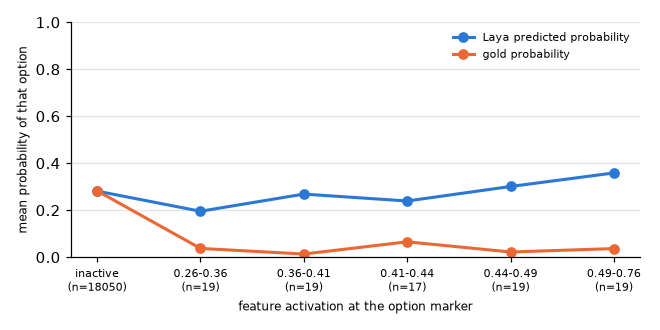

# Feature 4706

Critérios em que aparece: pred_error

**Interpretação (preencher):** 

---

## Maiores ativações

**tr_security_incidents_000288 / urgency** (score, security_incidents) | ativação 2.773 em `estado` | opções ['0', '1', '2', '3'] | Laya: **3** [0.108, 0.354, 0.167, 0.371] | gabarito: **1**

```
<bos> score question: How quickly must a responder act on this alert?<eos>
▸ <mask> level 0: No time pressure; can wait indefinitely.
▸ <mask> level 1: Routine; handle within the normal queue.
▸ <mask> level 2: Elevated; should be handled within the same week.
▸ <mask> level 3: Critical; requires action within the same day.

<eos>

 {"alert": {"description": "a first-ever sign-in from an unfamiliar country", "evidence": "At 2026-09-15 02:13:47 UTC a sign‑in originated from IP 203.0.113.45 (detected as Brazil), which is the first login for the⟦ ci⟧_runner_42 principal from that country. The account is unprivileged, has MFA enabled, and the credentials were last rotated on 2026-09-01; the sign‑in occurred while a change window was active and the source was not on the allowlist.", "rule": "new_country_login"}, "context": {"asset_criticality": "low", "change_window_active": true, "source_on_allowlist": false}, "history": {"credential_rotation_days_ago": 14, "distinct_countries_30d": 1, "logins_30d": 454, "prior_alerts_90d": 0}, "principal": {"mfa_enrolled": true, "name": "svc-billing-208", "privileges": ["repo:read"], "type": "ci_runner"}}<eos>
```

**tr_security_incidents_000288 / severity** (score, security_incidents) | ativação 2.770 em `estado` | opções ['0', '1', '2', '3', '4'] | Laya: **1** [0.1, 0.442, 0.248, 0.1, 0.11] | gabarito: **1**

```
<bos> score question: How severe is the potential impact if this alert is real?<eos>
▸ <mask> level 0: Negligible: no access to anything sensitive.
▸ <mask> level 1: Low: limited access, easily reversed.
▸ <mask> level 2: Moderate: access to internal systems or non-public data.
▸ <mask> level 3: High: access to production, secrets or customer data.
▸ <mask> level 4: Critical: active compromise of crown-jewel systems.

<eos>

 {"alert": {"description": "a first-ever sign-in from an unfamiliar country", "evidence": "At 2026-09-15 02:13:47 UTC a sign‑in originated from IP 203.0.113.45 (detected as Brazil), which is the first login for the⟦ ci⟧_runner_42 principal from that country. The account is unprivileged, has MFA enabled, and the credentials were last rotated on 2026-09-01; the sign‑in occurred while a change window was active and the source was not on the allowlist.", "rule": "new_country_login"}, "context": {"asset_criticality": "low", "change_window_active": true, "source_on_allowlist": false}, "history": {"credential_rotation_days_ago": 14, "distinct_countries_30d": 1, "logins_30d": 454, "prior_alerts_90d": 0}, "principal": {"mfa_enrolled": true, "name": "svc-billing-208", "privileges": ["repo:read"], "type": "ci_runner"}}<eos>
```

**tr_customer_service_000151 / urgency** (score, customer_service) | ativação 2.496 em `estado` | opções ['0', '1', '2', '3'] | Laya: **0** [0.724, 0.198, 0.048, 0.03] | gabarito: **2**

```
<bos> score question: How time-sensitive is this conversation?<eos>
▸ <mask> level 0: No time pressure; can wait indefinitely.
▸ <mask> level 1: Routine; handle within the normal queue.
▸ <mask> level 2: Elevated; should be handled within the same week.
▸ <mask> level 3: Critical; requires action within the same day.

<eos>

 {"account": {"lifetime_value_usd": 95, "prior_tickets_90d": 0, "seats": 1, "tenure_months": 3, "tier": "enterprise"}, "orders": [{"amount_usd": 299, "date": "2026-02-01", "id": "A-70416", "status": "failed"}, {"amount_usd": 299, "date": "2026-02-15", "id": "A-68913", "status": "pending"}], "thread": [{"role": "customer", "text": "Hello, I’m reaching out because the platform’s performance has been noticeably slow over the past week, and it’s affecting our workflow. We’re on the enterprise plan, paying $299 a month, and we need a stable experience."}, {"role": "agent", "text": "I’m sorry to hear about the slowdown. Could you tell me which features or pages are most affected, and any error messages you’ve encountered?"}, {"role": "customer", "text": "The dashboard and reporting modules take up to 45 seconds to load, and occasional time‑outs appear when we try to export data. I need a solution in place by next Friday, or we’ll have to look elsewhere."}, {"role": "agent", "text": "Thanks for the specifics. Do you have any recent logs or screenshots that show the⟦ time⟧‑outs? That would help us pinpoint the bottleneck."}, {"role": "customer", "text": "I’ve attached the latest logs from our server and a couple of screenshots of the timeout dialogs. Please let me know what’s causing this lag."}, {"role": "agent", "text": "I appreciate you sending those files. I’ll have our performance team examine them and see what’s triggering the delay. Meanwhile, is there any temporary workaround you’ve tried that offers a bit more speed?"}, {"role": "customer", "text": "We’ve tried clearing caches and using a different browser, but the issue persists. If this isn’t sorted out by next Friday, I’ll have to consider moving to a competitor."}]}<eos>
```

**tr_security_incidents_000059 / urgency** (score, security_incidents) | ativação 2.299 em `estado` | opções ['0', '1', '2', '3'] | Laya: **3** [0.106, 0.278, 0.136, 0.481] | gabarito: **3**

```
<bos> score question: How quickly must a responder act on this alert?<eos>
▸ <mask> level 0: No time pressure; can wait indefinitely.
▸ <mask> level 1: Routine; handle within the normal queue.
▸ <mask> level 2: Elevated; should be handled within the same week.
▸ <mask> level 3: Critical; requires action within the same day.

<eos>

 {"alert": {"description": "many failed authentications followed by a success", "evidence": "At 14:02 UTC on 2026-05-19, IIS worker process w3wp.exe on EXCH-02 recorded 63 failed OWA logons for shared mailbox accountsales@corp.example from 192.0.2.77, followed by one successful MFA logon at 14:05 UTC from the same address. The mailbox password was last changed 365 days ago, and no change window was active on⟦ EX⟧CH-02 during that period. The source IP was not in the known office, VPN, or partner address lists.", "rule": "brute_force"}, "context": {"asset_criticality": "medium", "change_window_active": false, "source_on_allowlist": false}, "history": {"credential_rotation_days_ago": 365, "distinct_countries_30d": 1, "logins_30d": 1177, "prior_alerts_90d": 1}, "principal": {"mfa_enrolled": true, "name": "svc-support-100", "privileges": ["repo:read"], "type": "shared_mailbox"}}<eos>
```

**tr_security_incidents_000059 / disposition** (choice, security_incidents) | ativação 2.291 em `estado` | opções ['close_benign', 'contain', 'investigate', 'monitor'] | Laya: **monitor** [0.043, 0.242, 0.024, 0.692] | gabarito: **investigate**

```
<bos> choice question: How should this security alert be dispositioned?<eos>
▸ <mask> close_benign: Expected, explainable activity; close without analyst time.
▸ <mask> contain: Contain the host or account immediately; do not wait for triage.
▸ <mask> investigate: Warrants an analyst opening an investigation.
▸ <mask> monitor: Not clearly malicious, but worth watching for recurrence.

<eos>

 {"alert": {"description": "many failed authentications followed by a success", "evidence": "At 14:02 UTC on 2026-05-19, IIS worker process w3wp.exe on EXCH-02 recorded 63 failed OWA logons for shared mailbox accountsales@corp.example from 192.0.2.77, followed by one successful MFA logon at 14:05 UTC from the same address. The mailbox password was last changed 365 days ago, and no change window was active on⟦ EX⟧CH-02 during that period. The source IP was not in the known office, VPN, or partner address lists.", "rule": "brute_force"}, "context": {"asset_criticality": "medium", "change_window_active": false, "source_on_allowlist": false}, "history": {"credential_rotation_days_ago": 365, "distinct_countries_30d": 1, "logins_30d": 1177, "prior_alerts_90d": 1}, "principal": {"mfa_enrolled": true, "name": "svc-support-100", "privileges": ["repo:read"], "type": "shared_mailbox"}}<eos>
```

## Ativações medianas (faixa 40-60%, mediana 0.467)

**tr_invoice_processing_000135 / matches_order** (noul, invoice_processing) | ativação 0.458 em `estado` | opções ['false', 'true'] | Laya: **true** [0.056, 0.944] | gabarito: **false**

```
<bos> noul question: The invoice reconciles with the purchase order and the recorded delivery.<eos>
▸ <mask> false: There is a discrepancy against the order or the delivery.
▸ <mask> true: Line items, quantities and amounts reconcile.

<eos>

 {"delivery": {"condition": "accepted with exceptions", "date": "2026-03-24", "received_qty": 10}, "invoice": {"currency": "USD", "id": "INV-2026-3267", "lines": [{"qty": 10, "sku": "SKU-451", "total_usd": 2383.7, "unit_usd": 238.37}], "total_usd": 2383.7, "vendor": "Vantage Materials"}, "payment": {"days_until_due": 5, "discount_expires_in_days": null, "early_payment_discount_pct": null, "status": "scheduled", "terms": "net 15"},⟦ "⟧purchase_order": {"freight_terms": "freight prepaid by vendor, not separately billable", "id": "PO-9358", "lines": [{"qty": 10, "unit_usd": 280.43}], "total_usd": 2804.3}, "vendor_history": {"disputes_12m": 1, "invoices_12m": 12, "prior_invoice_ids": ["INV-2026-5018"]}}<eos>
```

**tr_security_incidents_000274 / urgency** (score, security_incidents) | ativação 0.482 em `estado` | opções ['0', '1', '2', '3'] | Laya: **1** [0.101, 0.504, 0.134, 0.262] | gabarito: **3**

```
<bos> score question: How quickly must a responder act on this alert?<eos>
▸ <mask> level 0: No time pressure; can wait indefinitely.
▸ <mask> level 1: Routine; handle within the normal queue.
▸ <mask> level 2: Elevated; should be handled within the same week.
▸ <mask> level 3: Critical; requires action within the same day.

<eos>

 {"alert": {"description": "two successful logins from distant locations too close together", "evidence": "Successful logins were recorded for admin user 'jdoe' from IP 203.0.113.45 (New York, USA) at 2026-09-15 02:05:10 UTC and from IP 198.51.100.22 (Sydney, AU) at 2026-09-15 02:18:43 UTC, a 13‑minute interval. Both sessions used MFA and originated from an unrecognized source. The account’s credentials had not been refreshed for 180 days and no change window was defined.", "rule": "impossible_travel"}, "context": {"asset_criticality": "crown_jewel", "change_window_active": false, "source_on_allowlist": false}, "history": {"credential_rotation_days_ago": 180, "distinct_countries_30d": 1, "logins⟦_⟧30d": 1701, "prior_alerts_90d": 1}, "principal": {"mfa_enrolled": true, "name": "adm-support-968", "privileges": ["deploy:production", "secrets:read"], "type": "admin"}}<eos>
```

**tr_security_incidents_000236 / credential_compromise** (noul, security_incidents) | ativação 0.417 em `estado` | opções ['false', 'true'] | Laya: **true** [0.186, 0.814] | gabarito: **false**

```
<bos> noul question: The evidence indicates a credential or account has been compromised.<eos>
▸ <mask> false: no, the statement does not hold
▸ <mask> true: yes, the statement holds

<eos>

 {"alert": {"description": "a long-unused account became active", "evidence": "The privileged admin_01 account, which had shown no activity for 120 consecutive days, successfully authenticated from allowlisted IP 10.0.4.55 at 02:00 AM. This session was established with MFA enabled and used credentials rotated 30 days ago, though no change tickets were active at the time.", "rule": "dormant_account_use"}, "context": {"asset_criticality": "medium", "change_window_active": false, "source_on_allowlist": true}, "history": {"credential_rotation_days_ago": 30, "distinct_countries_30d": 3, "logins⟦_⟧30d": 15, "prior_alerts_90d": 0}, "principal": {"mfa_enrolled": true, "name": "ci-infra-266", "privileges": ["deploy:production", "secrets:read"], "type": "admin"}}<eos>
```

**tr_customer_service_000295 / action** (choice, customer_service) | ativação 0.451 em `marcador` | opções ['answer_directly', 'close_no_action', 'escalate_to_human', 'execute_refund', 'request_information'] | Laya: **answer_directly** [0.508, 0.136, 0.032, 0.292, 0.033] | gabarito: **escalate_to_human**

```
<bos> choice question: What should the assistant do next with this conversation?<eos>
▸ <mask> answer_directly: The assistant can resolve this itself with information it already has.
▸ ⟦<mask>⟧ close_no_action: No further action is warranted; the matter is settled.
▸ <mask> escalate_to_human: Hand off to a human agent with the appropriate authority.
▸ <mask> execute_refund: Issue the refund or credit the customer is owed.
▸ <mask> request_information: More detail is needed from the customer before anything can be done.

<eos>

 {"account": {"lifetime_value_usd": 4435, "prior_tickets_90d": 1, "seats": 3, "tenure_months": 49, "tier": "enterprise"}, "thread": [{"role": "customer", "text": "Our enterprise dashboard is crawling—pages take over a minute to load, and our team can’t meet the rollout deadline tomorrow. This needs to be fixed ASAP."}, {"role": "agent", "text": "I’m sorry you’re seeing that slowdown. Could you tell me which modules are affected and whether the latency started after the recent update you mentioned in ticket #98765?"}, {"role": "customer", "text": "It’s the analytics and reporting sections, and yes, the issue reappeared after the last patch. We need an immediate investigation; let me know what you can do before the deadline."}]}<eos>
```

**tr_invoice_processing_000062 / matches_order** (noul, invoice_processing) | ativação 0.501 em `estado` | opções ['false', 'true'] | Laya: **true** [0.035, 0.965] | gabarito: **false**

```
<bos> noul question: The invoice reconciles with the purchase order and the recorded delivery.<eos>
▸ <mask> false: There is a discrepancy against the order or the delivery.
▸ <mask> true: Line items, quantities and amounts reconcile.

<eos>

 {"delivery": {"condition": "accepted", "date": "2026-03-17", "received_qty": 400}, "invoice": {"currency": "USD", "id": "INV-2026-2744", "lines": [{"qty": 450, "sku": "SKU-350", "total_usd": 67711.5, "unit_usd": 150.47}], "total_usd": 67711.5, "vendor": "Vantage Materials"}, "payment": {"days_until_due": 2, "discount_expires_in_days": null, "early_payment_discount_pct": null, "status": "scheduled", "terms": "net 15"}, "purchase_order": {"freight_terms":⟦ "⟧freight prepaid by vendor, not separately billable", "id": "PO-3238", "lines": [{"qty": 400, "unit_usd": 150.47}], "total_usd": 60188.0}, "vendor_history": {"disputes_12m": 0, "invoices_12m": 45, "prior_invoice_ids": ["INV-2026-4175"]}}<eos>
```

## Estatísticas (conjunto de descoberta, dev e teste)

**pred / error**

| split | decisões | ativas | ativas e Laya errou | taxa | lift | q (BH) | OR (CMH) | q (CMH) |
|---|---|---|---|---|---|---|---|---|
| discovery | 5100 | 24 | 24 | 1.000 | 1.55 | 0.000181 | inf | 0.923 |
| dev | 900 | 7 | 7 | 1.000 | 1.49 | nan | nan | nan |
| test | 2000 | 9 | 9 | 1.000 | 1.54 | nan | nan | nan |

**corr / error**

| split | decisões | ativas | ativas e Laya errou | taxa | lift | q (BH) | OR (CMH) | q (CMH) |
|---|---|---|---|---|---|---|---|---|
| discovery | 5100 | 2 | 2 | 1.000 | 1.55 | nan | nan | nan |
| dev | 900 | 0 | 0 | nan | nan | nan | nan | nan |
| test | 2000 | 1 | 1 | 1.000 | 1.54 | nan | nan | nan |

**state / error**

| split | decisões | ativas | ativas e Laya errou | taxa | lift | q (BH) | OR (CMH) | q (CMH) |
|---|---|---|---|---|---|---|---|---|
| discovery | 5100 | 2310 | 1422 | 0.616 | 0.96 | 0.000996 | 0.72 | 0.00172 |
| dev | 900 | 405 | 267 | 0.659 | 0.98 | 0.838 | 0.64 | 0.199 |
| test | 2000 | 875 | 555 | 0.634 | 0.98 | 0.468 | 0.79 | 0.362 |

**pred / probe_right_laya_wrong**

| split | decisões | ativas | ativas e Laya errou | taxa | lift | q (BH) | OR (CMH) | q (CMH) |
|---|---|---|---|---|---|---|---|---|
| discovery | 2932 | 9 | 9 | 1.000 | 1.65 | nan | nan | nan |
| dev | 523 | 3 | 3 | 1.000 | 1.55 | nan | nan | nan |
| test | 1149 | 6 | 6 | 1.000 | 1.64 | nan | nan | nan |

**corr / probe_right_laya_wrong**

| split | decisões | ativas | ativas e Laya errou | taxa | lift | q (BH) | OR (CMH) | q (CMH) |
|---|---|---|---|---|---|---|---|---|
| discovery | 2932 | 2 | 2 | 1.000 | 1.65 | nan | nan | nan |
| dev | 523 | 0 | 0 | nan | nan | nan | nan | nan |
| test | 1149 | 0 | 0 | nan | nan | nan | nan | nan |

**state / probe_right_laya_wrong**

| split | decisões | ativas | ativas e Laya errou | taxa | lift | q (BH) | OR (CMH) | q (CMH) |
|---|---|---|---|---|---|---|---|---|
| discovery | 2932 | 1434 | 846 | 0.590 | 0.97 | 0.181 | 0.62 | 0.000464 |
| dev | 523 | 270 | 178 | 0.659 | 1.02 | 0.849 | 0.62 | 0.237 |
| test | 1149 | 563 | 338 | 0.600 | 0.98 | 0.75 | 0.64 | 0.0909 |

Confusão mais sobre-representada (pred): `action|1>2` (n=12, lift 35.92, p=4.77e-17). Formato `pergunta|índice previsto>índice correto`.

Confusão mais sobre-representada (corr): `action|0>2` (n=2, lift 82.26, p=nan). Formato `pergunta|índice previsto>índice correto`.

Confusão mais sobre-representada (state): `duplicate|1>0` (n=190, lift 1.93, p=2.73e-40). Formato `pergunta|índice previsto>índice correto`.



