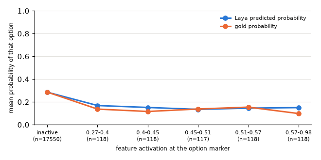

# Feature 4805

Critérios em que aparece: pred_error, pred_error_stratified, corr_error_stratified, pred_probe_right_laya_wrong, pred_probe_right_laya_wrong_stratified

**Interpretação (preencher):** 

---

## Maiores ativações

**tr_security_incidents_000073 / urgency** (score, security_incidents) | ativação 2.779 em `estado` | opções ['0', '1', '2', '3'] | Laya: **1** [0.102, 0.362, 0.212, 0.324] | gabarito: **1**

```
<bos> score question: How quickly must a responder act on this alert?<eos>
▸ <mask> level 0: No time pressure; can wait indefinitely.
▸ <mask> level 1: Routine; handle within the normal queue.
▸ <mask> level 2: Elevated; should be handled within the same week.
▸ <mask> level 3: Critical; requires action within the same day.

<eos>

 {"alert": {"description": "an endpoint agent matched a known signature", "evidence": "An endpoint agent on `ci-executor-04` identified a file matching signature `WORM_RS_A` during a scheduled change window.⟦ The⟧ associated unprivileged `ci_runner` principal accessed the system from the allowlisted source 10.50.2.1 using credentials rotated 3 days ago.", "rule": "malware_signature"}, "context": {"asset_criticality": "low", "change_window_active": true, "source_on_allowlist": true}, "history": {"credential_rotation_days_ago": 3, "distinct_countries_30d": 4, "logins_30d": 731, "prior_alerts_90d": 0}, "principal": {"mfa_enrolled": true, "name": "adm-billing-719", "privileges": ["repo:read"], "type": "ci_runner"}}<eos>
```

**tr_customer_service_000153 / category** (choice, customer_service) | ativação 2.768 em `estado` | opções ['account', 'billing', 'delivery', 'refund', 'technical'] | Laya: **account** [0.995, 0.001, 0.0, 0.002, 0.001] | gabarito: **account**

```
<bos> choice question: What is this customer conversation primarily about?<eos>
▸ <mask> account: Login, plan changes, profile or access management.
▸ <mask> billing: A charge, invoice, subscription or payment problem.
▸ <mask> delivery: Shipping, fulfilment or delivery of a physical item.
▸ <mask> refund: The customer is explicitly asking for money back.
▸ <mask> technical: The product or service is not working as expected.

<eos>

 {"account": {"lifetime_value_usd": 232, "prior_tickets_90d": 3, "seats": 1, "tenure_months": 8, "tier": "standard"}, "thread": [{"role": "customer", "text": "We've added three new team members and need to assign them seats in the admin portal.⟦ The⟧ current seat count shows six, but we should have nine."}, {"role": "agent", "text": "I see, thanks for the details. Could you confirm the email addresses of the new users?"}, {"role": "customer", "text": "Sure, they're alice@example.com, bob@example.com, and carol@example.com."}]}<eos>
```

**tr_customer_service_000153 / churn_risk** (score, customer_service) | ativação 2.717 em `estado` | opções ['0', '1', '2', '3'] | Laya: **1** [0.1, 0.721, 0.125, 0.053] | gabarito: **0**

```
<bos> score question: How likely is this customer to stop doing business with us because of this interaction?<eos>
▸ <mask> level 0: No sign of dissatisfaction.
▸ <mask> level 1: Mild frustration, but the relationship is intact.
▸ <mask> level 2: Clearly unhappy; repeat problems or explicit complaints.
▸ <mask> level 3: Imminent: threatening to cancel, dispute or leave.

<eos>

 {"account": {"lifetime_value_usd": 232, "prior_tickets_90d": 3, "seats": 1, "tenure_months": 8, "tier": "standard"}, "thread": [{"role": "customer", "text": "We've added three new team members and need to assign them seats in the admin portal.⟦ The⟧ current seat count shows six, but we should have nine."}, {"role": "agent", "text": "I see, thanks for the details. Could you confirm the email addresses of the new users?"}, {"role": "customer", "text": "Sure, they're alice@example.com, bob@example.com, and carol@example.com."}]}<eos>
```

**tr_customer_service_000153 / urgency** (score, customer_service) | ativação 2.658 em `estado` | opções ['0', '1', '2', '3'] | Laya: **1** [0.169, 0.512, 0.224, 0.094] | gabarito: **1**

```
<bos> score question: How time-sensitive is this conversation?<eos>
▸ <mask> level 0: No time pressure; can wait indefinitely.
▸ <mask> level 1: Routine; handle within the normal queue.
▸ <mask> level 2: Elevated; should be handled within the same week.
▸ <mask> level 3: Critical; requires action within the same day.

<eos>

 {"account": {"lifetime_value_usd": 232, "prior_tickets_90d": 3, "seats": 1, "tenure_months": 8, "tier": "standard"}, "thread": [{"role": "customer", "text": "We've added three new team members and need to assign them seats in the admin portal.⟦ The⟧ current seat count shows six, but we should have nine."}, {"role": "agent", "text": "I see, thanks for the details. Could you confirm the email addresses of the new users?"}, {"role": "customer", "text": "Sure, they're alice@example.com, bob@example.com, and carol@example.com."}]}<eos>
```

**tr_security_incidents_000073 / true_positive** (noul, security_incidents) | ativação 2.648 em `estado` | opções ['false', 'true'] | Laya: **true** [0.292, 0.708] | gabarito: **false**

```
<bos> noul question: This alert reflects genuinely malicious or unauthorised activity.<eos>
▸ <mask> false: Benign activity, a misconfiguration, or a known false positive.
▸ <mask> true: The underlying behaviour is malicious or unauthorised.

<eos>

 {"alert": {"description": "an endpoint agent matched a known signature", "evidence": "An endpoint agent on `ci-executor-04` identified a file matching signature `WORM_RS_A` during a scheduled change window.⟦ The⟧ associated unprivileged `ci_runner` principal accessed the system from the allowlisted source 10.50.2.1 using credentials rotated 3 days ago.", "rule": "malware_signature"}, "context": {"asset_criticality": "low", "change_window_active": true, "source_on_allowlist": true}, "history": {"credential_rotation_days_ago": 3, "distinct_countries_30d": 4, "logins_30d": 731, "prior_alerts_90d": 0}, "principal": {"mfa_enrolled": true, "name": "adm-billing-719", "privileges": ["repo:read"], "type": "ci_runner"}}<eos>
```

## Ativações medianas (faixa 40-60%, mediana 0.588)

**tr_security_incidents_000024 / true_positive** (noul, security_incidents) | ativação 0.691 em `estado` | opções ['false', 'true'] | Laya: **true** [0.033, 0.967] | gabarito: **true**

```
<bos> noul question: This alert reflects genuinely malicious or unauthorised activity.<eos>
▸ <mask> false: Benign activity, a misconfiguration, or a known false positive.
▸ <mask> true: The underlying behaviour is malicious or unauthorised.

<eos>

 {"alert": {"description": "a session token was presented from a second address", "evidence": "A session token for the shared mailbox account was presented from an unrecognized IP address. The previous authentication occurred from a different location, and⟦ the⟧ account credentials have not been updated in 412 days.", "rule": "token_reuse"}, "context": {"asset_criticality": "high", "change_window_active": false, "source_on_allowlist": false}, "history": {"credential_rotation_days_ago": 412, "distinct_countries_30d": 4, "logins_30d": 818, "prior_alerts_90d": 1}, "principal": {"mfa_enrolled": true, "name": "adm-billing-412", "privileges": ["repo:read"], "type": "shared_mailbox"}}<eos>
```

**tr_security_incidents_000270 / credential_compromise** (noul, security_incidents) | ativação 0.491 em `opção` | opções ['false', 'true'] | Laya: **true** [0.009, 0.991] | gabarito: **true**

```
<bos> noul question: The evidence indicates a credential or account has been compromised.<eos>
▸ <mask> false: no, the⟦ statement⟧ does not hold
▸ <mask> true: yes, the statement holds

<eos>

 {"alert": {"description": "an endpoint agent matched a known signature", "evidence": "On 2026-09-15 at 14:32:07 UTC, the endpoint sensor on host WIN-34A9F reported the execution of C:\\Temp\\malicious.exe, whose hash (SHA‑256: a1b2c3d4…) matched a known malware signature. The event was generated by a contractor account with MFA enabled, and the credential for that account was last rotated 180 days prior.", "rule": "malware_signature"}, "context": {"asset_criticality": "crown_jewel", "change_window_active": false, "source_on_allowlist": false}, "history": {"credential_rotation_days_ago": 180, "distinct_countries_30d": 3, "logins_30d": 924, "prior_alerts_90d": 0}, "principal": {"mfa_enrolled": true, "name": "usr-infra-611", "privileges": ["repo:read"], "type": "contractor"}}<eos>
```

**tr_security_incidents_000129 / credential_compromise** (noul, security_incidents) | ativação 0.502 em `opção` | opções ['false', 'true'] | Laya: **true** [0.011, 0.989] | gabarito: **true**

```
<bos> noul question: The evidence indicates a credential or account has been compromised.<eos>
▸ <mask> false: no, the⟦ statement⟧ does not hold
▸ <mask> true: yes, the statement holds

<eos>

 {"alert": {"description": "a session token was presented from a second address", "evidence": "The session token associated with shared_mailbox was presented from an unrecognized IP address after having been used by a different source. This activity occurred outside of any scheduled change window, with the account credentials last rotated 180 days ago.", "rule": "token_reuse"}, "context": {"asset_criticality": "crown_jewel", "change_window_active": false, "source_on_allowlist": false}, "history": {"credential_rotation_days_ago": 180, "distinct_countries_30d": 3, "logins_30d": 1273, "prior_alerts_90d": 0}, "principal": {"mfa_enrolled": true, "name": "usr-deploy-897", "privileges": ["repo:read"], "type": "shared_mailbox"}}<eos>
```

**tr_security_incidents_000043 / credential_compromise** (noul, security_incidents) | ativação 0.588 em `pergunta` | opções ['false', 'true'] | Laya: **true** [0.176, 0.824] | gabarito: **true**

```
<bos> noul question:⟦ The⟧ evidence indicates a credential or account has been compromised.<eos>
▸ <mask> false: no, the statement does not hold
▸ <mask> true: yes, the statement holds

<eos>

 {"alert": {"description": "a session token was presented from a second address", "evidence": "At 10:03:21 UTC on 2026‑09‑16, a session token labeled \"jwt‑7f9b2c\" was presented from client IP 203.0.113.45 for an admin user with MFA enabled; the identical token was observed again from a different client IP 198.51.100.77 at 10:04:05 UTC. The second IP address is not present in the organization’s recognized source list, and the underlying credentials were last rotated on 2026‑09‑13 (3 days ago).", "rule": "token_reuse"}, "context": {"asset_criticality": "low", "change_window_active": false, "source_on_allowlist": false}, "history": {"credential_rotation_days_ago": 3, "distinct_countries_30d": 1, "logins_30d": 405, "prior_alerts_90d": 0}, "principal": {"mfa_enrolled": true, "name": "ci-billing-564", "privileges": ["deploy:production", "secrets:read"], "type": "admin"}}<eos>
```

**tr_security_incidents_000097 / credential_compromise** (noul, security_incidents) | ativação 0.490 em `opção` | opções ['false', 'true'] | Laya: **true** [0.006, 0.994] | gabarito: **true**

```
<bos> noul question: The evidence indicates a credential or account has been compromised.<eos>
▸ <mask> false: no, the⟦ statement⟧ does not hold
▸ <mask> true: yes, the statement holds

<eos>

 {"alert": {"description": "an endpoint agent matched a known signature", "evidence": "On 2026-09-16 09:45 UTC the endpoint agent on host WIN-01 flagged C:\\Windows\\Temp\\malicious.dll as matching MalwareSignatureID 0x7A9C. The file was executed by powershell.exe (PID 1122) under the service account svc_backup, whose password was changed three days ago, and the source of the execution could not be correlated to a known device.", "rule": "malware_signature"}, "context": {"asset_criticality": "high", "change_window_active": false, "source_on_allowlist": false}, "history": {"credential_rotation_days_ago": 3, "distinct_countries_30d": 3, "logins_30d": 1772, "prior_alerts_90d": 3}, "principal": {"mfa_enrolled": false, "name": "svc-support-209", "privileges": ["repo:read"], "type": "service_account"}}<eos>
```

## Estatísticas (conjunto de descoberta, dev e teste)

**pred / error**

| split | decisões | ativas | ativas e Laya errou | taxa | lift | q (BH) | OR (CMH) | q (CMH) |
|---|---|---|---|---|---|---|---|---|
| discovery | 5100 | 62 | 60 | 0.968 | 1.50 | 1.18e-08 | 8.51 | 0.0236 |
| dev | 900 | 15 | 15 | 1.000 | 1.49 | nan | nan | nan |
| test | 2000 | 22 | 22 | 1.000 | 1.54 | 0.000662 | inf | 0.496 |

**corr / error**

| split | decisões | ativas | ativas e Laya errou | taxa | lift | q (BH) | OR (CMH) | q (CMH) |
|---|---|---|---|---|---|---|---|---|
| discovery | 5100 | 76 | 74 | 0.974 | 1.51 | 1.61e-11 | 19.08 | 1.44e-10 |
| dev | 900 | 14 | 14 | 1.000 | 1.49 | nan | nan | nan |
| test | 2000 | 13 | 13 | 1.000 | 1.54 | nan | nan | nan |

**state / error**

| split | decisões | ativas | ativas e Laya errou | taxa | lift | q (BH) | OR (CMH) | q (CMH) |
|---|---|---|---|---|---|---|---|---|
| discovery | 5100 | 1556 | 947 | 0.609 | 0.95 | 0.00324 | 1.02 | 0.931 |
| dev | 900 | 292 | 179 | 0.613 | 0.91 | 0.183 | 0.81 | 0.614 |
| test | 2000 | 635 | 386 | 0.608 | 0.93 | 0.0787 | 0.88 | 0.663 |

**pred / probe_right_laya_wrong**

| split | decisões | ativas | ativas e Laya errou | taxa | lift | q (BH) | OR (CMH) | q (CMH) |
|---|---|---|---|---|---|---|---|---|
| discovery | 2932 | 30 | 30 | 1.000 | 1.65 | 2.04e-06 | inf | 2.33e-05 |
| dev | 523 | 10 | 10 | 1.000 | 1.55 | nan | nan | nan |
| test | 1149 | 14 | 14 | 1.000 | 1.64 | nan | nan | nan |

**corr / probe_right_laya_wrong**

| split | decisões | ativas | ativas e Laya errou | taxa | lift | q (BH) | OR (CMH) | q (CMH) |
|---|---|---|---|---|---|---|---|---|
| discovery | 2932 | 26 | 26 | 1.000 | 1.65 | 8.68e-06 | 1.16 | 0.582 |
| dev | 523 | 4 | 4 | 1.000 | 1.55 | nan | nan | nan |
| test | 1149 | 6 | 6 | 1.000 | 1.64 | nan | nan | nan |

**state / probe_right_laya_wrong**

| split | decisões | ativas | ativas e Laya errou | taxa | lift | q (BH) | OR (CMH) | q (CMH) |
|---|---|---|---|---|---|---|---|---|
| discovery | 2932 | 926 | 514 | 0.555 | 0.92 | 0.000876 | 1.01 | 0.965 |
| dev | 523 | 185 | 111 | 0.600 | 0.93 | 0.383 | 0.91 | 0.877 |
| test | 1149 | 392 | 231 | 0.589 | 0.96 | 0.56 | 1.19 | 0.569 |

Confusão mais sobre-representada (pred): `action|1>2` (n=19, lift 22.01, p=1.1e-21). Formato `pergunta|índice previsto>índice correto`.

Confusão mais sobre-representada (corr): `action|0>2` (n=23, lift 24.89, p=9.93e-28). Formato `pergunta|índice previsto>índice correto`.

Confusão mais sobre-representada (state): `disposition|3>2` (n=87, lift 1.70, p=4.09e-09). Formato `pergunta|índice previsto>índice correto`.



