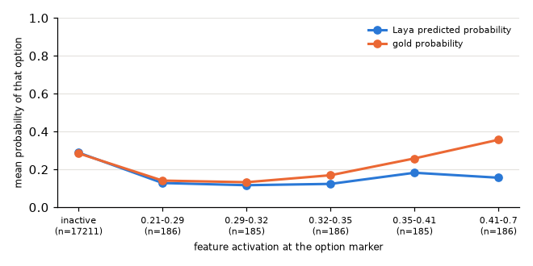

# Feature 4851

Critérios em que aparece: corr_error_stratified, corr_probe_right_laya_wrong_stratified

**Interpretação (preencher):** 

---

## Maiores ativações

**tr_security_incidents_000027 / severity** (score, security_incidents) | ativação 4.863 em `estado` | opções ['0', '1', '2', '3', '4'] | Laya: **1** [0.092, 0.362, 0.296, 0.094, 0.156] | gabarito: **3**

```
<bos> score question: How severe is the potential impact if this alert is real?<eos>
▸ <mask> level 0: Negligible: no access to anything sensitive.
▸ <mask> level 1: Low: limited access, easily reversed.
▸ <mask> level 2: Moderate: access to internal systems or non-public data.
▸ <mask> level 3: High: access to production, secrets or customer data.
▸ <mask> level 4: Critical: active compromise of crown-jewel systems.

<eos>

 {"alert": {"description": "a long-unused account became active", "evidence": "At 20⟦2⟧6-09-15 03:42 UTC, the CI runner account \"ci-runner-112\" (privileged, MFA disabled) logged in successfully from IP 203.0.113.45 after having no activity since 2024-02-01. The source host is on the allowlist, the credentials were last rotated 700 days ago, and the event occurred outside any defined change window.", "rule": "dormant_account_use"}, "context": {"asset_criticality": "high", "change_window_active": false, "source_on_allowlist": true}, "history": {"credential_rotation_days_ago": 700, "distinct_countries_30d": 4, "logins_30d": 587, "prior_alerts_90d": 3}, "principal": {"mfa_enrolled": false, "name": "ci-billing-618", "privileges": ["deploy:production", "secrets:read"], "type": "ci_runner"}}<eos>
```

**tr_security_incidents_000027 / urgency** (score, security_incidents) | ativação 4.668 em `estado` | opções ['0', '1', '2', '3'] | Laya: **3** [0.085, 0.346, 0.102, 0.466] | gabarito: **3**

```
<bos> score question: How quickly must a responder act on this alert?<eos>
▸ <mask> level 0: No time pressure; can wait indefinitely.
▸ <mask> level 1: Routine; handle within the normal queue.
▸ <mask> level 2: Elevated; should be handled within the same week.
▸ <mask> level 3: Critical; requires action within the same day.

<eos>

 {"alert": {"description": "a long-unused account became active", "evidence": "At 20⟦2⟧6-09-15 03:42 UTC, the CI runner account \"ci-runner-112\" (privileged, MFA disabled) logged in successfully from IP 203.0.113.45 after having no activity since 2024-02-01. The source host is on the allowlist, the credentials were last rotated 700 days ago, and the event occurred outside any defined change window.", "rule": "dormant_account_use"}, "context": {"asset_criticality": "high", "change_window_active": false, "source_on_allowlist": true}, "history": {"credential_rotation_days_ago": 700, "distinct_countries_30d": 4, "logins_30d": 587, "prior_alerts_90d": 3}, "principal": {"mfa_enrolled": false, "name": "ci-billing-618", "privileges": ["deploy:production", "secrets:read"], "type": "ci_runner"}}<eos>
```

**tr_security_incidents_000166 / urgency** (score, security_incidents) | ativação 4.453 em `estado` | opções ['0', '1', '2', '3'] | Laya: **1** [0.058, 0.513, 0.082, 0.347] | gabarito: **1**

```
<bos> score question: How quickly must a responder act on this alert?<eos>
▸ <mask> level 0: No time pressure; can wait indefinitely.
▸ <mask> level 1: Routine; handle within the normal queue.
▸ <mask> level 2: Elevated; should be handled within the same week.
▸ <mask> level 3: Critical; requires action within the same day.

<eos>

 {"alert": {"description": "a long-unused account became active", "evidence": "On 20⟦2⟧6-09-14 18:47 UTC the privileged CI runner service account svc-ci-runner-01 performed a git fetch on gitlab.internal, marking the first activity for this account since its creation on 2025-02-01. The operation came from the allow‑listed address 10.2.5.12. The account is MFA‑protected and its credentials have not been changed for 412 days.", "rule": "dormant_account_use"}, "context": {"asset_criticality": "medium", "change_window_active": false, "source_on_allowlist": true}, "history": {"credential_rotation_days_ago": 412, "distinct_countries_30d": 2, "logins_30d": 751, "prior_alerts_90d": 0}, "principal": {"mfa_enrolled": true, "name": "svc-deploy-785", "privileges": ["deploy:production", "secrets:read"], "type": "ci_runner"}}<eos>
```

**tr_customer_service_000123 / action** (choice, customer_service) | ativação 4.426 em `estado` | opções ['answer_directly', 'close_no_action', 'escalate_to_human', 'execute_refund', 'request_information'] | Laya: **answer_directly** [0.718, 0.173, 0.058, 0.019, 0.032] | gabarito: **escalate_to_human**

```
<bos> choice question: What should the assistant do next with this conversation?<eos>
▸ <mask> answer_directly: The assistant can resolve this itself with information it already has.
▸ <mask> close_no_action: No further action is warranted; the matter is settled.
▸ <mask> escalate_to_human: Hand off to a human agent with the appropriate authority.
▸ <mask> execute_refund: Issue the refund or credit the customer is owed.
▸ <mask> request_information: More detail is needed from the customer before anything can be done.

<eos>

 {"account": {"lifetime_value_usd": 154, "prior_tickets_90d": 1, "seats": 5, "tenure_months": 2, "tier": "premium"}, "thread": [{"role": "customer", "text": "Hello there. I'm having a bit of a problem logging into my Premium account this morning. It keeps telling me my credentials aren't recognized, even though I haven't changed them."}, {"role": "agent", "text": "I'd be happy to help you with that. Are you seeing a specific error code, or is it just the standard 'invalid password' notification?"}, {"role": "customer", "text": "It says 'User not found.' I had a ticket open last week about account syncing and the agent promised it would be fixed by now, but it seems I'm still locked out."}, {"role": "agent", "text": "I see. Since you mentioned the previous ticket, did you receive a confirmation email or a link to verify your identity after that interaction?"}, {"role": "customer", "text": "No, I never received any follow-up email at all, which is why I'm reaching out again. I've only been using the service for two months and I really like it, but I can't use what I can't access."}, {"role": "agent", "text": "I appreciate your patience while we work through this. Could you please confirm the primary email address associated with your account so I can check the status of your profile?"}, {"role": "customer", "text": "Of course, it's j.smith@example.com. I have a hard deadline for a project presentation at 1:00 PM today that requires the data in that account, so if you could check on that⟦ for⟧ me, I'd appreciate it."}]}<eos>
```

**tr_customer_service_000123 / category** (choice, customer_service) | ativação 4.391 em `estado` | opções ['account', 'billing', 'delivery', 'refund', 'technical'] | Laya: **account** [0.994, 0.0, 0.0, 0.0, 0.005] | gabarito: **account**

```
<bos> choice question: What is this customer conversation primarily about?<eos>
▸ <mask> account: Login, plan changes, profile or access management.
▸ <mask> billing: A charge, invoice, subscription or payment problem.
▸ <mask> delivery: Shipping, fulfilment or delivery of a physical item.
▸ <mask> refund: The customer is explicitly asking for money back.
▸ <mask> technical: The product or service is not working as expected.

<eos>

 {"account": {"lifetime_value_usd": 154, "prior_tickets_90d": 1, "seats": 5, "tenure_months": 2, "tier": "premium"}, "thread": [{"role": "customer", "text": "Hello there. I'm having a bit of a problem logging into my Premium account this morning. It keeps telling me my credentials aren't recognized, even though I haven't changed them."}, {"role": "agent", "text": "I'd be happy to help you with that. Are you seeing a specific error code, or is it just the standard 'invalid password' notification?"}, {"role": "customer", "text": "It says 'User not found.' I had a ticket open last week about account syncing and the agent promised it would be fixed by now, but it seems I'm still locked out."}, {"role": "agent", "text": "I see. Since you mentioned the previous ticket, did you receive a confirmation email or a link to verify your identity after that interaction?"}, {"role": "customer", "text": "No, I never received any follow-up email at all, which is why I'm reaching out again. I've only been using the service for two months and I really like it, but I can't use what I can't access."}, {"role": "agent", "text": "I appreciate your patience while we work through this. Could you please confirm the primary email address associated with your account so I can check the status of your profile?"}, {"role": "customer", "text": "Of course, it's j.smith@example.com. I have a hard deadline for a project presentation at 1:00 PM today that requires the data in that account, so if you could check on that⟦ for⟧ me, I'd appreciate it."}]}<eos>
```

## Ativações medianas (faixa 40-60%, mediana 0.777)

**tr_security_incidents_000279 / urgency** (score, security_incidents) | ativação 0.846 em `estado` | opções ['0', '1', '2', '3'] | Laya: **3** [0.048, 0.198, 0.189, 0.564] | gabarito: **2**

```
<bos> score question: How quickly must a responder act on this alert?<eos>
▸ <mask> level 0: No time pressure; can wait indefinitely.
▸ <mask> level 1: Routine; handle within the normal queue.
▸ <mask> level 2: Elevated; should be handled within the same week.
▸ <mask> level 3: Critical; requires action within the same day.

<eos>

 {"alert": {"description": "a security group was opened to the public internet", "evidence": "At 2026-09-15 14:23 UTC an inbound rule allowing 0.0.0.0/0 on TCP port 22 was added to security group SG-7F9C3A by employee@example.com from source IP 203.0.113.45. The change occurred while the designated change window was open and the employee's credentials were last rotated 700 days prior.", "rule": "config_drift"}, "context": {"asset_criticality": "low", "change_window_active": true, "source_on_allowlist": false}, "history": {"credential_rotation_days_ago": 700, "distinct_countries_30d": 1, "logins_30d": 712, "prior_alerts_90d": 1}, "principal": {"mfa_enrolled": true, "name": "adm-support-918", "privileges": ["repo:⟦read⟧"], "type": "employee"}}<eos>
```

**tr_agent_trace_observability_000251 / urgency** (score, agent_trace_observability) | ativação 0.821 em `opção` | opções ['0', '1', '2', '3'] | Laya: **3** [0.195, 0.271, 0.148, 0.386] | gabarito: **1**

```
<bos> score question: How quickly does this trace need attention?<eos>
▸ <mask> level 0: No time pressure; can wait indefinitely.
▸ <mask> level 1: Routine;⟦ handle⟧ within the normal queue.
▸ <mask> level 2: Elevated; should be handled within the same week.
▸ <mask> level 3: Critical; requires action within the same day.

<eos>

 {"agent": {"autonomy": "dry_run", "model": "internal-agent-v4"}, "constraints": ["Do not exceed a $50 spend on cloud resources", "Never modify production without an approved change ticket"], "task": "Backfill missing analytics events for the last seven days.", "trace_summary": {"constraint_violations": 0, "duration_s": 602.1, "irreversible_actions": 1, "steps": 5, "tool_errors": 3}}<eos>
```

**tr_customer_service_000212 / category** (choice, customer_service) | ativação 0.788 em `opção` | opções ['account', 'billing', 'delivery', 'refund', 'technical'] | Laya: **account** [0.631, 0.146, 0.005, 0.01, 0.209] | gabarito: **account**

```
<bos> choice question: What is this customer conversation primarily about?<eos>
▸ <mask> account: Login, plan changes, profile or access management.
▸ <mask> billing: A charge, invoice, subscription or payment problem.
▸ <mask> delivery:⟦ Shipping⟧, fulfilment or delivery of a physical item.
▸ <mask> refund: The customer is explicitly asking for money back.
▸ <mask> technical: The product or service is not working as expected.

<eos>

 {"account": {"lifetime_value_usd": 553, "prior_tickets_90d": 1, "seats": 5, "tenure_months": 19, "tier": "enterprise"}, "thread": [{"role": "customer", "text": "I've had enough—please cancel my enterprise account immediately. I've been with you for 19 months and the same issue keeps popping up. Stop any further charges."}]}<eos>
```

**tr_invoice_processing_000208 / discrepancy_severity** (score, invoice_processing) | ativação 0.808 em `estado` | opções ['0', '1', '2', '3'] | Laya: **2** [0.068, 0.253, 0.624, 0.056] | gabarito: **0**

```
<bos> score question: How material is any discrepancy between the invoice, the order and the delivery?<eos>
▸ <mask> level 0: None: everything reconciles.
▸ <mask> level 1: Trivial: rounding or a cosmetic difference.
▸ <mask> level 2: Moderate: a real difference worth confirming.
▸ <mask> level 3: Material: a large or unexplained difference.

<eos>

 {"delivery": {"condition": "accepted", "date": "2026-03-19", "received_qty": 10}, "invoice": {"currency": "USD", "id": "INV-2026-6082", "lines": [{"qty": 10, "sku": "SKU-170", "total_usd": 1515.9, "unit_usd": 151.59}], "total_usd": 1515.9, "vendor": "Orbit Logistics"}, "payment": {"days_until_due": -9, "discount_expires_in_days": null, "early_payment_discount_pct": null, "status": "overdue", "terms": "net 45"}, "purchase_⟦order⟧": {"freight_terms": "freight prepaid by vendor, not separately billable", "id": "PO-4990", "lines": [{"qty": 10, "unit_usd": 151.59}], "total_usd": 1515.9}, "vendor_history": {"disputes_12m": 0, "invoices_12m": 22, "prior_invoice_ids": ["INV-2026-4660"]}}<eos>
```

**tr_security_incidents_000116 / urgency** (score, security_incidents) | ativação 0.819 em `estado` | opções ['0', '1', '2', '3'] | Laya: **1** [0.108, 0.433, 0.258, 0.201] | gabarito: **3**

```
<bos> score question: How quickly must a responder act on this alert?<eos>
▸ <mask> level 0: No time pressure; can wait indefinitely.
▸ <mask> level 1: Routine; handle within the normal queue.
▸ <mask> level 2: Elevated; should be handled within the same week.
▸ <mask> level 3: Critical; requires action within the same day.

<eos>

 {"alert": {"description": "a large transfer to an external destination", "evidence": "Between 2026-09-16 04:55:12 UTC and 04:57:03 UTC an admin account transferred 4.2 GB of data to external endpoint 185.53.177.22 over HTTPS (port 443) using the rsync⟦ process⟧. The transfer occurred while a change window was open, the source host is unrecognised, and the admin’s credentials have not been rotated for 700 days.", "rule": "data_egress"}, "context": {"asset_criticality": "high", "change_window_active": true, "source_on_allowlist": false}, "history": {"credential_rotation_days_ago": 700, "distinct_countries_30d": 3, "logins_30d": 690, "prior_alerts_90d": 8}, "principal": {"mfa_enrolled": true, "name": "ci-infra-262", "privileges": ["repo:read"], "type": "admin"}}<eos>
```

## Estatísticas (conjunto de descoberta, dev e teste)

**pred / error**

| split | decisões | ativas | ativas e Laya errou | taxa | lift | q (BH) | OR (CMH) | q (CMH) |
|---|---|---|---|---|---|---|---|---|
| discovery | 5100 | 53 | 31 | 0.585 | 0.91 | 0.568 | 1.18 | 0.791 |
| dev | 900 | 14 | 10 | 0.714 | 1.06 | nan | nan | nan |
| test | 2000 | 24 | 12 | 0.500 | 0.77 | 0.264 | 0.62 | 0.763 |

**corr / error**

| split | decisões | ativas | ativas e Laya errou | taxa | lift | q (BH) | OR (CMH) | q (CMH) |
|---|---|---|---|---|---|---|---|---|
| discovery | 5100 | 161 | 139 | 0.863 | 1.34 | 1.37e-09 | 10.25 | 7.42e-10 |
| dev | 900 | 29 | 25 | 0.862 | 1.28 | 0.0607 | 4.77 | 0.335 |
| test | 2000 | 77 | 65 | 0.844 | 1.30 | 0.000429 | 2.29 | 0.117 |

**state / error**

| split | decisões | ativas | ativas e Laya errou | taxa | lift | q (BH) | OR (CMH) | q (CMH) |
|---|---|---|---|---|---|---|---|---|
| discovery | 5100 | 4766 | 3070 | 0.644 | 1.00 | 0.939 | 0.84 | 0.53 |
| dev | 900 | 859 | 580 | 0.675 | 1.00 | 0.82 | 1.14 | 0.915 |
| test | 2000 | 1875 | 1218 | 0.650 | 1.00 | 0.979 | 0.87 | 0.822 |

**pred / probe_right_laya_wrong**

| split | decisões | ativas | ativas e Laya errou | taxa | lift | q (BH) | OR (CMH) | q (CMH) |
|---|---|---|---|---|---|---|---|---|
| discovery | 2932 | 31 | 16 | 0.516 | 0.85 | 0.468 | 0.93 | 0.924 |
| dev | 523 | 6 | 2 | 0.333 | 0.52 | nan | nan | nan |
| test | 1149 | 14 | 7 | 0.500 | 0.82 | nan | nan | nan |

**corr / probe_right_laya_wrong**

| split | decisões | ativas | ativas e Laya errou | taxa | lift | q (BH) | OR (CMH) | q (CMH) |
|---|---|---|---|---|---|---|---|---|
| discovery | 2932 | 72 | 57 | 0.792 | 1.31 | 0.00172 | 8.38 | 8.1e-05 |
| dev | 523 | 14 | 10 | 0.714 | 1.11 | nan | nan | nan |
| test | 1149 | 30 | 23 | 0.767 | 1.25 | 0.144 | 1.83 | 0.601 |

**state / probe_right_laya_wrong**

| split | decisões | ativas | ativas e Laya errou | taxa | lift | q (BH) | OR (CMH) | q (CMH) |
|---|---|---|---|---|---|---|---|---|
| discovery | 2932 | 2743 | 1674 | 0.610 | 1.01 | 0.0981 | 0.94 | 0.876 |
| dev | 523 | 505 | 332 | 0.657 | 1.02 | 0.101 | 1.87 | 0.668 |
| test | 1149 | 1078 | 659 | 0.611 | 1.00 | 1 | 0.83 | 0.773 |

Confusão mais sobre-representada (pred): `credential_compromise|0>1` (n=7, lift 30.62, p=1.32e-09). Formato `pergunta|índice previsto>índice correto`.

Confusão mais sobre-representada (corr): `urgency|3>0` (n=26, lift 20.59, p=1.95e-30). Formato `pergunta|índice previsto>índice correto`.

Confusão mais sobre-representada (state): `duplicate|1>0` (n=216, lift 1.07, p=5.03e-06). Formato `pergunta|índice previsto>índice correto`.



