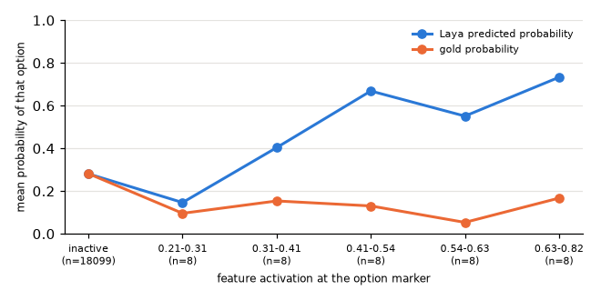

# Feature 4985

Critérios em que aparece: pred_error

**Interpretação (preencher):** 

---

## Maiores ativações

**tr_security_incidents_000022 / credential_compromise** (noul, security_incidents) | ativação 2.842 em `estado` | opções ['false', 'true'] | Laya: **true** [0.133, 0.867] | gabarito: **false**

```
<bos> noul question: The evidence indicates a credential or account has been compromised.<eos>
▸ <mask> false: no, the statement does not hold
▸ <mask> true: yes, the statement holds

<eos>

 {"alert": {"description": "a first-ever sign-in from an unfamiliar country", "evidence": "A CI runner principal performed a successful sign-in⟦ from⟧ a geographic location not previously associated with this account's history. The authentication involved MFA-protected credentials rotated one year ago and originated from an allowlisted source outside of a scheduled change window.", "rule": "new_country_login"}, "context": {"asset_criticality": "medium", "change_window_active": false, "source_on_allowlist": true}, "history": {"credential_rotation_days_ago": 365, "distinct_countries_30d": 1, "logins_30d": 1967, "prior_alerts_90d": 3}, "principal": {"mfa_enrolled": true, "name": "usr-analytics-668", "privileges": ["repo:read"], "type": "ci_runner"}}<eos>
```

**tr_security_incidents_000022 / urgency** (score, security_incidents) | ativação 2.650 em `estado` | opções ['0', '1', '2', '3'] | Laya: **3** [0.112, 0.265, 0.278, 0.345] | gabarito: **1**

```
<bos> score question: How quickly must a responder act on this alert?<eos>
▸ <mask> level 0: No time pressure; can wait indefinitely.
▸ <mask> level 1: Routine; handle within the normal queue.
▸ <mask> level 2: Elevated; should be handled within the same week.
▸ <mask> level 3: Critical; requires action within the same day.

<eos>

 {"alert": {"description": "a first-ever sign-in from an unfamiliar country", "evidence": "A CI runner principal performed a successful sign-in⟦ from⟧ a geographic location not previously associated with this account's history. The authentication involved MFA-protected credentials rotated one year ago and originated from an allowlisted source outside of a scheduled change window.", "rule": "new_country_login"}, "context": {"asset_criticality": "medium", "change_window_active": false, "source_on_allowlist": true}, "history": {"credential_rotation_days_ago": 365, "distinct_countries_30d": 1, "logins_30d": 1967, "prior_alerts_90d": 3}, "principal": {"mfa_enrolled": true, "name": "usr-analytics-668", "privileges": ["repo:read"], "type": "ci_runner"}}<eos>
```

**tr_security_incidents_000022 / disposition** (choice, security_incidents) | ativação 2.551 em `estado` | opções ['close_benign', 'contain', 'investigate', 'monitor'] | Laya: **monitor** [0.042, 0.23, 0.09, 0.637] | gabarito: **monitor**

```
<bos> choice question: How should this security alert be dispositioned?<eos>
▸ <mask> close_benign: Expected, explainable activity; close without analyst time.
▸ <mask> contain: Contain the host or account immediately; do not wait for triage.
▸ <mask> investigate: Warrants an analyst opening an investigation.
▸ <mask> monitor: Not clearly malicious, but worth watching for recurrence.

<eos>

 {"alert": {"description": "a first-ever sign-in from an unfamiliar country", "evidence": "A CI runner principal performed a successful sign-in⟦ from⟧ a geographic location not previously associated with this account's history. The authentication involved MFA-protected credentials rotated one year ago and originated from an allowlisted source outside of a scheduled change window.", "rule": "new_country_login"}, "context": {"asset_criticality": "medium", "change_window_active": false, "source_on_allowlist": true}, "history": {"credential_rotation_days_ago": 365, "distinct_countries_30d": 1, "logins_30d": 1967, "prior_alerts_90d": 3}, "principal": {"mfa_enrolled": true, "name": "usr-analytics-668", "privileges": ["repo:read"], "type": "ci_runner"}}<eos>
```

**tr_security_incidents_000022 / severity** (score, security_incidents) | ativação 2.490 em `estado` | opções ['0', '1', '2', '3', '4'] | Laya: **2** [0.132, 0.293, 0.302, 0.132, 0.141] | gabarito: **1**

```
<bos> score question: How severe is the potential impact if this alert is real?<eos>
▸ <mask> level 0: Negligible: no access to anything sensitive.
▸ <mask> level 1: Low: limited access, easily reversed.
▸ <mask> level 2: Moderate: access to internal systems or non-public data.
▸ <mask> level 3: High: access to production, secrets or customer data.
▸ <mask> level 4: Critical: active compromise of crown-jewel systems.

<eos>

 {"alert": {"description": "a first-ever sign-in from an unfamiliar country", "evidence": "A CI runner principal performed a successful sign-in⟦ from⟧ a geographic location not previously associated with this account's history. The authentication involved MFA-protected credentials rotated one year ago and originated from an allowlisted source outside of a scheduled change window.", "rule": "new_country_login"}, "context": {"asset_criticality": "medium", "change_window_active": false, "source_on_allowlist": true}, "history": {"credential_rotation_days_ago": 365, "distinct_countries_30d": 1, "logins_30d": 1967, "prior_alerts_90d": 3}, "principal": {"mfa_enrolled": true, "name": "usr-analytics-668", "privileges": ["repo:read"], "type": "ci_runner"}}<eos>
```

**tr_security_incidents_000022 / true_positive** (noul, security_incidents) | ativação 2.324 em `estado` | opções ['false', 'true'] | Laya: **true** [0.238, 0.762] | gabarito: **false**

```
<bos> noul question: This alert reflects genuinely malicious or unauthorised activity.<eos>
▸ <mask> false: Benign activity, a misconfiguration, or a known false positive.
▸ <mask> true: The underlying behaviour is malicious or unauthorised.

<eos>

 {"alert": {"description": "a first-ever sign-in from an unfamiliar country", "evidence": "A CI runner principal performed a successful sign-in⟦ from⟧ a geographic location not previously associated with this account's history. The authentication involved MFA-protected credentials rotated one year ago and originated from an allowlisted source outside of a scheduled change window.", "rule": "new_country_login"}, "context": {"asset_criticality": "medium", "change_window_active": false, "source_on_allowlist": true}, "history": {"credential_rotation_days_ago": 365, "distinct_countries_30d": 1, "logins_30d": 1967, "prior_alerts_90d": 3}, "principal": {"mfa_enrolled": true, "name": "usr-analytics-668", "privileges": ["repo:read"], "type": "ci_runner"}}<eos>
```

## Ativações medianas (faixa 40-60%, mediana 0.758)

**tr_security_incidents_000122 / urgency** (score, security_incidents) | ativação 0.746 em `estado` | opções ['0', '1', '2', '3'] | Laya: **1** [0.18, 0.376, 0.198, 0.246] | gabarito: **1**

```
<bos> score question: How quickly must a responder act on this alert?<eos>
▸ <mask> level 0: No time pressure; can wait indefinitely.
▸ <mask> level 1: Routine; handle within the normal queue.
▸ <mask> level 2: Elevated; should be handled within the same week.
▸ <mask> level 3: Critical; requires action within the same day.

<eos>

 {"alert": {"description": "a long-unused account became active", "evidence": "An unprivileged account assigned to 'employee_id_482' authenticated via MFA from an unrecognized geolocation after 120 days of inactivity. This access occurred outside of any scheduled change window using credentials that were last updated 30 days ago.", "rule": "dormant⟦_⟧account_use"}, "context": {"asset_criticality": "medium", "change_window_active": false, "source_on_allowlist": false}, "history": {"credential_rotation_days_ago": 30, "distinct_countries_30d": 2, "logins_30d": 696, "prior_alerts_90d": 8}, "principal": {"mfa_enrolled": true, "name": "ci-analytics-285", "privileges": ["repo:read"], "type": "employee"}}<eos>
```

**tr_customer_service_000152 / churn_risk** (score, customer_service) | ativação 0.721 em `estado` | opções ['0', '1', '2', '3'] | Laya: **1** [0.111, 0.626, 0.159, 0.105] | gabarito: **1**

```
<bos> score question: How likely is this customer to stop doing business with us because of this interaction?<eos>
▸ <mask> level 0: No sign of dissatisfaction.
▸ <mask> level 1: Mild frustration, but the relationship is intact.
▸ <mask> level 2: Clearly unhappy; repeat problems or explicit complaints.
▸ <mask> level 3: Imminent: threatening to cancel, dispute or leave.

<eos>

 {"account": {"lifetime_value_⟦usd⟧": 799, "prior_tickets_90d": 0, "seats": 1, "tenure_months": 33, "tier": "standard"}, "thread": [{"role": "customer", "text": "Hello, I'm writing because the analytics dashboard stopped updating as of this morning, and I need the latest data by 5 pm today to finalize my report. Could you please look into this?"}]}<eos>
```

**tr_invoice_processing_000162 / disposition** (choice, invoice_processing) | ativação 0.749 em `estado` | opções ['approve', 'hold', 'manual_review', 'reject'] | Laya: **reject** [0.411, 0.127, 0.027, 0.434] | gabarito: **manual_review**

```
<bos> choice question: How should this vendor invoice be dispositioned?<eos>
▸ <mask> approve: Matches the order and delivery; approve for payment.
▸ <mask> hold: Something needs confirming before payment; hold pending clarification.
▸ <mask> manual_review: A human in finance must review the discrepancy.
▸ <mask> reject: Should not be paid: duplicate, unauthorised or materially wrong.

<eos>

 {"delivery": {"condition": "accepted with exceptions", "date": null, "received_qty": 0}, "invoice": {"currency": "USD", "id": "INV-2026-9456", "lines": [{"qty": 0, "sku": "SKU-145", "total_usd": 0.0, "unit_usd": 326.59}], "total_usd": 0.0, "vendor": "Acme Fabrication"}, "payment": {"days_until_due": -21, "discount_expires_in_days": null, "early_payment_discount_pct": null, "status": "overdue", "terms": "net 60"}, "purchase_order": {"freight_terms": "⟦freight⟧ prepaid by vendor, not separately billable", "id": "PO-3349", "lines": [{"qty": 50, "unit_usd": 326.59}], "total_usd": 16329.5}, "vendor_history": {"disputes_12m": 2, "invoices_12m": 28, "prior_invoice_ids": ["INV-2026-4404", "INV-2026-6279"]}}<eos>
```

**tr_security_incidents_000228 / disposition** (choice, security_incidents) | ativação 0.814 em `estado` | opções ['close_benign', 'contain', 'investigate', 'monitor'] | Laya: **monitor** [0.121, 0.336, 0.113, 0.431] | gabarito: **investigate**

```
<bos> choice question: How should this security alert be dispositioned?<eos>
▸ <mask> close_benign: Expected, explainable activity; close without analyst time.
▸ <mask> contain: Contain the host or account immediately; do not wait for triage.
▸ <mask> investigate: Warrants an analyst opening an investigation.
▸ <mask> monitor: Not clearly malicious, but worth watching for recurrence.

<eos>

 {"alert": {"description": "a first-ever sign-in from an unfamiliar country", "evidence": "At 08:42 UTC, the unprivileged shared mailbox authenticated from IP 185.156.174.20 in the Netherlands, marking the first recorded sign⟦-⟧in from this country. The session used valid credentials rotated 14 days ago and passed multi-factor authentication from an unrecognized source device.", "rule": "new_country_login"}, "context": {"asset_criticality": "high", "change_window_active": false, "source_on_allowlist": false}, "history": {"credential_rotation_days_ago": 14, "distinct_countries_30d": 2, "logins_30d": 1119, "prior_alerts_90d": 0}, "principal": {"mfa_enrolled": true, "name": "ci-billing-303", "privileges": ["repo:read"], "type": "shared_mailbox"}}<eos>
```

**tr_security_incidents_000182 / credential_compromise** (noul, security_incidents) | ativação 0.668 em `estado` | opções ['false', 'true'] | Laya: **true** [0.269, 0.731] | gabarito: **true**

```
<bos> noul question: The evidence indicates a credential or account has been compromised.<eos>
▸ <mask> false: no, the statement does not hold
▸ <mask> true: yes, the statement holds

<eos>

 {"alert": {"description": "an unusual volume of files read in a short window", "evidence": "Between 2026-09-15 14:00 and 14:05 UTC, the admin account \"admin_klee\" on server 10.10.20.5 accessed 4,832 files in the \\share\\archives directory via the process cmd.exe. The activity originated from IP 198.51.100.77, which is not recognized as an approved source, and the account's password was last rotated on 2026-09-12.", "rule": "mass_download"}, "context": {"asset_⟦critical⟧ity": "low", "change_window_active": false, "source_on_allowlist": false}, "history": {"credential_rotation_days_ago": 3, "distinct_countries_30d": 4, "logins_30d": 1031, "prior_alerts_90d": 0}, "principal": {"mfa_enrolled": false, "name": "svc-infra-869", "privileges": ["repo:read"], "type": "admin"}}<eos>
```

## Estatísticas (conjunto de descoberta, dev e teste)

**pred / error**

| split | decisões | ativas | ativas e Laya errou | taxa | lift | q (BH) | OR (CMH) | q (CMH) |
|---|---|---|---|---|---|---|---|---|
| discovery | 5100 | 21 | 20 | 0.952 | 1.48 | 0.00583 | 3.38 | 0.662 |
| dev | 900 | 5 | 5 | 1.000 | 1.49 | nan | nan | nan |
| test | 2000 | 7 | 6 | 0.857 | 1.32 | nan | nan | nan |

**corr / error**

| split | decisões | ativas | ativas e Laya errou | taxa | lift | q (BH) | OR (CMH) | q (CMH) |
|---|---|---|---|---|---|---|---|---|
| discovery | 5100 | 4 | 3 | 0.750 | 1.17 | nan | nan | nan |
| dev | 900 | 0 | 0 | nan | nan | nan | nan | nan |
| test | 2000 | 2 | 1 | 0.500 | 0.77 | nan | nan | nan |

**state / error**

| split | decisões | ativas | ativas e Laya errou | taxa | lift | q (BH) | OR (CMH) | q (CMH) |
|---|---|---|---|---|---|---|---|---|
| discovery | 5100 | 446 | 294 | 0.659 | 1.02 | 0.665 | 1.29 | 0.188 |
| dev | 900 | 75 | 51 | 0.680 | 1.01 | 1 | 1.42 | 0.62 |
| test | 2000 | 202 | 118 | 0.584 | 0.90 | 0.206 | 0.81 | 0.605 |

**pred / probe_right_laya_wrong**

| split | decisões | ativas | ativas e Laya errou | taxa | lift | q (BH) | OR (CMH) | q (CMH) |
|---|---|---|---|---|---|---|---|---|
| discovery | 2932 | 13 | 12 | 0.923 | 1.52 | nan | nan | nan |
| dev | 523 | 4 | 4 | 1.000 | 1.55 | nan | nan | nan |
| test | 1149 | 5 | 5 | 1.000 | 1.64 | nan | nan | nan |

**corr / probe_right_laya_wrong**

| split | decisões | ativas | ativas e Laya errou | taxa | lift | q (BH) | OR (CMH) | q (CMH) |
|---|---|---|---|---|---|---|---|---|
| discovery | 2932 | 1 | 0 | 0.000 | 0.00 | nan | nan | nan |
| dev | 523 | 0 | 0 | nan | nan | nan | nan | nan |
| test | 1149 | 0 | 0 | nan | nan | nan | nan | nan |

**state / probe_right_laya_wrong**

| split | decisões | ativas | ativas e Laya errou | taxa | lift | q (BH) | OR (CMH) | q (CMH) |
|---|---|---|---|---|---|---|---|---|
| discovery | 2932 | 265 | 164 | 0.619 | 1.02 | 0.798 | 1.41 | 0.143 |
| dev | 523 | 49 | 32 | 0.653 | 1.01 | 1 | 1.68 | 0.479 |
| test | 1149 | 117 | 60 | 0.513 | 0.84 | 0.127 | 0.75 | 0.539 |

Confusão mais sobre-representada (pred): `action|3>2` (n=8, lift 16.89, p=8.34e-09). Formato `pergunta|índice previsto>índice correto`.

Confusão mais sobre-representada (corr): `disposition|1>0` (n=2, lift 510.00, p=nan). Formato `pergunta|índice previsto>índice correto`.

Confusão mais sobre-representada (state): `credential_compromise|1>0` (n=24, lift 3.35, p=5.87e-08). Formato `pergunta|índice previsto>índice correto`.



