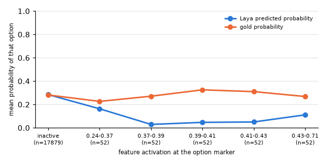

# Feature 4996

Critérios em que aparece: corr_probe_right_laya_wrong

**Interpretação (preencher):** 

---

## Maiores ativações

**tr_customer_service_000247 / category** (choice, customer_service) | ativação 2.879 em `estado` | opções ['account', 'billing', 'delivery', 'refund', 'technical'] | Laya: **delivery** [0.0, 0.0, 1.0, 0.0, 0.0] | gabarito: **delivery**

```
<bos> choice question: What is this customer conversation primarily about?<eos>
▸ <mask> account: Login, plan changes, profile or access management.
▸ <mask> billing: A charge, invoice, subscription or payment problem.
▸ <mask> delivery: Shipping, fulfilment or delivery of a physical item.
▸ <mask> refund: The customer is explicitly asking for money back.
▸ <mask> technical: The product or service is not working as expected.

<eos>

 {"account": {"lifetime_value_usd": 2665, "prior_tickets_90d": 2, "seats": 1, "tenure_months": 49, "tier": "enterprise"}, "orders": [{"amount_usd": 299, "date": "2026-03-24", "id": "A-46595", "status": "failed"}, {"amount_usd": 299, "date": "2026-02-03", "id": "A-35425", "status": "pending"}], "thread": [{"role": "customer", "text": "I'm looking at the delivery that arrived⟦ for⟧ our office this morning and I'm a bit lost because these appear to be Model X components, but our enterprise contract is specifically for the Series 4 kits."}, {"role": "agent", "text": "I'm sorry for the confusion regarding the items in your shipment. Would you mind providing the batch number listed on the packing slip inside the box?"}, {"role": "customer", "text": "The slip actually lists the Series 4 parts, which is even more confusing since the physical items in the box are definitely the blue Model X ones, so I'm not really sure how to proceed with this."}]}<eos>
```

**tr_agent_trace_observability_000292 / outcome** (choice, agent_trace_observability) | ativação 2.678 em `estado` | opções ['failure', 'harmful', 'partial', 'success'] | Laya: **failure** [0.456, 0.044, 0.159, 0.34] | gabarito: **success**

```
<bos> choice question: How did this agent run turn out?<eos>
▸ <mask> failure: The agent did not accomplish the task.
▸ <mask> harmful: The agent took an action that caused damage or violated a constraint.
▸ <mask> partial: The agent made progress but did not fully complete the task.
▸ <mask> success: The agent completed the task correctly.

<eos>

 {"agent": {"autonomy": "unsupervised", "model": "internal-agent-v3"}, "constraints": ["Never modify production without an approved change ticket", "Do not exceed a $50 spend on cloud resources"], "task": "Triage and close duplicate issues⟦ in⟧ the support tracker.", "trace_summary": {"constraint_violations": 0, "duration_s": 602.5, "irreversible_actions": 1, "steps": 8, "tool_errors": 1}}<eos>
```

**tr_agent_trace_observability_000211 / outcome** (choice, agent_trace_observability) | ativação 2.672 em `estado` | opções ['failure', 'harmful', 'partial', 'success'] | Laya: **failure** [0.377, 0.073, 0.194, 0.356] | gabarito: **partial**

```
<bos> choice question: How did this agent run turn out?<eos>
▸ <mask> failure: The agent did not accomplish the task.
▸ <mask> harmful: The agent took an action that caused damage or violated a constraint.
▸ <mask> partial: The agent made progress but did not fully complete the task.
▸ <mask> success: The agent completed the task correctly.

<eos>

 {"agent": {"autonomy": "unsupervised", "model": "internal-agent-v2"}, "constraints": ["Never modify production without an approved change ticket", "Do not exceed a $50 spend on cloud resources", "Never delete anything matching release/*"], "task": "Triage and close duplicate issues⟦ in⟧ the support tracker.", "trace_summary": {"constraint_violations": 0, "duration_s": 213.8, "irreversible_actions": 1, "steps": 9, "tool_errors": 1}}<eos>
```

**tr_customer_service_000247 / needs_human** (noul, customer_service) | ativação 2.656 em `estado` | opções ['false', 'true'] | Laya: **true** [0.313, 0.687] | gabarito: **true**

```
<bos> noul question: This conversation requires a human agent rather than automated handling.<eos>
▸ <mask> false: Automation can carry this to resolution.
▸ <mask> true: A human must take over: judgement, authority or empathy is required.

<eos>

 {"account": {"lifetime_value_usd": 2665, "prior_tickets_90d": 2, "seats": 1, "tenure_months": 49, "tier": "enterprise"}, "orders": [{"amount_usd": 299, "date": "2026-03-24", "id": "A-46595", "status": "failed"}, {"amount_usd": 299, "date": "2026-02-03", "id": "A-35425", "status": "pending"}], "thread": [{"role": "customer", "text": "I'm looking at the delivery that arrived⟦ for⟧ our office this morning and I'm a bit lost because these appear to be Model X components, but our enterprise contract is specifically for the Series 4 kits."}, {"role": "agent", "text": "I'm sorry for the confusion regarding the items in your shipment. Would you mind providing the batch number listed on the packing slip inside the box?"}, {"role": "customer", "text": "The slip actually lists the Series 4 parts, which is even more confusing since the physical items in the box are definitely the blue Model X ones, so I'm not really sure how to proceed with this."}]}<eos>
```

**tr_customer_service_000247 / churn_risk** (score, customer_service) | ativação 2.654 em `estado` | opções ['0', '1', '2', '3'] | Laya: **1** [0.141, 0.556, 0.234, 0.069] | gabarito: **1**

```
<bos> score question: How likely is this customer to stop doing business with us because of this interaction?<eos>
▸ <mask> level 0: No sign of dissatisfaction.
▸ <mask> level 1: Mild frustration, but the relationship is intact.
▸ <mask> level 2: Clearly unhappy; repeat problems or explicit complaints.
▸ <mask> level 3: Imminent: threatening to cancel, dispute or leave.

<eos>

 {"account": {"lifetime_value_usd": 2665, "prior_tickets_90d": 2, "seats": 1, "tenure_months": 49, "tier": "enterprise"}, "orders": [{"amount_usd": 299, "date": "2026-03-24", "id": "A-46595", "status": "failed"}, {"amount_usd": 299, "date": "2026-02-03", "id": "A-35425", "status": "pending"}], "thread": [{"role": "customer", "text": "I'm looking at the delivery that arrived⟦ for⟧ our office this morning and I'm a bit lost because these appear to be Model X components, but our enterprise contract is specifically for the Series 4 kits."}, {"role": "agent", "text": "I'm sorry for the confusion regarding the items in your shipment. Would you mind providing the batch number listed on the packing slip inside the box?"}, {"role": "customer", "text": "The slip actually lists the Series 4 parts, which is even more confusing since the physical items in the box are definitely the blue Model X ones, so I'm not really sure how to proceed with this."}]}<eos>
```

## Ativações medianas (faixa 40-60%, mediana 0.824)

**tr_security_incidents_000158 / disposition** (choice, security_incidents) | ativação 0.846 em `estado` | opções ['close_benign', 'contain', 'investigate', 'monitor'] | Laya: **monitor** [0.035, 0.178, 0.129, 0.658] | gabarito: **investigate**

```
<bos> choice question: How should this security alert be dispositioned?<eos>
▸ <mask> close_benign: Expected, explainable activity; close without analyst time.
▸ <mask> contain: Contain the host or account immediately; do not wait for triage.
▸ <mask> investigate: Warrants an analyst opening an investigation.
▸ <mask> monitor: Not clearly malicious, but worth watching for recurrence.

<eos>

 {"alert": {"description": "many failed authentications followed by a success", "evidence": "Between 2026-09-16 11:02 UTC and 11:07 UTC, a contractor account experienced 27 consecutive failed authentication attempts from 198.51.100.22, after which a successful login occurred at 11:09 UTC using MFA. The originating address is absent from the approved source list, and the account's credentials⟦ were⟧ last rotated on 2026‑08‑17.", "rule": "brute_force"}, "context": {"asset_criticality": "medium", "change_window_active": false, "source_on_allowlist": false}, "history": {"credential_rotation_days_ago": 30, "distinct_countries_30d": 2, "logins_30d": 1639, "prior_alerts_90d": 3}, "principal": {"mfa_enrolled": true, "name": "ci-analytics-833", "privileges": ["repo:read"], "type": "contractor"}}<eos>
```

**tr_customer_service_000057 / churn_risk** (score, customer_service) | ativação 0.737 em `pergunta` | opções ['0', '1', '2', '3'] | Laya: **1** [0.15, 0.541, 0.272, 0.037] | gabarito: **2**

```
<bos> score question: How likely⟦ is⟧ this customer to stop doing business with us because of this interaction?<eos>
▸ <mask> level 0: No sign of dissatisfaction.
▸ <mask> level 1: Mild frustration, but the relationship is intact.
▸ <mask> level 2: Clearly unhappy; repeat problems or explicit complaints.
▸ <mask> level 3: Imminent: threatening to cancel, dispute or leave.

<eos>

 {"account": {"lifetime_value_usd": 1386, "prior_tickets_90d": 1, "seats": 1, "tenure_months": 72, "tier": "free"}, "thread": [{"role": "customer", "text": "Your service is crawling at a snail’s pace and I’ve been on the free plan for six years – this is unacceptable."}, {"role": "agent", "text": "I’m sorry you’re experiencing slowness. Could you let me know which device and browser you’re using?"}, {"role": "customer", "text": "Ticket #6789 was supposed to fix this weeks ago, but nothing changed. It’s the same lag every time I log in."}, {"role": "agent", "text": "Got it. When did the slowdown start, and are you seeing any error messages on the screen?"}, {"role": "customer", "text": "It started yesterday, no error messages, just endless loading. My work is getting held up and I need an update."}]}<eos>
```

**tr_security_incidents_000122 / severity** (score, security_incidents) | ativação 0.737 em `opção` | opções ['0', '1', '2', '3', '4'] | Laya: **1** [0.184, 0.646, 0.092, 0.04, 0.038] | gabarito: **1**

```
<bos> score question: How severe is the potential impact if this alert is real?<eos>
▸ <mask> level 0: Negligible: no access to anything sensitive.
▸ <mask> level 1: Low: limited access, easily reversed.
▸ <mask> level 2: Moderate: access to internal systems or non-public data.
▸ <mask> level 3: High: access to production, secrets or customer data.
▸ <mask> level 4: Critical: active compromise⟦ of⟧ crown-jewel systems.

<eos>

 {"alert": {"description": "a long-unused account became active", "evidence": "An unprivileged account assigned to 'employee_id_482' authenticated via MFA from an unrecognized geolocation after 120 days of inactivity. This access occurred outside of any scheduled change window using credentials that were last updated 30 days ago.", "rule": "dormant_account_use"}, "context": {"asset_criticality": "medium", "change_window_active": false, "source_on_allowlist": false}, "history": {"credential_rotation_days_ago": 30, "distinct_countries_30d": 2, "logins_30d": 696, "prior_alerts_90d": 8}, "principal": {"mfa_enrolled": true, "name": "ci-analytics-285", "privileges": ["repo:read"], "type": "employee"}}<eos>
```

**tr_security_incidents_000189 / true_positive** (noul, security_incidents) | ativação 0.807 em `estado` | opções ['false', 'true'] | Laya: **true** [0.377, 0.622] | gabarito: **false**

```
<bos> noul question: This alert reflects genuinely malicious or unauthorised activity.<eos>
▸ <mask> false: Benign activity, a misconfiguration, or a known false positive.
▸ <mask> true: The underlying behaviour is malicious or unauthorised.

<eos>

 {"alert": {"description": "a long-unused account became active", "evidence": "At 2026-09-15 02:34:11 UTC an admin account (username: admin_jdoe) authenticated from IP 203.0.113.45 after 412 days of inactivity. The login succeeded with MFA and the credential⟦’⟧s last rotation timestamp is 2025-09-16.", "rule": "dormant_account_use"}, "context": {"asset_criticality": "low", "change_window_active": false, "source_on_allowlist": false}, "history": {"credential_rotation_days_ago": 365, "distinct_countries_30d": 2, "logins_30d": 150, "prior_alerts_90d": 0}, "principal": {"mfa_enrolled": true, "name": "adm-deploy-266", "privileges": ["deploy:production", "secrets:read"], "type": "admin"}}<eos>
```

**tr_security_incidents_000067 / severity** (score, security_incidents) | ativação 0.850 em `opção` | opções ['0', '1', '2', '3', '4'] | Laya: **1** [0.123, 0.328, 0.313, 0.143, 0.093] | gabarito: **3**

```
<bos> score question: How severe is the potential impact if this alert is real?<eos>
▸ <mask> level 0: Negligible: no access to anything sensitive.
▸ <mask> level 1: Low: limited access, easily reversed.
▸ <mask> level 2: Moderate: access to internal systems or non-public data.
▸ <mask> level 3: High: access⟦ to⟧ production, secrets or customer data.
▸ <mask> level 4: Critical: active compromise of crown-jewel systems.

<eos>

 {"alert": {"description": "a security group was opened to the public internet", "evidence": "The security group configuration was modified to allow inbound traffic from 0.0.0.0/0. This change originated from an unrecognized network source outside of a designated maintenance window.", "rule": "config_drift"}, "context": {"asset_criticality": "medium", "change_window_active": false, "source_on_allowlist": false}, "history": {"credential_rotation_days_ago": 14, "distinct_countries_30d": 1, "logins_30d": 1017, "prior_alerts_90d": 25}, "principal": {"mfa_enrolled": true, "name": "svc-analytics-657", "privileges": ["deploy:production", "secrets:read"], "type": "admin"}}<eos>
```

## Estatísticas (conjunto de descoberta, dev e teste)

**pred / error**

| split | decisões | ativas | ativas e Laya errou | taxa | lift | q (BH) | OR (CMH) | q (CMH) |
|---|---|---|---|---|---|---|---|---|
| discovery | 5100 | 16 | 15 | 0.938 | 1.46 | nan | nan | nan |
| dev | 900 | 4 | 4 | 1.000 | 1.49 | nan | nan | nan |
| test | 2000 | 10 | 10 | 1.000 | 1.54 | nan | nan | nan |

**corr / error**

| split | decisões | ativas | ativas e Laya errou | taxa | lift | q (BH) | OR (CMH) | q (CMH) |
|---|---|---|---|---|---|---|---|---|
| discovery | 5100 | 81 | 80 | 0.988 | 1.53 | 9.21e-14 | 11.97 | 0.0752 |
| dev | 900 | 24 | 24 | 1.000 | 1.49 | 0.000433 | inf | 0.665 |
| test | 2000 | 36 | 36 | 1.000 | 1.54 | 1.11e-06 | inf | 0.15 |

**state / error**

| split | decisões | ativas | ativas e Laya errou | taxa | lift | q (BH) | OR (CMH) | q (CMH) |
|---|---|---|---|---|---|---|---|---|
| discovery | 5100 | 3184 | 2052 | 0.644 | 1.00 | 0.977 | 1.01 | 0.957 |
| dev | 900 | 563 | 373 | 0.663 | 0.99 | 0.812 | 1.04 | 0.939 |
| test | 2000 | 1188 | 761 | 0.641 | 0.98 | 0.573 | 1.04 | 0.898 |

**pred / probe_right_laya_wrong**

| split | decisões | ativas | ativas e Laya errou | taxa | lift | q (BH) | OR (CMH) | q (CMH) |
|---|---|---|---|---|---|---|---|---|
| discovery | 2932 | 8 | 8 | 1.000 | 1.65 | nan | nan | nan |
| dev | 523 | 3 | 3 | 1.000 | 1.55 | nan | nan | nan |
| test | 1149 | 7 | 7 | 1.000 | 1.64 | nan | nan | nan |

**corr / probe_right_laya_wrong**

| split | decisões | ativas | ativas e Laya errou | taxa | lift | q (BH) | OR (CMH) | q (CMH) |
|---|---|---|---|---|---|---|---|---|
| discovery | 2932 | 50 | 50 | 1.000 | 1.65 | 6.66e-11 | inf | 0.116 |
| dev | 523 | 14 | 14 | 1.000 | 1.55 | nan | nan | nan |
| test | 1149 | 21 | 21 | 1.000 | 1.64 | 0.00013 | inf | 0.308 |

**state / probe_right_laya_wrong**

| split | decisões | ativas | ativas e Laya errou | taxa | lift | q (BH) | OR (CMH) | q (CMH) |
|---|---|---|---|---|---|---|---|---|
| discovery | 2932 | 1841 | 1106 | 0.601 | 0.99 | 0.662 | 0.97 | 0.892 |
| dev | 523 | 330 | 211 | 0.639 | 0.99 | 0.954 | 1.10 | 0.863 |
| test | 1149 | 694 | 423 | 0.610 | 1.00 | 1 | 1.22 | 0.477 |

Confusão mais sobre-representada (pred): `action|1>2` (n=9, lift 40.40, p=nan). Formato `pergunta|índice previsto>índice correto`.

Confusão mais sobre-representada (corr): `disposition|0>2` (n=47, lift 51.02, p=0). Formato `pergunta|índice previsto>índice correto`.

Confusão mais sobre-representada (state): `risk|2>1` (n=73, lift 1.46, p=3.68e-09). Formato `pergunta|índice previsto>índice correto`.



