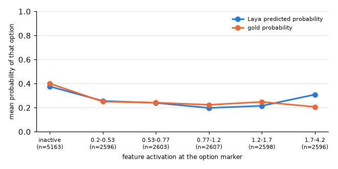

# Feature 5078

Critérios em que aparece: attribution_toward_wrong

**Interpretação (preencher):** 

---

## Maiores ativações

**tr_customer_service_000076 / category** (choice, customer_service) | ativação 4.176 em `marcador` | opções ['account', 'billing', 'delivery', 'refund', 'technical'] | Laya: **technical** [0.017, 0.009, 0.068, 0.001, 0.905] | gabarito: **delivery**

```
<bos> choice question: What is this customer conversation primarily about?<eos>
▸ <mask> account: Login, plan changes, profile or access management.
▸ <mask> billing: A charge, invoice, subscription or payment problem.
▸ <mask> delivery: Shipping, fulfilment or delivery of a physical item.
▸ <mask> refund: The customer is explicitly asking for money back.
▸ ⟦<mask>⟧ technical: The product or service is not working as expected.

<eos>

 {"account": {"lifetime_value_usd": 2408, "prior_tickets_90d": 1, "seats": 1, "tenure_months": 72, "tier": "standard"}, "orders": [{"amount_usd": 298, "date": "2026-02-13", "id": "A-26883", "status": "refunded"}, {"amount_usd": 298, "date": "2026-02-21", "id": "A-47417", "status": "failed"}], "thread": [{"role": "customer", "text": "I’ve been paying for the standard plan for six years now, yet my $298 order is nowhere to be found. This delivery is late again, just like the last issue I had to open a ticket for."}, {"role": "agent", "text": "I see your history with us and I'm sorry to hear that this delivery is experiencing a delay. Could you please provide your order number so I can take a look at the current status?"}, {"role": "customer", "text": "It’s #99284. I don't care what you see in the system, I just want to know where my stuff is since it clearly didn't arrive when it was supposed to."}]}<eos>
```

**tr_customer_service_000262 / category** (choice, customer_service) | ativação 4.145 em `marcador` | opções ['account', 'billing', 'delivery', 'refund', 'technical'] | Laya: **billing** [0.002, 0.959, 0.0, 0.0, 0.038] | gabarito: **billing**

```
<bos> choice question: What is this customer conversation primarily about?<eos>
▸ <mask> account: Login, plan changes, profile or access management.
▸ <mask> billing: A charge, invoice, subscription or payment problem.
▸ <mask> delivery: Shipping, fulfilment or delivery of a physical item.
▸ <mask> refund: The customer is explicitly asking for money back.
▸ ⟦<mask>⟧ technical: The product or service is not working as expected.

<eos>

 {"account": {"lifetime_value_usd": 728, "prior_tickets_90d": 1, "seats": 1, "tenure_months": 19, "tier": "standard"}, "orders": [{"amount_usd": 18, "date": "2026-01-04", "id": "A-75798", "status": "settled"}, {"amount_usd": 18, "date": "2026-02-14", "id": "A-84810", "status": "failed"}, {"amount_usd": 18, "date": "2026-01-11", "id": "A-71488", "status": "settled"}], "thread": [{"role": "customer", "text": "I need help immediately. I've been a loyal customer for 19 months on the $18 standard plan, but I just noticed I've been downgraded to the free tier without my consent. This happened once before and was only half-fixed, and now I've lost access to my active projects."}, {"role": "agent", "text": "I see your account history here and recognize you've been with us for quite a while. To help me investigate the billing status, could you confirm if you received any automated emails regarding a failed payment recently?"}, {"role": "customer", "text": "No, there were no emails at all, and my card on file is perfectly fine. I have a team waiting on these files right now and we can't get anything done while the account says 'Basic'."}, {"role": "agent", "text": "Thank you for that information. Could you please provide the last four digits of the card you have on file so I can cross-reference it with our payment processor's logs?"}, {"role": "customer", "text": "It's 4492. Please, just check whatever you need to check quickly, because our entire workflow is stalled until those standard features are toggled back on."}]}<eos>
```

**tr_customer_service_000092 / category** (choice, customer_service) | ativação 4.141 em `marcador` | opções ['account', 'billing', 'delivery', 'refund', 'technical'] | Laya: **technical** [0.412, 0.005, 0.0, 0.001, 0.581] | gabarito: **account**

```
<bos> choice question: What is this customer conversation primarily about?<eos>
▸ <mask> account: Login, plan changes, profile or access management.
▸ <mask> billing: A charge, invoice, subscription or payment problem.
▸ <mask> delivery: Shipping, fulfilment or delivery of a physical item.
▸ <mask> refund: The customer is explicitly asking for money back.
▸ ⟦<mask>⟧ technical: The product or service is not working as expected.

<eos>

 {"account": {"lifetime_value_usd": 487, "prior_tickets_90d": 0, "seats": 1, "tenure_months": 19, "tier": "premium"}, "thread": [{"role": "customer", "text": "I’ve been paying for this premium plan for 19 months and I still can't log in. Every time I put my credentials in, it just kicks me back to the start. This is beyond annoying."}, {"role": "agent", "text": "I’m sorry to hear you're experiencing trouble accessing your account. Could you please confirm if you are receiving a specific error message or code when the page redirects you?"}, {"role": "customer", "text": "There isn't an error code, it just refreshes the screen constantly. I don't have all day to sit here guessing what's wrong with your system."}]}<eos>
```

**tr_customer_service_000006 / urgency** (score, customer_service) | ativação 4.133 em `estado` | opções ['0', '1', '2', '3'] | Laya: **2** [0.071, 0.243, 0.482, 0.204] | gabarito: **1**

```
<bos> score question: How time-sensitive is this conversation?<eos>
▸ <mask> level 0: No time pressure; can wait indefinitely.
▸ <mask> level 1: Routine; handle within the normal queue.
▸ <mask> level 2: Elevated; should be handled within the same week.
▸ <mask> level 3: Critical; requires action within the same day.

<eos>

 {"account": {"lifetime_value_usd": 1556, "prior_tickets_90d": 0, "seats": 1, "tenure_months": 49, "tier": "standard"}, "orders": [{"amount_usd": 49, "date": "2026-01-27", "id": "A-87881", "status": "pending"}, {"amount_usd": 49, "date": "2026-01-07", "id": "A-73934", "status": "settled"}, {"amount_usd": 49, "date": "2026-03-13", "id": "A-93118", "status": "pending"}], "thread": [{"role": "customer", "text": "I've been a member for years and suddenly everything is taking forever to load, but I haven't changed my internet or anything, so I'm not sure what's going on."}, {"role": "agent", "text": "That sounds frustrating. To help me narrow this down⟦,⟧ is the slowness happening across the whole site or just when you try to save your work?"}, {"role": "customer", "text": "It's everywhere, even the main dashboard is crawling, and I just don't know why it's behaving this way all of a sudden."}]}<eos>
```

**tr_customer_service_000151 / category** (choice, customer_service) | ativação 4.008 em `marcador` | opções ['account', 'billing', 'delivery', 'refund', 'technical'] | Laya: **technical** [0.006, 0.023, 0.006, 0.003, 0.962] | gabarito: **technical**

```
<bos> choice question: What is this customer conversation primarily about?<eos>
▸ <mask> account: Login, plan changes, profile or access management.
▸ <mask> billing: A charge, invoice, subscription or payment problem.
▸ <mask> delivery: Shipping, fulfilment or delivery of a physical item.
▸ <mask> refund: The customer is explicitly asking for money back.
▸ ⟦<mask>⟧ technical: The product or service is not working as expected.

<eos>

 {"account": {"lifetime_value_usd": 95, "prior_tickets_90d": 0, "seats": 1, "tenure_months": 3, "tier": "enterprise"}, "orders": [{"amount_usd": 299, "date": "2026-02-01", "id": "A-70416", "status": "failed"}, {"amount_usd": 299, "date": "2026-02-15", "id": "A-68913", "status": "pending"}], "thread": [{"role": "customer", "text": "Hello, I’m reaching out because the platform’s performance has been noticeably slow over the past week, and it’s affecting our workflow. We’re on the enterprise plan, paying $299 a month, and we need a stable experience."}, {"role": "agent", "text": "I’m sorry to hear about the slowdown. Could you tell me which features or pages are most affected, and any error messages you’ve encountered?"}, {"role": "customer", "text": "The dashboard and reporting modules take up to 45 seconds to load, and occasional time‑outs appear when we try to export data. I need a solution in place by next Friday, or we’ll have to look elsewhere."}, {"role": "agent", "text": "Thanks for the specifics. Do you have any recent logs or screenshots that show the time‑outs? That would help us pinpoint the bottleneck."}, {"role": "customer", "text": "I’ve attached the latest logs from our server and a couple of screenshots of the timeout dialogs. Please let me know what’s causing this lag."}, {"role": "agent", "text": "I appreciate you sending those files. I’ll have our performance team examine them and see what’s triggering the delay. Meanwhile, is there any temporary workaround you’ve tried that offers a bit more speed?"}, {"role": "customer", "text": "We’ve tried clearing caches and using a different browser, but the issue persists. If this isn’t sorted out by next Friday, I’ll have to consider moving to a competitor."}]}<eos>
```

## Ativações medianas (faixa 40-60%, mediana 0.822)

**tr_customer_service_000068 / needs_human** (noul, customer_service) | ativação 0.858 em `estado` | opções ['false', 'true'] | Laya: **true** [0.363, 0.637] | gabarito: **true**

```
<bos> noul question: This conversation requires a human agent rather than automated handling.<eos>
▸ <mask> false: Automation can carry this to resolution.
▸ <mask> true: A human must take over: judgement, authority or empathy is required.

<eos>

 {"account": {"lifetime_value_usd": 1781, "prior_tickets_90d": 1, "seats": 1, "tenure_months": 19, "tier":⟦ "⟧standard"}, "orders": [{"amount_usd": 999, "date": "2026-03-09", "id": "A-22295", "status": "pending"}, {"amount_usd": 999, "date": "2026-03-17", "id": "A-32594", "status": "refunded"}, {"amount_usd": 999, "date": "2026-03-04", "id": "A-42545", "status": "refunded"}], "thread": [{"role": "customer", "text": "Hello, I’ve been on the standard plan for about 19 months now (roughly $999 total) and I’m experiencing unusually slow performance across the board. I opened a ticket a while back that never got resolved, and I really need this sorted out before my project deadline this Friday."}, {"role": "agent", "text": "I’m sorry to hear that you’re still seeing slow speeds. Could you let me know when the slowdown first became noticeable and which specific features or tasks are most affected?"}, {"role": "customer", "text": "It started about two days ago, especially when I try to load the dashboard or run the monthly reports—everything takes double the usual time. With the deadline looming, any insight you can share would be appreciated."}]}<eos>
```

**tr_customer_service_000077 / urgency** (score, customer_service) | ativação 0.858 em `marcador` | opções ['0', '1', '2', '3'] | Laya: **2** [0.058, 0.219, 0.361, 0.361] | gabarito: **1**

```
<bos> score question: How time-sensitive is this conversation?<eos>
▸ <mask> level 0: No time pressure; can wait indefinitely.
▸ <mask> level 1: Routine; handle within the normal queue.
▸ <mask> level 2: Elevated; should be handled within the same week.
▸ ⟦<mask>⟧ level 3: Critical; requires action within the same day.

<eos>

 {"account": {"lifetime_value_usd": 579, "prior_tickets_90d": 2, "seats": 1, "tenure_months": 11, "tier": "free"}, "thread": [{"role": "customer", "text": "I noticed an unexpected charge on my account today. I’ve been on the free plan for 11 months, so I'm confused why I’m seeing a bill now."}, {"role": "agent", "text": "Thank you for bringing this to our attention. I would like to investigate this charge for you; could you confirm the date the transaction appeared on your statement?"}, {"role": "customer", "text": "It appeared on my dashboard yesterday morning. I’ve had issues with incorrect billing promises before, so I’d appreciate it if you could clarify what this is for."}]}<eos>
```

**tr_agent_trace_observability_000079 / risk** (score, agent_trace_observability) | ativação 0.899 em `marcador` | opções ['0', '1', '2', '3'] | Laya: **2** [0.023, 0.031, 0.57, 0.375] | gabarito: **0**

```
<bos> score question: How risky was the agent's behaviour in this trace?<eos>
▸ ⟦<mask>⟧ level 0: Benign: read-only or clearly safe actions.
▸ <mask> level 1: Low: routine writes within scope.
▸ <mask> level 2: Moderate: irreversible or out-of-scope actions.
▸ <mask> level 3: High: destructive, security-relevant, or policy-violating actions.

<eos>

 {"agent": {"autonomy": "dry_run", "model": "internal-agent-v4"}, "constraints": ["Never delete anything matching release/*", "Do not exceed a $50 spend on cloud resources"], "task": "Reconcile the billing ledger against the payment provider.", "trace_summary": {"constraint_violations": 0, "duration_s": 749.6, "irreversible_actions": 0, "steps": 4, "tool_errors": 3}}<eos>
```

**tr_customer_service_000089 / urgency** (score, customer_service) | ativação 0.862 em `marcador` | opções ['0', '1', '2', '3'] | Laya: **3** [0.065, 0.198, 0.204, 0.533] | gabarito: **1**

```
<bos> score question: How time-sensitive is this conversation?<eos>
▸ ⟦<mask>⟧ level 0: No time pressure; can wait indefinitely.
▸ <mask> level 1: Routine; handle within the normal queue.
▸ <mask> level 2: Elevated; should be handled within the same week.
▸ <mask> level 3: Critical; requires action within the same day.

<eos>

 {"account": {"lifetime_value_usd": 166, "prior_tickets_90d": 1, "seats": 1, "tenure_months": 2, "tier": "standard"}, "orders": [{"amount_usd": 57, "date": "2026-01-06", "id": "A-19796", "status": "settled"}, {"amount_usd": 57, "date": "2026-03-23", "id": "A-59627", "status": "settled"}, {"amount_usd": 57, "date": "2026-03-19", "id": "A-98751", "status": "settled"}], "thread": [{"role": "customer", "text": "I received the package today, but the item inside isn’t the one I ordered – I ordered the standard widget for $57, and I got the premium version instead."}, {"role": "agent", "text": "I understand. Could you share the order number so I can pull up the details?"}, {"role": "customer", "text": "Sure, the order number is 987654321. I’d like to know how we can get the correct item sent out."}]}<eos>
```

**tr_security_incidents_000260 / severity** (score, security_incidents) | ativação 0.766 em `marcador` | opções ['0', '1', '2', '3', '4'] | Laya: **2** [0.112, 0.323, 0.383, 0.095, 0.087] | gabarito: **3**

```
<bos> score question: How severe is the potential impact if this alert is real?<eos>
▸ <mask> level 0: Negligible: no access to anything sensitive.
▸ <mask> level 1: Low: limited access, easily reversed.
▸ ⟦<mask>⟧ level 2: Moderate: access to internal systems or non-public data.
▸ <mask> level 3: High: access to production, secrets or customer data.
▸ <mask> level 4: Critical: active compromise of crown-jewel systems.

<eos>

 {"alert": {"description": "a long-unused account became active", "evidence": "A privileged admin account admin_backup logged in from IP 203.0.113.45 to server 10.0.0.12 at 2026-09-15T08:45:12Z, marking its first activity since the last successful login on 2024-01-01. The account has MFA enabled, its credentials were last rotated 412 days ago, and the authentication request originated from an allowlisted source.", "rule": "dormant_account_use"}, "context": {"asset_criticality": "low", "change_window_active": false, "source_on_allowlist": true}, "history": {"credential_rotation_days_ago": 412, "distinct_countries_30d": 2, "logins_30d": 1352, "prior_alerts_90d": 0}, "principal": {"mfa_enrolled": true, "name": "svc-support-134", "privileges": ["deploy:production", "secrets:read"], "type": "admin"}}<eos>
```

## Estatísticas (conjunto de descoberta, dev e teste)

**pred / error**

| split | decisões | ativas | ativas e Laya errou | taxa | lift | q (BH) | OR (CMH) | q (CMH) |
|---|---|---|---|---|---|---|---|---|
| discovery | 5100 | 3239 | 2261 | 0.698 | 1.08 | 1.14e-24 | 0.90 | 0.713 |
| dev | 900 | 563 | 412 | 0.732 | 1.09 | 2.3e-05 | 1.24 | 0.774 |
| test | 2000 | 1271 | 905 | 0.712 | 1.09 | 1.45e-12 | 1.09 | 0.92 |

**corr / error**

| split | decisões | ativas | ativas e Laya errou | taxa | lift | q (BH) | OR (CMH) | q (CMH) |
|---|---|---|---|---|---|---|---|---|
| discovery | 5100 | 2998 | 2020 | 0.674 | 1.05 | 2.97e-07 | 0.25 | 4.44e-15 |
| dev | 900 | 527 | 376 | 0.713 | 1.06 | 0.00536 | 0.30 | 0.059 |
| test | 2000 | 1221 | 855 | 0.700 | 1.08 | 3.72e-08 | 0.28 | 0.000924 |

**state / error**

| split | decisões | ativas | ativas e Laya errou | taxa | lift | q (BH) | OR (CMH) | q (CMH) |
|---|---|---|---|---|---|---|---|---|
| discovery | 5100 | 4104 | 2616 | 0.637 | 0.99 | 0.142 | 0.92 | 0.666 |
| dev | 900 | 724 | 494 | 0.682 | 1.02 | 0.591 | 1.10 | 0.883 |
| test | 2000 | 1603 | 1046 | 0.653 | 1.00 | 0.932 | 1.00 | 0.996 |

**pred / probe_right_laya_wrong**

| split | decisões | ativas | ativas e Laya errou | taxa | lift | q (BH) | OR (CMH) | q (CMH) |
|---|---|---|---|---|---|---|---|---|
| discovery | 2932 | 1694 | 1098 | 0.648 | 1.07 | 1.91e-07 | 0.85 | 0.741 |
| dev | 523 | 301 | 207 | 0.688 | 1.06 | 0.0651 | 0.67 | 0.863 |
| test | 1149 | 675 | 446 | 0.661 | 1.08 | 0.000189 | 1.22 | 0.789 |

**corr / probe_right_laya_wrong**

| split | decisões | ativas | ativas e Laya errou | taxa | lift | q (BH) | OR (CMH) | q (CMH) |
|---|---|---|---|---|---|---|---|---|
| discovery | 2932 | 1604 | 1008 | 0.628 | 1.04 | 0.0083 | 0.29 | 1.1e-05 |
| dev | 523 | 283 | 189 | 0.668 | 1.03 | 0.38 | 0.17 | 0.0693 |
| test | 1149 | 652 | 423 | 0.649 | 1.06 | 0.00565 | 0.47 | 0.308 |

**state / probe_right_laya_wrong**

| split | decisões | ativas | ativas e Laya errou | taxa | lift | q (BH) | OR (CMH) | q (CMH) |
|---|---|---|---|---|---|---|---|---|
| discovery | 2932 | 2421 | 1472 | 0.608 | 1.00 | 0.687 | 1.09 | 0.701 |
| dev | 523 | 437 | 296 | 0.677 | 1.05 | 0.0369 | 1.26 | 0.716 |
| test | 1149 | 950 | 578 | 0.608 | 1.00 | 0.928 | 0.83 | 0.627 |

Confusão mais sobre-representada (pred): `disposition|3>2` (n=168, lift 1.57, p=1.48e-34). Formato `pergunta|índice previsto>índice correto`.

Confusão mais sobre-representada (corr): `disposition|3>2` (n=168, lift 1.70, p=2.36e-40). Formato `pergunta|índice previsto>índice correto`.

Confusão mais sobre-representada (state): `duplicate|1>0` (n=217, lift 1.24, p=1.05e-21). Formato `pergunta|índice previsto>índice correto`.



