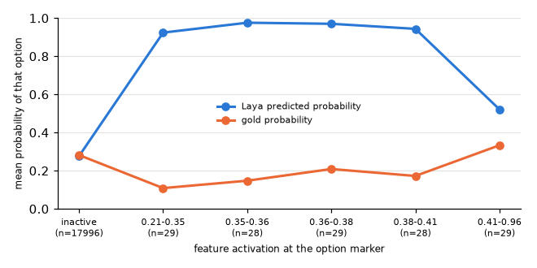

# Feature 5183

Critérios em que aparece: pred_probe_right_laya_wrong

**Interpretação (preencher):** 

---

## Maiores ativações

**tr_customer_service_000175 / churn_risk** (score, customer_service) | ativação 7.117 em `estado` | opções ['0', '1', '2', '3'] | Laya: **2** [0.052, 0.089, 0.812, 0.048] | gabarito: **2**

```
<bos> score question: How likely is this customer to stop doing business with us because of this interaction?<eos>
▸ <mask> level 0: No sign of dissatisfaction.
▸ <mask> level 1: Mild frustration, but the relationship is intact.
▸ <mask> level 2: Clearly unhappy; repeat problems or explicit complaints.
▸ <mask> level 3: Imminent: threatening to cancel, dispute or leave.

<eos>

 {"account": {"lifetime_value_usd": 133, "prior_tickets_90d": 1, "seats": 40, "tenure_months": 8, "tier": "enterprise"}, "orders": [{"amount_usd": 149, "date": "2026-01-04", "id": "A-23809", "status": "settled"}, {"amount_usd": 149, "date": "2026-01-20", "id": "A-52054", "status": "refunded"}], "thread": [{"role": "customer", "text": "I just opened my enterprise delivery and it is the completely wrong item. After the last issue with the missing shipment, I guess I shouldn't be surprised that this is happening again."}, {"role": "agent", "text": "I am very sorry to hear that you received the incorrect item. Could you please provide the order number and describe the item you received instead?"}, {"role": "customer", "text": "The order number is #88291. It was supposed to be the⟦ $⟧149 hardware kit, but I got a box of cables instead. I need the correct items by Friday morning at the latest."}, {"role": "agent", "text": "Thank you for those details. I've noted the discrepancy regarding the hardware kit. Could you please send over a photo of the packing slip that was included in the box?"}, {"role": "customer", "text": "I've attached the photo to this message. I really hope we can get this resolved before my event starts."}]}<eos>
```

**tr_customer_service_000175 / urgency** (score, customer_service) | ativação 7.059 em `estado` | opções ['0', '1', '2', '3'] | Laya: **2** [0.122, 0.255, 0.333, 0.289] | gabarito: **2**

```
<bos> score question: How time-sensitive is this conversation?<eos>
▸ <mask> level 0: No time pressure; can wait indefinitely.
▸ <mask> level 1: Routine; handle within the normal queue.
▸ <mask> level 2: Elevated; should be handled within the same week.
▸ <mask> level 3: Critical; requires action within the same day.

<eos>

 {"account": {"lifetime_value_usd": 133, "prior_tickets_90d": 1, "seats": 40, "tenure_months": 8, "tier": "enterprise"}, "orders": [{"amount_usd": 149, "date": "2026-01-04", "id": "A-23809", "status": "settled"}, {"amount_usd": 149, "date": "2026-01-20", "id": "A-52054", "status": "refunded"}], "thread": [{"role": "customer", "text": "I just opened my enterprise delivery and it is the completely wrong item. After the last issue with the missing shipment, I guess I shouldn't be surprised that this is happening again."}, {"role": "agent", "text": "I am very sorry to hear that you received the incorrect item. Could you please provide the order number and describe the item you received instead?"}, {"role": "customer", "text": "The order number is #88291. It was supposed to be the⟦ $⟧149 hardware kit, but I got a box of cables instead. I need the correct items by Friday morning at the latest."}, {"role": "agent", "text": "Thank you for those details. I've noted the discrepancy regarding the hardware kit. Could you please send over a photo of the packing slip that was included in the box?"}, {"role": "customer", "text": "I've attached the photo to this message. I really hope we can get this resolved before my event starts."}]}<eos>
```

**tr_customer_service_000009 / action** (choice, customer_service) | ativação 7.020 em `estado` | opções ['answer_directly', 'close_no_action', 'escalate_to_human', 'execute_refund', 'request_information'] | Laya: **execute_refund** [0.098, 0.105, 0.084, 0.71, 0.004] | gabarito: **escalate_to_human**

```
<bos> choice question: What should the assistant do next with this conversation?<eos>
▸ <mask> answer_directly: The assistant can resolve this itself with information it already has.
▸ <mask> close_no_action: No further action is warranted; the matter is settled.
▸ <mask> escalate_to_human: Hand off to a human agent with the appropriate authority.
▸ <mask> execute_refund: Issue the refund or credit the customer is owed.
▸ <mask> request_information: More detail is needed from the customer before anything can be done.

<eos>

 {"account": {"lifetime_value_usd": 21, "prior_tickets_90d": 1, "seats": 1, "tenure_months": 1, "tier": "free"}, "orders": [{"amount_usd": 999, "date": "2026-02-27", "id": "A-68256", "status": "pending"}], "thread": [{"role": "customer", "text": "Honestly, this is ridiculous—I’ve been told my free‑plan account would keep the seats I paid $999 for, yet they disappeared again after the first month. This is ticket⟦ #⟧2 and nothing’s been fixed!"}, {"role": "agent", "text": "I’m sorry you’re experiencing this. Could you tell me which usernames were removed so I can investigate further?"}, {"role": "customer", "text": "The seats for user1, user2, and user3 are gone. I need them restored immediately; this can’t keep happening."}]}<eos>
```

**tr_customer_service_000175 / needs_human** (noul, customer_service) | ativação 6.891 em `estado` | opções ['false', 'true'] | Laya: **false** [0.678, 0.322] | gabarito: **true**

```
<bos> noul question: This conversation requires a human agent rather than automated handling.<eos>
▸ <mask> false: Automation can carry this to resolution.
▸ <mask> true: A human must take over: judgement, authority or empathy is required.

<eos>

 {"account": {"lifetime_value_usd": 133, "prior_tickets_90d": 1, "seats": 40, "tenure_months": 8, "tier": "enterprise"}, "orders": [{"amount_usd": 149, "date": "2026-01-04", "id": "A-23809", "status": "settled"}, {"amount_usd": 149, "date": "2026-01-20", "id": "A-52054", "status": "refunded"}], "thread": [{"role": "customer", "text": "I just opened my enterprise delivery and it is the completely wrong item. After the last issue with the missing shipment, I guess I shouldn't be surprised that this is happening again."}, {"role": "agent", "text": "I am very sorry to hear that you received the incorrect item. Could you please provide the order number and describe the item you received instead?"}, {"role": "customer", "text": "The order number is #88291. It was supposed to be the⟦ $⟧149 hardware kit, but I got a box of cables instead. I need the correct items by Friday morning at the latest."}, {"role": "agent", "text": "Thank you for those details. I've noted the discrepancy regarding the hardware kit. Could you please send over a photo of the packing slip that was included in the box?"}, {"role": "customer", "text": "I've attached the photo to this message. I really hope we can get this resolved before my event starts."}]}<eos>
```

**tr_customer_service_000175 / action** (choice, customer_service) | ativação 6.824 em `estado` | opções ['answer_directly', 'close_no_action', 'escalate_to_human', 'execute_refund', 'request_information'] | Laya: **close_no_action** [0.37, 0.416, 0.023, 0.183, 0.008] | gabarito: **escalate_to_human**

```
<bos> choice question: What should the assistant do next with this conversation?<eos>
▸ <mask> answer_directly: The assistant can resolve this itself with information it already has.
▸ <mask> close_no_action: No further action is warranted; the matter is settled.
▸ <mask> escalate_to_human: Hand off to a human agent with the appropriate authority.
▸ <mask> execute_refund: Issue the refund or credit the customer is owed.
▸ <mask> request_information: More detail is needed from the customer before anything can be done.

<eos>

 {"account": {"lifetime_value_usd": 133, "prior_tickets_90d": 1, "seats": 40, "tenure_months": 8, "tier": "enterprise"}, "orders": [{"amount_usd": 149, "date": "2026-01-04", "id": "A-23809", "status": "settled"}, {"amount_usd": 149, "date": "2026-01-20", "id": "A-52054", "status": "refunded"}], "thread": [{"role": "customer", "text": "I just opened my enterprise delivery and it is the completely wrong item. After the last issue with the missing shipment, I guess I shouldn't be surprised that this is happening again."}, {"role": "agent", "text": "I am very sorry to hear that you received the incorrect item. Could you please provide the order number and describe the item you received instead?"}, {"role": "customer", "text": "The order number is #88291. It was supposed to be the⟦ $⟧149 hardware kit, but I got a box of cables instead. I need the correct items by Friday morning at the latest."}, {"role": "agent", "text": "Thank you for those details. I've noted the discrepancy regarding the hardware kit. Could you please send over a photo of the packing slip that was included in the box?"}, {"role": "customer", "text": "I've attached the photo to this message. I really hope we can get this resolved before my event starts."}]}<eos>
```

## Ativações medianas (faixa 40-60%, mediana 1.066)

**tr_security_incidents_000110 / true_positive** (noul, security_incidents) | ativação 1.145 em `estado` | opções ['false', 'true'] | Laya: **true** [0.008, 0.992] | gabarito: **true**

```
<bos> noul question: This alert reflects genuinely malicious or unauthorised activity.<eos>
▸ <mask> false: Benign activity, a misconfiguration, or a known false positive.
▸ <mask> true: The underlying behaviour is malicious or unauthorised.

<eos>

 {"alert": {"description": "many failed authentications followed by a success", "evidence": "Fifty‑seven failed RDP authentication attempts were logged against host WIN-DB01 (192.168.5.22) between 2026-09-15 14:10 and 14:18 UTC, followed by a successful login from the same source IP 172.16.8.44 at 14:19 UTC. The login used a shared_mailbox account with⟦ MFA⟧ enabled, unprivileged status, and a password that has not been rotated for 700 days; the source IP is present on the allowlist.", "rule": "brute_force"}, "context": {"asset_criticality": "high", "change_window_active": false, "source_on_allowlist": true}, "history": {"credential_rotation_days_ago": 700, "distinct_countries_30d": 1, "logins_30d": 1558, "prior_alerts_90d": 1}, "principal": {"mfa_enrolled": true, "name": "svc-billing-899", "privileges": ["repo:read"], "type": "shared_mailbox"}}<eos>
```

**tr_invoice_processing_000155 / discrepancy_severity** (score, invoice_processing) | ativação 1.068 em `estado` | opções ['0', '1', '2', '3'] | Laya: **2** [0.1, 0.376, 0.474, 0.05] | gabarito: **2**

```
<bos> score question: How material is any discrepancy between the invoice, the order and the delivery?<eos>
▸ <mask> level 0: None: everything reconciles.
▸ <mask> level 1: Trivial: rounding or a cosmetic difference.
▸ <mask> level 2: Moderate: a real difference worth confirming.
▸ <mask> level 3: Material: a large or unexplained difference.

<eos>

 {"delivery": {"condition": "accepted", "date": "2026-03-06", "received_qty": 50}, "invoice": {"currency": "USD", "id": "INV-2026-6593", "lines": [{"qty": 50, "sku": "SKU-818", "total_usd": 3631.5, "unit_usd": 72.63}], "total_usd": 3631.5, "vendor": "Pallas Industrial"}, "payment": {"days_until_due": 18, "discount_expires_in_days": 1, "early_payment_discount_pct": 2.0, "status": "scheduled", "terms": "net 45"}, "purchase_order": {"freight_terms": "freight prepaid by vendor, not separately billable", "id": "PO-9149", "lines": [{"qty": 50, "unit_usd": 70.51}], "total_usd": 3525.5}, "vendor_history": {"disputes_12m": 0, "invoices_12m": 16, "prior_invoice_ids": ["INV-2026⟦-⟧8810", "INV-2026-4192"]}}<eos>
```

**tr_customer_service_000202 / needs_human** (noul, customer_service) | ativação 1.093 em `estado` | opções ['false', 'true'] | Laya: **true** [0.078, 0.922] | gabarito: **true**

```
<bos> noul question: This conversation requires a human agent rather than automated handling.<eos>
▸ <mask> false: Automation can carry this to resolution.
▸ <mask> true: A human must take over: judgement, authority or empathy is required.

<eos>

 {"account": {"lifetime_value_usd": 271, "prior_tickets_90d": 1, "seats": 1, "tenure_months": 11, "tier": "free"}, "thread": [{"role": "customer", "text": "Your new analytics dashboard stopped updating two hours ago, and I’ve been trying to get this fixed all day—this is unacceptable!"}, {"role": "agent", "text": "I understand your frustration. Can you tell me which browser and version you’re using, and whether you see any error messages?"}, {"role": "customer", "text": "I’m on Chrome 115, and the page just shows a blank screen with a 50⟦0⟧ error. I need this working by tomorrow’s reporting deadline, so I expect a quick response."}]}<eos>
```

**tr_security_incidents_000058 / true_positive** (noul, security_incidents) | ativação 1.108 em `estado` | opções ['false', 'true'] | Laya: **true** [0.422, 0.578] | gabarito: **false**

```
<bos> noul question: This alert reflects genuinely malicious or unauthorised activity.<eos>
▸ <mask> false: Benign activity, a misconfiguration, or a known false positive.
▸ <mask> true: The underlying behaviour is malicious or unauthorised.

<eos>

 {"alert": {"description": "an unusual volume of files read in a short window", "evidence": "From 09:41 to 09:46 UTC on 2026-05-18, process explorer.exe on FIN-ADMIN-112 opened 1,204 files under D:\\Shared\\Finance\\Q1, including q1-ledger.xlsx and payroll-2026-04.csv, after a successful MFA logon for admin account fin_admin from 203.0.113⟦.⟧47. A change window for FIN-ADMIN-112 was open from 09:00 to 12:00 UTC, and the account's credentials were last rotated 14 days ago. The source IP was outside the registered corporate address ranges.", "rule": "mass_download"}, "context": {"asset_criticality": "low", "change_window_active": true, "source_on_allowlist": false}, "history": {"credential_rotation_days_ago": 14, "distinct_countries_30d": 4, "logins_30d": 1055, "prior_alerts_90d": 0}, "principal": {"mfa_enrolled": true, "name": "usr-infra-171", "privileges": ["deploy:production", "secrets:read"], "type": "admin"}}<eos>
```

**tr_security_incidents_000166 / urgency** (score, security_incidents) | ativação 0.993 em `estado` | opções ['0', '1', '2', '3'] | Laya: **1** [0.058, 0.513, 0.082, 0.347] | gabarito: **1**

```
<bos> score question: How quickly must a responder act on this alert?<eos>
▸ <mask> level 0: No time pressure; can wait indefinitely.
▸ <mask> level 1: Routine; handle within the normal queue.
▸ <mask> level 2: Elevated; should be handled within the same week.
▸ <mask> level 3: Critical; requires action within the same day.

<eos>

 {"alert": {"description": "a long-unused account became active", "evidence": "On 2026-09-14 18:47 UTC the privileged CI runner service account svc-ci-runner-01 performed a git fetch on gitlab.internal, marking the first activity for this account since its creation on 2025-02-01. The operation came from the⟦ allow⟧‑listed address 10.2.5.12. The account is MFA‑protected and its credentials have not been changed for 412 days.", "rule": "dormant_account_use"}, "context": {"asset_criticality": "medium", "change_window_active": false, "source_on_allowlist": true}, "history": {"credential_rotation_days_ago": 412, "distinct_countries_30d": 2, "logins_30d": 751, "prior_alerts_90d": 0}, "principal": {"mfa_enrolled": true, "name": "svc-deploy-785", "privileges": ["deploy:production", "secrets:read"], "type": "ci_runner"}}<eos>
```

## Estatísticas (conjunto de descoberta, dev e teste)

**pred / error**

| split | decisões | ativas | ativas e Laya errou | taxa | lift | q (BH) | OR (CMH) | q (CMH) |
|---|---|---|---|---|---|---|---|---|
| discovery | 5100 | 123 | 102 | 0.829 | 1.29 | 3.27e-05 | 0.24 | 0.0496 |
| dev | 900 | 34 | 32 | 0.941 | 1.40 | 0.00257 | 1.20 | 0.982 |
| test | 2000 | 63 | 54 | 0.857 | 1.32 | 0.0014 | 0.39 | 0.649 |

**corr / error**

| split | decisões | ativas | ativas e Laya errou | taxa | lift | q (BH) | OR (CMH) | q (CMH) |
|---|---|---|---|---|---|---|---|---|
| discovery | 5100 | 25 | 4 | 0.160 | 0.25 | 4.13e-06 | 3.38 | 0.584 |
| dev | 900 | 3 | 1 | 0.333 | 0.50 | nan | nan | nan |
| test | 2000 | 13 | 4 | 0.308 | 0.47 | nan | nan | nan |

**state / error**

| split | decisões | ativas | ativas e Laya errou | taxa | lift | q (BH) | OR (CMH) | q (CMH) |
|---|---|---|---|---|---|---|---|---|
| discovery | 5100 | 4923 | 3178 | 0.646 | 1.00 | 0.316 | 0.96 | 0.949 |
| dev | 900 | 873 | 589 | 0.675 | 1.00 | 0.828 | 1.12 | 0.938 |
| test | 2000 | 1950 | 1267 | 0.650 | 1.00 | 0.956 | 0.71 | 0.675 |

**pred / probe_right_laya_wrong**

| split | decisões | ativas | ativas e Laya errou | taxa | lift | q (BH) | OR (CMH) | q (CMH) |
|---|---|---|---|---|---|---|---|---|
| discovery | 2932 | 103 | 102 | 0.990 | 1.64 | 3.28e-20 | 0.91 | 0.977 |
| dev | 523 | 31 | 31 | 1.000 | 1.55 | 3.36e-05 | nan | nan |
| test | 1149 | 54 | 54 | 1.000 | 1.64 | 7.38e-11 | nan | nan |

**corr / probe_right_laya_wrong**

| split | decisões | ativas | ativas e Laya errou | taxa | lift | q (BH) | OR (CMH) | q (CMH) |
|---|---|---|---|---|---|---|---|---|
| discovery | 2932 | 3 | 2 | 0.667 | 1.10 | nan | nan | nan |
| dev | 523 | 0 | 0 | nan | nan | nan | nan | nan |
| test | 1149 | 1 | 1 | 1.000 | 1.64 | nan | nan | nan |

**state / probe_right_laya_wrong**

| split | decisões | ativas | ativas e Laya errou | taxa | lift | q (BH) | OR (CMH) | q (CMH) |
|---|---|---|---|---|---|---|---|---|
| discovery | 2932 | 2829 | 1729 | 0.611 | 1.01 | 0.00469 | 1.31 | 0.543 |
| dev | 523 | 510 | 332 | 0.651 | 1.01 | 0.583 | 1.06 | 0.975 |
| test | 1149 | 1119 | 684 | 0.611 | 1.00 | 1 | 0.68 | 0.664 |

Confusão mais sobre-representada (pred): `duplicate|1>0` (n=101, lift 19.30, p=0). Formato `pergunta|índice previsto>índice correto`.

Confusão mais sobre-representada (corr): `needs_human|1>0` (n=4, lift 13.38, p=0.000194). Formato `pergunta|índice previsto>índice correto`.

Confusão mais sobre-representada (state): `duplicate|1>0` (n=217, lift 1.04, p=0.000396). Formato `pergunta|índice previsto>índice correto`.



