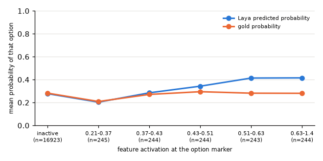

# Feature 5276

Critérios em que aparece: attribution_toward_correct

**Interpretação (preencher):** 

---

## Maiores ativações

**tr_customer_service_000217 / churn_risk** (score, customer_service) | ativação 3.432 em `pergunta` | opções ['0', '1', '2', '3'] | Laya: **2** [0.04, 0.255, 0.644, 0.061] | gabarito: **1**

```
<bos> score⟦ question⟧: How likely is this customer to stop doing business with us because of this interaction?<eos>
▸ <mask> level 0: No sign of dissatisfaction.
▸ <mask> level 1: Mild frustration, but the relationship is intact.
▸ <mask> level 2: Clearly unhappy; repeat problems or explicit complaints.
▸ <mask> level 3: Imminent: threatening to cancel, dispute or leave.

<eos>

 {"account": {"lifetime_value_usd": 835, "prior_tickets_90d": 0, "seats": 1, "tenure_months": 33, "tier": "free"}, "thread": [{"role": "customer", "text": "I've been using this account for nearly three years without an issue, but now I'm locked out and the reset emails just aren't arriving. I suppose this is just how it goes sometimes; I'm not sure what else to try."}]}<eos>
```

**tr_customer_service_000246 / churn_risk** (score, customer_service) | ativação 3.359 em `pergunta` | opções ['0', '1', '2', '3'] | Laya: **2** [0.024, 0.099, 0.613, 0.264] | gabarito: **2**

```
<bos> score⟦ question⟧: How likely is this customer to stop doing business with us because of this interaction?<eos>
▸ <mask> level 0: No sign of dissatisfaction.
▸ <mask> level 1: Mild frustration, but the relationship is intact.
▸ <mask> level 2: Clearly unhappy; repeat problems or explicit complaints.
▸ <mask> level 3: Imminent: threatening to cancel, dispute or leave.

<eos>

 {"account": {"lifetime_value_usd": 2575, "prior_tickets_90d": 0, "seats": 1, "tenure_months": 60, "tier": "free"}, "orders": [{"amount_usd": 9, "date": "2026-01-21", "id": "A-12450", "status": "settled"}], "thread": [{"role": "customer", "text": "I need someone to help me right now, I'm completely locked out of my account and I have a major presentation starting in less than twenty minutes!"}, {"role": "agent", "text": "I understand the urgency of getting back into your account before your presentation. Could you tell me the exact error message you receive when you try to log in?"}, {"role": "customer", "text": "It just says 'Authentication Failed' over and over again, and I've already tried the password reset button three times but no email is showing up!"}, {"role": "agent", "text": "Thank you for that information. To help me narrow this down, are you attempting to log in through our desktop application or via a web browser?"}, {"role": "customer", "text": "I've tried Chrome, Safari, and the desktop app, and nothing is working; I'm starting to panic because all my files are in there and I can't get to them!"}, {"role": "agent", "text": "I see. Have you had a chance to check your junk or spam folders for that reset link, or are you using a corporate network that might have a strict firewall?"}, {"role": "customer", "text": "I've checked every folder and there is nothing, and I'm just on my home Wi-Fi, so please tell me what else I can try because I'm running out of time!"}]}<eos>
```

**tr_customer_service_000294 / urgency** (score, customer_service) | ativação 3.324 em `estado` | opções ['0', '1', '2', '3'] | Laya: **3** [0.075, 0.122, 0.157, 0.646] | gabarito: **3**

```
<bos> score question: How time-sensitive is this conversation?<eos>
▸ <mask> level 0: No time pressure; can wait indefinitely.
▸ <mask> level 1: Routine; handle within the normal queue.
▸ <mask> level 2: Elevated; should be handled within the same week.
▸ <mask> level 3: Critical; requires action within the same day.

<eos>

 {"account": {"lifetime_value_usd": 3345, "prior_tickets_90d": 1, "seats": 1, "tenure_months": 41, "tier": "free"}, "orders": [{"amount_usd": 29, "date": "2026-02-13", "id": "A-72288", "status": "settled"}, {"amount_usd": 29, "date": "2026-02-07", "id": "A-13988", "status": "settled"}, {"amount_usd": 29, "date": "2026-03-22", "id": "A-75966", "status": "refunded"}], "thread": [{"role": "customer", "text": "I've had it—cancel my account immediately! I've been on your free plan for 41 months, paid roughly $29 a month, and you still can't sort out the billing mess. Ticket #12345 was only half‑fixed, and now you're making me think about leaving for good."}, {"role": "agent", "text": "I’m sorry you’re experiencing this frustration. Could you confirm the email address linked to the account and the exact issue you’d like us to address before we proceed with cancellation?"}, {"role": "customer", "text": "The issue is the same nonsense you tried to ‘partially fix’ before—random charges and a broken dashboard. I don’t want any more half‑measures; I want the account gone right now, or I’m posting a scathing review and moving my business elsewhere."},⟦ {"⟧role": "agent", "text": "I understand how aggravating that must be. To make sure we’re handling the correct profile, could you also let me know if you need a data export before we terminate the service?"}, {"role": "customer", "text": "Forget the export—just delete everything. I don’t care about my data; I just want you to stop billing me and shut the account down this instant."}, {"role": "agent", "text": "Got it, you’d like immediate termination without an export. For security, could you provide the last four digits of the payment method on file so I can verify the request?"}, {"role": "customer", "text": "I’m not giving you any more numbers. Do it now, or I’m taking this to your CEO and the press."}]}<eos>
```

**tr_customer_service_000059 / action** (choice, customer_service) | ativação 3.195 em `estado` | opções ['answer_directly', 'close_no_action', 'escalate_to_human', 'execute_refund', 'request_information'] | Laya: **answer_directly** [0.956, 0.034, 0.003, 0.004, 0.003] | gabarito: **escalate_to_human**

```
<bos> choice question: What should the assistant do next with this conversation?<eos>
▸ <mask> answer_directly: The assistant can resolve this itself with information it already has.
▸ <mask> close_no_action: No further action is warranted; the matter is settled.
▸ <mask> escalate_to_human: Hand off to a human agent with the appropriate authority.
▸ <mask> execute_refund: Issue the refund or credit the customer is owed.
▸ <mask> request_information: More detail is needed from the customer before anything can be done.

<eos>

 {"account": {"lifetime_value_usd": 169, "prior_tickets_90d": 3, "seats": 1, "tenure_months": 5, "tier": "enterprise"}, "thread": [{"role": "customer", "text": "I need my account cancelled immediately; this can’t wait any longer."}, {"role": "agent", "text": "I understand. May I ask the reason you’re choosing to cancel?"}, {"role": "customer", "text": "I’ve dealt with the same problems over and over despite three prior tickets being closed; I want confirmation that the account will be terminated."}, {"role": "agent", "text": "Got it. Could you provide the email address associated with the account so I can verify your request?"}, {"role": "customer", "text": "myname@example.com –⟦ please⟧ proceed right away."}]}<eos>
```

**tr_customer_service_000294 / needs_human** (noul, customer_service) | ativação 3.096 em `estado` | opções ['false', 'true'] | Laya: **true** [0.023, 0.977] | gabarito: **true**

```
<bos> noul question: This conversation requires a human agent rather than automated handling.<eos>
▸ <mask> false: Automation can carry this to resolution.
▸ <mask> true: A human must take over: judgement, authority or empathy is required.

<eos>

 {"account": {"lifetime_value_usd": 3345, "prior_tickets_90d": 1, "seats": 1, "tenure_months": 41, "tier": "free"}, "orders": [{"amount_usd": 29, "date": "2026-02-13", "id": "A-72288", "status": "settled"}, {"amount_usd": 29, "date": "2026-02-07", "id": "A-13988", "status": "settled"}, {"amount_usd": 29, "date": "2026-03-22", "id": "A-75966", "status": "refunded"}], "thread": [{"role": "customer", "text": "I've had it—cancel my account immediately! I've been on your free plan for 41 months, paid roughly $29 a month, and you still can't sort out the billing mess. Ticket #12345 was only half‑fixed, and now you're making me think about leaving for good."}, {"role": "agent", "text": "I’m sorry you’re experiencing this frustration. Could you confirm the email address linked to the account and the exact issue you’d like us to address before we proceed with cancellation?"}, {"role": "customer", "text": "The issue is the same nonsense you tried to ‘partially fix’ before—random charges and a broken dashboard. I don’t want any more half‑measures; I want the account gone right now, or I’m posting a scathing review and moving my business elsewhere."},⟦ {"⟧role": "agent", "text": "I understand how aggravating that must be. To make sure we’re handling the correct profile, could you also let me know if you need a data export before we terminate the service?"}, {"role": "customer", "text": "Forget the export—just delete everything. I don’t care about my data; I just want you to stop billing me and shut the account down this instant."}, {"role": "agent", "text": "Got it, you’d like immediate termination without an export. For security, could you provide the last four digits of the payment method on file so I can verify the request?"}, {"role": "customer", "text": "I’m not giving you any more numbers. Do it now, or I’m taking this to your CEO and the press."}]}<eos>
```

## Ativações medianas (faixa 40-60%, mediana 0.707)

**tr_security_incidents_000174 / severity** (score, security_incidents) | ativação 0.678 em `pergunta` | opções ['0', '1', '2', '3', '4'] | Laya: **1** [0.179, 0.367, 0.212, 0.119, 0.123] | gabarito: **3**

```
<bos>⟦ score⟧ question: How severe is the potential impact if this alert is real?<eos>
▸ <mask> level 0: Negligible: no access to anything sensitive.
▸ <mask> level 1: Low: limited access, easily reversed.
▸ <mask> level 2: Moderate: access to internal systems or non-public data.
▸ <mask> level 3: High: access to production, secrets or customer data.
▸ <mask> level 4: Critical: active compromise of crown-jewel systems.

<eos>

 {"alert": {"description": "a long-unused account became active", "evidence": "The unprivileged contractor account, previously inactive for 180 days, initiated a session from the unrecognized IP 198.51.100.12 at 02:45 UTC. This login utilized credentials rotated 14 days ago and passed MFA verification despite falling outside any active change window.", "rule": "dormant_account_use"}, "context": {"asset_criticality": "crown_jewel", "change_window_active": false, "source_on_allowlist": false}, "history": {"credential_rotation_days_ago": 14, "distinct_countries_30d": 4, "logins_30d": 1934, "prior_alerts_90d": 0}, "principal": {"mfa_enrolled": true, "name": "adm-support-509", "privileges": ["repo:read"], "type": "contractor"}}<eos>
```

**tr_security_incidents_000193 / urgency** (score, security_incidents) | ativação 0.699 em `pergunta` | opções ['0', '1', '2', '3'] | Laya: **3** [0.034, 0.095, 0.04, 0.831] | gabarito: **3**

```
<bos> score question:⟦ How⟧ quickly must a responder act on this alert?<eos>
▸ <mask> level 0: No time pressure; can wait indefinitely.
▸ <mask> level 1: Routine; handle within the normal queue.
▸ <mask> level 2: Elevated; should be handled within the same week.
▸ <mask> level 3: Critical; requires action within the same day.

<eos>

 {"alert": {"description": "audit logging was turned off on a host", "evidence": "Audit logging on host WIN-DB01 ceased at 14:03:12 local time, with the last recorded event from the service_account svc_backup occurring just before that timestamp. The change was initiated from IP address 198.51.100.77, which is not recognized as an authorized source. The service account does not have MFA enabled and its credentials were last rotated on 2024‑08‑15.", "rule": "disabled_logging"}, "context": {"asset_criticality": "low", "change_window_active": false, "source_on_allowlist": false}, "history": {"credential_rotation_days_ago": 30, "distinct_countries_30d": 1, "logins_30d": 1240, "prior_alerts_90d": 0}, "principal": {"mfa_enrolled": false, "name": "svc-billing-114", "privileges": ["deploy:production", "secrets:read"], "type": "service_account"}}<eos>
```

**tr_agent_trace_observability_000068 / needs_review** (noul, agent_trace_observability) | ativação 0.677 em `estado` | opções ['false', 'true'] | Laya: **true** [0.493, 0.507] | gabarito: **false**

```
<bos> noul question: This trace requires human review.<eos>
▸ <mask> false: No human attention is warranted.
▸ <mask> true: A human should inspect this run.

<eos>

 {"agent": {"autonomy": "unsupervised", "model": "internal-agent-v3"}, "constraints": ["Do not force-push to any branch", "Do not touch customer data outside the named accounts", "Never delete anything matching release/*"], "task":⟦ "⟧Rotate the expired TLS certificate on the staging load balancer.", "trace_summary": {"constraint_violations": 0, "duration_s": 109.7, "irreversible_actions": 0, "steps": 9, "tool_errors": 0}}<eos>
```

**tr_security_incidents_000231 / severity** (score, security_incidents) | ativação 0.783 em `estado` | opções ['0', '1', '2', '3', '4'] | Laya: **1** [0.075, 0.548, 0.251, 0.061, 0.064] | gabarito: **2**

```
<bos> score question: How severe is the potential impact if this alert is real?<eos>
▸ <mask> level 0: Negligible: no access to anything sensitive.
▸ <mask> level 1: Low: limited access, easily reversed.
▸ <mask> level 2: Moderate: access to internal systems or non-public data.
▸ <mask> level 3: High: access to production, secrets or customer data.
▸ <mask> level 4: Critical: active compromise of crown-jewel systems.

<eos>

 {"alert": {"description": "a first-ever sign-in from an unfamiliar country", "evidence⟦":⟧ "On 2026-09-15 08:45:12 UTC, employee user \"jdoe@example.com\" performed a successful interactive login to the corporate VPN from IP 203.0.113.45, which resolves to São Paulo, Brazil—a country not previously seen for this account. The login required MFA, the source IP is listed in the approved allowlist, and the account's password was last rotated on 2026-09-12.", "rule": "new_country_login"}, "context": {"asset_criticality": "high", "change_window_active": false, "source_on_allowlist": true}, "history": {"credential_rotation_days_ago": 3, "distinct_countries_30d": 2, "logins_30d": 1789, "prior_alerts_90d": 0}, "principal": {"mfa_enrolled": true, "name": "svc-support-177", "privileges": ["repo:read"], "type": "employee"}}<eos>
```

**tr_customer_service_000257 / urgency** (score, customer_service) | ativação 0.698 em `estado` | opções ['0', '1', '2', '3'] | Laya: **2** [0.05, 0.28, 0.507, 0.162] | gabarito: **3**

```
<bos> score question: How time-sensitive is this conversation?<eos>
▸ <mask> level 0: No time pressure; can wait indefinitely.
▸ <mask> level 1: Routine; handle within the normal queue.
▸ <mask> level 2: Elevated; should be handled within the same week.
▸ <mask> level 3: Critical; requires action within the same day.

<eos>

 {"account": {"lifetime_value_usd": 131, "prior_tickets_90d": 1, "seats": 1, "tenure_months": 5, "tier": "standard"}, "orders": [{"amount_usd": 447, "date": "2026-03-22", "id": "A-40460", "status": "settled"}, {"amount_usd": 447, "date": "2026-02-25", "id": "A-64478", "status": "failed"}], "thread": [{"role": "customer", "text": "What the hell? I ordered the deluxe headset for $447 and you sent me a basic mouse instead. This is unacceptable."}, {"role":⟦ "⟧agent", "text": "I’m sorry you received the wrong item. Can you tell me the order number so I can look into the mix‑up?"}, {"role": "customer", "text": "Order #B5544LM. I need the correct headset sent to me immediately."}]}<eos>
```

## Estatísticas (conjunto de descoberta, dev e teste)

**pred / error**

| split | decisões | ativas | ativas e Laya errou | taxa | lift | q (BH) | OR (CMH) | q (CMH) |
|---|---|---|---|---|---|---|---|---|
| discovery | 5100 | 435 | 316 | 0.726 | 1.13 | 0.000501 | 1.16 | 0.67 |
| dev | 900 | 75 | 59 | 0.787 | 1.17 | 0.0993 | 1.18 | 0.912 |
| test | 2000 | 168 | 125 | 0.744 | 1.14 | 0.0211 | 1.83 | 0.443 |

**corr / error**

| split | decisões | ativas | ativas e Laya errou | taxa | lift | q (BH) | OR (CMH) | q (CMH) |
|---|---|---|---|---|---|---|---|---|
| discovery | 5100 | 305 | 186 | 0.610 | 0.95 | 0.267 | 0.56 | 0.0238 |
| dev | 900 | 62 | 46 | 0.742 | 1.10 | 0.373 | 1.67 | 0.64 |
| test | 2000 | 151 | 108 | 0.715 | 1.10 | 0.128 | 1.36 | 0.547 |

**state / error**

| split | decisões | ativas | ativas e Laya errou | taxa | lift | q (BH) | OR (CMH) | q (CMH) |
|---|---|---|---|---|---|---|---|---|
| discovery | 5100 | 4264 | 2709 | 0.635 | 0.99 | 0.0187 | 1.02 | 0.947 |
| dev | 900 | 733 | 492 | 0.671 | 1.00 | 1 | 1.69 | 0.221 |
| test | 2000 | 1700 | 1089 | 0.641 | 0.98 | 0.164 | 1.03 | 0.953 |

**pred / probe_right_laya_wrong**

| split | decisões | ativas | ativas e Laya errou | taxa | lift | q (BH) | OR (CMH) | q (CMH) |
|---|---|---|---|---|---|---|---|---|
| discovery | 2932 | 256 | 187 | 0.730 | 1.21 | 5.1e-05 | 1.07 | 0.914 |
| dev | 523 | 40 | 32 | 0.800 | 1.24 | 0.103 | 1.59 | 0.803 |
| test | 1149 | 105 | 82 | 0.781 | 1.28 | 0.000557 | 1.17 | 0.902 |

**corr / probe_right_laya_wrong**

| split | decisões | ativas | ativas e Laya errou | taxa | lift | q (BH) | OR (CMH) | q (CMH) |
|---|---|---|---|---|---|---|---|---|
| discovery | 2932 | 200 | 131 | 0.655 | 1.08 | 0.188 | 0.65 | 0.283 |
| dev | 523 | 46 | 38 | 0.826 | 1.28 | 0.0162 | 2.50 | 0.458 |
| test | 1149 | 98 | 75 | 0.765 | 1.25 | 0.00212 | 1.32 | 0.727 |

**state / probe_right_laya_wrong**

| split | decisões | ativas | ativas e Laya errou | taxa | lift | q (BH) | OR (CMH) | q (CMH) |
|---|---|---|---|---|---|---|---|---|
| discovery | 2932 | 2449 | 1428 | 0.583 | 0.96 | 2.65e-07 | 0.88 | 0.589 |
| dev | 523 | 419 | 266 | 0.635 | 0.98 | 0.651 | 2.13 | 0.134 |
| test | 1149 | 963 | 574 | 0.596 | 0.98 | 0.104 | 1.21 | 0.683 |

Confusão mais sobre-representada (pred): `disposition|3>2` (n=92, lift 6.42, p=0). Formato `pergunta|índice previsto>índice correto`.

Confusão mais sobre-representada (corr): `duplicate|1>0` (n=50, lift 3.85, p=1.08e-17). Formato `pergunta|índice previsto>índice correto`.

Confusão mais sobre-representada (state): `risk|2>1` (n=79, lift 1.18, p=9.04e-06). Formato `pergunta|índice previsto>índice correto`.



