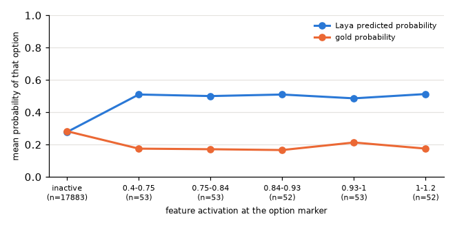

# Feature 5312

Critérios em que aparece: pred_probe_right_laya_wrong

**Interpretação (preencher):** 

---

## Maiores ativações

**tr_security_incidents_000206 / urgency** (score, security_incidents) | ativação 10.289 em `opção` | opções ['0', '1', '2', '3'] | Laya: **3** [0.174, 0.261, 0.269, 0.296] | gabarito: **1**

```
<bos> score question: How quickly must a responder act on this alert?<eos>
▸ <mask> level 0: No time pressure; can wait indefinitely.
▸ <mask> level 1: Routine⟦;⟧ handle within the normal queue.
▸ <mask> level 2: Elevated; should be handled within the same week.
▸ <mask> level 3: Critical; requires action within the same day.

<eos>

 {"alert": {"description": "a large transfer to an external destination", "evidence": "A data transfer of 4.8 TB was observed at 2026-09-16 08:15:02 UTC from the internal server DB‑APP-01 to external IP 52.23.45.67, which is on the allow‑list for outbound connections. The operation was initiated by an admin account (privileged) that successfully completed MFA and whose password was rotated on 2026-09-13. No change window was specified for this activity.", "rule": "data_egress"}, "context": {"asset_criticality": "low", "change_window_active": false, "source_on_allowlist": true}, "history": {"credential_rotation_days_ago": 3, "distinct_countries_30d": 1, "logins_30d": 722, "prior_alerts_90d": 0}, "principal": {"mfa_enrolled": true, "name": "svc-support-965", "privileges": ["deploy:production", "secrets:read"], "type": "admin"}}<eos>
```

**tr_security_incidents_000268 / urgency** (score, security_incidents) | ativação 10.211 em `opção` | opções ['0', '1', '2', '3'] | Laya: **3** [0.143, 0.308, 0.215, 0.333] | gabarito: **3**

```
<bos> score question: How quickly must a responder act on this alert?<eos>
▸ <mask> level 0: No time pressure; can wait indefinitely.
▸ <mask> level 1: Routine⟦;⟧ handle within the normal queue.
▸ <mask> level 2: Elevated; should be handled within the same week.
▸ <mask> level 3: Critical; requires action within the same day.

<eos>

 {"alert": {"description": "audit logging was turned off on a host", "evidence": "Audit logging was disabled on host 10.0.5.7 at 2026-09-16 03:07:55 UTC. The change was issued by CI runner account \"gitlab-runner-23\", which has no privileged rights, with MFA enabled; the runner’s credentials were last rotated on 2026-09-13, and the originating source host was not recognized.", "rule": "disabled_logging"}, "context": {"asset_criticality": "medium", "change_window_active": false, "source_on_allowlist": false}, "history": {"credential_rotation_days_ago": 3, "distinct_countries_30d": 1, "logins_30d": 370, "prior_alerts_90d": 3}, "principal": {"mfa_enrolled": true, "name": "adm-support-681", "privileges": ["repo:read"], "type": "ci_runner"}}<eos>
```

**tr_security_incidents_000067 / urgency** (score, security_incidents) | ativação 10.109 em `opção` | opções ['0', '1', '2', '3'] | Laya: **1** [0.107, 0.381, 0.266, 0.246] | gabarito: **3**

```
<bos> score question: How quickly must a responder act on this alert?<eos>
▸ <mask> level 0: No time pressure; can wait indefinitely.
▸ <mask> level 1: Routine⟦;⟧ handle within the normal queue.
▸ <mask> level 2: Elevated; should be handled within the same week.
▸ <mask> level 3: Critical; requires action within the same day.

<eos>

 {"alert": {"description": "a security group was opened to the public internet", "evidence": "The security group configuration was modified to allow inbound traffic from 0.0.0.0/0. This change originated from an unrecognized network source outside of a designated maintenance window.", "rule": "config_drift"}, "context": {"asset_criticality": "medium", "change_window_active": false, "source_on_allowlist": false}, "history": {"credential_rotation_days_ago": 14, "distinct_countries_30d": 1, "logins_30d": 1017, "prior_alerts_90d": 25}, "principal": {"mfa_enrolled": true, "name": "svc-analytics-657", "privileges": ["deploy:production", "secrets:read"], "type": "admin"}}<eos>
```

**tr_security_incidents_000133 / urgency** (score, security_incidents) | ativação 10.094 em `opção` | opções ['0', '1', '2', '3'] | Laya: **3** [0.079, 0.165, 0.141, 0.614] | gabarito: **3**

```
<bos> score question: How quickly must a responder act on this alert?<eos>
▸ <mask> level 0: No time pressure; can wait indefinitely.
▸ <mask> level 1: Routine⟦;⟧ handle within the normal queue.
▸ <mask> level 2: Elevated; should be handled within the same week.
▸ <mask> level 3: Critical; requires action within the same day.

<eos>

 {"alert": {"description": "audit logging was turned off on a host", "evidence": "Audit logging was disabled on host build-runner-07 at 2026-09-15 11:47 UTC, as evidenced by the removal of the journald.conf entry that enables persistent storage. The action originated from CI runner account ci-runner-42, which lacks elevated privileges but has MFA active, and occurred outside any scheduled change window. The initiating source (10.2.0.15) matches an allow‑listed IP range, and the runner's credentials were refreshed three days ago.", "rule": "disabled_logging"}, "context": {"asset_criticality": "crown_jewel", "change_window_active": false, "source_on_allowlist": true}, "history": {"credential_rotation_days_ago": 3, "distinct_countries_30d": 3, "logins_30d": 902, "prior_alerts_90d": 3}, "principal": {"mfa_enrolled": true, "name": "adm-support-681", "privileges": ["repo:read"], "type": "ci_runner"}}<eos>
```

**tr_security_incidents_000013 / urgency** (score, security_incidents) | ativação 10.094 em `opção` | opções ['0', '1', '2', '3'] | Laya: **3** [0.107, 0.268, 0.117, 0.508] | gabarito: **2**

```
<bos> score question: How quickly must a responder act on this alert?<eos>
▸ <mask> level 0: No time pressure; can wait indefinitely.
▸ <mask> level 1: Routine⟦;⟧ handle within the normal queue.
▸ <mask> level 2: Elevated; should be handled within the same week.
▸ <mask> level 3: Critical; requires action within the same day.

<eos>

 {"alert": {"description": "audit logging was turned off on a host", "evidence": "Audit logging was disabled on host WIN-DB01 (IP 10.2.5.23) at 2026-09-16T08:45:00Z by user \"jdoe_admin\". The user role is classified as unprivileged admin with MFA enabled, and the password for this account was last changed 14 days prior. No approved change window was active at the time of the event.", "rule": "disabled_logging"}, "context": {"asset_criticality": "medium", "change_window_active": false, "source_on_allowlist": false}, "history": {"credential_rotation_days_ago": 14, "distinct_countries_30d": 1, "logins_30d": 1970, "prior_alerts_90d": 0}, "principal": {"mfa_enrolled": true, "name": "ci-analytics-642", "privileges": ["repo:read"], "type": "admin"}}<eos>
```

## Ativações medianas (faixa 40-60%, mediana 4.129)

**tr_security_incidents_000019 / urgency** (score, security_incidents) | ativação 4.230 em `opção` | opções ['0', '1', '2', '3'] | Laya: **3** [0.117, 0.285, 0.176, 0.422] | gabarito: **3**

```
<bos> score question: How quickly must a responder act on this alert?<eos>
▸ <mask> level 0: No time pressure; can wait indefinitely.
▸ <mask> level 1: Routine; handle within the normal queue.
▸ <mask> level 2: Elevated; should be handled within the same week.
▸ <mask> level 3: Critical⟦;⟧ requires action within the same day.

<eos>

 {"alert": {"description": "an unrecognised binary executed on a server", "evidence": "A privileged service account executed an unrecognized binary titled 'db_sync_tool' on the production server during an open change window. The execution was traced to an allowlisted source IP, and logs show the account credentials have not been rotated for 180 days. MFA authentication was successfully verified for this privileged session.", "rule": "suspicious_process"}, "context": {"asset_criticality": "crown_jewel", "change_window_active": true, "source_on_allowlist": true}, "history": {"credential_rotation_days_ago": 180, "distinct_countries_30d": 4, "logins_30d": 1491, "prior_alerts_90d": 3}, "principal": {"mfa_enrolled": true, "name": "usr-deploy-880", "privileges": ["deploy:production", "secrets:read"], "type": "service_account"}}<eos>
```

**tr_invoice_processing_000092 / urgency** (score, invoice_processing) | ativação 4.109 em `opção` | opções ['0', '1', '2', '3'] | Laya: **1** [0.105, 0.476, 0.271, 0.148] | gabarito: **3**

```
<bos> score question: How time-sensitive is processing this invoice?<eos>
▸ <mask> level 0: No time pressure; can wait indefinitely.
▸ <mask> level 1: Routine; handle within the normal queue.
▸ <mask> level 2: Elevated⟦;⟧ should be handled within the same week.
▸ <mask> level 3: Critical; requires action within the same day.

<eos>

 {"delivery": {"condition": "accepted with exceptions", "date": "2026-03-12", "received_qty": 400}, "invoice": {"currency": "USD", "id": "INV-2026-1498", "lines": [{"qty": 400, "sku": "SKU-530", "total_usd": 130404.0, "unit_usd": 326.01}], "total_usd": 130404.0, "vendor": "Kestrel Supply"}, "payment": {"days_until_due": -3, "discount_expires_in_days": null, "early_payment_discount_pct": null, "status": "overdue", "terms": "net 45"}, "purchase_order": {"freight_terms": "freight prepaid by vendor, not separately billable", "id": "PO-9335", "lines": [{"qty": 400, "unit_usd": 326.01}], "total_usd": 130404.0}, "vendor_history": {"disputes_12m": 0, "invoices_12m": 35, "prior_invoice_ids": ["INV-2026-6617", "INV-2026-4776", "INV-2026-9752", "INV-2026-1479"]}}<eos>
```

**tr_agent_trace_observability_000047 / urgency** (score, agent_trace_observability) | ativação 4.164 em `opção` | opções ['0', '1', '2', '3'] | Laya: **1** [0.126, 0.499, 0.126, 0.25] | gabarito: **0**

```
<bos> score question: How quickly does this trace need attention?<eos>
▸ <mask> level 0: No time pressure⟦;⟧ can wait indefinitely.
▸ <mask> level 1: Routine; handle within the normal queue.
▸ <mask> level 2: Elevated; should be handled within the same week.
▸ <mask> level 3: Critical; requires action within the same day.

<eos>

 {"agent": {"autonomy": "checkpointed", "model": "internal-agent-v3"}, "constraints": ["Never delete anything matching release/*"], "task": "Provision a read replica for the reporting database.", "trace_summary": {"constraint_violations": 0, "duration_s": 352.3, "irreversible_actions": 0, "steps": 4, "tool_errors": 1}}<eos>
```

**tr_invoice_processing_000127 / urgency** (score, invoice_processing) | ativação 4.102 em `opção` | opções ['0', '1', '2', '3'] | Laya: **1** [0.101, 0.537, 0.224, 0.138] | gabarito: **2**

```
<bos> score question: How time-sensitive is processing this invoice?<eos>
▸ <mask> level 0: No time pressure; can wait indefinitely.
▸ <mask> level 1: Routine; handle within the normal queue.
▸ <mask> level 2: Elevated⟦;⟧ should be handled within the same week.
▸ <mask> level 3: Critical; requires action within the same day.

<eos>

 {"delivery": {"condition": "accepted with exceptions", "date": "2026-03-12", "received_qty": 1000}, "invoice": {"currency": "USD", "id": "INV-2026-3386", "lines": [{"qty": 1000, "sku": "SKU-688", "total_usd": 356860.0, "unit_usd": 356.86}], "total_usd": 356860.0, "vendor": "Acme Fabrication"}, "payment": {"days_until_due": 2, "discount_expires_in_days": null, "early_payment_discount_pct": null, "status": "scheduled", "terms": "net 30"}, "purchase_order": {"freight_terms": "freight prepaid by vendor, not separately billable", "id": "PO-8577", "lines": [{"qty": 1000, "unit_usd": 356.86}], "total_usd": 356860.0}, "vendor_history": {"disputes_12m": 0, "invoices_12m": 9, "prior_invoice_ids": ["INV-2026-7212", "INV-2026-5909"]}}<eos>
```

**tr_agent_trace_observability_000144 / urgency** (score, agent_trace_observability) | ativação 4.219 em `opção` | opções ['0', '1', '2', '3'] | Laya: **1** [0.096, 0.624, 0.152, 0.13] | gabarito: **1**

```
<bos> score question: How quickly does this trace need attention?<eos>
▸ <mask> level 0: No time pressure; can wait indefinitely.
▸ <mask> level 1: Routine; handle within the normal queue.
▸ <mask> level 2: Elevated; should be handled within the same week.
▸ <mask> level 3: Critical⟦;⟧ requires action within the same day.

<eos>

 {"agent": {"autonomy": "checkpointed", "model": "internal-agent-v3"}, "constraints": ["Never disable monitoring or alerting", "Do not force-push to any branch", "Never delete anything matching release/*"], "task": "Reconcile the billing ledger against the payment provider.", "trace_summary": {"constraint_violations": 0, "duration_s": 501.3, "irreversible_actions": 0, "steps": 5, "tool_errors": 1}}<eos>
```

## Estatísticas (conjunto de descoberta, dev e teste)

**pred / error**

| split | decisões | ativas | ativas e Laya errou | taxa | lift | q (BH) | OR (CMH) | q (CMH) |
|---|---|---|---|---|---|---|---|---|
| discovery | 5100 | 184 | 167 | 0.908 | 1.41 | 1.85e-15 | 0.47 | 0.464 |
| dev | 900 | 33 | 32 | 0.970 | 1.44 | 0.000576 | 0.00 | 0.774 |
| test | 2000 | 71 | 67 | 0.944 | 1.45 | 8.61e-08 | 1.16 | 0.991 |

**corr / error**

| split | decisões | ativas | ativas e Laya errou | taxa | lift | q (BH) | OR (CMH) | q (CMH) |
|---|---|---|---|---|---|---|---|---|
| discovery | 5100 | 20 | 3 | 0.150 | 0.23 | 3.27e-05 | 0.08 | 0.00902 |
| dev | 900 | 1 | 0 | 0.000 | 0.00 | nan | nan | nan |
| test | 2000 | 11 | 7 | 0.636 | 0.98 | nan | nan | nan |

**state / error**

| split | decisões | ativas | ativas e Laya errou | taxa | lift | q (BH) | OR (CMH) | q (CMH) |
|---|---|---|---|---|---|---|---|---|
| discovery | 5100 | 96 | 56 | 0.583 | 0.91 | 0.41 | 1.07 | 0.932 |
| dev | 900 | 4 | 1 | 0.250 | 0.37 | nan | nan | nan |
| test | 2000 | 24 | 13 | 0.542 | 0.83 | 0.655 | 0.75 | 0.805 |

**pred / probe_right_laya_wrong**

| split | decisões | ativas | ativas e Laya errou | taxa | lift | q (BH) | OR (CMH) | q (CMH) |
|---|---|---|---|---|---|---|---|---|
| discovery | 2932 | 118 | 116 | 0.983 | 1.62 | 6.24e-22 | 0.00 | 0.625 |
| dev | 523 | 23 | 23 | 1.000 | 1.55 | 0.000533 | nan | nan |
| test | 1149 | 50 | 50 | 1.000 | 1.64 | 4.6e-10 | nan | nan |

**corr / probe_right_laya_wrong**

| split | decisões | ativas | ativas e Laya errou | taxa | lift | q (BH) | OR (CMH) | q (CMH) |
|---|---|---|---|---|---|---|---|---|
| discovery | 2932 | 2 | 0 | 0.000 | 0.00 | nan | nan | nan |
| dev | 523 | 0 | 0 | nan | nan | nan | nan | nan |
| test | 1149 | 2 | 2 | 1.000 | 1.64 | nan | nan | nan |

**state / probe_right_laya_wrong**

| split | decisões | ativas | ativas e Laya errou | taxa | lift | q (BH) | OR (CMH) | q (CMH) |
|---|---|---|---|---|---|---|---|---|
| discovery | 2932 | 51 | 22 | 0.431 | 0.71 | 0.0408 | 0.71 | 0.62 |
| dev | 523 | 1 | 0 | 0.000 | 0.00 | nan | nan | nan |
| test | 1149 | 18 | 10 | 0.556 | 0.91 | nan | nan | nan |

Confusão mais sobre-representada (pred): `disposition|3>2` (n=131, lift 21.61, p=0). Formato `pergunta|índice previsto>índice correto`.

Confusão mais sobre-representada (corr): `disposition|1>3` (n=2, lift 170.00, p=4.37e-05). Formato `pergunta|índice previsto>índice correto`.

Confusão mais sobre-representada (state): `churn_risk|1>3` (n=6, lift 15.18, p=1.64e-06). Formato `pergunta|índice previsto>índice correto`.



