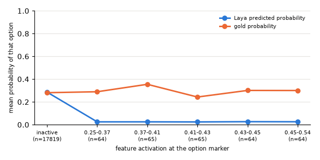

# Feature 5373

Critérios em que aparece: corr_probe_right_laya_wrong

**Interpretação (preencher):** 

---

## Maiores ativações

**tr_invoice_processing_000246 / discrepancy_severity** (score, invoice_processing) | ativação 3.896 em `estado` | opções ['0', '1', '2', '3'] | Laya: **2** [0.116, 0.295, 0.508, 0.081] | gabarito: **2**

```
<bos> score question: How material is any discrepancy between the invoice, the order and the delivery?<eos>
▸ <mask> level 0: None: everything reconciles.
▸ <mask> level 1: Trivial: rounding or a cosmetic difference.
▸ <mask> level 2: Moderate: a real difference worth confirming.
▸ <mask> level 3: Material: a large or unexplained difference.

<eos>

 {"delivery": {"condition": "accepted with exceptions", "date": "2026-03-13", "received_qty": 100}, "invoice": {"currency": "USD", "id": "INV-2026-9771", "lines": [{"qty": 100, "sku": "SKU-808", "total_usd": 28674.0, "unit_usd": 286.74}], "total_usd": 28674.0, "vendor":⟦ "⟧Vantage Materials"}, "payment": {"days_until_due": 18, "discount_expires_in_days": null, "early_payment_discount_pct": null, "status": "scheduled", "terms": "net 30"}, "purchase_order": {"freight_terms": "freight prepaid by vendor, not separately billable", "id": "PO-5067", "lines": [{"qty": 100, "unit_usd": 286.74}], "total_usd": 28674.0}, "vendor_history": {"disputes_12m": 0, "invoices_12m": 33, "prior_invoice_ids": ["INV-2026-6899", "INV-2026-5358", "INV-2026-9069", "INV-2026-1688"]}}<eos>
```

**tr_invoice_processing_000188 / discrepancy_severity** (score, invoice_processing) | ativação 3.777 em `estado` | opções ['0', '1', '2', '3'] | Laya: **2** [0.066, 0.343, 0.531, 0.06] | gabarito: **2**

```
<bos> score question: How material is any discrepancy between the invoice, the order and the delivery?<eos>
▸ <mask> level 0: None: everything reconciles.
▸ <mask> level 1: Trivial: rounding or a cosmetic difference.
▸ <mask> level 2: Moderate: a real difference worth confirming.
▸ <mask> level 3: Material: a large or unexplained difference.

<eos>

 {"delivery": {"condition": "accepted", "date": "2026-03-15", "received_qty": 100}, "invoice": {"currency": "USD", "id": "INV-2026-3653", "lines": [{"qty": 105, "sku": "SKU-202", "total_usd": 18433.8, "unit_usd": 175.56}], "total_usd": 18433.8, "vendor":⟦ "⟧Vantage Materials"}, "payment": {"days_until_due": -9, "discount_expires_in_days": null, "early_payment_discount_pct": null, "status": "overdue", "terms": "net 30"}, "purchase_order": {"freight_terms": "freight prepaid by vendor, not separately billable", "id": "PO-4680", "lines": [{"qty": 100, "unit_usd": 175.56}], "total_usd": 17556.0}, "vendor_history": {"disputes_12m": 0, "invoices_12m": 13, "prior_invoice_ids": ["INV-2026-6119", "INV-2026-3195", "INV-2026-6893", "INV-2026-4761"]}}<eos>
```

**tr_invoice_processing_000197 / discrepancy_severity** (score, invoice_processing) | ativação 3.746 em `estado` | opções ['0', '1', '2', '3'] | Laya: **2** [0.071, 0.271, 0.581, 0.076] | gabarito: **3**

```
<bos> score question: How material is any discrepancy between the invoice, the order and the delivery?<eos>
▸ <mask> level 0: None: everything reconciles.
▸ <mask> level 1: Trivial: rounding or a cosmetic difference.
▸ <mask> level 2: Moderate: a real difference worth confirming.
▸ <mask> level 3: Material: a large or unexplained difference.

<eos>

 {"delivery": {"condition": "accepted with exceptions", "date": "2026-03-20", "received_qty": 100}, "invoice": {"currency": "USD", "id": "INV-2026-2449", "lines": [{"qty": 100, "sku": "SKU-717", "total_usd": 14417.0, "unit_usd": 144.17}], "total_usd": 14417.0, "vendor":⟦ "⟧Vantage Materials"}, "payment": {"days_until_due": 18, "discount_expires_in_days": null, "early_payment_discount_pct": null, "status": "scheduled", "terms": "net 30"}, "purchase_order": {"freight_terms": "freight prepaid by vendor, not separately billable", "id": "PO-3796", "lines": [{"qty": 100, "unit_usd": 144.17}], "total_usd": 14417.0}, "vendor_history": {"disputes_12m": 2, "invoices_12m": 25, "prior_invoice_ids": ["INV-2026-2449", "INV-2026-9332", "INV-2026-7430", "INV-2026-9715"]}}<eos>
```

**tr_invoice_processing_000192 / discrepancy_severity** (score, invoice_processing) | ativação 3.738 em `estado` | opções ['0', '1', '2', '3'] | Laya: **2** [0.072, 0.382, 0.472, 0.073] | gabarito: **0**

```
<bos> score question: How material is any discrepancy between the invoice, the order and the delivery?<eos>
▸ <mask> level 0: None: everything reconciles.
▸ <mask> level 1: Trivial: rounding or a cosmetic difference.
▸ <mask> level 2: Moderate: a real difference worth confirming.
▸ <mask> level 3: Material: a large or unexplained difference.

<eos>

 {"delivery": {"condition": "accepted with exceptions", "date": "2026-03-15", "received_qty": 100}, "invoice": {"currency": "USD", "id": "INV-2026-3889", "lines": [{"qty": 100, "sku": "SKU-203", "total_usd": 15547.0, "unit_usd": 155.47}], "total_usd": 15547.0, "vendor":⟦ "⟧Vantage Materials"}, "payment": {"days_until_due": 44, "discount_expires_in_days": null, "early_payment_discount_pct": null, "status": "scheduled", "terms": "net 60"}, "purchase_order": {"freight_terms": "freight prepaid by vendor, not separately billable", "id": "PO-3301", "lines": [{"qty": 100, "unit_usd": 155.47}], "total_usd": 15547.0}, "vendor_history": {"disputes_12m": 2, "invoices_12m": 14, "prior_invoice_ids": ["INV-2026-3889", "INV-2026-9651", "INV-2026-8012", "INV-2026-5534"]}}<eos>
```

**tr_invoice_processing_000021 / discrepancy_severity** (score, invoice_processing) | ativação 3.727 em `estado` | opções ['0', '1', '2', '3'] | Laya: **2** [0.046, 0.305, 0.573, 0.076] | gabarito: **0**

```
<bos> score question: How material is any discrepancy between the invoice, the order and the delivery?<eos>
▸ <mask> level 0: None: everything reconciles.
▸ <mask> level 1: Trivial: rounding or a cosmetic difference.
▸ <mask> level 2: Moderate: a real difference worth confirming.
▸ <mask> level 3: Material: a large or unexplained difference.

<eos>

 {"delivery": {"condition": "accepted", "date": "2026-03-07", "received_qty": 100}, "invoice": {"currency": "USD", "id": "INV-2026-1810", "lines": [{"qty": 100, "sku": "SKU-868", "total_usd": 40841.0, "unit_usd": 408.41}], "total_usd": 40841.0, "vendor":⟦ "⟧Vantage Materials"}, "payment": {"days_until_due": 0, "discount_expires_in_days": null, "early_payment_discount_pct": null, "status": "scheduled", "terms": "net 45"}, "purchase_order": {"freight_terms": "freight prepaid by vendor, not separately billable", "id": "PO-3491", "lines": [{"qty": 100, "unit_usd": 408.41}], "total_usd": 40841.0}, "vendor_history": {"disputes_12m": 0, "invoices_12m": 57, "prior_invoice_ids": ["INV-2026-1810", "INV-2026-7846", "INV-2026-5769", "INV-2026-7710"]}}<eos>
```

## Ativações medianas (faixa 40-60%, mediana 0.606)

**tr_customer_service_000033 / action** (choice, customer_service) | ativação 0.619 em `estado` | opções ['answer_directly', 'close_no_action', 'escalate_to_human', 'execute_refund', 'request_information'] | Laya: **close_no_action** [0.067, 0.893, 0.015, 0.015, 0.01] | gabarito: **escalate_to_human**

```
<bos> choice question: What should the assistant do next with this conversation?<eos>
▸ <mask> answer_directly: The assistant can resolve this itself with information it already has.
▸ <mask> close_no_action: No further action is warranted; the matter is settled.
▸ <mask> escalate_to_human: Hand off to a human agent with the appropriate authority.
▸ <mask> execute_refund: Issue the refund or credit the customer is owed.
▸ <mask> request_information: More detail is needed from the customer before anything can be done.

<eos>

 {"account": {"lifetime_value_usd": 972, "prior_tickets_90d": 3, "seats": 1, "tenure_months": 49, "tier": "free"}, "orders": [{"amount_usd": 999, "date": "2026-03-06", "id⟦":⟧ "A-72271", "status": "settled"}, {"amount_usd": 999, "date": "2026-02-16", "id": "A-14198", "status": "settled"}, {"amount_usd": 999, "date": "2026-01-05", "id": "A-90678", "status": "settled"}], "thread": [{"role": "customer", "text": "I've been trying to downgrade to the free plan for three days now and the website just keeps looping me back to the dashboard. This is incredibly annoying given I've been a loyal user for over four years."}, {"role": "agent", "text": "I'm sorry for the frustration the downgrade process is causing. Could you tell me if you are seeing any specific error codes or pop-up messages when the page refreshes?"}, {"role": "customer", "text": "There are no codes, it just fails silently. I've spent almost a thousand dollars with you guys over 49 months, and after having three previous tickets only 'partially' addressed, I really expected a simple plan change to actually work."}, {"role": "agent", "text": "I appreciate your long-term history with us. To help me investigate the account block, would you mind specifying which features from those three previous tickets are still causing you issues on your current plan?"}, {"role": "customer", "text": "The seat management and the data exports never worked right, which is why I'm trying to scale back. I'm just tired of paying for a service that feels broken every time I try to adjust my settings."}]}<eos>
```

**tr_invoice_processing_000194 / discrepancy_severity** (score, invoice_processing) | ativação 0.723 em `estado` | opções ['0', '1', '2', '3'] | Laya: **2** [0.075, 0.233, 0.616, 0.076] | gabarito: **0**

```
<bos> score question: How material is any discrepancy between the invoice, the order and the delivery?<eos>
▸ <mask> level 0: None: everything reconciles.
▸ <mask> level 1: Trivial: rounding or a cosmetic difference.
▸ <mask> level 2: Moderate: a real difference worth confirming.
▸ <mask> level 3: Material: a large or unexplained difference.

<eos>

 {"delivery": {"condition": "accepted", "date": "2026-03-09", "received_qty": 1000}, "invoice": {"currency": "USD", "id": "INV-2026-6341", "lines": [{"qty": 1000, "sku": "SKU-622", "total_usd": 173280.0, "unit_usd": 173.28}], "total_usd": 173280.0, "vendor": "Acme Fabrication"}, "payment": {"days_until_due": -21, "discount_expires_in_days": null, "early_payment_discount_pct": null, "status": "overdue", "terms": "net 30"}, "purchase_order": {"freight_terms": "freight prepaid by vendor, not separately billable", "id": "PO-3528", "lines": [{"qty": 1000, "unit_usd": 173.28}], "total_usd": 173280.0}, "vendor_history": {"disputes_12m": 0, "invoices_12m": 11, "prior_invoice_ids": ["INV⟦-⟧2026-6341"]}}<eos>
```

**tr_security_incidents_000205 / urgency** (score, security_incidents) | ativação 0.611 em `opção` | opções ['0', '1', '2', '3'] | Laya: **3** [0.178, 0.251, 0.189, 0.382] | gabarito: **3**

```
<bos> score question: How quickly must a responder act on this alert?<eos>
▸ <mask> level 0:⟦ No⟧ time pressure; can wait indefinitely.
▸ <mask> level 1: Routine; handle within the normal queue.
▸ <mask> level 2: Elevated; should be handled within the same week.
▸ <mask> level 3: Critical; requires action within the same day.

<eos>

 {"alert": {"description": "audit logging was turned off on a host", "evidence": "On 2026-09-14 22:07:53 UTC audit logging was disabled on host WIN‑SRV-12 (hostname: win-srv-12.corp.example.com) by an employee account with unprivileged rights. The action originated from an unrecognised source IP 198.51.100.22, MFA was confirmed, and the user’s credentials were last updated on 2026-06-16. No maintenance window was associated with this change.", "rule": "disabled_logging"}, "context": {"asset_criticality": "medium", "change_window_active": false, "source_on_allowlist": false}, "history": {"credential_rotation_days_ago": 90, "distinct_countries_30d": 4, "logins_30d": 1587, "prior_alerts_90d": 0}, "principal": {"mfa_enrolled": true, "name": "ci-infra-804", "privileges": ["repo:read"], "type": "employee"}}<eos>
```

**tr_invoice_processing_000115 / disposition** (choice, invoice_processing) | ativação 0.529 em `marcador` | opções ['approve', 'hold', 'manual_review', 'reject'] | Laya: **approve** [0.66, 0.122, 0.017, 0.201] | gabarito: **manual_review**

```
<bos> choice question: How should this vendor invoice be dispositioned?<eos>
▸ <mask> approve: Matches the order and delivery; approve for payment.
▸ <mask> hold: Something needs confirming before payment; hold pending clarification.
▸ ⟦<mask>⟧ manual_review: A human in finance must review the discrepancy.
▸ <mask> reject: Should not be paid: duplicate, unauthorised or materially wrong.

<eos>

 {"delivery": {"condition": "accepted", "date": "2026-03-01", "received_qty": 250}, "invoice": {"currency": "USD", "id": "INV-2026-2237", "lines": [{"qty": 250, "sku": "SKU-253", "total_usd": 43517.5, "unit_usd": 174.07}], "total_usd": 43517.5, "vendor": "Acme Fabrication"}, "payment": {"days_until_due": -21, "discount_expires_in_days": 6, "early_payment_discount_pct": 2.0, "status": "overdue", "terms": "net 15"}, "purchase_order": {"freight_terms": "freight prepaid by vendor, not separately billable", "id": "PO-2032", "lines": [{"qty": 250, "unit_usd": 169.0}], "total_usd": 42250.0}, "vendor_history": {"disputes_12m": 1, "invoices_12m": 42, "prior_invoice_ids": ["INV-2026-7782", "INV-2026-3580", "INV-2026-5842"]}}<eos>
```

**tr_customer_service_000206 / category** (choice, customer_service) | ativação 0.536 em `estado` | opções ['account', 'billing', 'delivery', 'refund', 'technical'] | Laya: **billing** [0.088, 0.859, 0.001, 0.002, 0.051] | gabarito: **billing**

```
<bos> choice question: What is this customer conversation primarily about?<eos>
▸ <mask> account: Login, plan changes, profile or access management.
▸ <mask> billing: A charge, invoice, subscription or payment problem.
▸ <mask> delivery: Shipping, fulfilment or delivery of a physical item.
▸ <mask> refund: The customer is explicitly asking for money back.
▸ <mask> technical: The product or service is not working as expected.

<eos>

 {"account": {"lifetime_value_usd": 152, "prior_tickets_90d": 3, "seats": 1, "tenure_months": 5, "tier": "standard"}, "orders": [{"amount_usd": 297, "date": "2026-03-11", "id": "A-35334", "status": "settled"}], "thread":⟦ [⟧{"role": "customer", "text": "I just got an email saying my $297 payment failed, but I don't understand why because I haven't changed any of my bank settings."}, {"role": "agent", "text": "I can certainly look into that billing notification for you. Have you recently updated any of the security features on your credit card, such as a new expiration date or CVV?"}, {"role": "customer", "text": "No, everything is exactly the same as it was when it worked two months ago. This same thing happened back in June and then it just started working again for no reason."}, {"role": "agent", "text": "I see that we've had a few intermittent issues with this account in the past. Are you getting a specific error message when you try to manually process the payment through the 'Pay Now' button?"}, {"role": "customer", "text": "It just gives me a red box that says 'Transaction Denied' and tells me to contact my administrator, but I am the administrator."}, {"role": "agent", "text": "That is definitely confusing. Could you tell me if you are trying to process this through a VPN or a restricted corporate network, as that can sometimes trigger a decline?"}, {"role": "customer", "text": "I'm just using my home Wi-Fi like I always do, so I don't think it's a network problem on my end."}]}<eos>
```

## Estatísticas (conjunto de descoberta, dev e teste)

**pred / error**

| split | decisões | ativas | ativas e Laya errou | taxa | lift | q (BH) | OR (CMH) | q (CMH) |
|---|---|---|---|---|---|---|---|---|
| discovery | 5100 | 0 | 0 | nan | nan | nan | nan | nan |
| dev | 900 | 0 | 0 | nan | nan | nan | nan | nan |
| test | 2000 | 0 | 0 | nan | nan | nan | nan | nan |

**corr / error**

| split | decisões | ativas | ativas e Laya errou | taxa | lift | q (BH) | OR (CMH) | q (CMH) |
|---|---|---|---|---|---|---|---|---|
| discovery | 5100 | 100 | 100 | 1.000 | 1.55 | 6.13e-19 | inf | 0.0189 |
| dev | 900 | 31 | 31 | 1.000 | 1.49 | 3e-05 | inf | 0.64 |
| test | 2000 | 50 | 50 | 1.000 | 1.54 | 3.46e-09 | inf | 0.141 |

**state / error**

| split | decisões | ativas | ativas e Laya errou | taxa | lift | q (BH) | OR (CMH) | q (CMH) |
|---|---|---|---|---|---|---|---|---|
| discovery | 5100 | 1431 | 886 | 0.619 | 0.96 | 0.0691 | 0.93 | 0.614 |
| dev | 900 | 267 | 182 | 0.682 | 1.01 | 0.989 | 1.07 | 0.897 |
| test | 2000 | 549 | 348 | 0.634 | 0.97 | 0.658 | 0.89 | 0.693 |

**pred / probe_right_laya_wrong**

| split | decisões | ativas | ativas e Laya errou | taxa | lift | q (BH) | OR (CMH) | q (CMH) |
|---|---|---|---|---|---|---|---|---|
| discovery | 2932 | 0 | 0 | nan | nan | nan | nan | nan |
| dev | 523 | 0 | 0 | nan | nan | nan | nan | nan |
| test | 1149 | 0 | 0 | nan | nan | nan | nan | nan |

**corr / probe_right_laya_wrong**

| split | decisões | ativas | ativas e Laya errou | taxa | lift | q (BH) | OR (CMH) | q (CMH) |
|---|---|---|---|---|---|---|---|---|
| discovery | 2932 | 60 | 60 | 1.000 | 1.65 | 4.64e-13 | inf | 0.11 |
| dev | 523 | 19 | 19 | 1.000 | 1.55 | nan | nan | nan |
| test | 1149 | 28 | 28 | 1.000 | 1.64 | 5.05e-06 | inf | 0.304 |

**state / probe_right_laya_wrong**

| split | decisões | ativas | ativas e Laya errou | taxa | lift | q (BH) | OR (CMH) | q (CMH) |
|---|---|---|---|---|---|---|---|---|
| discovery | 2932 | 836 | 481 | 0.575 | 0.95 | 0.0841 | 0.85 | 0.297 |
| dev | 523 | 154 | 100 | 0.649 | 1.00 | 1 | 1.05 | 0.945 |
| test | 1149 | 341 | 205 | 0.601 | 0.98 | 0.891 | 0.99 | 0.98 |

Confusão mais sobre-representada (corr): `disposition|0>2` (n=47, lift 41.33, p=0). Formato `pergunta|índice previsto>índice correto`.

Confusão mais sobre-representada (state): `action|1>2` (n=43, lift 2.16, p=8.63e-09). Formato `pergunta|índice previsto>índice correto`.



