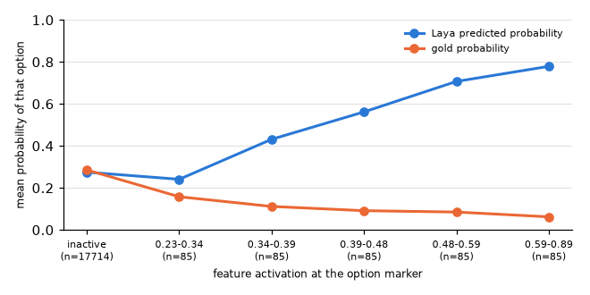

# Feature 5442

Critérios em que aparece: pred_error, pred_probe_right_laya_wrong

**Interpretação (preencher):** 

---

## Maiores ativações

**tr_customer_service_000282 / needs_human** (noul, customer_service) | ativação 4.406 em `estado` | opções ['false', 'true'] | Laya: **true** [0.208, 0.792] | gabarito: **false**

```
<bos> noul question: This conversation requires a human agent rather than automated handling.<eos>
▸ <mask> false: Automation can carry this to resolution.
▸ <mask> true: A human must take over: judgement, authority or empathy is required.

<eos>

 {"account": {"lifetime_value_usd": 53, "prior_tickets_90d": 0, "seats": 3, "tenure_months": 1, "tier": "premium"}, "thread": [{"role": "customer", "text": "I've been waiting for my refund to hit my account for days now and there's still nothing showing up. I signed up for the Premium plan last month and it's been nothing but a headache."}, {"role": "agent", "text": "I understand how concerning it is when expected funds⟦ don⟧'t appear. Could you please confirm the date you initially requested the transaction reversal?"}, {"role": "customer", "text": "I did it last Tuesday! It's ridiculous that I'm even having to ask about this because the confirmation email said it was processed immediately."}, {"role": "agent", "text": "Thank you for that information. To help me look into the status on our end, are you able to provide the transaction ID from that confirmation email?"}, {"role": "customer", "text": "I'm looking for it now, but I shouldn't have to jump through hoops just to get my money back from a service I barely used for four weeks."}]}<eos>
```

**tr_customer_service_000281 / category** (choice, customer_service) | ativação 4.301 em `estado` | opções ['account', 'billing', 'delivery', 'refund', 'technical'] | Laya: **refund** [0.089, 0.358, 0.003, 0.371, 0.179] | gabarito: **refund**

```
<bos> choice question: What is this customer conversation primarily about?<eos>
▸ <mask> account: Login, plan changes, profile or access management.
▸ <mask> billing: A charge, invoice, subscription or payment problem.
▸ <mask> delivery: Shipping, fulfilment or delivery of a physical item.
▸ <mask> refund: The customer is explicitly asking for money back.
▸ <mask> technical: The product or service is not working as expected.

<eos>

 {"account": {"lifetime_value_usd": 2899, "prior_tickets_90d": 1, "seats": 1, "tenure_months": 49, "tier": "free"}, "orders": [{"amount_usd": 29, "date": "2026-03-17", "id": "A-98902", "status": "settled"}, {"amount_usd": 29, "date": "2026-03-17", "id": "A-31035", "status": "settled"}, {"amount_usd": 29, "date": "2026-01-23", "id": "A-52749", "status": "refunded"}], "thread": [{"role": "customer", "text": "Hello, I am checking in on the $29 refund I requested. I have been a loyal user for 49 months and was hoping to have this settled before my bank statement closes this Friday."}, {"role": "agent", "text": "Thank you for your patience. I see we have a previous ticket open regarding this. Could you please verify the email address associated with the transaction you are referring to?"}, {"role": "customer", "text": "It is associated with the email I’m writing⟦ from⟧ right now. I just really need an update on where things stand because of that Friday deadline."}]}<eos>
```

**tr_customer_service_000282 / category** (choice, customer_service) | ativação 4.258 em `estado` | opções ['account', 'billing', 'delivery', 'refund', 'technical'] | Laya: **technical** [0.091, 0.127, 0.004, 0.041, 0.737] | gabarito: **refund**

```
<bos> choice question: What is this customer conversation primarily about?<eos>
▸ <mask> account: Login, plan changes, profile or access management.
▸ <mask> billing: A charge, invoice, subscription or payment problem.
▸ <mask> delivery: Shipping, fulfilment or delivery of a physical item.
▸ <mask> refund: The customer is explicitly asking for money back.
▸ <mask> technical: The product or service is not working as expected.

<eos>

 {"account": {"lifetime_value_usd": 53, "prior_tickets_90d": 0, "seats": 3, "tenure_months": 1, "tier": "premium"}, "thread": [{"role": "customer", "text": "I've been waiting for my refund to hit my account for days now and there's still nothing showing up. I signed up for the Premium plan last month and it's been nothing but a headache."}, {"role": "agent", "text": "I understand how concerning it is when expected funds⟦ don⟧'t appear. Could you please confirm the date you initially requested the transaction reversal?"}, {"role": "customer", "text": "I did it last Tuesday! It's ridiculous that I'm even having to ask about this because the confirmation email said it was processed immediately."}, {"role": "agent", "text": "Thank you for that information. To help me look into the status on our end, are you able to provide the transaction ID from that confirmation email?"}, {"role": "customer", "text": "I'm looking for it now, but I shouldn't have to jump through hoops just to get my money back from a service I barely used for four weeks."}]}<eos>
```

**tr_customer_service_000282 / churn_risk** (score, customer_service) | ativação 4.258 em `estado` | opções ['0', '1', '2', '3'] | Laya: **2** [0.06, 0.243, 0.593, 0.104] | gabarito: **2**

```
<bos> score question: How likely is this customer to stop doing business with us because of this interaction?<eos>
▸ <mask> level 0: No sign of dissatisfaction.
▸ <mask> level 1: Mild frustration, but the relationship is intact.
▸ <mask> level 2: Clearly unhappy; repeat problems or explicit complaints.
▸ <mask> level 3: Imminent: threatening to cancel, dispute or leave.

<eos>

 {"account": {"lifetime_value_usd": 53, "prior_tickets_90d": 0, "seats": 3, "tenure_months": 1, "tier": "premium"}, "thread": [{"role": "customer", "text": "I've been waiting for my refund to hit my account for days now and there's still nothing showing up. I signed up for the Premium plan last month and it's been nothing but a headache."}, {"role": "agent", "text": "I understand how concerning it is when expected funds⟦ don⟧'t appear. Could you please confirm the date you initially requested the transaction reversal?"}, {"role": "customer", "text": "I did it last Tuesday! It's ridiculous that I'm even having to ask about this because the confirmation email said it was processed immediately."}, {"role": "agent", "text": "Thank you for that information. To help me look into the status on our end, are you able to provide the transaction ID from that confirmation email?"}, {"role": "customer", "text": "I'm looking for it now, but I shouldn't have to jump through hoops just to get my money back from a service I barely used for four weeks."}]}<eos>
```

**tr_customer_service_000282 / urgency** (score, customer_service) | ativação 4.246 em `estado` | opções ['0', '1', '2', '3'] | Laya: **3** [0.046, 0.099, 0.23, 0.625] | gabarito: **2**

```
<bos> score question: How time-sensitive is this conversation?<eos>
▸ <mask> level 0: No time pressure; can wait indefinitely.
▸ <mask> level 1: Routine; handle within the normal queue.
▸ <mask> level 2: Elevated; should be handled within the same week.
▸ <mask> level 3: Critical; requires action within the same day.

<eos>

 {"account": {"lifetime_value_usd": 53, "prior_tickets_90d": 0, "seats": 3, "tenure_months": 1, "tier": "premium"}, "thread": [{"role": "customer", "text": "I've been waiting for my refund to hit my account for days now and there's still nothing showing up. I signed up for the Premium plan last month and it's been nothing but a headache."}, {"role": "agent", "text": "I understand how concerning it is when expected funds⟦ don⟧'t appear. Could you please confirm the date you initially requested the transaction reversal?"}, {"role": "customer", "text": "I did it last Tuesday! It's ridiculous that I'm even having to ask about this because the confirmation email said it was processed immediately."}, {"role": "agent", "text": "Thank you for that information. To help me look into the status on our end, are you able to provide the transaction ID from that confirmation email?"}, {"role": "customer", "text": "I'm looking for it now, but I shouldn't have to jump through hoops just to get my money back from a service I barely used for four weeks."}]}<eos>
```

## Ativações medianas (faixa 40-60%, mediana 0.821)

**tr_security_incidents_000051 / urgency** (score, security_incidents) | ativação 0.763 em `estado` | opções ['0', '1', '2', '3'] | Laya: **3** [0.127, 0.324, 0.163, 0.385] | gabarito: **3**

```
<bos> score question: How quickly must a responder act on this alert?<eos>
▸ <mask> level 0: No time pressure; can wait indefinitely.
▸ <mask> level 1: Routine; handle within the normal queue.
▸ <mask> level 2: Elevated; should be handled within the same week.
▸ <mask> level 3: Critical; requires action within the same day.

<eos>

 {"alert": {"description": "many failed authentications followed by a success", "evidence": "A sequence of failed authentication attempts from an unrecognized source was followed by a successful login to a privileged shared mailbox. The account, which does not have multi-factor authentication enabled, utilized credentials that were last rotated 700 days ago.", "rule": "brute_force"}, "context": {"asset_criticality": "medium", "change_window_active": false, "source_⟦on⟧_allowlist": false}, "history": {"credential_rotation_days_ago": 700, "distinct_countries_30d": 3, "logins_30d": 1791, "prior_alerts_90d": 0}, "principal": {"mfa_enrolled": false, "name": "svc-analytics-259", "privileges": ["deploy:production", "secrets:read"], "type": "shared_mailbox"}}<eos>
```

**tr_security_incidents_000096 / severity** (score, security_incidents) | ativação 0.745 em `estado` | opções ['0', '1', '2', '3', '4'] | Laya: **1** [0.035, 0.625, 0.184, 0.124, 0.033] | gabarito: **1**

```
<bos> score question: How severe is the potential impact if this alert is real?<eos>
▸ <mask> level 0: Negligible: no access to anything sensitive.
▸ <mask> level 1: Low: limited access, easily reversed.
▸ <mask> level 2: Moderate: access to internal systems or non-public data.
▸ <mask> level 3: High: access to production, secrets or customer data.
▸ <mask> level 4: Critical: active compromise of crown-jewel systems.

<eos>

 {"alert": {"description": "an unusual volume of files read in a short window", "evidence": "At 2026-09-15 03:12 UTC the gitlab-runner process (PID 8421) on host 172.20.5.12 accessed 8,764 distinct files under /var/lib/gitlab-runner/builds within a five‑minute window. The request originated from IP 203.0.113.45, which is not listed in the organization’s asset inventory, and the runner’s credentials have not been rotated for 412 days.", "rule": "mass_download"}, "context": {"asset_criticality": "low", "change_window_active": false, "source_⟦on⟧_allowlist": false}, "history": {"credential_rotation_days_ago": 412, "distinct_countries_30d": 2, "logins_30d": 1415, "prior_alerts_90d": 0}, "principal": {"mfa_enrolled": true, "name": "adm-support-164", "privileges": ["repo:read"], "type": "ci_runner"}}<eos>
```

**tr_invoice_processing_000121 / disposition** (choice, invoice_processing) | ativação 0.728 em `estado` | opções ['approve', 'hold', 'manual_review', 'reject'] | Laya: **approve** [0.567, 0.109, 0.025, 0.299] | gabarito: **manual_review**

```
<bos> choice question: How should this vendor invoice be dispositioned?<eos>
▸ <mask> approve: Matches the order and delivery; approve for payment.
▸ <mask> hold: Something needs confirming before payment; hold pending clarification.
▸ <mask> manual_review: A human in finance must review the discrepancy.
▸ <mask> reject: Should not be paid: duplicate, unauthorised or materially wrong.

<eos>

 {"delivery": {"condition": "accepted", "date": "2026-03-14", "⟦received⟧_qty": 10}, "invoice": {"currency": "USD", "id": "INV-2026-5925", "lines": [{"qty": 60, "sku": "SKU-806", "total_usd": 11831.4, "unit_usd": 197.19}], "total_usd": 11831.4, "vendor": "Acme Fabrication"}, "payment": {"days_until_due": 44, "discount_expires_in_days": 6, "early_payment_discount_pct": 2.0, "status": "scheduled", "terms": "net 30"}, "purchase_order": {"freight_terms": "freight prepaid by vendor, not separately billable", "id": "PO-5026", "lines": [{"qty": 10, "unit_usd": 197.19}], "total_usd": 1971.9}, "vendor_history": {"disputes_12m": 0, "invoices_12m": 52, "prior_invoice_ids": ["INV-2026-6624", "INV-2026-2495", "INV-2026-7658"]}}<eos>
```

**tr_security_incidents_000027 / true_positive** (noul, security_incidents) | ativação 0.872 em `estado` | opções ['false', 'true'] | Laya: **false** [0.659, 0.341] | gabarito: **true**

```
<bos> noul question: This alert reflects genuinely malicious or unauthorised activity.<eos>
▸ <mask> false: Benign activity, a misconfiguration, or a known false positive.
▸ <mask> true: The underlying behaviour is malicious or unauthorised.

<eos>

 {"alert": {"description": "a long-unused account became active", "evidence": "At 2026-09-15 03:42 UTC, the CI runner account \"ci-runner-112\" (privileged, MFA disabled) logged in successfully from IP 203.0.113.45 after having no activity since 2024-02-01. The source host is on the allowlist, the credentials were last rotated 700 days ago, and the event occurred outside any defined change window.", "rule": "dormant_account_use"}, "context": {"asset_criticality": "high", "change_window_active": false, "source_on_allowlist": true}, "history": {"credential_rotation_days_ago": 700, "⟦distinct⟧_countries_30d": 4, "logins_30d": 587, "prior_alerts_90d": 3}, "principal": {"mfa_enrolled": false, "name": "ci-billing-618", "privileges": ["deploy:production", "secrets:read"], "type": "ci_runner"}}<eos>
```

**tr_security_incidents_000186 / severity** (score, security_incidents) | ativação 0.751 em `estado` | opções ['0', '1', '2', '3', '4'] | Laya: **1** [0.077, 0.467, 0.316, 0.088, 0.052] | gabarito: **4**

```
<bos> score question: How severe is the potential impact if this alert is real?<eos>
▸ <mask> level 0: Negligible: no access to anything sensitive.
▸ <mask> level 1: Low: limited access, easily reversed.
▸ <mask> level 2: Moderate: access to internal systems or non-public data.
▸ <mask> level 3: High: access to production, secrets or customer data.
▸ <mask> level 4: Critical: active compromise of crown-jewel systems.

<eos>

 {"alert": {"description": "an account granted itself or received elevated permissions", "evidence": "On 2026-09-15 at 02:48:37 UTC, employee account \"asmith\" was added to the \"Domain Admins\" group on server 10.2.5.17 via a PowerShell command \"Add-ADGroupMember\" executed from an unrecognized source IP 203.0.113.45. The action occurred while the scheduled change window was active and the account's password had not been rotated in the past 365 days.", "rule": "privilege_escalation"}, "context": {"asset_criticality": "high", "⟦change⟧_window_active": true, "source_on_allowlist": false}, "history": {"credential_rotation_days_ago": 365, "distinct_countries_30d": 2, "logins_30d": 308, "prior_alerts_90d": 3}, "principal": {"mfa_enrolled": true, "name": "svc-analytics-581", "privileges": ["repo:read"], "type": "employee"}}<eos>
```

## Estatísticas (conjunto de descoberta, dev e teste)

**pred / error**

| split | decisões | ativas | ativas e Laya errou | taxa | lift | q (BH) | OR (CMH) | q (CMH) |
|---|---|---|---|---|---|---|---|---|
| discovery | 5100 | 294 | 285 | 0.969 | 1.51 | 4.95e-42 | 1.41 | 0.663 |
| dev | 900 | 51 | 51 | 1.000 | 1.49 | 1.96e-07 | inf | 0.66 |
| test | 2000 | 106 | 102 | 0.962 | 1.48 | 1.88e-13 | 1.76 | 0.763 |

**corr / error**

| split | decisões | ativas | ativas e Laya errou | taxa | lift | q (BH) | OR (CMH) | q (CMH) |
|---|---|---|---|---|---|---|---|---|
| discovery | 5100 | 24 | 15 | 0.625 | 0.97 | 1 | 4.00 | 0.00841 |
| dev | 900 | 2 | 2 | 1.000 | 1.49 | nan | nan | nan |
| test | 2000 | 5 | 1 | 0.200 | 0.31 | nan | nan | nan |

**state / error**

| split | decisões | ativas | ativas e Laya errou | taxa | lift | q (BH) | OR (CMH) | q (CMH) |
|---|---|---|---|---|---|---|---|---|
| discovery | 5100 | 3694 | 2359 | 0.639 | 0.99 | 0.377 | 1.04 | 0.856 |
| dev | 900 | 628 | 410 | 0.653 | 0.97 | 0.351 | 0.88 | 0.807 |
| test | 2000 | 1405 | 888 | 0.632 | 0.97 | 0.0862 | 0.85 | 0.543 |

**pred / probe_right_laya_wrong**

| split | decisões | ativas | ativas e Laya errou | taxa | lift | q (BH) | OR (CMH) | q (CMH) |
|---|---|---|---|---|---|---|---|---|
| discovery | 2932 | 151 | 146 | 0.967 | 1.60 | 6.63e-25 | 0.78 | 0.82 |
| dev | 523 | 23 | 23 | 1.000 | 1.55 | 0.000533 | inf | 0.386 |
| test | 1149 | 46 | 45 | 0.978 | 1.60 | 5.34e-08 | 1.17 | 0.952 |

**corr / probe_right_laya_wrong**

| split | decisões | ativas | ativas e Laya errou | taxa | lift | q (BH) | OR (CMH) | q (CMH) |
|---|---|---|---|---|---|---|---|---|
| discovery | 2932 | 6 | 1 | 0.167 | 0.28 | nan | nan | nan |
| dev | 523 | 0 | 0 | nan | nan | nan | nan | nan |
| test | 1149 | 1 | 0 | 0.000 | 0.00 | nan | nan | nan |

**state / probe_right_laya_wrong**

| split | decisões | ativas | ativas e Laya errou | taxa | lift | q (BH) | OR (CMH) | q (CMH) |
|---|---|---|---|---|---|---|---|---|
| discovery | 2932 | 2192 | 1321 | 0.603 | 1.00 | 0.75 | 0.97 | 0.915 |
| dev | 523 | 379 | 238 | 0.628 | 0.97 | 0.483 | 0.86 | 0.79 |
| test | 1149 | 841 | 494 | 0.587 | 0.96 | 0.0529 | 0.75 | 0.358 |

Confusão mais sobre-representada (pred): `action|3>1` (n=102, lift 15.94, p=0). Formato `pergunta|índice previsto>índice correto`.

Confusão mais sobre-representada (corr): `disposition|3>0` (n=6, lift 35.42, p=9.82e-09). Formato `pergunta|índice previsto>índice correto`.

Confusão mais sobre-representada (state): `duplicate|1>0` (n=189, lift 1.20, p=9.63e-08). Formato `pergunta|índice previsto>índice correto`.



