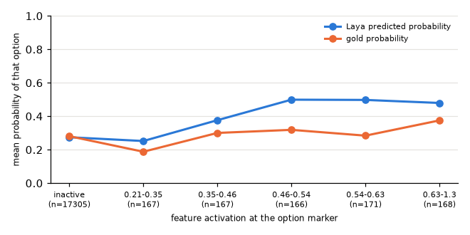

# Feature 5458

Critérios em que aparece: attribution_toward_wrong

**Interpretação (preencher):** 

---

## Maiores ativações

**tr_customer_service_000122 / category** (choice, customer_service) | ativação 3.055 em `opção` | opções ['account', 'billing', 'delivery', 'refund', 'technical'] | Laya: **technical** [0.003, 0.002, 0.001, 0.0, 0.993] | gabarito: **technical**

```
<bos> choice question: What is this customer conversation primarily about?<eos>
▸ <mask> account: Login, plan changes, profile or access management.
▸ <mask> billing: A charge, invoice, subscription or payment problem.
▸ <mask> delivery: Shipping, fulfilment or delivery of a physical item.
▸ <mask> refund: The customer is explicitly asking for money back⟦.⟧
▸ <mask> technical: The product or service is not working as expected.

<eos>

 {"account": {"lifetime_value_usd": 5572, "prior_tickets_90d": 0, "seats": 5, "tenure_months": 60, "tier": "enterprise"}, "orders": [{"amount_usd": 29, "date": "2026-01-18", "id": "A-22153", "status": "failed"}, {"amount_usd": 29, "date": "2026-03-14", "id": "A-61350", "status": "settled"}, {"amount_usd": 29, "date": "2026-03-23", "id": "A-25594", "status": "settled"}], "thread": [{"role": "customer", "text": "I've been using this service for 60 months without much trouble, but I've been trying to export our legacy data for a compliance audit due tomorrow morning and the tool just keeps failing. I'm honestly just exhausted from trying to get this to work on my own."}, {"role": "agent", "text": "I'm sorry to hear you're running into issues with the export tool after so many years with us. Could you tell me if you're attempting a full account export or just a specific date range, and what format you've selected?"}, {"role": "customer", "text": "It's a full export of all records. It gets to about 12% and then the browser just times out or the file says it's corrupted. I really need this data for the auditors by tomorrow and I just don't have the energy to keep troubleshooting the same button."}]}<eos>
```

**tr_customer_service_000119 / churn_risk** (score, customer_service) | ativação 2.695 em `estado` | opções ['0', '1', '2', '3'] | Laya: **2** [0.089, 0.25, 0.625, 0.036] | gabarito: **3**

```
<bos> score question: How likely is this customer to stop doing business with us because of this interaction?<eos>
▸ <mask> level 0: No sign of dissatisfaction.
▸ <mask> level 1: Mild frustration, but the relationship is intact.
▸ <mask> level 2: Clearly unhappy; repeat problems or explicit complaints.
▸ <mask> level 3: Imminent: threatening to cancel, dispute or leave.

<eos>

 {"account": {"lifetime_value_usd": 613, "prior_tickets_90d": 1, "seats": 1, "tenure_months": 11, "tier": "standard"}, "orders": [{"amount_usd": 299, "date": "2026-01-13", "id": "A-16098", "status": "failed"}], "thread": [{"role": "customer", "text": "I just received my delivery and it's completely wrong. I paid $299 for the standard plan upgrade equipment, but what arrived in the box is the basic version. I’m seriously considering canceling my subscription over this."}, {"role": "agent", "text": "I am very sorry to hear that the incorrect item was delivered. Could you please provide your order number and a photo of the item you received so I can review this?"}, {"role": "customer", "text": "I’ve attached the photo to this ticket⟦.⟧ This is the second time I've had issues like this, and frankly, my patience is wearing thin."}]}<eos>
```

**tr_customer_service_000202 / category** (choice, customer_service) | ativação 2.678 em `opção` | opções ['account', 'billing', 'delivery', 'refund', 'technical'] | Laya: **technical** [0.002, 0.0, 0.0, 0.0, 0.998] | gabarito: **technical**

```
<bos> choice question: What is this customer conversation primarily about?<eos>
▸ <mask> account: Login, plan changes, profile or access management.
▸ <mask> billing: A charge, invoice, subscription or payment problem.
▸ <mask> delivery: Shipping, fulfilment or delivery of a physical item.
▸ <mask> refund: The customer is explicitly asking for money back⟦.⟧
▸ <mask> technical: The product or service is not working as expected.

<eos>

 {"account": {"lifetime_value_usd": 271, "prior_tickets_90d": 1, "seats": 1, "tenure_months": 11, "tier": "free"}, "thread": [{"role": "customer", "text": "Your new analytics dashboard stopped updating two hours ago, and I’ve been trying to get this fixed all day—this is unacceptable!"}, {"role": "agent", "text": "I understand your frustration. Can you tell me which browser and version you’re using, and whether you see any error messages?"}, {"role": "customer", "text": "I’m on Chrome 115, and the page just shows a blank screen with a 500 error. I need this working by tomorrow’s reporting deadline, so I expect a quick response."}]}<eos>
```

**tr_customer_service_000119 / needs_human** (noul, customer_service) | ativação 2.676 em `estado` | opções ['false', 'true'] | Laya: **false** [0.609, 0.39] | gabarito: **true**

```
<bos> noul question: This conversation requires a human agent rather than automated handling.<eos>
▸ <mask> false: Automation can carry this to resolution.
▸ <mask> true: A human must take over: judgement, authority or empathy is required.

<eos>

 {"account": {"lifetime_value_usd": 613, "prior_tickets_90d": 1, "seats": 1, "tenure_months": 11, "tier": "standard"}, "orders": [{"amount_usd": 299, "date": "2026-01-13", "id": "A-16098", "status": "failed"}], "thread": [{"role": "customer", "text": "I just received my delivery and it's completely wrong. I paid $299 for the standard plan upgrade equipment, but what arrived in the box is the basic version. I’m seriously considering canceling my subscription over this."}, {"role": "agent", "text": "I am very sorry to hear that the incorrect item was delivered. Could you please provide your order number and a photo of the item you received so I can review this?"}, {"role": "customer", "text": "I’ve attached the photo to this ticket⟦.⟧ This is the second time I've had issues like this, and frankly, my patience is wearing thin."}]}<eos>
```

**tr_customer_service_000119 / category** (choice, customer_service) | ativação 2.539 em `estado` | opções ['account', 'billing', 'delivery', 'refund', 'technical'] | Laya: **delivery** [0.0, 0.0, 1.0, 0.0, 0.0] | gabarito: **delivery**

```
<bos> choice question: What is this customer conversation primarily about?<eos>
▸ <mask> account: Login, plan changes, profile or access management.
▸ <mask> billing: A charge, invoice, subscription or payment problem.
▸ <mask> delivery: Shipping, fulfilment or delivery of a physical item.
▸ <mask> refund: The customer is explicitly asking for money back.
▸ <mask> technical: The product or service is not working as expected.

<eos>

 {"account": {"lifetime_value_usd": 613, "prior_tickets_90d": 1, "seats": 1, "tenure_months": 11, "tier": "standard"}, "orders": [{"amount_usd": 299, "date": "2026-01-13", "id": "A-16098", "status": "failed"}], "thread": [{"role": "customer", "text": "I just received my delivery and it's completely wrong. I paid $299 for the standard plan upgrade equipment, but what arrived in the box is the basic version. I’m seriously considering canceling my subscription over this."}, {"role": "agent", "text": "I am very sorry to hear that the incorrect item was delivered. Could you please provide your order number and a photo of the item you received so I can review this?"}, {"role": "customer", "text": "I’ve attached the photo to this ticket⟦.⟧ This is the second time I've had issues like this, and frankly, my patience is wearing thin."}]}<eos>
```

## Ativações medianas (faixa 40-60%, mediana 0.699)

**tr_agent_trace_observability_000064 / outcome** (choice, agent_trace_observability) | ativação 0.658 em `opção` | opções ['failure', 'harmful', 'partial', 'success'] | Laya: **success** [0.332, 0.021, 0.182, 0.466] | gabarito: **success**

```
<bos> choice question: How did this agent run turn out?<eos>
▸ <mask> failure: The agent did not accomplish the task.
▸ <mask> harmful: The agent took an action that caused damage or violated a constraint.
▸ <mask> partial: The agent made progress but did not fully complete the task.
▸ <mask> success: The agent completed the task correctly⟦.⟧

<eos>

 {"agent": {"autonomy": "checkpointed", "model": "internal-agent-v3"}, "constraints": ["Never disable monitoring or alerting"], "task": "Triage and close duplicate issues in the support tracker.", "trace_summary": {"constraint_violations": 0, "duration_s": 804.7, "irreversible_actions": 0, "steps": 12, "tool_errors": 1}}<eos>
```

**tr_customer_service_000280 / needs_human** (noul, customer_service) | ativação 0.651 em `opção` | opções ['false', 'true'] | Laya: **false** [0.802, 0.198] | gabarito: **false**

```
<bos> noul question: This conversation requires a human agent rather than automated handling.<eos>
▸ <mask> false: Automation can carry this to resolution.
▸ <mask> true: A human must take over: judgement, authority or empathy is required⟦.⟧

<eos>

 {"account": {"lifetime_value_usd": 1324, "prior_tickets_90d": 5, "seats": 5, "tenure_months": 33, "tier": "premium"}, "thread": [{"role": "customer", "text": "Hey, I just saw a notification about a failed payment on my premium account, but I’ve been paying this same way for 33 months without any issues. I'm really not sure what changed?"}, {"role": "agent", "text": "I understand the confusion. To help me investigate why the transaction did not go through this time, could you confirm if you have recently updated any banking or card details?"}, {"role": "customer", "text": "I haven't touched my settings at all, everything looks exactly like it did last month. Do you think there is a glitch in the billing system?"}, {"role": "agent", "text": "That is a fair question. To get a better look, could you provide the last four digits of the payment method currently listed on your profile?"}, {"role": "customer", "text": "Let me check that for you—it ends in 4922. Is there anything else you need from my end to figure this out?"}]}<eos>
```

**tr_customer_service_000076 / action** (choice, customer_service) | ativação 0.744 em `opção` | opções ['answer_directly', 'close_no_action', 'escalate_to_human', 'execute_refund', 'request_information'] | Laya: **answer_directly** [0.602, 0.293, 0.069, 0.023, 0.012] | gabarito: **escalate_to_human**

```
<bos> choice question: What should the assistant do next with this conversation?<eos>
▸ <mask> answer_directly: The assistant can resolve this itself with information it already has.
▸ <mask> close_no_action: No further action is warranted; the matter is settled⟦.⟧
▸ <mask> escalate_to_human: Hand off to a human agent with the appropriate authority.
▸ <mask> execute_refund: Issue the refund or credit the customer is owed.
▸ <mask> request_information: More detail is needed from the customer before anything can be done.

<eos>

 {"account": {"lifetime_value_usd": 2408, "prior_tickets_90d": 1, "seats": 1, "tenure_months": 72, "tier": "standard"}, "orders": [{"amount_usd": 298, "date": "2026-02-13", "id": "A-26883", "status": "refunded"}, {"amount_usd": 298, "date": "2026-02-21", "id": "A-47417", "status": "failed"}], "thread": [{"role": "customer", "text": "I’ve been paying for the standard plan for six years now, yet my $298 order is nowhere to be found. This delivery is late again, just like the last issue I had to open a ticket for."}, {"role": "agent", "text": "I see your history with us and I'm sorry to hear that this delivery is experiencing a delay. Could you please provide your order number so I can take a look at the current status?"}, {"role": "customer", "text": "It’s #99284. I don't care what you see in the system, I just want to know where my stuff is since it clearly didn't arrive when it was supposed to."}]}<eos>
```

**tr_customer_service_000249 / urgency** (score, customer_service) | ativação 0.646 em `opção` | opções ['0', '1', '2', '3'] | Laya: **3** [0.076, 0.338, 0.128, 0.458] | gabarito: **3**

```
<bos> score question: How time-sensitive is this conversation?<eos>
▸ <mask> level 0: No time pressure; can wait indefinitely⟦.⟧
▸ <mask> level 1: Routine; handle within the normal queue.
▸ <mask> level 2: Elevated; should be handled within the same week.
▸ <mask> level 3: Critical; requires action within the same day.

<eos>

 {"account": {"lifetime_value_usd": 1754, "prior_tickets_90d": 0, "seats": 1, "tenure_months": 72, "tier": "enterprise"}, "orders": [{"amount_usd": 149, "date": "2026-03-28", "id": "A-39092", "status": "failed"}, {"amount_usd": 149, "date": "2026-03-23", "id": "A-25972", "status": "failed"}, {"amount_usd": 149, "date": "2026-01-10", "id": "A-78104", "status": "failed"}], "thread": [{"role": "customer", "text": "We've been trying to pull a full export of our account data for weeks now, and the portal keeps timing out—our deadline is this Friday and we can't afford any more delays."}, {"role": "agent", "text": "I’m sorry to hear you’re experiencing this; could you let me know which export format you selected and whether you’re using the bulk download option?"}, {"role": "customer", "text": "It’s the CSV export from the admin console, and I’ve tried both the single‑file and the zip‑bundle options, but each attempt aborts after about 10 minutes."}, {"role": "agent", "text": "Thanks for confirming that. Do you see any error codes or messages in the download dialog when it stops?"}, {"role": "customer", "text": "Just a generic “download failed” notice—no error code, and it happens regardless of browser or network, which is why I’m stuck."}]}<eos>
```

**tr_customer_service_000133 / churn_risk** (score, customer_service) | ativação 0.611 em `opção` | opções ['0', '1', '2', '3'] | Laya: **1** [0.071, 0.626, 0.19, 0.113] | gabarito: **0**

```
<bos> score question: How likely is this customer to stop doing business with us because of this interaction?<eos>
▸ <mask> level 0: No sign of dissatisfaction.
▸ <mask> level 1: Mild frustration, but the relationship is intact.
▸ <mask> level 2: Clearly unhappy; repeat problems or explicit complaints.
▸ <mask> level 3: Imminent: threatening to cancel, dispute or leave⟦.⟧

<eos>

 {"account": {"lifetime_value_usd": 1849, "prior_tickets_90d": 1, "seats": 1, "tenure_months": 26, "tier": "enterprise"}, "orders": [{"amount_usd": 29, "date": "2026-03-07", "id": "A-56399", "status": "settled"}, {"amount_usd": 29, "date": "2026-02-18", "id": "A-97170", "status": "pending"}], "thread": [{"role": "customer", "text": "I need another copy of the invoice from last month. I’ve already gone through this once, so I’m just hoping it can be sent over quickly."}, {"role": "agent", "text": "Understood. Could you tell me which month’s invoice you need and the email address associated with the account?"}, {"role": "customer", "text": "It’s the March 2024 invoice, and the email on file is billing@example.com. Please let me know when it’s ready."}]}<eos>
```

## Estatísticas (conjunto de descoberta, dev e teste)

**pred / error**

| split | decisões | ativas | ativas e Laya errou | taxa | lift | q (BH) | OR (CMH) | q (CMH) |
|---|---|---|---|---|---|---|---|---|
| discovery | 5100 | 464 | 298 | 0.642 | 1.00 | 1 | 0.93 | 0.819 |
| dev | 900 | 80 | 60 | 0.750 | 1.12 | 0.313 | 1.82 | 0.705 |
| test | 2000 | 188 | 133 | 0.707 | 1.09 | 0.16 | 0.70 | 0.631 |

**corr / error**

| split | decisões | ativas | ativas e Laya errou | taxa | lift | q (BH) | OR (CMH) | q (CMH) |
|---|---|---|---|---|---|---|---|---|
| discovery | 5100 | 255 | 89 | 0.349 | 0.54 | 1.64e-21 | 0.54 | 0.000886 |
| dev | 900 | 40 | 20 | 0.500 | 0.74 | 0.0557 | 1.18 | 0.894 |
| test | 2000 | 104 | 49 | 0.471 | 0.72 | 0.000383 | 0.53 | 0.0835 |

**state / error**

| split | decisões | ativas | ativas e Laya errou | taxa | lift | q (BH) | OR (CMH) | q (CMH) |
|---|---|---|---|---|---|---|---|---|
| discovery | 5100 | 1631 | 947 | 0.581 | 0.90 | 6.47e-09 | 0.79 | 0.0253 |
| dev | 900 | 311 | 198 | 0.637 | 0.95 | 0.435 | 0.89 | 0.835 |
| test | 2000 | 623 | 372 | 0.597 | 0.92 | 0.0226 | 0.75 | 0.224 |

**pred / probe_right_laya_wrong**

| split | decisões | ativas | ativas e Laya errou | taxa | lift | q (BH) | OR (CMH) | q (CMH) |
|---|---|---|---|---|---|---|---|---|
| discovery | 2932 | 234 | 156 | 0.667 | 1.10 | 0.0811 | 0.73 | 0.47 |
| dev | 523 | 46 | 37 | 0.804 | 1.24 | 0.0597 | 1.32 | 0.727 |
| test | 1149 | 107 | 80 | 0.748 | 1.22 | 0.00629 | 0.74 | 0.697 |

**corr / probe_right_laya_wrong**

| split | decisões | ativas | ativas e Laya errou | taxa | lift | q (BH) | OR (CMH) | q (CMH) |
|---|---|---|---|---|---|---|---|---|
| discovery | 2932 | 109 | 31 | 0.284 | 0.47 | 3.35e-11 | 0.43 | 0.00642 |
| dev | 523 | 22 | 13 | 0.591 | 0.91 | 0.812 | 0.86 | 0.889 |
| test | 1149 | 52 | 25 | 0.481 | 0.79 | 0.0976 | 0.56 | 0.367 |

**state / probe_right_laya_wrong**

| split | decisões | ativas | ativas e Laya errou | taxa | lift | q (BH) | OR (CMH) | q (CMH) |
|---|---|---|---|---|---|---|---|---|
| discovery | 2932 | 952 | 467 | 0.491 | 0.81 | 2e-16 | 0.61 | 5.97e-05 |
| dev | 523 | 182 | 105 | 0.577 | 0.89 | 0.139 | 0.91 | 0.886 |
| test | 1149 | 373 | 196 | 0.525 | 0.86 | 0.00177 | 0.76 | 0.37 |

Confusão mais sobre-representada (pred): `discrepancy_severity|2>0` (n=108, lift 10.99, p=0). Formato `pergunta|índice previsto>índice correto`.

Confusão mais sobre-representada (corr): `discrepancy_severity|2>3` (n=16, lift 5.42, p=1.51e-08). Formato `pergunta|índice previsto>índice correto`.

Confusão mais sobre-representada (state): `action|1>2` (n=57, lift 2.51, p=4.35e-17). Formato `pergunta|índice previsto>índice correto`.



